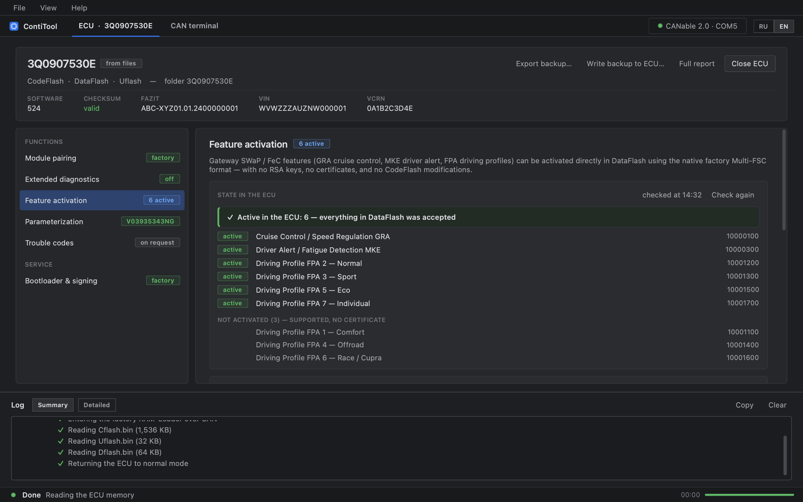
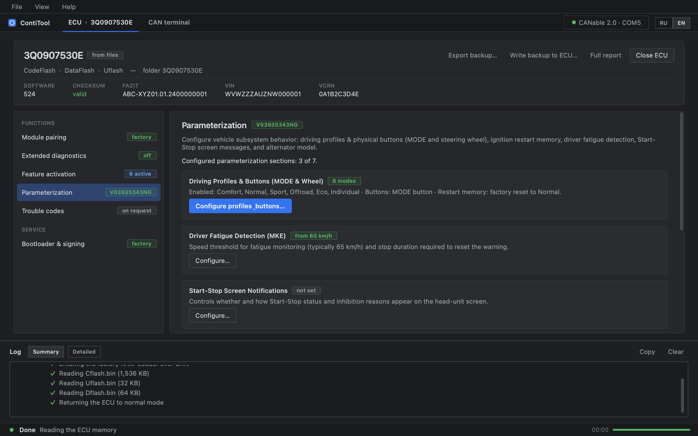
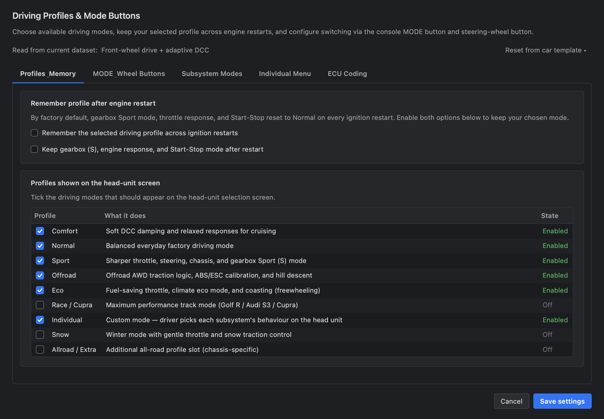
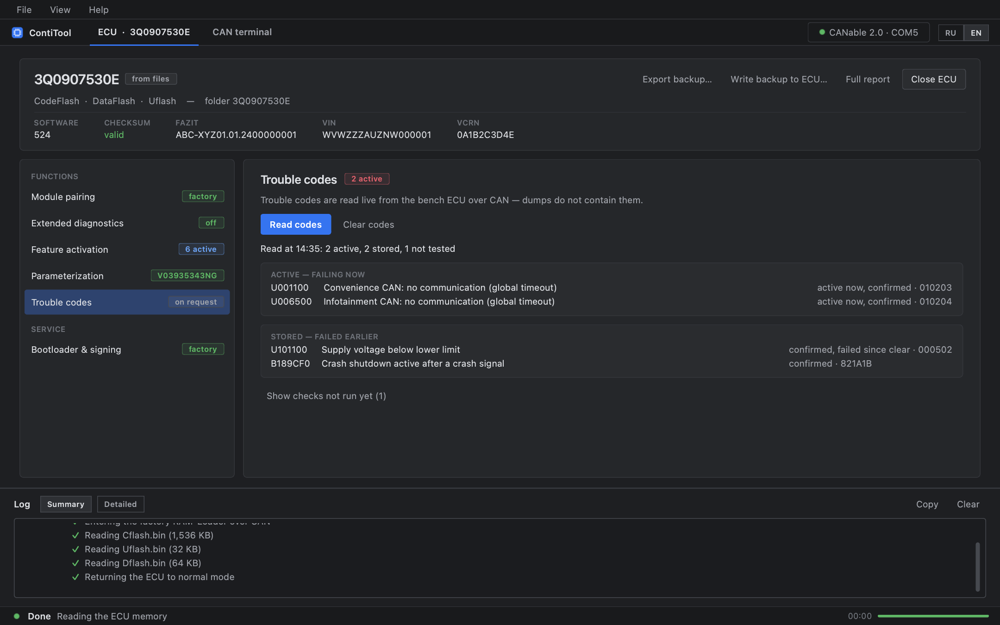
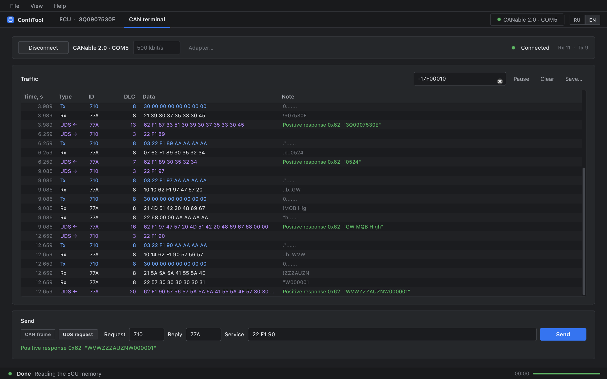
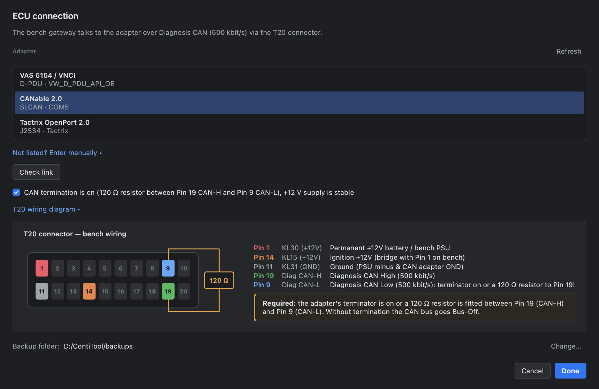
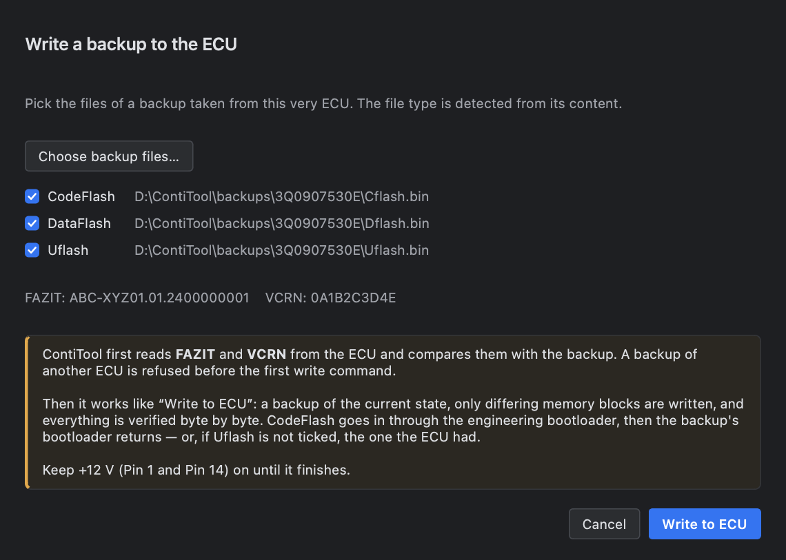
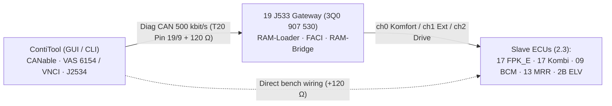

<div align="center">

# ContiTool

**Six VAG MQB ECUs straight over CAN. No opening. No desoldering. Zero paid tokens.**

`19 J533 Gateway` · `17 FPK_E / AID` · `17 Kombi VDD` · `09 BCM` · `13 ACC MRR` · `2B ELV`

<br>

[](README.md)
[](https://github.com/perkthefox/mqb_contitool/releases/latest)
[](https://github.com/perkthefox/mqb_contitool/releases/tag/v2.3.0-rc1)
[](#quick-start)
[](#license)

[](https://vwhacking.antonperk.com)
[](https://www.drive2.ru/users/perkthefox/)
[](https://t.me/perkthefox)
[](#support-the-author)

**Made by PerkTheFox** · [🇷🇺 Читать на русском](README.md) · 🇬🇧 English · [📜 Changelog](CHANGELOG.md) · [📚 Deep Docs](docs/README.md)

</div>

<br>

| Stable Release · **`v2.2.1a`** *(main)* | Release Candidate · **`v2.3.0-rc1`** *(2.3 preview)* |
| :--- | :--- |
| Battle-tested release for everyday **`19 J533`** (`3Q0 907 530`) gateway work. | Massive 2.3 expansion covering **all six MQB ECUs**: `17 FPK_E / AID`, `17 Kombi VDD`, `09 BCM`, `13 ACC MRR`, `2B ELV`, CAN bus scanner, and the transparent `J533` RAM-Bridge. |
| **Pick this one** for rock-solid daily `J533` servicing. Switch to the `candidate` update channel in **Settings** anytime. | **Unstable channel:** features may fail, misbehave, or be outright broken. Bench use with full backups only — please report bugs in [Issues](https://github.com/perkthefox/mqb_contitool/issues). |
| 👉 **[Download stable v2.2.1a](https://github.com/perkthefox/mqb_contitool/releases/latest)** | 👉 **[Try v2.3.0-rc1](https://github.com/perkthefox/mqb_contitool/releases/tag/v2.3.0-rc1)** |

<p align="center">
  
</p>

---

## Why ContiTool Exists

Servicing VAG MQB control units normally means juggling expensive dongles, bench programmers, hot air, and paid online tokens. **ContiTool** puts the whole stack into a single open **Qt 6 Desktop GUI + CLI** tool for **Windows, macOS, and Linux**:

- **Zero opening, zero desoldering:** read and flash `CodeFlash`, `DataFlash`, `UFlash`, `Extra Area`, and `EEPROM` over CAN — with hardware `FACI Blank-Check`, so saved dumps are even safe to flash directly with external programmers (`VVDI`, `Multiprog`, `UPA`, `Orange5`).
- **Immobilizer, keys, and CP on your own terms:** full **A→B** immo transfers (including `Kombi VDD` → `FPK_E`), **non-destructive additive key learning** via the stock LF coil without wiping existing keys, hybrid `Component Protection (#MoLaLi)` across all 12 gateway banks, `GFA`/`IKA`/`K_ffb` extraction, and `BCM` remote (`FFB`) / `ELV` adaptation.
- **SWaP, datasets, and brick recovery:** built-in `RSA-1024` + `SWaP FSC v2` signer, `FPA`/`DCC`/`MKE`/`Start-Stop`/`BEM` editors, `MRR` radar CP defeat & `SWaP` activation, factory `FRF`/`ODX` flashing, and direct recovery of gateways stuck in `FBL`.
- **One gateway = the whole bench bus:** plug into a `19 J533` Diagnosis CAN port — ContiTool discovers every slave ECU behind it and spins up a transparent `ch3 ↔ ch0/ch2` RAM-bridge whenever needed (including gateway-fired `BURST-GO` so `FPK_E` level 8 even works with `VAS 6154 / VNCI`).

---

## Read Before You Connect

> [!CAUTION]
> - **Do NOT use this program** if you don't know why you need it, have never used ODIS or VCTool, or have any doubt about your adapter, wiring, or power supply. Cheap Chinese clones are not considered safe even if they "work".
> - **Bench use only.** Work with ECUs removed on a regulated `+12.5–13.8 V` supply. A voltage sag or link drop in a live car can immobilize the vehicle and permanently brick the module. Connecting to a car is strictly at your own risk.
> - **Always save a verified full backup before writing.** ContiTool is free, open, and provided **"AS IS"** without warranty — selling it violates the [license](#license). **If someone sold it to you, you were cheated.**
> - Bugs and questions — **[GitHub Issues](https://github.com/perkthefox/mqb_contitool/issues) only** (no direct messages).

---

## Supported VAG MQB ECUs

| Addr | ECU | MCU / Platform | Verified Software | Adapters | Channel |
| :---: | :--- | :--- | :--- | :--- | :---: |
| **`19`** | **J533 Gateway**<br>`3Q0 907 530`, `8S0 907 468` | Renesas `RH850/F1L` | All Continental `3Q0`/`8S0` (`HW 517–527+`) | `CANable` / `SLCAN` / `candleLight`<br>`VAS 6154 / VNCI` · `J2534` | **`2.2.x` + `2.3`** |
| **`17`** | **FPK_E / AID**<br>`83A`, `5E0`, `5NA`, `3G0` | Renesas `RH850/D1M2A` | `SW 83A (6181)`, `1701`, `1703`, `1711` | **Direct (`T18`):** `CANable` / `SLCAN` / `candleLight`¹<br>**Via `J533` bridge:** also `VAS 6154 / VNCI` | **`2.3 RC`** |
| **`17`** | **Kombi VDD**<br>`EV_DashBoardVDDMQBAB` | Renesas `V850E2/Dx4` | `5NA 920 740 B (0310)`<br>`8V0 920 860 E (2220)` | `CANable` / `SLCAN` / `candleLight`<br>`VAS 6154 / VNCI` · `J2534` *(direct & via gateway)* | **`2.3 RC`** |
| **`09`** | **BCM MQBAB**<br>Continental `5Q0 937 084 ...` | Renesas `RH850` | `SW 0173`, `0175`, `0212`, `0253` (`BL`/`BQ`/`CJ`/`CG`, etc.) | `CANable` / `SLCAN` / `candleLight`<br>`VAS 6154 / VNCI` *(full RawMode, direct & bridged)*² | **`2.3 RC`** |
| **`13`** | **ACC Radar MRRevo14F**<br>`3QF` / `5Q0` | NXP `MPC5674K` / `MPC5675K` | Gen1 / Gen2 (`0130`, `0192`, `0196`, `0272`, `0780`, etc.) | `CANable` / `SLCAN` / `candleLight`<br>`VAS 6154 / VNCI` *(full RawMode, direct & bridged)*² | **`2.3 RC`** |
| **`2B`** | **ELV / J764**<br>`5Q0` / `3Q0` | Renesas `RH850/F1L` | Bench-verified: UDS + `32 KB DataFlash` (`0x1BFD8A0B/0A`) | UDS: any; `32 KB DataFlash`: `CANable` / `SLCAN` / `candleLight` or `VAS 6154 / VNCI` *(RawMode)*² | **`2.3 RC`** |

> ¹ **Why direct `17 FPK_E` needs `CANable / candleLight`:** keyless level 8 requires ~1,000 frames paced at **`0.35 ms/frame`** (~0.36 s). A `VAS 6154 / VNCI` takes 3–7 ms per TCP frame and physically misses the timing window. **Through a `19 J533` gateway**, `VNCI` works because the gateway itself blasts the stream from RAM at full 500 kbit/s (`BURST-GO`).
>
> ² **29-bit over `VAS 6154 / VNCI` (`BCM` / `MRR` / `ELV`):** 11-bit UDS (passport, status, DTCs, key/adaptation writes) works on every adapter; 29-bit RawMode TX (`TxFlag 0x100`) is implemented from DLL `27.2` RE and still awaits live VCI verification — if 29-bit XCP/WFS/ELV frames fail on your VNCI, use a native CAN adapter (`CANable / candleLight`).
>
> **`5Q0 907 530`** and **`Lear 3Q0 907 530`** gateways (PowerPC `MPC5607B` / `MPC5748G`) are **not supported** and are strictly refused before sending loader commands. Unverified `PN + SW` combinations on slave ECUs display a yellow warning banner.

---

## Capabilities by ECU

### `19 J533` — Continental MQB Gateway (`2.2.x` + `2.3`)
- **Full Diagnosis CAN read/write (`500 kbit/s`):** `Cflash` (`1.5 MB` in ~61 s via batched `FED_READER`), `Uflash` (`32 KB`), `Dflash` (`64 KB` with hardware `FACI Blank-Check`), `EEPROM 95640` (`8 KB`), `OPBT` + `IDCODE`/`CHIP ID`. Differential `DataFlash` flashing preserving `ECC` and `ICUSB`, `Uflash` unlock (including OTP-locked `OTPEUA`), **FBL brick recovery**, non-zero `F15B` cure, and factory `FRF`/`ODX` flashing.
- **Hybrid Component Protection (`#MoLaLi`):** all **12 slave ECU banks (`#1..#12`)** — factory modules stay on native `SHE M1..M3` + Master `GFA` while retrofitted banks authenticate via plaintext 16-byte `IKA` keys, with automatic `95640` bitmask bypass and zero desoldering.
- **Engineering Mode, `SWaP / RSA-1024`, `ZDC` & DTCs:** Engineering Mode + `ASAM CCP v2.1`, pure-Python `RSA-1024 (e = 3)` + 171-byte `SWaP FSC v2` signer (with live `22 3C 00` verification), **`FPA`** (`On/Off`, 15-step `DCC`), `MKE`, `Start-Stop`, `BEM` editors, guided `ZDC` upload with `0x0600` coding sync, and **770 ODIS DTC codes**.

### `17 FPK_E / AID` — Continental Digital Clusters (`2.3 RC`)
- **Keyless level 8 & full readout:** `SW 83A (6181)`, `1701`, `1703`, `1711` — reads `DataFlash 64 KB`, `Extra Area 256 B` + `IDAUTH`, `UFlash 32 KB`, `BFlash 96 KB`, and `CodeFlash 2 MB` via fast `0x6F1` streaming with `UDS 0x23` fallback.
- **Programmer-safe `Dflash.bin` via hardware RV40F Blank-Check (`0x71`):** erased floating-gate cells are scrubbed to deterministic `0xFF`, making saved `Dflash.bin` images safe both for ContiTool CAN writes and for external programmers (`VVDI Prog`, `Multiprog`, `UPA`, `Orange5`).
- **Smart CAN writer + `SWRESA`:** zero-erase `smart_eel_append`, `smart_tail_update`, `full_blank_checked_diff`, foreign `FD11` and `Kombi VDD` dump guard.
- **A→B Immo transfer, LF coil key learning & `FBL RSA`:** `EEL T01` editor (`VIN`, odometer, coding, `PowerClass`, partners, `KESSY`, `K_c`, `IKA/CP`, `K_ffb`, transponders), cross-family `Kombi VDD` donor transfer, live RAM `S0/S1` extraction + **additive mode-5 key learning without wiping existing keys**, `.FBL_RSAKEY` / `BOLO` / ODX signing tools, and bench controls (KL15, gauges, MFL, DTC).

### `17 Kombi VDD` — VDO/VDD Instrument Clusters (`2.3 RC`)
- Dedicated workbench & CLI for `EV_DashBoardVDDMQBAB` (`SW 0310` and `SW 2220`, including the 75-byte `EEL 0x0068` layout).
- `FD11 SL 7` via known key or `10 4F + SA1` with **built-in `7F 27 37` lockout timer reset (`+0x62EF`)**, pure 11-bit UDS EEL read/write (direct or behind any gateway), additive mode-5 LF coil key learning, and A→B transfer.

### `09 BCM`, `13 ACC MRR`, `2B ELV` & `J533` RAM-Bridge (`2.3 RC`)
- **`09 BCM` (Continental MQBAB):** `SW 0173 / 0175 / 0212 / 0253`, pre-bridge UDS profile verification, `GFA`/`IKA`/`K_ffb` readout with fail-closed `FFB` backup & restore, manual and automatic cluster-to-BCM remote (`FFB`) adaptation from `FPK_E` / `Kombi VDD`.
- **`13 ACC MRR` (Bosch MRRevo14F):** XCP / fast SRAM `DFlash` (FEE) and `CFlash` read/write with sector checksums, `GFA`/`IKA` keys, CP counter reset, **CP deactivation**, **Gen1/Gen2 `SWaP` activation** with stock restore, and `FRF`/`ODX` flashing.
- **`2B ELV` (J764):** passport/status/DTCs, 32 KB `DataFlash` readout, offline `EeeLib` editor, `2E 02E2` or cluster-dump adaptation, virginization, `IDAC` reset, and `31 01 02 03` + WFS5 bootloader check.
- **Bus Scanner, CAN Terminal & Private Problem Reports:** unified bus topology, header ECU switcher, 11/29-bit raw CAN + ISO-TP UDS terminal, transparent `J533CanBridge` (`GAFL` filter + `BURST-GO`), and automatic key/`VIN`/`FAZIT` redaction in Problem Reports when dumps are unchecked.

---

## Screenshots

| | |
|:---:|:---:|
| <br>**Parameterization** — driving profiles, MKE, start-stop, alternator | <br>**Driving profiles & buttons** — the FPA editor |
| <br>**DTC memory** — ODIS codes with plain descriptions | <br>**CAN terminal** — UDS over ISO-TP with decoded replies |
| <br>**Connection** — found adapters and the T20 wiring diagram | <br>**Write a backup back** — only into the same ECU (FAZIT / VCRN) |

---

## Quick Start

### Standalone Executables (No Python Required)

Grab a build from **[GitHub Releases](https://github.com/perkthefox/mqb_contitool/releases)**. Windows builds bundle verified D-PDU driver `27.2` (`dpdu/VW_PDUAPI_27.2`).

| OS | Stable **`v2.2.1a`** *(main)* | Release Candidate **`v2.3.0-rc1`** *(unstable)* |
| :--- | :--- | :--- |
| **Windows x64** | `ContiTool-v2.2.1a-windows-amd64.zip` → `ContiTool.exe` | `ContiTool-v2.3.0-rc1-windows-amd64.zip` → `ContiTool.exe` |
| **macOS Apple Silicon** | `ContiTool-v2.2.1a-macos-arm64.dmg` → `ContiTool.app` | `ContiTool-v2.3.0-rc1-macos-arm64.dmg` → `ContiTool.app` |
| **Linux x86_64** | `ContiTool-v2.2.1a-linux-x86_64.tar.gz` → `ContiTool/ContiTool` | `ContiTool-v2.3.0-rc1-linux-x86_64.tar.gz` → `ContiTool/ContiTool` |

### Run from Source (`Python 3.12+`)

```bash
python3 -m venv .venv
source .venv/bin/activate        # Windows: .venv\Scripts\activate
pip install -r requirements.txt

python3 conti_cp_tool.py         # no args -> Desktop GUI; subcommand -> CLI
```

Build standalone packages locally: `pip install -r requirements-dev.txt && python3 scripts/build_release.py` (output in `dist/release/`).

---

## Bench Wiring Reference



### `19 J533` Gateway — `T20` Connector

| `T20` Pin | Signal | Description |
| :---: | :--- | :--- |
| **Pin 1** | `KL30 (+12V)` | Permanent `+12 V` bench power (`12.5–13.8 V`) |
| **Pin 14** | `KL15 (+12V)` | Ignition `+12 V` (bridge with `Pin 1` on bench) |
| **Pin 11** | `KL31 (GND)` | Common ground (PSU minus & adapter `GND`) |
| **Pin 19** | `Diag CAN-H` | Diagnosis `CAN High` (`500 kbit/s`) |
| **Pin 9** | `Diag CAN-L` | Diagnosis `CAN Low` (`500 kbit/s`) — **`120 Ω` terminator to Pin 19** |

### `17 FPK_E / Kombi VDD` Cluster — `T18` Connector

| `T18` Pin | Signal | Description |
| :---: | :--- | :--- |
| **Pin 1** | `KL30 (+12V)` | Permanent `+12 V` bench power (wakes via CAN) |
| **Pin 10** | `KL31 (GND)` | Common ground (PSU minus & adapter `GND`) |
| **Pin 8 / 9** | `D2 Coil 1 / 2` | Stock `125 kHz` immobilizer coil (non-polarized) |
| **Pin 18** | `CAN-H` | Cluster `CAN High` (`500 kbit/s`) |
| **Pin 17** | `CAN-L` | Cluster `CAN Low` (`500 kbit/s`) — **`120 Ω` terminator to Pin 18** |

### `2B ELV (J764)` Steering Lock — `T4` (`T4dg` / `T4al`) Connector

| `T4` Pin | Signal | Description |
| :---: | :--- | :--- |
| **Pin 1** | `CAN-H` | `Komfort CAN High` (`500 kbit/s`, to J533 `T20 Pin 15`) |
| **Pin 2** | `CAN-L` | `Komfort CAN Low` (`500 kbit/s`) — **`120 Ω` terminator to Pin 1** |
| **Pin 3** | `KL30 (+12V)` | Permanent `+12 V` bench power (wakes via CAN `0x1B000010`) |
| **Pin 4** | `KL31 (GND)` | Common ground (PSU minus & adapter `GND`) |

> [!IMPORTANT]
> Always ensure a **`120 Ω`** termination resistor sits across `CAN-H` / `CAN-L` on direct bench connections (`VAS 6154 / VNCI` and `J2534` usually terminate internally; enable the `120 Ω` jumper or add a resistor on `CANable / SLCAN`).

<details>
<summary><b>The 64 KB DataFlash Rule & All 12 Component Protection Banks (19 J533)</b></summary>

<br>

> [!WARNING]
> Although `3Q0 907 530 xx` MCUs are laser-marked `R7F7010343AFP`, the die inside is **`R7F7010543AFP / R7F7010563AFP` with a full `64 KB` DataFlash (`65,536` bytes)** — all 12 `CP` banks and `SWaP` keys live in the upper half (`0xC000..0xFFFF`). **Never select a 32 KB `R7F7010343` profile** in external programmers.

| Bank | ECU | MQB Module | `Dflash` Offset | `NvM` | `95640` Mask | UDS ID | CP CAN TX / RX |
| :---: | :---: | :--- | :---: | :---: | :---: | :---: | :---: |
| `#1` | **`17`** | Instrument Cluster / Immo (`J285`) | `0xC000` / `0xC080` | `0x60` | `0x0001` | `714 / 77E` | `17FC0114 / 17FE0114` |
| `#2` | **`09`** | Central Electrics `BCM` (`J519`) | `0xC100` / `0xC180` | `0x61` | `0x0002` | `70E / 778` | `17FC010E / 17FE010E` |
| `#3` | **`13`** | Adaptive Cruise `ACC` Radar (`J428`) | `0xC200` / `0xC280` | `0x62` | `0x0004` | `757 / 7C1` | `17FC0157 / 17FE0157` |
| `#4` | **`15`** | Airbag Control Unit (`J234`) | `0xC300` / `0xC380` | `0x63` | `0x0008` | `715 / 77F` | `17FC0115 / 17FE0115` |
| `#5` | **`47`** | Digital Sound Amplifier (`J525`) | `0xC400` / `0xC480` | `0x64` | `0x0010` | `76F / 7D9` | `17FC016F / 17FE016F` |
| `#6` | **`57`** | TV Tuner (`R78`) | `0xC500` / `0xC580` | `0x65` | `0x0020` | `76D / 7D7` | `17FC016D / 17FE016D` |
| `#7` | **`5F`** | Infotainment `MIB1 / MIB2 / MIB3` (`J794`) | `0xC600` / `0xC680` | `0x66` | `0x0040` | `773 / 7DD` | `17FC0173 / 17FE0173` |
| `#8` | **`3C`** | Lane Change Assist `Master` (`J769`) | `0xC700` / `0xC780` | `0x67` | `0x0080` | `74E / 7B8` | `17FC014E / 17FE014E` |
| `#9` | **`CF`** | Lane Change Assist `Slave` (`J770`) | `0xC800` / `0xC880` | `0x68` | `0x0100` | `78A / 7F4` | `17FC018A / 17FE018A` |
| `#10` | **`3D`** | Special Function (`J608`) | `0xC900` / `0xC980` | `0x69` | `0x0200` | `72C / 796` | `17FC012C / 17FE012C` |
| `#11` | **`A5`** | Front Assistance Camera (`R242`) | `0xCA00` / `0xCA80` | `0x6A` | `0x0400` | `74F / 7B9` | `17FC014F / 17FE014F` |
| `#12` | **`8C`** | Hybrid / EV Battery Manager (`J840`) | `0xCB00` / `0xCB80` | `0x6B` | `0x0800` | `77B / 7E5` | `17FC017B / 17FE017B` |
| `Mst` | **`19`** | Gateway Master Key `GFA` (`Master`) | `0xDA00` / `0xDA80` | `0x7B` | — | `710 / 77A` | *Keep untouched!* |

</details>

---

## CLI Usage

```bash
# Adapter discovery & full CAN bus scan:
python3 conti_cp_tool.py -l en can ports
python3 conti_cp_tool.py -l en can scan --port COM4

# 19 J533 Gateway — backup, inspect, hybrid CP, SWaP, and 1-command turnkey:
python3 conti_cp_tool.py -l en can backup --port COM4
python3 conti_cp_tool.py -l en inspect --cflash Cflash.bin --dflash Dflash.bin --uflash Uflash.bin
python3 conti_cp_tool.py -l en can turnkey --port COM4 --set 5F=A1B2C3D4E5F60718293A4B5C6D7E8F90 --clear-dtc --yes
python3 conti_cp_tool.py -l en set-rsa-key --generate-key swap_key.json --cflash-in Cflash.bin --cflash-out Cflash_swap.bin --dflash-in Dflash.bin --dflash-out Dflash_swap.bin --target swap
python3 conti_cp_tool.py -l en sign-fsc --key swap_key.json --dflash Dflash_swap.bin --fec 10000100 -o fpa_10000100.fsc

# 17 FPK_E / AID (2.3) — hardware Blank-Check read, inspect, and A->B transfer:
python3 conti_cp_tool.py -l en fpke read --port COM4
python3 conti_cp_tool.py -l en fpke read --interface dpdu --via-gateway --gateway-channel 0
python3 conti_cp_tool.py -l en fpke inspect --dflash Dflash.bin --extra ExtraArea.bin
python3 conti_cp_tool.py -l en fpke plan-transfer --donor-dflash donor/Dflash.bin --recipient-dflash target/Dflash.bin

# 17 Kombi VDD · 09 BCM · 13 MRR · 2B ELV (2.3):
python3 conti_cp_tool.py -l en kombi read --port COM4
python3 conti_cp_tool.py -l en bcm read --port COM4 --via-gateway
python3 conti_cp_tool.py -l en mrr status --port COM4
python3 conti_cp_tool.py -l en elv status --port COM4
```

---

## FAQ

**Should I install `v2.2.1a` or `v2.3.0-rc1`?**
For stable daily **`19 J533`** gateway work, install **[`v2.2.1a`](https://github.com/perkthefox/mqb_contitool/releases/latest)** (you can pick the `stable` or `candidate` auto-update channel in **Settings**). If you want `FPK_E`, `Kombi VDD`, `BCM`, `MRR`, `ELV`, or the `J533` RAM-bridge, grab Release Candidate **[`v2.3.0-rc1`](https://github.com/perkthefox/mqb_contitool/releases/tag/v2.3.0-rc1)** — just remember it is an early preview and full backups are mandatory.

**Can I flash a ContiTool `FPK_E / AID` `Dflash.bin` directly with VVDI / Multiprog / UPA?**
Yes, starting in `2.3.0-rc1`. ContiTool runs hardware RV40F FACI Blank-Check (`0x71`) across all 64 KB and scrubs erased cells to deterministic `0xFF` (`fpke_report.json` → `dflash.blank_checked: true`). If Blank-Check had to be skipped on an unverified SW revision (`blank_checked: false`), ContiTool warns you explicitly — never write an unchecked raw dump via an external programmer (writing back via ContiTool over CAN remains safe).

**Does `VAS 6154 / VNCI` work directly on slave ECUs without a gateway?**
- **`17 Kombi VDD`:** yes, both direct and behind any gateway (pure 11-bit UDS).
- **`09 BCM`, `13 ACC MRR`, `2B ELV`:** yes, both direct and via the `J533` bridge on any VNCI with full RawMode (11-bit UDS works on every VNCI; 29-bit RawMode TX awaits live VCI verification — switch to `CANable / candleLight` if 29-bit XCP/WFS/ELV frames fail).
- **`17 FPK_E / AID`:** not directly on `T18` (level 8 requires `0.35 ms/frame`, while VNCI takes 3–7 ms per TCP frame). Connect `FPK_E` **through a `19 J533` gateway** (`BURST-GO`) and `VAS 6154 / VNCI` works too!

**Do I need ODIS for a VAS 6154 / VNCI, and is adapter reflashing normal?**
No ODIS required — verified D-PDU driver `27.2` ships in `dpdu/` next to ContiTool (you only need the adapter's USB driver). Automatic VCI firmware flashing on first connect (~30 s) is normal; keep ODIS and VCTool closed. Drivers `30+` require explicit opt-in because they can stall mid-UDS flash.

**My `J533` gateway stopped answering Stage 1 or is stuck in `FBL` — how do I recover it?**
A non-zero `F15B` fingerprint is detected automatically before sending `27 12`, offering a one-step UDS cure with a zero fingerprint. For a gateway stuck in `FBL`, click **"Write backup…"** on the Start screen — ContiTool verifies `FAZIT` over UDS without entering `RAM-Loader` and flashes the application directly.

**How do I report a bug?**
Click **"Create report…"** (or Help → Report a problem…) — ContiTool packs the logs (excluding dumps and automatically redacting cryptographic keys by default) and opens a pre-filled [GitHub Issue](https://github.com/perkthefox/mqb_contitool/issues).

---

## Deep Technical Docs (`docs/`) & Project Layout

Byte-accurate `J533` specifications live in **[`docs/`](docs/README.md)**:
- **[`docs/can-read-write.en.md`](docs/can-read-write.en.md)** — `CAN RAM-Loader` (`0x0100120E`), memory streaming, `FACI` programming, and `FD_0DATA` UDS flashing.
- **[`docs/component-protection.en.md`](docs/component-protection.en.md)** — `KSCHUTZ`, `ICUS0`, 38-byte hybrid trampoline, `95640` bypass, and `64 KB DataFlash` map.
- **[`docs/engineering-and-swap.en.md`](docs/engineering-and-swap.en.md)** — Engineering Mode, `ASAM CCP v2.1`, `ZDC`, `RSA-1024 (e = 3)`, `SWaP FSC v2`, and `ODX` signing.

```text
├── conti_cp_tool.py              # Entry point (no args -> Qt 6 GUI, subcommand -> CLI)
├── CHANGELOG.md                  # Full release history (RU / EN)
├── docs/                         # Concrete hardware, memory & protocol docs (RU / EN)
├── scripts/build_release.py      # Cross-platform PyInstaller builder (.exe / .app / .dmg / .tar.gz)
├── src/
│   ├── contitool/
│   │   ├── core/                 # Analyzers, crypto & patchers (J533, FPK_E, Kombi, BCM, MRR, ELV, ZDC, FRF)
│   │   ├── can/                  # ISO-TP / D-PDU / J2534, J533 RAM-Bridge, RH850/VLE applets & workflows
│   │   ├── cli/                  # Terminal tables, progress bar & CLI subcommands
│   │   └── gui/                  # PySide6 / Qt 6 Desktop GUI, Bus Scanner & CAN Terminal
│   └── openpdu/                  # Experimental portable VAS 6154 TCP client (no vendor D-PDU driver)
└── tests/                        # 640+ unit, protocol, emulator & headless GUI tests (pytest)
```

---

## Support the Author

ContiTool is free and open-source — no paid tokens, dongles, or subscriptions. If it saved you hours of bench work or rescued an ECU, you can support ongoing VAG MQB research:

- **Telegram Tribute:** [t.me/tribute/app?startapp=dUo2](https://t.me/tribute/app?startapp=dUo2)
- **USDT (`TON`):** `UQAqOBO5Yh3Ci2zYidIymqC6SPWrVcV5Erq6-U2trXvH09ol`
- **USDT (`TRON / TRC20`):** `TESSKf8XFw6jCHcRjGiX6sWJW2AHS76wUD`
- **BTC (`Bitcoin`):** `bc1qltnsw22g5rg5pfcdkzrw08pzjztlx7z6wrtg7x`

---

## License

ContiTool © 2026 PerkTheFox is licensed under **[PolyForm Noncommercial 1.0.0 with Additional Terms](LICENSE)**. In short (only `LICENSE` is legally binding):

- **source-available** — read, study, and modify freely;
- **free** for personal/noncommercial use and **for paid repair and diagnostics** (workshops may use it on customer vehicles);
- **no selling** — not the app, not copies, not access, not bundled in paid toolkits;
- **modified versions** must remain open-source under the same terms with the `Required Notice` intact.

Third-party notices: [`THIRD_PARTY_NOTICES.md`](THIRD_PARTY_NOTICES.md). Contributing: [`CONTRIBUTING.md`](CONTRIBUTING.md). Security: [`SECURITY.md`](SECURITY.md).

---

<div align="center">

**Made by PerkTheFox**  
[vwhacking.antonperk.com](https://vwhacking.antonperk.com) · [Drive2: perkthefox](https://www.drive2.ru/users/perkthefox/) · [Telegram: @perkthefox](https://t.me/perkthefox)  
*Free for the VAG research community. If someone sold it to you, you were cheated.*

</div>
