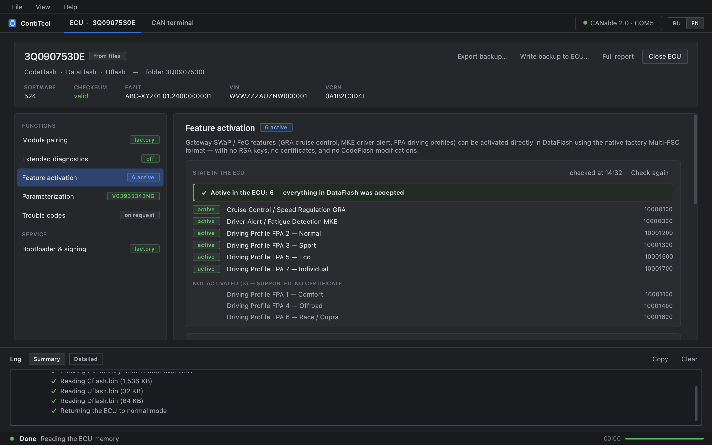
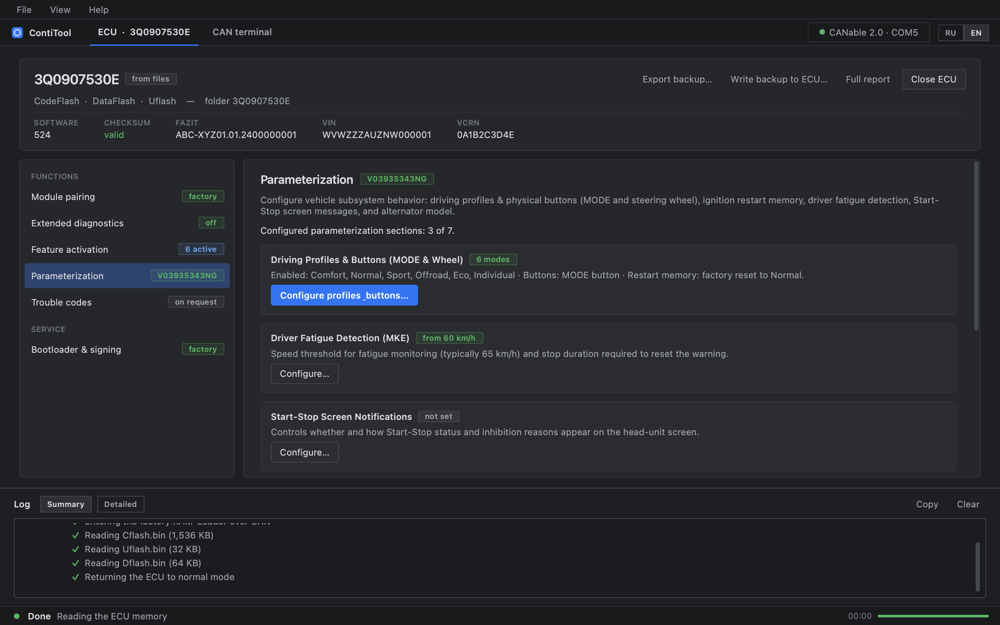
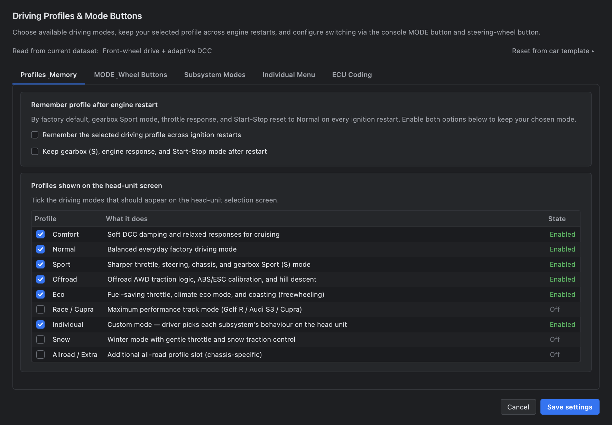
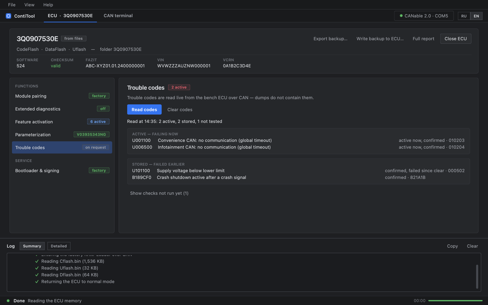
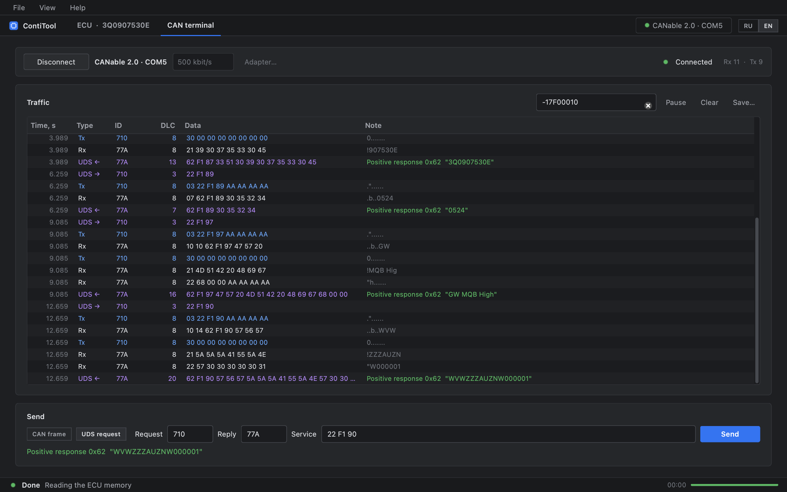
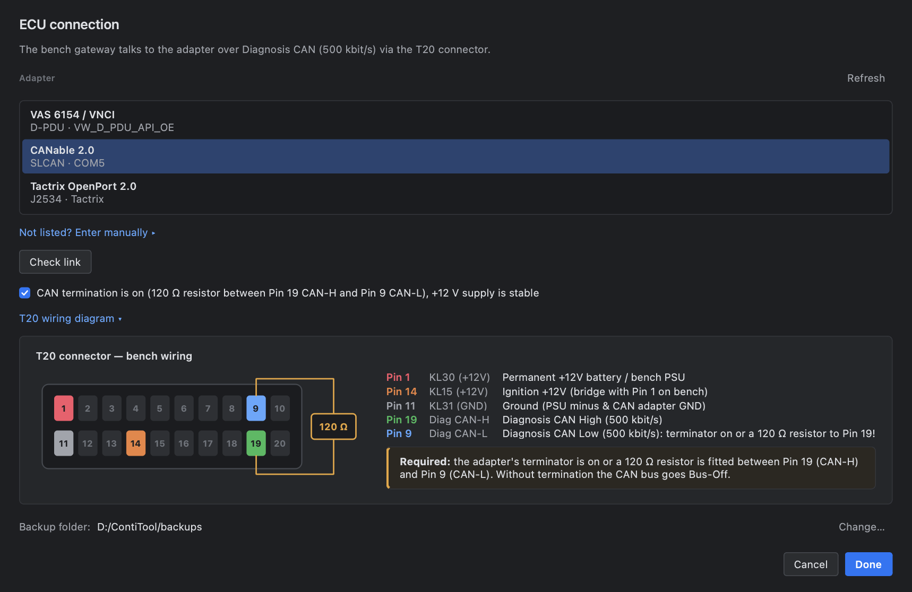
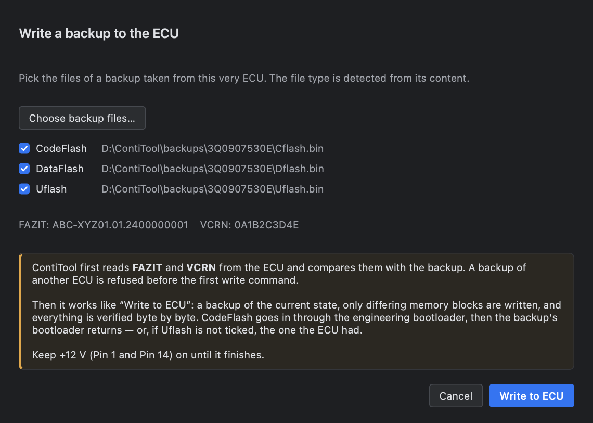
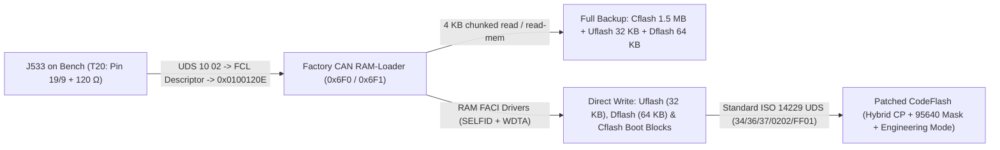

<div align="center">

# ContiTool v2.0 — Continental VAG MQB Gateway J533 (`3Q0 907 530`)
### Renesas RH850/F1L — Diagnosis CAN Studio, Component Protection (`KSCHUTZ`), Engineering Mode & `SWaP / RSA-1024`

[](README.md)
[](#quick-start)
[-0284C7?style=for-the-badge)](#the-64-kb-dataflash-rule-for-bench-programmers)
[](#intended-use--terms)

[](https://vwhacking.antonperk.com)
[](https://www.drive2.ru/users/perkthefox/)
[](https://t.me/perkthefox)

**Made by PerkTheFox** • **[🇷🇺 Читать на русском (`README.md`)](README.md) | 🇬🇧 English** • **[📚 Deep Technical Docs (`docs/`)](docs/README.md)**

</div>

<p align="center">
  
</p>

---

## Intended Use & Terms

- **Scope & Intended Use**: **ContiTool** is a cross-platform Desktop GUI (**Qt 6 / PySide6**) and command-line (**CLI**) bench utility for automotive electronics technicians, independent workshops, and **VAG MQB** owners servicing **Continental J533 Gateways (`3Q0 907 530 xx`, Renesas `RH850/F1L`)**: full flash backup over CAN, ECU repair/replacement, **Component Protection** module adaptation, and **SWaP / FeC** certificate management.
- **Do NOT use this program** if you do not know why you “need” it, cannot work with ODIS or VCTool, or have any, even the slightest doubt that the adapter, the wiring or the power supply is sound. Cheap Chinese adapters are not considered safe, even if the program “gets along” with them.
- **Do not connect it to a working car.** Work with the gateway removed, on a bench, with a regulated power supply. In a car the gateway connects all the modules: while it sits in its bootloader, or if a write fails, the modules stop seeing each other — the car may not start or drive. Besides, the car's voltage sags during a long write, and any dip or dropout during a write leads to a brick. If you connect to a car anyway, it is your risk: the author takes no responsibility for a damaged ECU. Do not message the author about it — open a [GitHub issue](https://github.com/perkthefox/mqb_contitool/issues) and wait for an answer.
- **FREE COMMUNITY TOOL — STRICTLY NOT FOR SALE!** Selling this software, bundling it into paid packages, or charging for access to it is strictly prohibited.
- Provided **"AS IS"** without warranty of any kind, solely for authorized bench diagnostics, repair, and engineering research on owner-controlled hardware. The author (`PerkTheFox`) assumes zero liability for any direct or indirect damage. **Always save a verified full backup of all memory regions (`Cflash.bin` `1.5 MB`, `Uflash.bin` `32 KB`, `Dflash.bin` `64 KB`) before writing!**

---

## Highlights

1. **One working screen built around a single ECU (`GUI`)**:
   - The gateway is opened once — read over CAN or loaded from a folder of dumps — and the whole interface then describes that ECU: part number, checksum, `VIN`, `VCRN`, and one line per feature with its current state.
   - On the left, the ECU's functions with their state; on the right, the selected function's page: what it does, step-by-step actions (e.g. for SWaP: your key → certificate → sending it to the ECU) and the list of enabled features by name.
   - Edits are written to copies (a `ContiTool_edited` folder); the original dumps are never modified. The bottom panel shows the state of every dump (`CodeFlash`, `DataFlash`, `Uflash`), exports changed files to any folder, and flashes **all** modified memory regions directly over **Diagnosis CAN** with a single **"Write to ECU"** click (100% replacing a bench programmer).
   - Before writing `CodeFlash` over CAN, ContiTool automatically activates the engineering bootloader via `FACI` if the gateway is still on factory FBL, and writes modified `CodeFlash` boot blocks (`0x0000..0xBFFF`, e.g. custom `FBL RSA` key) and `DataFlash` (`64 KB`) directly via RAM `FACI` drivers.
   - **Write a backup back**: you pick the backup files, and ContiTool first reads `FAZIT` and `VCRN` from the ECU and refuses a backup of another ECU — before the first write command. **Export backup** copies the dumps as read to a folder of your choice.
   - **What the ECU itself accepted**: the Feature activation page reads the gateway's own answer (`22 3C 00`) — which features are active, which were rejected and why (`VCRN`, signature, validity). It runs automatically after a SWaP write.
   - Every operation shows its current step, progress (`%`), byte counter, transfer speed (`KB/s`), elapsed time and `ETA` in the status bar. The log at the bottom is a short summary by default — the operation, its steps and the outcome; "Detailed" shows the full technical log with addresses, UDS and CAN.
   - Live 1-click **Русский ⇄ English** language toggle in the header.
2. **Full Bench-Programmer Replacement Over Diagnosis CAN (`500 kbit/s` — No ECU Opening Needed)**:
   - Automatic adapter discovery for `CANable` / `SLCAN`, `SocketCAN`, `PCAN`, `Vector`, `Kvaser` and, on Windows, `J2534 PassThru` (Tactrix, Mongoose…) plus `VAS 6154` / `VNCI 6154A` through the ODIS D-PDU driver with a one-click link check, built-in **20-pin J533 `T20`** wiring diagram, and a CAN termination confirmation (`VAS 6154` / `VNCI` and `J2534` adapters terminate the bus themselves). While an operation runs, no second link to the adapter is opened. The installed D-PDU driver is used; versions `27.2` and `31.0` / `31.1` run as is, others only after an explicit confirmation (on connect the driver reflashes the VCI to its own version). Memory reads need a native USB adapter: serial SLCAN clones (CH340 etc.) lose frames.
   - Full read-only CAN backup of **`Cflash.bin` (`1.5 MB`)** + **`Uflash.bin` (`32 KB`)** + **`Dflash.bin` (`64 KB`)** with `SHA-256` manifests, plus arbitrary physical address range reading (`can read-mem` — flash, `Local RAM`, MMIO registers).
   - Direct differential CAN writing of **`DataFlash.bin` (`64 KB`, `0xFF200000..0xFF20FFFF`)** via a native RAM `FACI` driver (`FENTRYR = 0xAA80`, `64`-byte blocks, `4`-byte word programming preserving valid `R_FDL` hardware `ECC`, `ICUSB 0xF800..0xFFFF` guard, and full `64 KB` readback verification).
   - Atomic RAM `FACI` programming of the **`Uflash` (`32 KB`)** bootloader with automatic pre-backup, full `32 KB` readback verification, and live `RSA` status probe.
   - Complete **`CodeFlash.bin` (`1.5 MB`)** programming: boot blocks `0x00000000..0x0000BFFF` (including `Sector 5` with `FBL RSA` modulus at `0x0000A2F7` and automatic preservation of the MCU's 128-bit `SELFID` at `0x0000AB00`) are written via `FACI`, and `FD_0DATA` is flashed via standard UDS (or pure `--raw-faci`) with full `1.5 MB` readback verification, Application health check (`10 03` / `3E 00`), and `DTC` reading/clearing.
   - **CAN terminal**: send your own CAN frames (11/29-bit) or UDS requests over ISO-TP (replies are reassembled, `7F xx 78` is handled, negative response codes are decoded), with a live traffic table, ID filter, pause, copy, save to file, and command history.
   - **Whole pipeline in one CLI command** (`can turnkey`): `Full Backup → Unlock Uflash → Write CP Keys to DataFlash → Patch & Flash CodeFlash → Health & Clear DTC`.
   - **Trouble code descriptions**: codes from `19 02` are shown with their ODIS code (`U023500`, `B189CF0`, …) and a Russian or English description for the whole MQB gateway set (770 codes); active, stored and not-tested-since-clear codes are kept apart — the latter are not faults.
3. **Hybrid Component Protection (`KSCHUTZ` `#MoLaLi`) Binding**:
   - Full support for all **12 VAG Slave ECU Banks (`#1..#12`)** with per-bank status inspection and guardrails against `00..00` zeros or `SHE M1` (`00..00E5`) headers.
   - Installs a 38-byte `RH850` **Hybrid `KSCHUTZ` Trampoline** in `CodeFlash`: all factory vehicle ECUs (`SHE M1..M3` and Master Key `GFA`) keep working natively while selected retrofitted ECUs authenticate using 16-byte plaintext `IKA` keys.
   - Automatic external `ST M95640 SPI EEPROM` bitmask bypass when binding previously empty banks (`47`, `57`, `3C`, `CF`, `3D`, `A5`, `8C`, etc.) without desoldering the `95640` chip.
4. **Engineering Mode & Stock Restore**:
   - `CodeFlash`: unlocks `Feature 0x80/0x81/0x83`, removes `ASAM CCP v2.1` (`0x1BFC8600 / 0x1BFC8601`) memory blacklists, and enables `CAN RAM-Loader` entry (100% reversible to stock).
   - `Uflash`: 4-byte `+0x342A` RSA-Free FBL patch accepting any valid-CRC `.odx` / firmware over UDS (100% reversible to stock).
5. **`RSA-1024 (e = 3)`, SWaP `FSC` v2 & `ODX` Signing Studio**:
   - Pure-Python `RSA-1024 (e = 3)` keypair generator exporting `.json` + OpenSSL `.private.pem` & `.public.pem`.
   - Synchronized public modulus replacement in `CodeFlash.bin` and `DataFlash.bin` (`NvM 0x7C @ 0xDB04` with `CRC-32 @ 0xDCE4` update while preserving the original 5-byte `VCRN @ 0xDC0C`).
   - 171-byte (`0xAB`) **VAG SWaP `FSC` v2** certificate signer (`RIPEMD-160 + RSA-1024`, including `FPA Driving Profile 10000100`, `MKE 10000300`, etc.) for OBD upload (`2E 3C 01` + `31 01 C0 01`) and `ODX` `<FW-SIGNATURE>` (`SHA-1 + RSA-1024`) signing.

---

## Screenshots

| | |
|:---:|:---:|
| <br>**Parameterization** — driving profiles, MKE, start-stop, alternator | <br>**Driving profiles & buttons** — the FPA editor |
| <br>**Trouble codes** — ODIS codes with plain descriptions | <br>**CAN terminal** — UDS over ISO-TP with decoded replies |
| <br>**Connection** — found adapters and the T20 wiring diagram | <br>**Write a backup back** — only into the same ECU (FAZIT / VCRN) |

---

## How the Core Techniques Work & Prerequisites



1. **Closed-Unit CAN Read & Write Without Opening the ECU or Using a Bench Programmer ([full breakdown in `docs/can-read-write.en.md`](docs/can-read-write.en.md))**:
   - Although production `RH850/F1L` silicon is serial read-locked, entering `Uflash.bin` (`ProgrammingSession 10 02`) is supported on every stock gateway. Inside `Uflash`, ContiTool uses two calibrated multi-DID `0x22` passes to point the active `Renesas FCL` descriptor (`0xFEDE0C68`) at **`0x0100120E`** — Stage 2 of Continental's built-in **`CAN RAM-Loader` (`0x6F0 / 0x6F1`)**.
   - From RAM, a 28-byte reader stub streams `Cflash`, `Uflash`, `Dflash`, or any custom physical address range (`can read-mem`) without entering flash `P/E` mode.
   - For flash programming, self-contained RH850 `FACI` RAM drivers service hardware watchdogs (`WDTA0` + `WDTA1`) and load the MCU's 128-bit `SELFID` directly from `Cflash + 0xAB00`:
     - **`Uflash` (`32 KB`)** is reprogrammed atomically from RAM with the 4-byte `+0x342A` patch and verified by full readback;
     - **`DataFlash` (`64 KB`, `0xFF200000..0xFF20FFFF`)** is reprogrammed differentially in 64-byte blocks (`FENTRYR = 0xAA80`) using 4-byte word writes that preserve valid `R_FDL` hardware `ECC` and guard the `ICUSB` system tail (`0xF800..0xFFFF`);
     - **`CodeFlash` (`1.5 MB`)**: boot blocks `0x00000000..0x0000BFFF` (including `Sector 5` with the `FBL RSA` key) are written directly via `FACI` while preserving the live `SELFID`, and `FD_0DATA` is flashed over standard `ISO 14229 UDS` with `App CRC-16/MODBUS` (`0x0000C21C`) verification — or entirely via `--raw-faci`.
2. **Hybrid Component Protection Selector ([full breakdown in `docs/component-protection.en.md`](docs/component-protection.en.md))**:
   - Factory slave keys are 64-byte `SHE M1..M3` containers unwrapped by hardware `ICUS0` (`CMD_LOAD_KEY = 0x40`). ContiTool's 38-byte selector at `0x0016FF80` inspects the `M2/M3` tail in RAM: non-zero `SHE` records and Master Key `GFA` (`0xDA00`) use native `0x40`, whereas banks holding a 16-byte plaintext `IKA` key with a zero tail automatically switch to `CMD_LOAD_PLAIN_KEY = 0x10`.
3. **Practical Notes for `CP` Module Binding**:
   - **You must already have the Slave ECU's 16-byte `K3` (`IKA`) key**: plaintext `K3` never travels over CAN or `ODIS` logs — extract it beforehand from the memory dump of the target Slave ECU (`5F`, `17`, `13`, `47`, `A5`, etc.).
   - **100% Diagnosis CAN Writing**: both the patched `CodeFlash.bin` and the updated `DataFlash.bin` (`64 KB` holding `IKA` keys or a custom `SWaP RSA` modulus) are written directly to the gateway over **Diagnosis CAN** via **"Write to ECU"** in the GUI or `can write-dflash` / `can write-cflash` / `can turnkey --set ...` in the CLI — no external bench programmer is required!

---

## Quick Start

### Option 1 — Standalone Executables (Recommended)

Download from **GitHub Releases**:
- **Windows**: extract `ContiTool-v2.0.1d-windows-amd64.zip` and launch **`ContiTool.exe`**.
- **macOS**: open `ContiTool-v2.0.1d-macos-arm64.dmg` (or `.zip`) and launch **`ContiTool.app`**.
- **Linux**: extract `ContiTool-v2.0.1d-linux-x86_64.tar.gz` and run **`ContiTool/ContiTool`**.

### Option 2 — Run from Source (`Python 3.12+`)

```bash
python3 -m venv .venv
source .venv/bin/activate        # Windows: .venv\Scripts\activate
pip install -r requirements.txt

# Launch Desktop GUI:
python3 conti_cp_tool.py
```

To build standalone `.exe` / `.app` packages locally: `pip install -r requirements-dev.txt && python3 scripts/build_release.py` (output in `dist/release/`).

---

## Bench Wiring (`J533 T20` 20-Pin Connector)

Connect 5 wires to the gateway's 20-pin connector for **Diagnosis CAN (`500 kbit/s`)**:

| J533 `T20` Pin | Signal | Description |
| :---: | :--- | :--- |
| **Pin 1** | `KL30 (+12V)` | Permanent `+12V` bench power supply (`12.5–13.8 V`) |
| **Pin 14** | `KL15 (+12V)` | Ignition `+12V` (bridge together with `Pin 1` on bench) |
| **Pin 11** | `KL31 (GND)` | Common ground (PSU minus & CAN adapter `GND`) |
| **Pin 19** | `Diag CAN-H` | Diagnosis `CAN High` (`500 kbit/s`) |
| **Pin 9** | `Diag CAN-L` | Diagnosis `CAN Low` (`500 kbit/s`) |

> [!IMPORTANT]
> **Mandatory: Connect a `120 Ω` termination resistor between `Pin 19` (`CAN-H`) and `Pin 9` (`CAN-L`)** (or enable the `120 Ω` jumper on your CAN adapter)! `J533` has no internal termination on its diagnostic CAN pair.

### The `64 KB DataFlash` Rule for Bench Programmers

> [!WARNING]
> Although `3Q0 907 530 xx` MCUs are marked `R7F7010343AFP`, the silicon inside is **`R7F7010543AFP / R7F7010563AFP` with a full `64 KB` DataFlash (`65,536` bytes)**, and **all 12 `CP` banks and `SWaP` keys reside in the upper half (`0xC000..0xFFFF`)**!
> - **Never** select a `32 KB` `R7F7010343` profile — it truncates all keys.
> - **Always** select the `3Q0907530` preset or **`R7F7010543` / `R7F7010563` (`64 KB Dflash`)** when importing/exporting dumps for third-party tools (ContiTool's Live CAN Read & Write handles all `64 KB` automatically with no external programmer needed).

---

## Summary of All 12 Component Protection Banks (`DataFlash 64 KB`)

| Bank | ECU | MQB Module | `Dflash` Offset | `NvM` | `95640` Mask | UDS ID | CP CAN TX / RX |
| :---: | :---: | :--- | :---: | :---: | :---: | :---: | :---: |
| `#1` | **`17`** | Instrument Cluster / Immo (`J285`) | `0xC000` / `0xC080` | `0x60` | `0x0001` | `714 / 77E` | `17FC0114 / 17FE0114` |
| `#2` | **`09`** | Central Electrics `BCM` (`J519`) | `0xC100` / `0xC180` | `0x61` | `0x0002` | `70E / 778` | `17FC010E / 17FE010E` |
| `#3` | **`13`** | Adaptive Cruise `ACC` Radar (`J428`) | `0xC200` / `0xC280` | `0x62` | `0x0004` | `757 / 7C1` | `17FC0157 / 17FE0157` |
| `#4` | **`15`** | Airbag Control Unit (`J234`) | `0xC300` / `0xC380` | `0x63` | `0x0008` | `715 / 77F` | `17FC0115 / 17FE0115` |
| `#5` | **`47`** | Digital Sound Amplifier (`J525`) | `0xC400` / `0xC480` | `0x64` | `0x0010` | `76F / 7D9` | `17FC016F / 17FE016F` |
| `#6` | **`57`** | TV Tuner (`R78`) | `0xC500` / `0xC580` | `0x65` | `0x0020` | `76D / 7D7` | `17FC016D / 17FE016D` |
| `#7` | **`5F`** | Infotainment `MIB1 / MIB2 / MIB3` (`J794`) | `0xC600` / `0xC680` | `0x66` | `0x0040` | `773 / 7DD` | `17FC0173 / 17FE0173` |
| `#8` | **`3C`** | Lane Change Assist `Master` (`J769`) | `0xC700` / `0xC780` | `0x67` | `0x0080` | `74E / 7B8` | `17FC014E / 17FE014E` |
| `#9` | **`CF`** | Lane Change Assist `Slave` (`J770`) | `0xC800` / `0xC880` | `0x68` | `0x0100` | `78A / 7F4` | `17FC018A / 17FE018A` |
| `#10` | **`3D`** | Special Function (`J608`) | `0xC900` / `0xC980` | `0x69` | `0x0200` | `72C / 796` | `17FC012C / 17FE012C` |
| `#11` | **`A5`** | Front Assistance Camera (`R242`) | `0xCA00` / `0xCA80` | `0x6A` | `0x0400` | `74F / 7B9` | `17FC014F / 17FE014F` |
| `#12` | **`8C`** | Hybrid / EV Battery Manager (`J840`) | `0xCB00` / `0xCB80` | `0x6B` | `0x0800` | `77B / 7E5` | `17FC017B / 17FE017B` |
| `Mst` | **`19`** | Gateway Master Key `GFA` (`Master`) | `0xDA00` / `0xDA80` | `0x7B` | — | `710 / 77A` | *Keep untouched!* |

---

## CLI Usage

Running `python3 conti_cp_tool.py` without arguments opens the Desktop GUI; passing any subcommand runs in CLI mode (`-l en` / `-l ru`):

```bash
# CLI help & read-only dump inspection:
python3 conti_cp_tool.py -l en --help
python3 conti_cp_tool.py -l en inspect --cflash Cflash.bin --dflash Dflash.bin --uflash Uflash.bin

# Turnkey offline CP binding (hybrid trampoline + automatic 95640 mask bypass + IKA write):
python3 conti_cp_tool.py -l en bind-cp \
  --cflash-in Cflash.bin --dflash-in Dflash.bin \
  --cflash-out Cflash_cp.bin --dflash-out Dflash_cp.bin \
  --set 5F=A1B2C3D4E5F60718293A4B5C6D7E8F90

# Enable Engineering Mode & sign a custom SWaP FSC certificate (FPA 10000100):
python3 conti_cp_tool.py -l en patch-engineering --cflash-in Cflash.bin --cflash-out Cflash_eng.bin --uflash-in Uflash.bin --uflash-out Uflash_eng.bin
python3 conti_cp_tool.py -l en set-rsa-key --generate-key swap_key.json --cflash-in Cflash.bin --cflash-out Cflash_swap.bin --dflash-in Dflash.bin --dflash-out Dflash_swap.bin --target swap
python3 conti_cp_tool.py -l en sign-fsc --key swap_key.json --dflash Dflash_swap.bin --fec 10000100 -o fpa_10000100.fsc

# Live Diagnosis CAN operations (port scan, full read/write of all flash regions, 1-command turnkey):
python3 conti_cp_tool.py -l en can ports
python3 conti_cp_tool.py -l en can backup --port COM4
python3 conti_cp_tool.py -l en can write-dflash --port COM4 --dflash Dflash_cp.bin --yes
python3 conti_cp_tool.py -l en can write-cflash --port COM4 --cflash Cflash_cp.bin --yes
python3 conti_cp_tool.py -l en can read-mem --port COM4 --address 0xFF20C000 --length 0x1000 --out-file cp_banks.bin
python3 conti_cp_tool.py -l en can turnkey --port COM4 --set 5F=A1B2C3D4E5F60718293A4B5C6D7E8F90 --clear-dtc --yes
```

---

## FAQ

**The VNCI does not connect although the driver is supported.**
Reconnect the adapter or press “Check link” a few times. On connect the D-PDU driver itself reflashes the adapter to its own version (about 30 seconds), and ContiTool takes that for a CAN link error. If that does not help, restart the computer.

**My cheap Chinese adapter “works” — so I can use it?**
No. Cheap Chinese adapters are not considered safe, even if the program “gets along” with them. A $2 adapter raises the chance of a brick by 99.9%.

**The link dropped during the first read and the gateway no longer answers.**
Switch the ignition off for a few seconds and back on; as a last resort disconnect the battery terminal. On the bench, cut the +12 V supply for a few seconds. And in general, better not play with this on a live car.

**Do I need ODIS to use a VAS 6154 / VNCI?**
No. All you need is the **VW D-PDU API** driver, a standalone package (`VW_D-PDU_API_Win_x64` plus its VAS 6154 add-on); ODIS itself is not required.

**Several D-PDU drivers are installed — which one does ContiTool use?**
Every one it finds is its own row in the Connection window (`OE`, `OS`, `VCTOOL`…) with its version. The ODIS-E variant is picked by default, but you can choose any other and the choice is remembered. If the adapter does not answer through one driver, try another.

**Update the VAS 6154 / VNCI adapter firmware.** Some adapters on older firmware refuse the raw CAN channel, without which reading memory does not work. The D-PDU driver updates the firmware itself on the first connect (about 30 seconds) — let it finish and do not unplug the adapter.

**What does "adapter provides no raw CAN channel" mean?**
ContiTool reads memory through RawMode on pins 6/14. Some adapters do not provide it: other vendors' J2534 drivers, and some VAS 6154 / VNCI units — genuine ones included — where the refusal comes from the adapter itself on every driver. ContiTool then tries a fallback (ODIS-style links on fixed identifiers) and verifies it with one request. If that answers nothing, the adapter cannot be used; try another D-PDU driver, otherwise another adapter.

**The driver is not installed, or may not be installed.**
Copy the installed driver's folder into `dpdu/` next to ContiTool — it is found automatically and listed first. No registry entry and no administrator rights needed; it must be the 64-bit build. ContiTool ships no driver itself: the files are Volkswagen's, so bring your own copy.

**How do I report a problem?**
After an error ContiTool offers a report itself (or Help → Report a problem…): it collects an archive with the program, operation and D-PDU driver logs and opens a new [GitHub issue](https://github.com/perkthefox/mqb_contitool/issues) with the text filled in — just drag the archive into it. Please do not message the author directly.

## Deep Technical Documentation (`docs/`)

Concrete, byte-accurate engineering documentation without noisy debug logs lives in **[`docs/`](docs/README.md)**:

- **[`docs/can-read-write.en.md`](docs/can-read-write.en.md)** — exact `Uflash` `FCL` descriptor staging (`0xFEDE0548` → `0x0100120E`), `0x6F0 / 0x6F1` stream framing, `can backup` / `read-mem` reading, direct `FACI` RAM programming of `Uflash` (`32 KB`), `DataFlash` (`64 KB`), and `CodeFlash` boot blocks (`SELFID` auto-load + `WDTA` servicing), and `ISO 14229 UDS` `FD_0DATA` flashing.
- **[`docs/component-protection.en.md`](docs/component-protection.en.md)** — `KSCHUTZ` & `ICUS0` internals, 38-byte hybrid trampoline disassembly, `ST M95640` mask bypass, full `64 KB` `DataFlash` map, runtime `80 01 / C0 01 / 80 02 / C0 02` `AES-128-ECB` handshake, and two-step Slave ECU UDS key adaptation (`2E 00 BE → 2E 00 BD`).
- **[`docs/engineering-and-swap.en.md`](docs/engineering-and-swap.en.md)** — Engineering Mode opcodes, `ASAM CCP v2.1` (`0x1BFC8600`), stock `CRC-32` `ZDC` dataset upload, service `DID` / `RoutineControl` catalog, and `RSA-1024 (e = 3)` / `SWaP FSC v2` / `ODX` signing.

> [!NOTE]
> **Note When Using AI Coding Agents (Claude Code, etc.):**  
> Because `docs/` contains low-level bootloader, `FACI` flash controller, and ECU cryptographic specifications, reading `docs/` through AI coding assistants may trigger false-positive automated safety safeguards. `CLAUDE.md` instructs agents not to open `docs/` automatically — **avoid asking AI agents to read `docs/` in full**, and point them only to a specific needed section if necessary.

---

## Project Structure

```text
├── conti_cp_tool.py              # Entry point (opens Qt 6 GUI with no args, or runs CLI subcommands)
├── CLAUDE.md                     # Developer & AI agent repository guide
├── docs/                         # Concrete hardware, memory & protocol documentation (RU / EN)
├── scripts/build_release.py      # Cross-platform PyInstaller release builder (.exe / .app / .dmg)
├── src/contitool/
│   ├── core/                     # Dump analyzers, CRC-16/32, CP/Engineering patchers & RSA/SWaP crypto
│   ├── can/                      # ISO-TP / 0x6F0 RAM-Loader transport, port discovery & CAN workflows
│   ├── cli/                      # Terminal tables, live progress bar & CLI subcommands
│   └── gui/                      # PySide6 / Qt 6 Desktop GUI & built-in CAN terminal
└── tests/                        # Unit, protocol & headless GUI smoke tests (pytest)
```

---

<div align="center">

**Made by PerkTheFox**  
[vwhacking.antonperk.com](https://vwhacking.antonperk.com) • [Drive2: perkthefox](https://www.drive2.ru/users/perkthefox/) • [Telegram: @perkthefox](https://t.me/perkthefox)  
*Free for the VAG research community — Not for commercial sale.*

</div>
