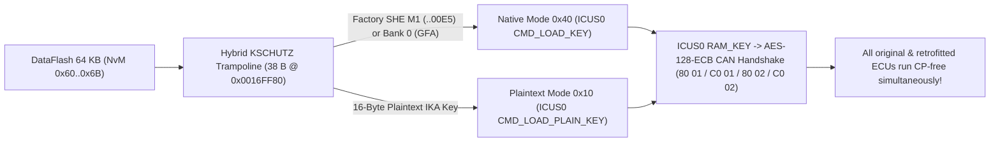

<div align="center">

# Continental VAG MQB Gateway J533 (`3Q0 907 530`)
### Renesas RH850/F1L — Component Protection (`KSCHUTZ`), Engineering Mode & `RSA-1024` / `SWaP` Toolkit

[-3776AB?style=for-the-badge&logo=python&logoColor=white)](#quick-start)
[](#important-selecting-the-mcu-in-your-programmer-64-kb-vs-32-kb)
[-00A88F?style=for-the-badge)](#interactive-windowing-interface-tui)
[](#disclaimer--terms-of-use)

[](https://vwhacking.antonperk.com)
[](https://www.drive2.ru/users/perkthefox/)
[](https://t.me/perkthefox)

**Made by PerkTheFox** • **Zero Dependencies (Pure Python 3)** • **[🇷🇺 Читать на русском (`README.md`)](README.md) | 🇬🇧 English**

</div>

---

## Disclaimer & Terms of Use

> [!CAUTION]
> **DISCLAIMER OF LIABILITY (`AS IS`):**  
> Use this toolkit **strictly at your own risk**! Modifying CAN Gateway (`J533`) firmware, `KSCHUTZ` cryptographic NvM records, or Flash Bootloader code can brick the ECU, corrupt security keys, or trigger Component Protection faults across the vehicle.  
> **If anything breaks, bricks, or goes wrong with your ECU or vehicle — the author (`PerkTheFox`) is NOT at fault and bears ZERO responsibility!**  
> Before writing anything back to the unit, **always save a complete, unmodified backup of every memory region: `CodeFlash.bin` (`1.5 MB`), `DataFlash.bin` (`64 KB`), `Uflash.bin` (`32 KB`), and external `95640` SPI EEPROM (`8 KB`)**.

> [!WARNING]
> **STRICTLY NOT FOR SALE:**  
> This utility is created as a free research and educational tool for the VAG enthusiast community. Selling this script, bundling it into commercial software packages/group-buys, or charging money for the tool itself is strictly prohibited. When sharing or building upon this research, please preserve author attribution: **[vwhacking.antonperk.com](https://vwhacking.antonperk.com)** • **[Drive2](https://www.drive2.ru/users/perkthefox/)** • **[Telegram](https://t.me/perkthefox)**.

---

## Overview

`conti_cp_tool.py` is a self-contained, zero-dependency **Python 3** toolkit (`stdlib` only — no `pip` packages required) for inspecting dumps, performing offline **Component Protection (`KSCHUTZ` `#MoLaLi`)** binding, unlocking **Engineering Mode**, and managing **`RSA-1024 (e = 3)` / `SWaP` (`FeC` / `FSC`)** cryptography on **Continental VAG MQB J533 Gateways** (`3Q0 907 530 AC / AG / AJ / AL / AM / AN / AP / AQ / AR` and compatible **Renesas RH850/F1L** units).

```text
 ◆ CONTINENTAL J533 • RH850/F1L TOOLKIT          Made by PerkTheFox • vwhacking.antonperk.com • [EN] • NOT FOR SALE   
  ╭── MAIN MENU • CONTINENTAL J533 (3Q0 907 530) ───────────────────────────────────────────────────────── [1/9] ──╮
  │ Auto-discovered nearby dumps: CodeFlash = 1 • DataFlash = 1 • Uflash = 1   |   Language [L]: English (EN)      │
  ├────────────────────────────────────────────────────────────────────────────────────────────────────────────────┤
  │  ▸ [1] ★ TURNKEY CP MODULE BINDING (CodeFlash + DataFlash IKA keys)                                Recommended │
  │    [2]   ENGINEERING MODE ('Engineering Unit': RSA-Free OBD flash + live CCP/RAM)                 OBD UDS + C… │
  │    [3]   RSA-1024 KEYS & SWaP / FeC / ODX SIGNING (custom FSC for FPA Driving Mode, etc.)         RSA-1024     │
  │    [4]   INSPECT DUMPS (analyze CodeFlash, Uflash & 12 CP banks + SWaP table)                     Read-only    │
  │    [5]   INDIVIDUAL SERVICE ACTIONS (patch Cflash only, write or clear a CP bank)                 Manual mode  │
  │    [6]   STEP-BY-STEP GUIDE & 12 CP BANKS REFERENCE (where to read IKA, CAN IDs, Dflash map)      Docs         │
  │    [A]   About Author, Links & Disclaimer (PerkTheFox)                                            vwhacking.a… │
  │    [L]   Switch Interface Language: Русский ⇄ English                                             EN -> RU     │
  │    [0]   Exit Program                                                                                          │
  ├────────────────────────────────────────────────────────────────────────────────────────────────────────────────┤
  │ Prepares both files ready for your programmer: patched CodeFlash (with valid CRC-16) and DataFlash with        │
  │ plaintext IKA keys for chosen ECUs (5F MIB2, 17 Cluster, 13 ACC, 47 Sound, A5 Camera, etc.).                   │
  ╰────────────────────────────────────────────────────────────────────────────────────────────────────────────────╯
 ↑↓ Navigate │ Enter Open │ 1-6 Quick Launch │ L Language (RU/EN) │ A Author │ 0/Q Quit                              
```

---

## What You Need Before Starting (NOT a "One-Click" Magic Tool!)

> [!IMPORTANT]
> **This script is NOT a one-button "plug in an OBD cable and make everything work" solution!**  
> It does not talk to the car over a diagnostic cable, cannot unlock read-protected silicon in software, and cannot magically guess security keys over CAN. It is a **low-level binary dump & key preparation toolkit** built for specialists who have bench hardware tools and understand `VAG MQB` / `KSCHUTZ` architecture.

To actually use this script on a vehicle, **two prerequisites are strictly required**:

1. **A real bench dump from your physical `J533` Gateway read via `Voltage Glitch`:**
   - The `Renesas RH850/F1L` (`R7F7010543` / `R7F7010563`) MCU inside production Continental `3Q0 907 530` gateways is factory read-locked (`Security Lock`).
   - Unpacking a dealer `.frf` / `.odx` update file is NOT enough: `.odx` files do not contain your car's unique `DataFlash.bin` (`64 KB` holding existing `SHE` slave keys, Master Key `GFA`, `VCRN`, and `SWaP` slots), `Uflash.bin` (`32 KB`), or the `0x00000000..0x0000C1FF` boot prefix.
   - You must remove the gateway from the car, open it on the bench, read `CodeFlash.bin` + `DataFlash.bin` (+ `Uflash.bin`) using a hardware **`Voltage Glitch` (`Fault Injection`)** programmer (`VVDI Multi-Prog`, `CG100X`, `Orange-5 RH850 Glitch`, etc.), patch the dumps with this script, and flash them back on the bench.
2. **The target Slave ECU's 16-byte `K3` (`IKA`) key extracted in advance from that ECU's own dump:**
   - To bind a used or retrofitted module (`5F` MIB2, `17` Cluster, `13` ACC Radar, `47` Sound Amplifier, `A5` Camera, etc.) to the gateway offline, you must **already know that specific unit's 16-byte plaintext `K3` (`IKA` — Individual Key Application) Component Protection key** (`32` HEX characters).
   - **Plaintext `K3` NEVER travels over UDS / CAN and NEVER appears in `ODIS` logs or bus captures!** During `ODIS Online` / `FAZIT` adaptation, keys are delivered strictly inside encrypted cryptographic containers (`SHE M1..M3` / `AES`) unwrapped inside hardware security modules, while runtime CAN handshakes exchange only random nonces and `AES-128` proofs.
   - **The ONLY way to obtain `K3` (`IKA`) is by dumping the memory of the target Slave ECU itself** (`EEPROM` / `DataFlash` / `SPI NOR` / `eMMC` on the bench or via direct internal access on that specific module — or, if you already have full dump write access on the Slave ECU, writing the same custom 16-byte key into both the Slave ECU dump and the Gateway bank).

---

## Features

### 1. Offline Component Protection (`KSCHUTZ` `#MoLaLi`) Binding
- **Full support for all 12 Slave CP Banks (`#1..#12`)** stored in Gateway `19`: `17` Instrument Cluster, `09` BCM, `13` ACC Radar, `15` Airbag, `47` Sound Amplifier, `57` TV Tuner, `5F` Infotainment (`MIB1` / `MIB2` / `MIB3`), `3C` / `CF` Side Assist Radars, `3D` Special Function, `A5` Front Camera, and `8C` Hybrid/EV Battery.
- **Safe 38-Byte Hybrid Auto-Detect Trampoline (`CodeFlash`)**: automatically locates the `KSCHUTZ` key-load callback by machine-code signature across firmware versions and installs a compact `RH850` trampoline:
  - all **existing factory ECUs** in the car with `SHE M1..M3` encrypted key blocks continue running natively through the hardware **`ICUS0`** HSM (`CMD_LOAD_KEY`, code `0x40`);
  - all **retrofitted or replacement used ECUs** simultaneously authenticate using 16-byte plaintext **`IKA`** keys (`CMD_LOAD_PLAIN_KEY`, code `0x10`) written into `DataFlash.bin`!
- **External `ST M95640` SPI EEPROM Learned-Bank Bitmask Bypass (`--bypass-eeprom-mask`)**: allows retrofitting new modules into previously empty (`FF..FF`) CP banks **without desoldering or editing the external `95640` EEPROM chip**.
- **Automatic `Application CRC-16/MODBUS` Recalculation** (`reflected poly 0xA001` at `0x0000C21C`, keeping block count `1` at `0x0000C21E`) so Flash Bootloader check `FF01` passes natively.



### 2. Engineering Mode ("Engineering Unit" for OBD-II Flashing & Live RAM/Flash)
- **`Uflash.bin` Bootloader Patch (`32 KB` @ `0x0100342A`) -> `RSA-Free Engineering FBL`**: after a one-time bench write of `Uflash.bin`, the gateway accepts **any custom `.odx` firmware update directly over the OBD-II port** (`ODIS-E` / `VCP`, routine `31 01 02 02`) without requiring a factory VAG `RSA-1024` signature.
- **Full `ASAM CCP v2.1` CAN Access (`0x1BFC8600` -> `0x1BFC8601`)**: unlocks the system engineering feature gate (`Feature 0x80 / 0x81 / 0x83`) and removes the `CCP` memory address blacklist, enabling live read access to `CodeFlash` / `DataFlash` / `Uflash` / `RAM` and live `RAM` writes on a running vehicle (including instant in-RAM activation of all 13 `SWaP` features by writing `0xFFFA` to `0xFEDE1394`).
- **Continental Factory `CAN RAM-Loader` Unlock (`0x07FC80FE` -> `0x6F0 / 0x6F1`)**: bypasses the one-time `OTP 0x0000A167` lock so custom `RH850` payloads can be uploaded and executed in RAM (`0xFEDE9000`).

### 3. `RSA-1024 (e = 3)` Cryptography & Custom `SWaP / FeC` (`FSC`) Certificates
- **Built-in Pure-Python `RSA-1024 (e = 3)` Keypair Generator**: Miller–Rabin primality testing using `secrets`, exporting `.json` plus standard OpenSSL `.private.pem` (`PKCS#1`) and `.public.pem` (`SPKI`) files.
- **Synchronized `SWaP RSA` & `FBL RSA` Public Modulus Replacement**: patches the public modulus in `CodeFlash.bin` AND simultaneously updates the mirrored `SWaP` NvM cache in `DataFlash.bin` (`NvM 0x7C @ 0xDB04`) with a fresh `IEEE CRC-32 @ 0xDCE4` while preserving the gateway's original 5-byte hardware **`VCRN`** (`DID 0x3C03 @ 0xDC0C`).
- **Custom 171-Byte (`0xAB`) `VAG SWaP FSC` Builder & Signer (`sign-fsc`)**: computes pure-Python `RIPEMD-160` + `PKCS#1 v1.5` signatures to generate valid activation certificates (`0x10000100` Driving Profile Selection `FPA / Mode`, `0x10000300` Driver Alert `MKE`, `0x10001800` `Snow`, etc.) ready for standard OBD-II upload via `UDS 0x2E 0x3C01` + `31 01 C0 01`.
- **Custom `.odx` Firmware Block Signer (`sign-odx`)**: generates 128-byte `SHA-1 + PKCS#1 v1.5` (`<FW-SIGNATURE>`) signatures matching your custom `FBL RSA` key (`Sector 5 @ 0x0000A2F7`).

### 4. Full-Screen Interactive Windowing TUI + Scriptable CLI (`EN` / `RU`)
- `ncurses`-style alternate-screen console windows with zero terminal scroll clutter, live window resize adaptation (`SIGWINCH`), responsive 3-tier `DataFlash` tables that never break borders even in narrow IDE consoles, built-in folder browser, Finder / Explorer drag-and-drop, and one-key clipboard copy.

---

## Important: Selecting the MCU in Your Programmer (`64 KB` vs `32 KB`)

> [!IMPORTANT]
> Commercial programmer menus (`VVDI Multi-Prog`, `CG100X`, etc.) historically label the `3Q0 907 530` gateway profile as **`Continental R7F7010343`**, even though official Renesas `RH850/F1L` specifications give `R7F7010343AFP` only **`32 KB` of Data Flash**. Disassembly of the gateway firmware proves the actual silicon inside `3Q0 907 530` belongs to the higher-tier **`R7F7010543AFP` / `R7F7010563AFP`** sub-series with **`64 KB` physical Data Flash (`65,536` bytes)** + hardware `ICU-S` (`R_FDL_Init` hardcodes `fdlPoolSize = 0x0400 = 1024 × 64 B`).
>
> **Bench Reading Rule:**
> - Always use your programmer's dedicated **`3Q0 907 530` / `MQB Gateway Continental`** ECU preset (which reads the full `64 KB`), **OR** if selecting manually by MCU part number, choose **`R7F7010543` / `R7F7010563` (`64 KB DataFlash`)**.
> - **NEVER manually select a `32 KB` `R7F7010343` chip profile!** All 12 CP banks, Master Key `GFA`, and `SWaP / FeC` certificates live in the upper half of `DataFlash` (`0xC000..0xF0BF`) — a `32 KB` read truncates them completely (and the tool will immediately reject an incomplete dump).

---

## Quick Start

No external libraries are required — only standard **Python 3.9+** on **macOS**, **Linux**, or **Windows**:

```bash
git clone <REPOSITORY_URL>
cd <REPOSITORY_FOLDER>

# Launch full-screen interactive TUI (with language selector, or pass -l en directly):
python3 conti_cp_tool.py -l en
```

Place your bench dumps (`CodeFlash.bin` / `Cflash.bin`, `DataFlash.bin` / `Dflash.bin`, and optional `Uflash.bin`) next to the script or inside any subfolder — or simply **drag & drop a file from Finder / File Explorer directly onto the TUI file picker window**.

---

## Interactive Windowing Interface (TUI)

| Key | Action |
| :--- | :--- |
| `↑` / `↓`, `PgUp` / `PgDn`, `Home` / `End` | Navigate menus, CP bank lists, folder browser, and scroll reports |
| `Enter` *(or digits `1`–`9`)* | Open highlighted item / confirm selection |
| `Space` *(`A` — select all, `N` — clear)* | Toggle `[✓]` checkboxes to bind or clear multiple CP banks at once |
| `Tab` / `←` `→` | Switch tabs inside the Dump Inspector and Reference Guide windows |
| `B` | Open interactive Folder Browser (in file picker) / Full RAW HEX CP Bank Cards (in inspector) |
| `F2` or `Ctrl+G` | Instantly generate a cryptographically random 16-byte `IKA` key |
| `C` | Copy HEX key / `VCRN` / command to OS clipboard (`pbcopy` / `clip` / `wl-copy`) |
| `L` | Toggle interface language **`English ⇄ Русский`** live in any open window |
| `Esc` | Go back one step / close active modal window |
| `0` or `Q` | Exit cleanly and restore the original terminal screen |

> [!TIP]
> Need classic line-by-line terminal prompts instead of full-screen TUI windows (e.g., for terminal logging or piped input)? Pass `--classic-ui`:  
> `python3 conti_cp_tool.py -l en --classic-ui`

---

## Complete Reference of All 12 CP Banks (`DataFlash 64 KB`)

Every CP bank is stored in `DataFlash.bin` in **two mirrored copies** (primary + `+0x80` mirror), framed with a `0x55555555` header word and an `IEEE CRC-32` (`zlib.crc32`, LE32) checksum:

| Bank | VAG ECU | MQB Module Description | `DataFlash` (Pri / Mir) | `NvM ID` | `95640` Mask | UDS Req / Resp | CP CAN TX / RX |
| :---: | :---: | :--- | :---: | :---: | :---: | :---: | :---: |
| **`#1`** | **`17`** | Instrument Cluster / Immobilizer (`J285`, AID / Virtual Cockpit) | `0xC000` / `0xC080` | `0x60` | `0x0001` (bit 0) | `714 / 77E` | `17FC0114 / 17FE0114` |
| **`#2`** | **`09`** | Central Electrics `BCM` (`J519`) | `0xC100` / `0xC180` | `0x61` | `0x0002` (bit 1) | `70E / 778` | `17FC010E / 17FE010E` |
| **`#3`** | **`13`** | Adaptive Cruise Control / `ACC` Radar (`J428`) | `0xC200` / `0xC280` | `0x62` | `0x0004` (bit 2) | `757 / 7C1` | `17FC0157 / 17FE0157` |
| **`#4`** | **`15`** | Airbag Control Module (`J234`) | `0xC300` / `0xC380` | `0x63` | `0x0008` (bit 3) | `715 / 77F` | `17FC0115 / 17FE0115` |
| **`#5`** | **`47`** | Digital Sound System / Amplifier (`J525`, Canton / Dynaudio / Fender) | `0xC400` / `0xC480` | `0x64` | `0x0010` (bit 4) | `76F / 7D9` | `17FC016F / 17FE016F` |
| **`#6`** | **`57`** | TV Tuner (`R78`) | `0xC500` / `0xC580` | `0x65` | `0x0020` (bit 5) | `76D / 7D7` | `17FC016D / 17FE016D` |
| **`#7`** | **`5F`** | Infotainment Head Unit `MIB1 / MIB2 / MIB3` (`J794`) | `0xC600` / `0xC680` | `0x66` | `0x0040` (bit 6) | `773 / 7DD` | `17FC0173 / 17FE0173` |
| **`#8`** | **`3C`** | Lane Change Assist `Side Assist 1` Master (`J769` / `J1086`) | `0xC700` / `0xC780` | `0x67` | `0x0080` (bit 7) | `74E / 7B8` | `17FC014E / 17FE014E` |
| **`#9`** | **`CF`** | Lane Change Assist `Side Assist 2` Slave (`J770` / `J1087`) | `0xC800` / `0xC880` | `0x68` | `0x0100` (bit 8) | `78A / 7F4` | `17FC018A / 17FE018A` |
| **`#10`** | **`3D`** | Special Function / Special Purpose Vehicle (`J608`) | `0xC900` / `0xC980` | `0x69` | `0x0200` (bit 9) | `72C / 796` | `17FC012C / 17FE012C` |
| **`#11`** | **`A5`** | Front Driver Assistance Camera `MFK` (`R242`, `3Q0` / `2Q0`) | `0xCA00` / `0xCA80` | `0x6A` | `0x0400` (bit 10) | `74F / 7B9` | `17FC014F / 17FE014F` |
| **`#12`** | **`8C`** | Hybrid / EV High-Voltage Battery Manager (`J840`, GTE / e-Golf) | `0xCB00` / `0xCB80` | `0x6B` | `0x0800` (bit 11) | `77B / 7E5` | `17FC017B / 17FE017B` |
| **`Mst`** | **`19`** | Gateway Own Application Master Key `GFA` (`Master`, `key_type=3`) | `0xDA00` / `0xDA80` | `0x7B` | — | `710 / 77A` | *Keep untouched!* |

---

## Complete `DataFlash.bin` (`64 KB`) Memory Map

| Offset Range in `Dflash.bin` | `NvM ID` | Contents & Purpose |
| :---: | :---: | :--- |
| `0x0000 .. 0x007F` | ZDC Header | Dataset identifier & version passport (`DID F1A0` / `F1A1`) |
| `0x0080 .. 0x303F` | 7 ZDC Blocks | Vehicle parameterization (`Base`, `MKE`, `FPA Driving Profile`, `Aux`, `Main GW`, `Cal`, `BEM` / Start-Stop), verified solely by `IEEE CRC-32` |
| `0x3040 .. 0xBFFF` | FDL Pool | Unallocated `Data Flash` pool (`0xFF`) |
| `0xC000 .. 0xCBFF` | `0x60 .. 0x6B` | **12 Slave Component Protection (`CP`) Banks (`#1..#12`)**, `2 × 128` bytes per bank |
| `0xCC00 .. 0xD8FF` | `0x6C .. 0x78` | Reserved `NvM` key slots |
| `0xD900 .. 0xD9FF` | `0x79 .. 0x7A` | Hardware `ICUS0` `AES-CMAC` authentication tags for `95640` block `0x5E` |
| `0xDA00 .. 0xDAFF` | `0x7B` | **Gateway `19` Own Application Master Key (`GFA`, Bank 0)** |
| `0xDB00 .. 0xDCFF` | `0x7C` | Cached **`SWaP RSA-1024`** public modulus (`0xDB04`) + 5-byte **`VCRN`** (`0xDC0C`) + `CRC-32` (`0xDCE4`) |
| `0xDD00 .. 0xE83F` | `0x7D .. 0x8B` | **15 `SWaP FSC` Activation Certificate Slots** (store donor plaintext `VIN` at `+0x10`) |
| `0xE840 .. 0xF0BF` | `0x8C .. 0x94` | `SWaP` counters & `NvM` layout version word (`NvM 0x00..0x5F` reside in external `8 KB` `ST M95640` SPI EEPROM) |

---

## Command-Line Interface (CLI) Examples

Every feature available in the interactive TUI can also be scripted via CLI (`-l en` or `CONTI_CP_LANG=en`):

```bash
# 1. Full read-only inspection of CodeFlash + DataFlash + Uflash dumps
python3 conti_cp_tool.py -l en inspect \
  --cflash CodeFlash.bin \
  --dflash DataFlash.bin \
  --uflash Uflash.bin

# 2. Offline binding of a retrofitted or used ECU (hybrid CodeFlash patch + plaintext IKA in DataFlash)
#    (e.g., retrofitting 47 Canton Sound Amplifier into empty Bank #5 with 95640 mask bypass)
python3 conti_cp_tool.py -l en patch-cflash \
  -i CodeFlash.bin -o CodeFlash.patched.bin \
  --bypass-eeprom-mask

python3 conti_cp_tool.py -l en set-cp-key \
  -i DataFlash.bin -o DataFlash.patched.bin \
  --bank 47 --key 00112233445566778899AABBCCDDEEFF

# 3. Convert gateway into an 'Engineering Unit' (RSA-Free OBD .odx flashing + full live CCP)
python3 conti_cp_tool.py -l en patch-engineering \
  --cflash-in CodeFlash.bin   --cflash-out CodeFlash.eng.bin \
  --uflash-in Uflash.bin      --uflash-out Uflash.eng.bin

# 4. Generate a custom RSA-1024 (e=3) keypair, embed SWaP modulus & sign an FPA Driving Mode FSC (0x10000100)
python3 conti_cp_tool.py -l en set-rsa-key \
  --generate-key my_swap_rsa1024.json \
  --cflash-in CodeFlash.bin   --cflash-out CodeFlash.swap.bin \
  --dflash-in DataFlash.bin   --dflash-out DataFlash.swap.bin \
  --target swap

python3 conti_cp_tool.py -l en sign-fsc \
  --key my_swap_rsa1024.json \
  --dflash DataFlash.swap.bin \
  --fec 10000100 \
  -o fpa_10000100.fsc

# 5. Print the 12 CP banks reference table and step-by-step guide
python3 conti_cp_tool.py -l en banks
python3 conti_cp_tool.py -l en guide
```

---

## Hidden Features & Engineering CAN / UDS Protocols on Gateway `J533`

Below is the complete byte-level specification of all hidden, engineering, and service CAN/UDS protocols inside the **Continental `3Q0 907 530` (`RH850/F1L`)** Gateway, recovered directly from `CodeFlash.bin` and `Uflash.bin` disassembly (OBD-II diagnostic CAN on pins `6 / 14`, **`500 kbps`**, physical Gateway `19` IDs: Tester Request **`0x710`** → Gateway Response **`0x77A`**).

### 1. Engineering UDS Sessions & Both `SecurityAccess` Levels (Including Stock Master Password)

Even on **100% unmodified factory firmware**, the UDS session dispatch table (`0x000203B0`) natively accepts engineering diagnostic sessions:

| UDS Request (`0x710`) | Reply (`0x77A`) | Session Name | Unlocked Capabilities |
| :---: | :---: | :--- | :--- |
| `10 03` | `50 03 ...` | `ExtendedDiagnosticSession` | Long Coding (`0x0600`), installation list (`0x04A3`), `LIN` / `BEM` / `Wake-up` service routines |
| **`10 40`** | `50 40 ...` | **`EOLSession` (VW End-Of-Line)** | Custom `ZDC` dataset upload (`0x34/0x36`), `SWaP FSC` upload (`0x3C01` + `0xC001`), `KSCHUTZ` sync (`0x0567`) |
| **`10 4F`** | `50 4F ...` | **`DevelopmentSession` (Engineering)** | Continental developer mode and Superuser `SecurityAccess Level 2` (`27 03 / 27 04`) |
| `10 02` | `50 02 ...` | `ProgrammingSession` | Software reset into Flash Bootloader `Uflash.bin` (`0xFEDFFFF0 = 0xA5430911`) |

#### Application `SecurityAccess` Algorithms (`0x0002714C` / `0x000817CA`)

1. **`Level 1` (`27 01` → `27 02`, open VAG login `20103` = `0x00004E87`):**
   - Unlocks adaptations, `ZDC` dataset flashing, and `SWaP FSC` activation.
   - **Formula:** `Key = (uint32_be(Seed) + 0x00004E87) & 0xFFFFFFFF`
   - **Worked Example (`Seed = 12 34 56 78`):** `0x12345678 + 0x00004E87 = 0x1234A4FF`
     ```text
     TX 0x710: 02 27 01 AA AA AA AA AA    ->  RX 0x77A: 06 67 01 12 34 56 78 AA   (Seed = 0x12345678)
     TX 0x710: 06 27 02 12 34 A4 FF AA    ->  RX 0x77A: 02 67 02 AA AA AA AA AA   (Level 1 Unlocked!)
     ```

2. **`Level 2` (`27 03` → `27 04`, Superuser Engineering Level `0xCAFFE012`):**
   - The `SendKey` handler (`0x0008182C`) accepts **either of two keys** even on untouched stock firmware:
     - **Dynamic seed-based key:** `Key = (uint32_be(Seed) + 0xCAFFE012) & 0xFFFFFFFF`  
       *(example for `Seed = 12 34 56 78`: `(0x12345678 + 0xCAFFE012) & 0xFFFFFFFF = 0xDD34368A` → `27 04 DD 34 36 8A`)*;
     - **Hardcoded seed-independent master password `CA FF E0 12`** (works for **ANY** `Seed`!):
       ```text
       TX 0x710: 02 10 4F AA AA AA AA AA    ->  RX 0x77A: 06 50 4F 00 32 01 F4 AA   (DevelopmentSession)
       TX 0x710: 02 27 03 AA AA AA AA AA    ->  RX 0x77A: 06 67 03 9A BC DE F0 AA   (any random Seed)
       TX 0x710: 06 27 04 CA FF E0 12 AA    ->  RX 0x77A: 02 67 04 AA AA AA AA AA   (Superuser Level 2 Unlocked!)
       ```

---

### 2. Live Calibration Protocol `ASAM CCP v2.1` (`29-bit CAN 0x1BFC8600 / 0x1BFC8601`)

Production gateway firmware compiles in a complete **ASAM CCP v2.1** calibration server on Diagnostic CAN (`500 kbps`, **29-bit Extended CAN IDs**, `DLC = 8`, Station Address **`0x0055`** Big-Endian or broadcast `00 00`):
- **Tester Request (`CRO`):** **`0x1BFC8600`** — `[CMD, CTR, Byte2, Byte3, Byte4, Byte5, Byte6, Byte7]` (`CTR` = arbitrary 1-byte packet counter echoed in reply).
- **Gateway Reply (`DTO`):** **`0x1BFC8601`** — `[0xFF, ERR, CTR, D0, D1, D2, D3, D4]` (`ERR = 0x00` ACK, `0x30` unknown command, `0x32` out of range, `0x33` address locked by `CCP_CheckAddr`).

> [!NOTE]
> On stock firmware, `CONNECT` works immediately, whereas reading protected regions (`CodeFlash`, `DataFlash`, `Uflash`, `KSCHUTZ RAM`) returns dummy `0xAD` bytes and `RAM` writes return `0x33`. Applying **`patch-engineering`** in `conti_cp_tool.py` unlocks `Feature 0x81` and strips the `CCP_CheckAddr` blacklist, enabling **full live memory read access and live `RAM` writes directly over the OBD-II port on a running car**!

| `CMD` | CCP Mnemonic | Request on `0x1BFC8600` (`8` bytes) | Reply on `0x1BFC8601` & Behavior |
| :---: | :--- | :--- | :--- |
| `0x01` | `CONNECT` | `01 <CTR> 00 55 00 00 00 00` | `FF 00 <CTR> ...` — opens CCP session with station `0x0055` |
| `0x1B` | `GET_CCP_VERSION` | `1B <CTR> 02 01 00 00 00 00` | `FF 00 <CTR> 02 01 00 00 00` — confirms `CCP v2.1` |
| `0x17` | `EXCHANGE_ID` | `17 <CTR> 00 00 00 00 00 00` | `FF 00 <CTR> <Len> ...` — sets `MTA0 = 0x000265F8` (ECU ID string) |
| `0x02` | `SET_MTA` | `02 <CTR> <00\|01> 00 <Addr_BE32>` | `FF 00 <CTR> ...` — loads 32-bit Big-Endian address into `MTA0` (`00`) or `MTA1` (`01`) |
| `0x04` | `UPLOAD` | `04 <CTR> <Size:01..05> 00 00 00 00 00` | `FF 00 <CTR> <B0..B4>` — reads `1..5` bytes from `[MTA0]` and advances `MTA0 += Size` |
| `0x0F` | `SHORT_UP` | `0F <CTR> <Size:01..05> 00 <Addr_BE32>` | `FF 00 <CTR> <B0..B4>` — single-frame `1..5` byte read via `MTA1` |
| `0x03` | `DNLOAD` | `03 <CTR> <Size:01..05> <D0..D4>` | `FF 00 <CTR> <Ext> <NewMTA0_BE32>` — writes `1..5` bytes to RAM at `[MTA0]`, `MTA0 += Size` |
| `0x23` | `DNLOAD_6` | `23 <CTR> <D0 D1 D2 D3 D4 D5>` | `FF 00 <CTR> <Ext> <NewMTA0_BE32>` — writes `6` bytes to RAM at `[MTA0]`, `MTA0 += 6` |
| `0x07` | `DISCONNECT` | `07 <CTR> <00\|01> 00 00 00 00 00` | `FF 00 <CTR> ...` — closes session (`00` temporary, `01` permanent) |

#### Practical `ASAM CCP` Use-Case Examples

1. **Live OBD dump of CP Bank `#7` (`5F` MIB2 @ `0xFF20C600` in internal `DataFlash`):**
   ```text
   TX 0x1BFC8600: 01 01 00 55 00 00 00 00   ->  RX 0x1BFC8601: FF 00 01 00 00 00 00 00  (CONNECT)
   TX 0x1BFC8600: 02 02 00 00 FF 20 C6 00   ->  RX 0x1BFC8601: FF 00 02 00 00 00 00 00  (MTA0 = 0xFF20C600)
   TX 0x1BFC8600: 04 03 05 00 00 00 00 00   ->  RX 0x1BFC8601: FF 00 03 55 55 55 55 K0  (header 55555555 + K0)
   TX 0x1BFC8600: 04 04 05 00 00 00 00 00   ->  RX 0x1BFC8601: FF 00 04 K1 K2 K3 K4 K5  (key bytes K1..K5)
   ```

2. **Instant in-RAM activation of ALL 13 `SWaP / FeC` licenses on the fly (no `RSA`, no `FSC`, no reboot):**
   The `SWaP` evaluator (`0x0007E05A`) aggregates all 13 feature flags into a 16-bit Little-Endian word at **`*(uint16_t *)0xFEDE1394`**:
   - bit `1` (`0x0002`) — `0x10000300` (`MKE` — Driver Alert / Fatigue Detection);
   - bit `3` (`0x0008`) — `0x10000100` (`FPA Base` — Driving Profile Selection master enable);
   - bits `5..15` (`0xFFE0`) — 11 `FPA` driving profiles (`0x10001100` *Comfort*, `0x10001200` *Normal*, `0x10001300` *Sport*, `0x10001400` *Offroad*, `0x10001500` *Eco*, `0x10001600`, `0x10001700` *Individual*, `0x10001800` *Snow*, `0x10001900` *E-Mode*, `0x10001A00` *GTE / Race*, `0x10001B00` *Offroad Individual*); bits `0` & `2` (`0x0005`) are internal `evaluated` status bits.
   - Writing **`0xFFFA`** (`FA FF` Little-Endian on CAN) sets all 13 license bits (`0x0002 | 0x0008 | 0xFFE0`) immediately:
   ```text
   TX 0x1BFC8600: 01 01 00 55 00 00 00 00   ->  RX 0x1BFC8601: FF 00 01 00 00 00 00 00  (CONNECT)
   TX 0x1BFC8600: 02 02 00 00 FE DE 13 94   ->  RX 0x1BFC8601: FF 00 02 00 00 00 00 00  (MTA0 = 0xFEDE1394)
   TX 0x1BFC8600: 03 03 02 FA FF 00 00 00   ->  RX 0x1BFC8601: FF 00 03 00 FE DE 13 96  (wrote 0xFFFA LE!)
   ```

3. **Timerless jump into the Factory `CAN RAM-Loader` at any uptime:**
   Write magic word `0xA4420810` (`10 08 42 A4` LE) into retention RAM `0xFEDFFFF0` and trigger UDS `ECUReset` (`11 01`):
   ```text
   TX 0x1BFC8600: 02 05 00 00 FE DF FF F0   ->  RX 0x1BFC8601: FF 00 05 00 00 00 00 00  (MTA0 = 0xFEDFFFF0)
   TX 0x1BFC8600: 03 06 04 10 08 42 A4 00   ->  RX 0x1BFC8601: FF 00 06 00 FE DF FF F4  (wrote 0xA4420810)
   TX 0x710:      02 11 01 AA AA AA AA AA   ->  resets MCU straight into CAN RAM-Loader on 0x6F0 / 0x6F1!
   ```

---

### 3. Hidden Trigger `0x07FC80FE` & Two-Stage Factory `CAN RAM-Loader` (`0x6F0 / 0x6F1` — Supervisor Code Execution Without RSA)

`Uflash.bin` embeds a proprietary two-stage Continental factory loader capable of streaming native `RH850` machine code into RAM (`0xFEDF8020..0xFEDFFEFF`) and executing it in Supervisor Mode with zero `RSA` checks.

#### Step 0 — Entry from Application (`29-bit CAN 0x07FC80FE`)
On an engineering-patched unit immediately after power-on or `11 01` (vehicle speed = 0), transmit the 29-bit frame:
```text
TX 0x07FC80FE: 84 00 00 00 00 00 00 00   ->  RX 0x07FC80FF (writes 0xA4420810 to 0xFEDFFFF0 + SWRESA reset)
```
After reset, the bootloader listens on **11-bit Standard CAN IDs: `0x6F0` (Tester TX) → `0x6F1` (Gateway RX)** (`500 kbps`).

#### Stage 1 — Factory `Seed / Key` on `0x6F0 / 0x6F1` (`0x01000BCC`)

1. Request `Seed`: `TX 0x6F0: 30 00 00 00 00 00 00 00` → `RX 0x6F1: 30 <S0> <S1> <S2> <S3>`.
2. **Exact 4-byte `Key` calculation (`poly = 0xA001` reflected, `init = 0x0000`):**

```python
def crc16_reflected_zero(data: bytes) -> int:
    crc = 0x0000  # NOTE: initial value at 0x01004AF4 is 0x0000 (NOT 0xFFFF!)
    for b in data:
        crc ^= b
        for _ in range(8):
            crc = ((crc >> 1) ^ 0xA001) if (crc & 1) else (crc >> 1)
    return crc & 0xFFFF

def conti_ramloader_key(seed4: bytes) -> bytes:
    s0, s1, s2, s3 = seed4
    buf = bytes([0x65, 0x96, s2, s1, 0xAC, s3, 0x53, s0])
    c1 = crc16_reflected_zero(buf[0:8])
    c2 = crc16_reflected_zero(buf[2:8])
    b0, b1 = c1 & 0xFF, (c1 >> 8) & 0xFF
    b2, b3 = c2 & 0xFF, (c2 >> 8) & 0xFF
    rem = s3 % 3
    if rem == 0:
        return bytes([b1, b2, b3, b0])
    if rem == 1:
        return bytes([b2, b0, b1, b3])
    return bytes([b3, b2, b0, b1])
```

- **Verified test vectors for all 3 branches of `S3 % 3`:**
  - `Seed = 12 34 56 78` (`0x78 % 3 = 0`, `c1 = 0x5890`, `c2 = 0x46A0`) → **`Key = 58 A0 46 90`**
  - `Seed = A1 B2 C3 01` (`0x01 % 3 = 1`, `c1 = 0xEF94`, `c2 = 0xF1A4`) → **`Key = A4 94 EF F1`**
  - `Seed = 11 22 33 44` (`0x44 % 3 = 2`, `c1 = 0x6350`, `c2 = 0x7D60`) → **`Key = 7D 60 50 63`**

3. Unlock and enter Stage 2:
```text
TX 0x6F0: 30 00 00 00 00 00 00 00   ->  RX 0x6F1: 30 12 34 56 78 ...  (Seed = 12 34 56 78)
TX 0x6F0: 20 58 A0 46 90 00 00 00   ->  RX 0x6F1: 20 ...              (Key accepted; bad key returns 35)
TX 0x6F0: 50 00 00 00 00 00 00 00   ->  RX 0x6F1: 50 ...              (Enters Stage 2 RAM-Loader!)
```

#### Stage 2 — Streaming Upload & Code Execution (`0x0100120E`)

- **Sync:** `TX 0x6F0: 84 00 00 00 00` → echo `RX 0x6F1: 84 00 00 00 00`.
- **Stream Packet Format** (packed sequentially across raw `0x6F0` frames without ISO-TP headers):
  `[HdrHi = 0x80 | ((Len >> 8) & 0x7F)] [HdrLo = Len & 0xFF] [Body[0 .. Len-1]] [XOR_Checksum]`
  where `XOR_Checksum` is the bytewise `XOR` of all packet bytes from `HdrHi` through `Body[Len-1]`.
- **Gateway Reply (`0x6F1`, 4 bytes):** `[0x80, 0x01, Status, 0x81 ^ Status]` (`0x00` = OK, `0x03` = XOR error, `0x05` = wrong 8-byte password, `0x07` = write pointer `r28` updated).
- **Execution Rule (`jarl [r28 + 8], lp`):** at write pointer `r28` (default `0xFEDF8130`, i.e., offset `0x0110` from `0xFEDF8020`), the first **8 bytes** MUST equal the Continental password **`DE 42 56 5E E5 65 24 ED`**, followed at `r28 + 8` (`0xFEDF8138`) by native `RH850` machine code ending with `7F 00` (`jmp [lp]`):

```text
# 1) Set write pointer r28 = 0xFEDF8020 + 0x0110 = 0xFEDF8130 (Body = 00 01 01 10, XOR = 80^04^00^01^01^10 = 94):
TX 0x6F0: 80 04 00 01 01 10 94                  ->  RX 0x6F1: 80 01 07 86  (Status 0x07: pointer set)

# 2) Upload 8B password + `jmp [lp]` (7F 00) stub (Len = 10 = 0x0A, XOR = 0x28), split across raw 0x6F0 frames:
TX 0x6F0: 80 0A DE 42 56 5E E5 65               (stream frame 1)
TX 0x6F0: 24 ED 7F 00 28                        ->  RX 0x6F1: 80 01 00 81  (Status 0x00: written to RAM)

# 3) Execute `jarl [0xFEDF8138], lp` in Supervisor Mode (Body = FE, XOR = 80^01^FE = 7F):
TX 0x6F0: 80 01 FE 7F                           ->  RX 0x6F1: 80 01 00 81  (Executed with zero RSA check!)

# 4) Clean exit & MCU reset (Body = 00 FF, XOR = 80^02^00^FF = 7D):
TX 0x6F0: 80 02 00 FF 7D                        ->  RX 0x6F1: 80 01 00 81  (MCU resets)
```

---

### 4. `Uflash` Flash Bootloader `VAG SA2` Algorithm (`10 02` → `27 11 / 27 12`)

In `ProgrammingSession` (`10 02`), `Uflash.bin` validates `27 11` / `27 12` using its `SA2` bytecode VM (`0x010023D8`, 124-byte script at `0x0000A377`). Exact closed-form Python implementation:

```python
def conti_j533_fbl_sa2(seed: int) -> int:
    x = seed & 0xFFFFFFFF
    for step in range(8):
        msb = (x >> 31) & 1
        x = ((x << 1) | (1 if step in (2, 7) else 0)) & 0xFFFFFFFF
        if msb:
            x ^= 0x1EDC6F41
    for _ in range(11):
        borrow = x < 0x80361423
        x = (x - 0x80361423) & 0xFFFFFFFF
        if borrow:
            x ^= 0x04000200
    return x
```

- **Verified Test Vectors (`27 11` → `27 12`):**
  - `Seed = 0x00000001` → `Key = 0x7DAD27A0`
  - `Seed = 0x12345678` → `Key = 0x7CA16271` (`TX 0x710: 06 27 12 7C A1 62 71 AA` → `RX 0x77A: 02 67 12`)
  - `Seed = 0xDEADBEEF` → `Key = 0x3AEE8BB5`
  - `Seed = 0xFFFFFFFF` → `Key = 0xEAE26413`

---

### 5. Stock OBD `ZDC` Dataset Upload (Zero RSA!), OBD `SWaP FSC` Activation & Service `DID` / `RoutineControl (0x31)`

#### A. `ZDC` Parameterization (`Dataset Upload`) Performs ZERO `RSA` Verification!
Unlike cameras or radars, the gateway's `RequestDownload` / `TransferData` handler (`0x0003E552` / `0x0003D558`) checks **only a standard 4-byte Little-Endian `IEEE 802.3 CRC-32` (`zlib.crc32`) appended to the end of each block**! Any custom-edited dataset (including the **`FPA Driving Profile Selection`** button/mode matrix) can be flashed over OBD onto a **100% stock unpatched gateway**:

```python
import struct, zlib
# Pack any of the 7 ZDC blocks (e.g., FPA idx=2: UDS_Addr=0x00002880, UDS_Len=0x0800 = 2048 bytes):
assert len(body_bytes) == uds_len - 4          # for FPA: 2044 payload bytes
zdc_payload = body_bytes + struct.pack("<I", zlib.crc32(body_bytes))  # + 4-byte CRC-32 LE = 2048 bytes
```

| `idx` | UDS Address (`0x34`) | Size (`UDS_Len`) | Offset in `Dflash.bin` | Dataset Consumer |
| :---: | :---: | :---: | :---: | :--- |
| `0` | `0x00000A00` | `0x0080` (`128` B) | `0x0080 .. 0x00FF` | Base `ZDC` configuration block |
| `1` | `0x00000A80` | `0x0100` (`256` B) | `0x0100 .. 0x01FF` | **`MKE`** — Driver Alert / Fatigue Detection parameters (`'ZM3'`) |
| **`2`** | **`0x00002880`** | **`0x0800` (`2048` B)** | `0x0200 .. 0x09FF` | **`FPA` (`Driving Profile Selection`)** — Driving Mode & button table |
| `3` | `0x00003080` | `0x0400` (`1024` B) | `0x0A00 .. 0x0DFF` | Auxiliary / Hybrid energy management table |
| `4` | `0x00000B80` | `0x1100` (`4352` B) | `0x1340 .. 0x243F` | **Main Gateway network routing dataset** (`'NC00'`) |
| `5` | `0x00003E00` | `0x012E` (`302` B) | `0x1200 .. 0x132D` | Subsystem calibration table |
| `6` | `0x00001C80` | `0x0C00` (`3072` B) | `0x2440 .. 0x303F` | **`BEM`** — Battery, LIN alternator & `Start-Stop` recuperation curves |

OBD UDS sequence to upload the `FPA` dataset (`0x710` → `0x77A`):
`10 40` → `27 01` / `27 02 <Seed + 0x4E87>` → *(opt. `2E F1 A0 <11B ID>`, `2E F1 A1 <4B Ver>`)* → `34 00 44 00 00 28 80 00 00 08 00` → `36 01 ...` .. `36 NN ...` (`2048` bytes ending with `CRC-32 LE`) → `37` → **`31 01 02 EF`** (`CheckMemory`) → **`31 01 03 00`**.

#### B. Exact 5-Step OBD `SWaP FSC` (`171`-Byte Certificate) Activation (`0x710` → `0x77A`)
1. `10 40` — strictly `EOLSession` *(`C0 01` is rejected in `10 03`!)*.
2. `27 01` → `27 02 <Seed + 0x4E87>` — open login `20103`.
3. *(Optional: read the gateway's 5-byte `VCRN` via `22 3C 03` or `22 3C 0A`.)*
4. `2E 3C 01 <171-byte FSC>` — stages the `sign-fsc` certificate into RAM buffer `0xFEDF590D`.
5. **`31 01 C0 01`** *(strictly 4 bytes with zero inline payload — appending `FSC` bytes to `31 01` fails with `7F 31 13`!)* → poll **`31 03 C0 01`** until completion (delete an installed `FeC` via `31 01 C0 02 <4B FeC>`).

#### C. Hidden Service `DIDs (0x2E)` & All 15 `RoutineControl (0x31)` RIDs

| Service + ID | Session / Security | Exact Function in Continental `J533` Firmware |
| :---: | :---: | :--- |
| `2E 04 FC` / `2E 04 FE` | `10 40` + `SA1` | **`Production Mode` (Assembly Line Mode)**: 3-byte bitmasks disabling select sleep/power checks with auto-clear counter *(does NOT disable CP)* |
| `2E 09 28` | `10 03` / `10 40` | **`Transport Mode`**: disables non-essential loads during vehicle shipping |
| `2E 06 00` / `2E 04 A3` | `10 03` / `10 40` | `Long Coding` and Gateway `Verbauliste` (installed ECU list in external `95640`) |
| `31 01 02 03` | `10 03` / `10 40` | `CheckProgrammingPreconditions` — verifies `V = 0`, etc. prior to flashing |
| `31 01 03 06` | `10 40` / `10 4F` | Native cryptographic unlock of `Feature 0x80 / 0x81 / 0x83` via 16-byte `ICUS0` challenge-response |
| `31 01 03 B0` / `05 C7` | `10 03` / `10 40` | Resets Battery Energy Management (`BEM`) statistics & communication fault counters |
| `31 01 04 B5` / `04 B6` | `10 03` / `10 40` | Starts & polls `LIN` slave bus diagnostic test (alternator, `J367` battery sensor) |
| `31 01 04 75` | `10 03` / `10 40` | Holds CAN subnetworks awake / Partial Networking test |
| `31 01 05 67` | `10 40` + `SA1` | `KSCHUTZ` (`CP`) service status check / synchronization routine |
| `31 01 06 65` | `10 03` / `10 40` | Physical `Wake-up line` diagnostic test |
| `31 01 06 91` | `10 03` / `10 40` | Forced bus sleep entry for quiescent current measurement |
| `31 01 10 27` | `10 40` + `SA1` | Factory EOL CAN/LIN transceiver self-test |

*(Note: none of the 73 `WDBI` DIDs or 15 `RoutineControl` RIDs enable raw broadcast mirroring of internal CAN buses onto the OBD-II `CAN Diagn.` pins — to sniff `0x17FC01xx / 0x17FE01xx` frames, connect directly to the target internal CAN twisted pair behind the gateway).*

---

## Component Protection (`KSCHUTZ` / `CP`) CAN Protocol & UDS Key Adaptation Commands

Below is the complete wire protocol between Master Gateway `J533 (19)` and a Slave ECU (illustrated with Infotainment `5F` MIB2 STD on `0x17FC0173 / 0x17FE0173` and diagnostic `0x773 / 0x7DD`), together with the **two-step UDS CAN key adaptation commands (`2E 00 BE` → `2E 00 BD`)** verified against `J5 M30` firmware disassembly and full-system emulation.

### 1. Four-Message Runtime CAN Handshake (`80 01` → `C0 01` → `80 02` → `C0 02`)

On internal vehicle CAN buses (`500 kbps`, `ISO-TP`, **29-bit Extended CAN IDs** from the 12-bank table above — e.g., `0x17FC0173` Gateway → `5F` and `0x17FE0173` `5F` → Gateway), the gateway performs mutual `AES-128-ECB` authentication at ignition-on and periodically during driving using the shared **16-byte working key `K3` (`IKA`)**:

1. **Gateway Challenge Request (`11`-byte `ISO-TP` on `0x17FC0173`):**  
   `80 01 <8-byte GW_Challenge> <1-byte Seq>`
2. **Slave Challenge Response (`11`-byte `ISO-TP` on `0x17FE0173`):**  
   `C0 01 <8-byte Slave_Challenge> <1-byte Seq>`
3. **Mutual Proof Calculation (`FIPS-197 AES-128-ECB`, no IV, no byte reversal):**  
   Both ECUs concatenate the two 8-byte nonces into a 16-byte block and encrypt it under **`K3` (`IKA`)**:
   $$\text{AuthBlock}_{16\text{B}} = \text{AES-128-ECB\_Encrypt}_{K_3}\!\left(\text{GW\_Challenge}_{8\text{B}} \;\|\; \text{Slave\_Challenge}_{8\text{B}}\right)$$
   - **`GW_Proof` (first 8 bytes):** `AuthBlock[0..7]`
   - **`Slave_Proof` (last 8 bytes):** `AuthBlock[8..15]`
4. **Gateway Proof (`11`-byte `ISO-TP` on `0x17FC0173`):**  
   `80 02 <8-byte GW_Proof> <1-byte Seq>`
5. **Slave Verdict & Reply (`0x17FE0173`):**
   - **If `GW_Proof == AuthBlock[0..7]` (keys match):** the Slave ECU resets its internal CP error counter to `0` (`KS_PASSIVE` — unmuting audio / unlocking features), arms a one-shot latch to accept the vehicle `VIN` from `0x6B4`, and replies with `11` bytes:  
     `C0 02 <8-byte Slave_Proof> <1-byte Seq>`
   - **If keys mismatch:** the Slave ECU pushes its error counter past the lock threshold (`>= 0x1F` → `KS_ACTIVE`, DTC `U110100`) and sends a 5-byte negative response:  
     `7F 80 02 35 <Seq>` (`0x35 = invalidKey`; other NRCs: `7F 80 01 21` busy booting, `7F 80 01 10` EEPROM read failure, `7F 80 02 22` sequence error).  
     *(On the bench without a gateway, `5F` increments its counter by `+1` at boot check and `+1` every **`16` minutes** = `960,000` ms, locking into `CP Active` at `0x1F` after roughly **`8` hours** of continuous runtime).*

#### Worked Calculation & Frame-by-Frame `ISO-TP` CAN Trace
Given shared key `K3 = 11 22 33 44 55 66 77 88 99 AA BB CC DD EE FF 00`, `Seq = 01`, `GW_Challenge = 01 02 03 04 05 06 07 08`, and `Slave_Challenge = 3E 12 A4 16 05 96 7F 03`:
- `AES-128-ECB` input: `01 02 03 04 05 06 07 08 3E 12 A4 16 05 96 7F 03`
- `AuthBlock` output: `4A 7F EC 1B FF 9B 47 1F | 24 E2 91 A4 AE EC E2 DC`
- `GW_Proof = 4A 7F EC 1B FF 9B 47 1F`, `Slave_Proof = 24 E2 91 A4 AE EC E2 DC`:

```text
# Step 1: J533 -> 5F (80 01 + GW_Challenge + Seq = 11 bytes: First Frame 10 0B + Flow Control 30 + Consecutive Frame 21)
TX 0x17FC0173: 10 0B 80 01 01 02 03 04
RX 0x17FE0173: 30 0F 05 AA AA AA AA AA
TX 0x17FC0173: 21 05 06 07 08 01 AA AA

# Step 2: 5F -> J533 (C0 01 + Slave_Challenge + Seq = 11 bytes)
RX 0x17FE0173: 10 0B C0 01 3E 12 A4 16
TX 0x17FC0173: 30 00 00 AA AA AA AA AA
RX 0x17FE0173: 21 05 96 7F 03 01 AA AA

# Step 3: J533 -> 5F (80 02 + GW_Proof + Seq = 11 bytes)
TX 0x17FC0173: 10 0B 80 02 4A 7F EC 1B
RX 0x17FE0173: 30 0F 05 AA AA AA AA AA
TX 0x17FC0173: 21 FF 9B 47 1F 01 AA AA

# Step 4: 5F -> J533 (C0 02 + Slave_Proof + Seq = 11 bytes -> CP cleared, KS counter = 0!)
RX 0x17FE0173: 10 0B C0 02 24 E2 91 A4
TX 0x17FC0173: 30 00 00 AA AA AA AA AA
RX 0x17FE0173: 21 AE EC E2 DC 01 AA AA
```

---

### 2. Broadcast Vehicle Identification Frame `0x6B4` (`VIN_01`, 11-bit CAN, `DLC = 8`)

Alongside the handshake, the gateway broadcasts a 3-part multiplexed **`0x6B4` (`VIN_01`)** frame across vehicle CAN buses. Immediately after a valid `C0 02` handshake, the Slave ECU's one-shot latch stores the 4-byte Vehicle/Gateway ID and 17-character `VIN` into `EEPROM` *(whereas if `data[1..4]` in mux `0` changes to a non-zero value WITHOUT a confirmed handshake, the Slave ECU immediately triggers `CP Active`!)*:

| Multiplexer (`data[0] & 3`) | `0x6B4` Payload Bytes | Example for `VIN = TMBJJ7NE0G0000480` & `VehID = 11 22 33 44` |
| :---: | :--- | :--- |
| **`0`** (`0x00`) | `data[1..4]` = `4B VehID`, `data[5..7]` = `VIN[0..2]` | `00 11 22 33 44 54 4D 42` (`"TMB"`) |
| **`1`** (`0x01`) | `data[1..7]` = `VIN[3..9]` (7 ASCII chars) | `01 4A 4A 37 4E 45 30 47` (`"JJ7NE0G"`) |
| **`2`** (`0x02`) | `data[1..7]` = `VIN[10..16]` (7 ASCII chars) | `02 30 30 30 30 34 38 30` (`"0000480"`) |

---

### 3. UDS CAN Key Adaptation Commands on the Slave ECU (`2E 00 BE` → `2E 00 BD`)

When adapting or changing the **`K3` (`IKA`)** key inside a Slave ECU over Diagnostic CAN (for example, writing a new `K3` into `5F` MIB2 on **`0x773` → `0x7DD`** without desoldering its EEPROM, given knowledge of that unit's **current** `K3` — either the donor's old `K3` or the factory Virgin default key `/6`), Slave firmware uses a **two-step `UDS 0x2E WriteDataByIdentifier` protocol**:

- **Sessions & Security:** accepted in sessions `0x01`, `0x03`, `0x40`, `0x4F` with **`sec = 0x00` (NO `SecurityAccess 0x27` required!)** and exempt from workshop fingerprint checks, because cryptographic authorization is proven by encrypting under the **currently active working key `K3_current`**!
- **Exact 37-Byte UDS Payload (`ISO-TP`):**
  ```text
  2E 00 <BE or BD> <Block1: 16 bytes> <Block2: 16 bytes> 00 00
  ```
  *(The trailing 2 bytes `00 00` are mandatory: the UDS table strictly requires `34` data bytes after `2E 00 BE/BD`, otherwise returning `7F 2E 13`!)*.

#### How `Block1` and `Block2` Are Calculated (`FUN_8041ecd8` / `FUN_803d107c`)
Upon reception, the Slave ECU **reverses the byte order** (`[15..0]`) of `Block1` and `Block2`, decrypts both blocks with **`AES-128-ECB_Decrypt`** under **`K3_current`** into plaintexts `P1` and `P2`, and verifies that `P2` is the exact **bitwise complement (`XOR 0xFF`)** of `P1` across all 16 bytes (`P1[i] == ~P2[i]`, otherwise rejecting with `7F 2E 31 = requestOutOfRange`).

Therefore, to pack any new 16-byte key `K_new` under a known `K3_current`:
$$\text{Block1} = \text{reverse}\!\left(\text{AES-128-ECB\_Encrypt}_{K_{3,\text{current}}}\!\left(K_{\text{new}}\right)\right)$$
$$\text{Block2} = \text{reverse}\!\left(\text{AES-128-ECB\_Encrypt}_{K_{3,\text{current}}}\!\left(K_{\text{new}} \oplus \mathtt{FF}^{16}\right)\right)$$

#### Why BOTH Steps Are Mandatory Strictly in Order `0x00BE` → `0x00BD`
1. **Step 1 — `UDS 2E 00 BE` (write new working key `K3_new` / `IKA`, encrypted under OLD `K3_current`):**
   - Writes `K3_new` into working Slot 3 (`/3`), fills secondary Slot 1 (`/1`) with `FF..FF`, and **resets the adaptation status byte to `0`** (`decrypted(/2)[9] = 0`).
   - *Pitfall:* stopping after `0x00BE` allows the CAN handshake to pass and unmutes audio, but leaves an active UDS fault "Control module not adapted" (`DTC 0x20`)!
2. **Step 2 — `UDS 2E 00 BD` (write secondary key `K1_new` / `GFA` into Slot 1 `/1`, encrypted under the NEW `K3_new`!):**
   - `0x00BD` MUST be encrypted under **the new `K3_new`** written in Step 1!
   - Stores the 16-byte `K1_new` (`GFA` / Slot 1 key) into `/1` and — whenever `K3_new` differs from the factory Virgin default — **sets the adaptation flag `decrypted(/2)[9] = 1`**, clearing the "not adapted" fault completely!

> [!WARNING]
> **Effect on `SWaP / FeC` (`VCRN`) in `5F` MIB2:** on `5F`, the internal `SWaP` individualization key is derived through `(K3, K1)`. Changing `K3` / `K1` via `0x00BE` / `0x00BD` therefore changes the head unit's 5-byte `VCRN` (`DID 0x3C05`). To preserve the head unit's original `VCRN` and factory `SWaP` licenses untouched, do not overwrite keys inside `5F` — simply read `5F`'s existing `K3` and write it into Gateway Bank `#7` with `conti_cp_tool.py`! *(On Master Gateway `J533` itself, online `2E 00 BE` + `2E 02 C5` on `0x710` expects a 64-byte `SHE M1||M2||M3` container under hardware `ICUS0 KEY_2` rather than inverted `AES-ECB`, which is why plaintext `IKA` binding on the gateway is performed in its dump).*

#### Ready-to-Use Python Calculator & Verified `ISO-TP` CAN Trace (`0x773` → `0x7DD`)

```python
import subprocess, struct

def aes128_ecb_encrypt(key16: bytes, plain16: bytes) -> bytes:
    return subprocess.run(
        ["openssl", "enc", "-aes-128-ecb", "-nopad", "-K", key16.hex()],
        input=plain16, capture_output=True, check=True,
    ).stdout

def build_cp_uds_write(did: int, k3_current: bytes, k_new: bytes) -> bytes:
    """Builds the 37-byte UDS 0x2E (0x00BE or 0x00BD) CP key write payload for a VAG Slave ECU."""
    inv_new = bytes(b ^ 0xFF for b in k_new)
    block1 = aes128_ecb_encrypt(k3_current, k_new)[::-1]    # reverse 16 bytes [15..0]
    block2 = aes128_ecb_encrypt(k3_current, inv_new)[::-1]  # reverse 16 bytes [15..0]
    return struct.pack(">BH", 0x2E, did) + block1 + block2 + b"\x00\x00"
```

**Worked Example:** adapting `5F` (`0x773` → `0x7DD`) from current key `K3_old = FF FF FF FF FF FF FF FF FF FF FF FF FF FF FF FF` to new working key `K3_new = 11 22 33 44 55 66 77 88 99 AA BB CC DD EE FF 00` and secondary key `K1_new = 00 01 02 03 04 05 06 07 08 09 0A 0B 0C 0D 0E 0F`:

```text
# 0) Enter Extended Diagnostic Session (NO SecurityAccess 0x27 required!):
TX 0x773: 02 10 03 55 55 55 55 55   ->  RX 0x7DD: 06 50 03 00 32 01 F4 AA

# 1) Step A — Write new working key K3_new via DID 0x00BE (37 bytes = 0x25, encrypted under K3_old):
#    Full UDS payload: 2E 00 BE 58DF59918BBF09D33FF952B3AC4DD745 957D7130E3DB18818E241FAF35656250 00 00
TX 0x773: 10 25 2E 00 BE 58 DF 59   ->  RX 0x7DD: 30 0F 05 AA AA AA AA AA
TX 0x773: 21 91 8B BF 09 D3 3F F9
TX 0x773: 22 52 B3 AC 4D D7 45 95
TX 0x773: 23 7D 71 30 E3 DB 18 81
TX 0x773: 24 8E 24 1F AF 35 65 62
TX 0x773: 25 50 00 00 55 55 55 55   ->  RX 0x7DD: 03 6E 00 BE AA AA AA AA  (K3_new stored in Slot /3!)

# 2) Step B — Write K1_new & set adaptation flag via DID 0x00BD (37 bytes = 0x25, encrypted under NEW K3_new!):
#    Full UDS payload: 2E 00 BD 2CC30C0CFAE3F1C2A496D04570ABD2A5 F84D9AA2BCF439E5113B602146D1537D 00 00
TX 0x773: 10 25 2E 00 BD 2C C3 0C   ->  RX 0x7DD: 30 0F 05 AA AA AA AA AA
TX 0x773: 21 0C FA E3 F1 C2 A4 96
TX 0x773: 22 D0 45 70 AB D2 A5 F8
TX 0x773: 23 4D 9A A2 BC F4 39 E5
TX 0x773: 24 11 3B 60 21 46 D1 53
TX 0x773: 25 7D 00 00 55 55 55 55   ->  RX 0x7DD: 03 6E 00 BD AA AA AA AA  (decrypted(/2)[9] = 1, fully adapted!)
```

---

## Technical Notes (Verified via `RH850` Disassembly)

<details>
<summary><b>1. What is the Gateway Application Master Key <code>GFA</code> (Bank 0, <code>0xDA00</code>) and why must you never touch it on a live car?</b></summary>

<br>

- `GFA` (`NvM 0x7B @ 0xDA00/0xDA80`, `key_type = 3`) is **NOT a shared vehicle CP key**, and individual slave `IKA` keys (`Banks 1..12`) cannot be mathematically derived from it (each `IKA` is an independent 128-bit random key generated by FAZIT).
- In firmware, `GFA` tracks Gateway `19`'s own adaptation status (`0xFEDFC988` bit 0) and verifies `AES-CMAC` signatures on online `ODIS` management containers (`UDS 0x2E 02C5`). If `0xDA00` is erased or corrupted, the gateway forces a random one-time dummy key (`key_type = 8`) for **all 12 slave banks**, immediately dropping every CP-protected module in the car into `Component Protection Active`!
- That is why the hybrid trampoline deliberately keeps `Bank 0` on native hardware `SHE` (`0x40`), preserving healthy Master status and full `ODIS Online` compatibility.

</details>

<details>
<summary><b>2. Why can't you simply write all zeros (<code>00..00</code>) into Gateway key slots to bypass Component Protection?</b></summary>

<br>

- Functional CP restrictions (audio mute in `5F` MIB2, radar disable in `13` ACC, cluster warning in `17`) are enforced **inside each individual Slave ECU**, not inside Gateway `19`!
- During the 4-frame CAN handshake (`80 01 <R_GW>` -> `C0 01 <R_SLAVE>` -> `80 02 <Proof_GW>` -> `C0 02 <Proof_SLAVE>`), the Slave ECU independently computes `AES-128-ECB(IKA_Slave, R_GW || R_SLAVE)` and verifies `<Proof_GW>`. If the Gateway uses `00..00` while the Slave holds its real `IKA`, the proofs mismatch and the Slave ECU locks itself (`U110100`).
- `00..00` (or any custom 16-byte random key generated via `F2`) works **only if the exact same 16 bytes are written into both sides** — the Gateway `DataFlash` bank AND the Slave ECU's `IKA` slot. In practice, reading the Slave's existing `IKA` (e.g., from `5F` MIB2 EEPROM) and writing it into the Gateway bank avoids modifying the Slave ECU altogether.

</details>

---

<div align="center">

**Made by PerkTheFox**  
[vwhacking.antonperk.com](https://vwhacking.antonperk.com) • [Drive2: perkthefox](https://www.drive2.ru/users/perkthefox/) • [Telegram: @perkthefox](https://t.me/perkthefox)  
*Free for the VAG research community — Not for commercial sale.*

</div>
