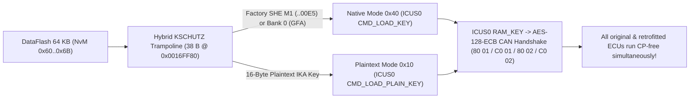

<div align="center">

# Continental VAG MQB Gateway J533 (`3Q0 907 530`)
### Renesas RH850/F1L — Component Protection (`KSCHUTZ`), Engineering Mode & `RSA-1024` / `SWaP` Toolkit

[-3776AB?style=for-the-badge&logo=python&logoColor=white)](#quick-start)
[](#important-selecting-the-mcu-in-your-programmer-64-kb-vs-32-kb)
[-00A88F?style=for-the-badge)](#interactive-windowing-interface-tui)
[](#disclaimer--terms-of-use)

[](https://vwhacking.antonperk.com)
[](https://www.drive2.ru/users/perkthefox/)
[](https://t.me/perkthefox)

**Made by PerkTheFox** • **Zero Dependencies (Pure Python 3)** • **[🇷🇺 Читать на русском (`README.md`)](README.md) | 🇬🇧 English**

</div>

---

## Disclaimer & Terms of Use

> [!CAUTION]
> **DISCLAIMER OF LIABILITY (`AS IS`):**  
> Use this toolkit **strictly at your own risk**! Modifying CAN Gateway (`J533`) firmware, `KSCHUTZ` cryptographic NvM records, or Flash Bootloader code can brick the ECU, corrupt security keys, or trigger Component Protection faults across the vehicle.  
> **If anything breaks, bricks, or goes wrong with your ECU or vehicle — the author (`PerkTheFox`) is NOT at fault and bears ZERO responsibility!**  
> Before writing anything back to the unit, **always save a complete, unmodified backup of every memory region: `CodeFlash.bin` (`1.5 MB`), `DataFlash.bin` (`64 KB`), `Uflash.bin` (`32 KB`), and external `95640` SPI EEPROM (`8 KB`)**.

> [!WARNING]
> **STRICTLY NOT FOR SALE:**  
> This utility is created as a free research and educational tool for the VAG enthusiast community. Selling this script, bundling it into commercial software packages/group-buys, or charging money for the tool itself is strictly prohibited. When sharing or building upon this research, please preserve author attribution: **[vwhacking.antonperk.com](https://vwhacking.antonperk.com)** • **[Drive2](https://www.drive2.ru/users/perkthefox/)** • **[Telegram](https://t.me/perkthefox)**.

---

## Overview

`conti_cp_tool.py` is a self-contained, zero-dependency **Python 3** toolkit (`stdlib` only — no `pip` packages required) for inspecting dumps, performing offline **Component Protection (`KSCHUTZ` `#MoLaLi`)** binding, unlocking **Engineering Mode**, and managing **`RSA-1024 (e = 3)` / `SWaP` (`FeC` / `FSC`)** cryptography on **Continental VAG MQB J533 Gateways** (`3Q0 907 530 AC / AG / AJ / AL / AM / AN / AP / AQ / AR` and compatible **Renesas RH850/F1L** units).

```text
 ◆ CONTINENTAL J533 • RH850/F1L TOOLKIT          Made by PerkTheFox • vwhacking.antonperk.com • [EN] • NOT FOR SALE   
  ╭── MAIN MENU • CONTINENTAL J533 (3Q0 907 530) ───────────────────────────────────────────────────────── [1/9] ──╮
  │ Auto-discovered nearby dumps: CodeFlash = 1 • DataFlash = 1 • Uflash = 1   |   Language [L]: English (EN)      │
  ├────────────────────────────────────────────────────────────────────────────────────────────────────────────────┤
  │  ▸ [1] ★ TURNKEY CP MODULE BINDING (CodeFlash + DataFlash IKA keys)                                Recommended │
  │    [2]   ENGINEERING MODE ('Engineering Unit': RSA-Free OBD flash + live CCP/RAM)                 OBD UDS + C… │
  │    [3]   RSA-1024 KEYS & SWaP / FeC / ODX SIGNING (custom FSC for FPA Driving Mode, etc.)         RSA-1024     │
  │    [4]   INSPECT DUMPS (analyze CodeFlash, Uflash & 12 CP banks + SWaP table)                     Read-only    │
  │    [5]   INDIVIDUAL SERVICE ACTIONS (patch Cflash only, write or clear a CP bank)                 Manual mode  │
  │    [6]   STEP-BY-STEP GUIDE & 12 CP BANKS REFERENCE (where to read IKA, CAN IDs, Dflash map)      Docs         │
  │    [A]   About Author, Links & Disclaimer (PerkTheFox)                                            vwhacking.a… │
  │    [L]   Switch Interface Language: Русский ⇄ English                                             EN -> RU     │
  │    [0]   Exit Program                                                                                          │
  ├────────────────────────────────────────────────────────────────────────────────────────────────────────────────┤
  │ Prepares both files ready for your programmer: patched CodeFlash (with valid CRC-16) and DataFlash with        │
  │ plaintext IKA keys for chosen ECUs (5F MIB2, 17 Cluster, 13 ACC, 47 Sound, A5 Camera, etc.).                   │
  ╰────────────────────────────────────────────────────────────────────────────────────────────────────────────────╯
 ↑↓ Navigate │ Enter Open │ 1-6 Quick Launch │ L Language (RU/EN) │ A Author │ 0/Q Quit                              
```

---

## Features

### 1. Offline Component Protection (`KSCHUTZ` `#MoLaLi`) Binding
- **Full support for all 12 Slave CP Banks (`#1..#12`)** stored in Gateway `19`: `17` Instrument Cluster, `09` BCM, `13` ACC Radar, `15` Airbag, `47` Sound Amplifier, `57` TV Tuner, `5F` Infotainment (`MIB1` / `MIB2` / `MIB3`), `3C` / `CF` Side Assist Radars, `3D` Special Function, `A5` Front Camera, and `8C` Hybrid/EV Battery.
- **Safe 38-Byte Hybrid Auto-Detect Trampoline (`CodeFlash`)**: automatically locates the `KSCHUTZ` key-load callback by machine-code signature across firmware versions and installs a compact `RH850` trampoline:
  - all **existing factory ECUs** in the car with `SHE M1..M3` encrypted key blocks continue running natively through the hardware **`ICUS0`** HSM (`CMD_LOAD_KEY`, code `0x40`);
  - all **retrofitted or replacement used ECUs** simultaneously authenticate using 16-byte plaintext **`IKA`** keys (`CMD_LOAD_PLAIN_KEY`, code `0x10`) written into `DataFlash.bin`!
- **External `ST M95640` SPI EEPROM Learned-Bank Bitmask Bypass (`--bypass-eeprom-mask`)**: allows retrofitting new modules into previously empty (`FF..FF`) CP banks **without desoldering or editing the external `95640` EEPROM chip**.
- **Automatic `Application CRC-16/MODBUS` Recalculation** (`reflected poly 0xA001` at `0x0000C21C`, keeping block count `1` at `0x0000C21E`) so Flash Bootloader check `FF01` passes natively.



### 2. Engineering Mode ("Engineering Unit" for OBD-II Flashing & Live RAM/Flash)
- **`Uflash.bin` Bootloader Patch (`32 KB` @ `0x0100342A`) -> `RSA-Free Engineering FBL`**: after a one-time bench write of `Uflash.bin`, the gateway accepts **any custom `.odx` firmware update directly over the OBD-II port** (`ODIS-E` / `VCP`, routine `31 01 02 02`) without requiring a factory VAG `RSA-1024` signature.
- **Full `ASAM CCP v2.1` CAN Access (`0x1BFC8600` -> `0x1BFC8601`)**: unlocks the system engineering feature gate (`Feature 0x80 / 0x81 / 0x83`) and removes the `CCP` memory address blacklist, enabling live read access to `CodeFlash` / `DataFlash` / `Uflash` / `RAM` and live `RAM` writes on a running vehicle (including instant in-RAM activation of all 13 `SWaP` features by writing `0xFFFA` to `0xFEDE1394`).
- **Continental Factory `CAN RAM-Loader` Unlock (`0x07FC80FE` -> `0x6F0 / 0x6F1`)**: bypasses the one-time `OTP 0x0000A167` lock so custom `RH850` payloads can be uploaded and executed in RAM (`0xFEDE9000`).

### 3. `RSA-1024 (e = 3)` Cryptography & Custom `SWaP / FeC` (`FSC`) Certificates
- **Built-in Pure-Python `RSA-1024 (e = 3)` Keypair Generator**: Miller–Rabin primality testing using `secrets`, exporting `.json` plus standard OpenSSL `.private.pem` (`PKCS#1`) and `.public.pem` (`SPKI`) files.
- **Synchronized `SWaP RSA` & `FBL RSA` Public Modulus Replacement**: patches the public modulus in `CodeFlash.bin` AND simultaneously updates the mirrored `SWaP` NvM cache in `DataFlash.bin` (`NvM 0x7C @ 0xDB04`) with a fresh `IEEE CRC-32 @ 0xDCE4` while preserving the gateway's original 5-byte hardware **`VCRN`** (`DID 0x3C03 @ 0xDC0C`).
- **Custom 171-Byte (`0xAB`) `VAG SWaP FSC` Builder & Signer (`sign-fsc`)**: computes pure-Python `RIPEMD-160` + `PKCS#1 v1.5` signatures to generate valid activation certificates (`0x10000100` Driving Profile Selection `FPA / Mode`, `0x10000300` Driver Alert `MKE`, `0x10001800` `MKB`, etc.) ready for standard OBD-II upload via `UDS 0x2E 0xDE01`.
- **Custom `.odx` Firmware Block Signer (`sign-odx`)**: generates 128-byte `SHA-1 + PKCS#1 v1.5` (`<FW-SIGNATURE>`) signatures matching your custom `FBL RSA` key (`Sector 5 @ 0x0000A2F7`).

### 4. Full-Screen Interactive Windowing TUI + Scriptable CLI (`EN` / `RU`)
- `ncurses`-style alternate-screen console windows with zero terminal scroll clutter, live window resize adaptation (`SIGWINCH`), responsive 3-tier `DataFlash` tables that never break borders even in narrow IDE consoles, built-in folder browser, Finder / Explorer drag-and-drop, and one-key clipboard copy.

---

## Important: Selecting the MCU in Your Programmer (`64 KB` vs `32 KB`)

> [!IMPORTANT]
> Commercial programmer menus (`VVDI Multi-Prog`, `CG100X`, etc.) historically label the `3Q0 907 530` gateway profile as **`Continental R7F7010343`**, even though official Renesas `RH850/F1L` specifications give `R7F7010343AFP` only **`32 KB` of Data Flash**. Disassembly of the gateway firmware proves the actual silicon inside `3Q0 907 530` belongs to the higher-tier **`R7F7010543AFP` / `R7F7010563AFP`** sub-series with **`64 KB` physical Data Flash (`65,536` bytes)** + hardware `ICU-S` (`R_FDL_Init` hardcodes `fdlPoolSize = 0x0400 = 1024 × 64 B`).
>
> **Bench Reading Rule:**
> - Always use your programmer's dedicated **`3Q0 907 530` / `MQB Gateway Continental`** ECU preset (which reads the full `64 KB`), **OR** if selecting manually by MCU part number, choose **`R7F7010543` / `R7F7010563` (`64 KB DataFlash`)**.
> - **NEVER manually select a `32 KB` `R7F7010343` chip profile!** All 12 CP banks, Master Key `GFA`, and `SWaP / FeC` certificates live in the upper half of `DataFlash` (`0xC000..0xF0BF`) — a `32 KB` read truncates them completely (and the tool will immediately reject an incomplete dump).

---

## Quick Start

No external libraries are required — only standard **Python 3.9+** on **macOS**, **Linux**, or **Windows**:

```bash
git clone <REPOSITORY_URL>
cd <REPOSITORY_FOLDER>

# Launch full-screen interactive TUI (with language selector, or pass -l en directly):
python3 conti_cp_tool.py -l en
```

Place your bench dumps (`CodeFlash.bin` / `Cflash.bin`, `DataFlash.bin` / `Dflash.bin`, and optional `Uflash.bin`) next to the script or inside any subfolder — or simply **drag & drop a file from Finder / File Explorer directly onto the TUI file picker window**.

---

## Interactive Windowing Interface (TUI)

| Key | Action |
| :--- | :--- |
| `↑` / `↓`, `PgUp` / `PgDn`, `Home` / `End` | Navigate menus, CP bank lists, folder browser, and scroll reports |
| `Enter` *(or digits `1`–`9`)* | Open highlighted item / confirm selection |
| `Space` *(`A` — select all, `N` — clear)* | Toggle `[✓]` checkboxes to bind or clear multiple CP banks at once |
| `Tab` / `←` `→` | Switch tabs inside the Dump Inspector and Reference Guide windows |
| `B` | Open interactive Folder Browser (in file picker) / Full RAW HEX CP Bank Cards (in inspector) |
| `F2` or `Ctrl+G` | Instantly generate a cryptographically random 16-byte `IKA` key |
| `C` | Copy HEX key / `VCRN` / command to OS clipboard (`pbcopy` / `clip` / `wl-copy`) |
| `L` | Toggle interface language **`English ⇄ Русский`** live in any open window |
| `Esc` | Go back one step / close active modal window |
| `0` or `Q` | Exit cleanly and restore the original terminal screen |

> [!TIP]
> Need classic line-by-line terminal prompts instead of full-screen TUI windows (e.g., for terminal logging or piped input)? Pass `--classic-ui`:  
> `python3 conti_cp_tool.py -l en --classic-ui`

---

## Complete Reference of All 12 CP Banks (`DataFlash 64 KB`)

Every CP bank is stored in `DataFlash.bin` in **two mirrored copies** (primary + `+0x80` mirror), framed with a `0x55555555` header word and an `IEEE CRC-32` (`zlib.crc32`, LE32) checksum:

| Bank | VAG ECU | MQB Module Description | `DataFlash` (Pri / Mir) | `NvM ID` | `95640` Mask | UDS Req / Resp | CP CAN TX / RX |
| :---: | :---: | :--- | :---: | :---: | :---: | :---: | :---: |
| **`#1`** | **`17`** | Instrument Cluster / Immobilizer (`J285`, AID / Virtual Cockpit) | `0xC000` / `0xC080` | `0x60` | `0x0001` (bit 0) | `714 / 77E` | `17FC0114 / 17FE0114` |
| **`#2`** | **`09`** | Central Electrics `BCM` (`J519`) | `0xC100` / `0xC180` | `0x61` | `0x0002` (bit 1) | `70E / 778` | `17FC010E / 17FE010E` |
| **`#3`** | **`13`** | Adaptive Cruise Control / `ACC` Radar (`J428`) | `0xC200` / `0xC280` | `0x62` | `0x0004` (bit 2) | `757 / 7C1` | `17FC0157 / 17FE0157` |
| **`#4`** | **`15`** | Airbag Control Module (`J234`) | `0xC300` / `0xC380` | `0x63` | `0x0008` (bit 3) | `715 / 77F` | `17FC0115 / 17FE0115` |
| **`#5`** | **`47`** | Digital Sound System / Amplifier (`J525`, Canton / Dynaudio / Fender) | `0xC400` / `0xC480` | `0x64` | `0x0010` (bit 4) | `76F / 7D9` | `17FC016F / 17FE016F` |
| **`#6`** | **`57`** | TV Tuner (`R78`) | `0xC500` / `0xC580` | `0x65` | `0x0020` (bit 5) | `76D / 7D7` | `17FC016D / 17FE016D` |
| **`#7`** | **`5F`** | Infotainment Head Unit `MIB1 / MIB2 / MIB3` (`J794`) | `0xC600` / `0xC680` | `0x66` | `0x0040` (bit 6) | `773 / 7DD` | `17FC0173 / 17FE0173` |
| **`#8`** | **`3C`** | Lane Change Assist `Side Assist 1` Master (`J769` / `J1086`) | `0xC700` / `0xC780` | `0x67` | `0x0080` (bit 7) | `74E / 7B8` | `17FC014E / 17FE014E` |
| **`#9`** | **`CF`** | Lane Change Assist `Side Assist 2` Slave (`J770` / `J1087`) | `0xC800` / `0xC880` | `0x68` | `0x0100` (bit 8) | `78A / 7F4` | `17FC018A / 17FE018A` |
| **`#10`** | **`3D`** | Special Function / Special Purpose Vehicle (`J608`) | `0xC900` / `0xC980` | `0x69` | `0x0200` (bit 9) | `72C / 796` | `17FC012C / 17FE012C` |
| **`#11`** | **`A5`** | Front Driver Assistance Camera `MFK` (`R242`, `3Q0` / `2Q0`) | `0xCA00` / `0xCA80` | `0x6A` | `0x0400` (bit 10) | `74F / 7B9` | `17FC014F / 17FE014F` |
| **`#12`** | **`8C`** | Hybrid / EV High-Voltage Battery Manager (`J840`, GTE / e-Golf) | `0xCB00` / `0xCB80` | `0x6B` | `0x0800` (bit 11) | `77B / 7E5` | `17FC017B / 17FE017B` |
| **`Mst`** | **`19`** | Gateway Own Application Master Key `GFA` (`Master`, `key_type=3`) | `0xDA00` / `0xDA80` | `0x7B` | — | `710 / 77A` | *Keep untouched!* |

---

## Complete `DataFlash.bin` (`64 KB`) Memory Map

| Offset Range in `Dflash.bin` | `NvM ID` | Contents & Purpose |
| :---: | :---: | :--- |
| `0x0000 .. 0x007F` | ZDC Header | Dataset identifier & version passport (`DID F1A0` / `F1A1`) |
| `0x0080 .. 0x303F` | 7 ZDC Blocks | Vehicle parameterization (`Base`, `MKE`, `FPA Driving Profile`, `Aux`, `Main GW`, `Cal`, `BEM` / Start-Stop), verified solely by `IEEE CRC-32` |
| `0x3040 .. 0xBFFF` | FDL Pool | Unallocated `Data Flash` pool (`0xFF`) |
| `0xC000 .. 0xCBFF` | `0x60 .. 0x6B` | **12 Slave Component Protection (`CP`) Banks (`#1..#12`)**, `2 × 128` bytes per bank |
| `0xCC00 .. 0xD8FF` | `0x6C .. 0x78` | Reserved `NvM` key slots |
| `0xD900 .. 0xD9FF` | `0x79 .. 0x7A` | Hardware `ICUS0` `AES-CMAC` authentication tags for `95640` block `0x5E` |
| `0xDA00 .. 0xDAFF` | `0x7B` | **Gateway `19` Own Application Master Key (`GFA`, Bank 0)** |
| `0xDB00 .. 0xDCFF` | `0x7C` | Cached **`SWaP RSA-1024`** public modulus (`0xDB04`) + 5-byte **`VCRN`** (`0xDC0C`) + `CRC-32` (`0xDCE4`) |
| `0xDD00 .. 0xE83F` | `0x7D .. 0x8B` | **15 `SWaP FSC` Activation Certificate Slots** (store donor plaintext `VIN` at `+0x10`) |
| `0xE840 .. 0xF0BF` | `0x8C .. 0x94` | `SWaP` counters & `NvM` layout version word (`NvM 0x00..0x5F` reside in external `8 KB` `ST M95640` SPI EEPROM) |

---

## Command-Line Interface (CLI) Examples

Every feature available in the interactive TUI can also be scripted via CLI (`-l en` or `CONTI_CP_LANG=en`):

```bash
# 1. Full read-only inspection of CodeFlash + DataFlash + Uflash dumps
python3 conti_cp_tool.py -l en inspect \
  --cflash CodeFlash.bin \
  --dflash DataFlash.bin \
  --uflash Uflash.bin

# 2. Offline binding of a retrofitted or used ECU (hybrid CodeFlash patch + plaintext IKA in DataFlash)
#    (e.g., retrofitting 47 Canton Sound Amplifier into empty Bank #5 with 95640 mask bypass)
python3 conti_cp_tool.py -l en patch-cflash \
  -i CodeFlash.bin -o CodeFlash.patched.bin \
  --bypass-eeprom-mask

python3 conti_cp_tool.py -l en set-cp-key \
  -i DataFlash.bin -o DataFlash.patched.bin \
  --bank 47 --key 00112233445566778899AABBCCDDEEFF

# 3. Convert gateway into an 'Engineering Unit' (RSA-Free OBD .odx flashing + full live CCP)
python3 conti_cp_tool.py -l en patch-engineering \
  --cflash-in CodeFlash.bin   --cflash-out CodeFlash.eng.bin \
  --uflash-in Uflash.bin      --uflash-out Uflash.eng.bin

# 4. Generate a custom RSA-1024 (e=3) keypair, embed SWaP modulus & sign an FPA Driving Mode FSC (0x10000100)
python3 conti_cp_tool.py -l en set-rsa-key \
  --generate-key my_swap_rsa1024.json \
  --cflash-in CodeFlash.bin   --cflash-out CodeFlash.swap.bin \
  --dflash-in DataFlash.bin   --dflash-out DataFlash.swap.bin \
  --target swap

python3 conti_cp_tool.py -l en sign-fsc \
  --key my_swap_rsa1024.json \
  --dflash DataFlash.swap.bin \
  --fec 10000100 \
  -o fpa_10000100.fsc

# 5. Print the 12 CP banks reference table and step-by-step guide
python3 conti_cp_tool.py -l en banks
python3 conti_cp_tool.py -l en guide
```

---

## Technical Notes (Verified via `RH850` Disassembly)

<details>
<summary><b>1. What is the Gateway Application Master Key <code>GFA</code> (Bank 0, <code>0xDA00</code>) and why must you never touch it on a live car?</b></summary>

<br>

- `GFA` (`NvM 0x7B @ 0xDA00/0xDA80`, `key_type = 3`) is **NOT a shared vehicle CP key**, and individual slave `IKA` keys (`Banks 1..12`) cannot be mathematically derived from it (each `IKA` is an independent 128-bit random key generated by FAZIT).
- In firmware, `GFA` tracks Gateway `19`'s own adaptation status (`0xFEDFC988` bit 0) and verifies `AES-CMAC` signatures on online `ODIS` management containers (`UDS 0x2E 02C5`). If `0xDA00` is erased or corrupted, the gateway forces a random one-time dummy key (`key_type = 8`) for **all 12 slave banks**, immediately dropping every CP-protected module in the car into `Component Protection Active`!
- That is why the hybrid trampoline deliberately keeps `Bank 0` on native hardware `SHE` (`0x40`), preserving healthy Master status and full `ODIS Online` compatibility.

</details>

<details>
<summary><b>2. Why can't you simply write all zeros (<code>00..00</code>) into Gateway key slots to bypass Component Protection?</b></summary>

<br>

- Functional CP restrictions (audio mute in `5F` MIB2, radar disable in `13` ACC, cluster warning in `17`) are enforced **inside each individual Slave ECU**, not inside Gateway `19`!
- During the 4-frame CAN handshake (`80 01 <R_GW>` -> `C0 01 <R_SLAVE>` -> `80 02 <Proof_GW>` -> `C0 02 <Proof_SLAVE>`), the Slave ECU independently computes `AES-128-ECB(IKA_Slave, R_GW || R_SLAVE)` and verifies `<Proof_GW>`. If the Gateway uses `00..00` while the Slave holds its real `IKA`, the proofs mismatch and the Slave ECU locks itself (`U110100`).
- `00..00` (or any custom 16-byte random key generated via `F2`) works **only if the exact same 16 bytes are written into both sides** — the Gateway `DataFlash` bank AND the Slave ECU's `IKA` slot. In practice, reading the Slave's existing `IKA` (e.g., from `5F` MIB2 EEPROM) and writing it into the Gateway bank avoids modifying the Slave ECU altogether.

</details>

---

<div align="center">

**Made by PerkTheFox**  
[vwhacking.antonperk.com](https://vwhacking.antonperk.com) • [Drive2: perkthefox](https://www.drive2.ru/users/perkthefox/) • [Telegram: @perkthefox](https://t.me/perkthefox)  
*Free for the VAG research community — Not for commercial sale.*

</div>
