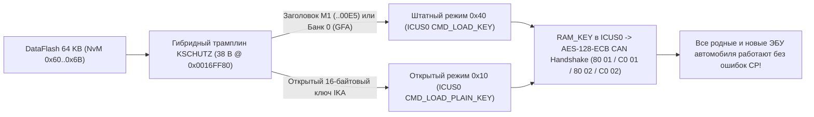

<div align="center">

# Continental VAG MQB Gateway J533 (`3Q0 907 530`)
### Renesas RH850/F1L — Component Protection (`KSCHUTZ`), Engineering Mode & `RSA-1024` / `SWaP` Toolkit

[-3776AB?style=for-the-badge&logo=python&logoColor=white)](#быстрый-старт)
[](#важно-выбор-микроконтроллера-в-программаторе-64-кб-против-32-кб)
[-00A88F?style=for-the-badge)](#интерактивный-оконный-интерфейс-tui)
[](#дисклеймер-и-условия-использования)

[](https://vwhacking.antonperk.com)
[](https://www.drive2.ru/users/perkthefox/)
[](https://t.me/perkthefox)

**Made by PerkTheFox** • **Zero Dependencies (Pure Python 3)** • **🇷🇺 Русский | [🇬🇧 Read in English (`README.en.md`)](README.en.md)**

</div>

---

## Дисклеймер и условия использования

> [!CAUTION]
> **ОТКАЗ ОТ ОТВЕТСТВЕННОСТИ (`AS IS`):**  
> Вы используете этот инструмент **исключительно на свой страх и риск**! Любое вмешательство в прошивку межсетевого шлюза (`J533`), криптохранилище `KSCHUTZ` или загрузчик может вывести ЭБУ из строя («усыпить» блок) или вызвать ошибки защиты компонентов в автомобиле.  
> **Если что-то сломается, уснёт или пойдёт не так — автор (`PerkTheFox`) НЕ ВИНОВАТ и не несёт никакой ответственности!**  
> Перед любыми действиями **всегда сохраняйте полный неизменённый бэкап всех областей памяти: `CodeFlash.bin` (`1.5 МБ`), `DataFlash.bin` (`64 КБ`), `Uflash.bin` (`32 КБ`) и внешней `95640` SPI EEPROM (`8 КБ`)**.

> [!WARNING]
> **СТРОГО НЕ ДЛЯ ПРОДАЖИ (`STRICTLY NOT FOR SALE`):**  
> Утилита создана для исследовательских и некоммерческих целей сообщества. Запрещается продавать этот скрипт, включать его в платные сборки/складчины или брать деньги за сам инструмент. При публикации материалов или доработок сохраняйте ссылки на автора: **[vwhacking.antonperk.com](https://vwhacking.antonperk.com)** • **[Drive2](https://www.drive2.ru/users/perkthefox/)** • **[Telegram](https://t.me/perkthefox)**.

---

## О проекте

`conti_cp_tool.py` — автономный комбайн на чистом **Python 3** (без единой сторонней библиотеки `pip`) для анализа, офлайн-привязки защиты компонентов (**Component Protection / KSCHUTZ `#MoLaLi`**), инженерной разблокировки и работы с криптографией **`RSA-1024 (e = 3)` / `SWaP` (`FeC` / `FSC`)** на гейтвеях **Continental VAG MQB J533** (`3Q0 907 530 AC / AG / AJ / AL / AM / AN / AP / AQ / AR` и совместимых на платформе **Renesas RH850/F1L**).

```text
 ◆ CONTINENTAL J533 • RH850/F1L TOOLKIT          Made by PerkTheFox • vwhacking.antonperk.com • [RU] • НЕ ДЛЯ ПРОДАЖИ 
  ╭── ГЛАВНОЕ МЕНЮ • CONTINENTAL J533 (3Q0 907 530) ───────────────────────────────────────────────────── [1/9] ──╮
  │ Автопоиск дампов рядом: CodeFlash = 1 • DataFlash = 1 • Uflash = 1   |   Язык [L]: Русский (RU)              │
  ├───────────────────────────────────────────────────────────────────────────────────────────────────────────────┤
  │  ▸ [1] ★ ПРИВЯЗКА БЛОКОВ CP «ПОД КЛЮЧ» (CodeFlash + ключи IKA в DataFlash)                     Рекомендуется │
  │    [2]   ИНЖЕНЕРНЫЙ РЕЖИМ («Инженерный юнит»: прошивка по OBD без RSA + живой CCP/RAM)      OBD UDS + CCP    │
  │    [3]   КЛЮЧИ RSA-1024 И ПОДПИСЬ SWaP / FeC / ODX (свои FSC для FPA Driving Mode и др.)     RSA-1024 (e=3)  │
  │    [4]   ИНСПЕКЦИЯ ДАМПОВ (анализ CodeFlash, Uflash и таблицы 12 банков CP + SWaP)            Чтение без за… │
  │    [5]   ТОЧЕЧНЫЕ СЕРВИСНЫЕ ОПЕРАЦИИ (отдельно пропатчить Cflash, записать/очистить банк)    Ручной режим    │
  │    [6]   ИНСТРУКЦИЯ И СПРАВОЧНИК 12 БАНКОВ CP (где брать IKA, CAN ID и распиновка Dflash)    Справка         │
  │    [A]   Об авторе, ссылки и дисклеймер (PerkTheFox)                                         vwhacking.anto… │
  │    [L]   Переключить язык интерфейса: Русский ⇄ English                                      RU -> EN        │
  │    [0]   Выход из программы                                                                                  │
  ├───────────────────────────────────────────────────────────────────────────────────────────────────────────────┤
  │ Подготовит сразу оба файла для записи программатором: пропатченный CodeFlash (с верным CRC-16) и DataFlash    │
  │ с ключами IKA выбранных блоков (5F MIB2, 17 Приборка, 13 ACC, 47 Звук, A5 Камера и др.).                      │
  ╰───────────────────────────────────────────────────────────────────────────────────────────────────────────────╯
 ↑↓ Навигация │ Enter Открыть │ 1-6 Быстрый запуск │ L Язык (RU/EN) │ A Автор │ 0/Q Выход                            
```

---

## Что нужно знать ДО запуска (это НЕ «однокнопочная таблетка»!)

> [!IMPORTANT]
> **Этот скрипт — НЕ однокнопочное решение из серии «подключил OBD-шнурок и нажал Сделать красиво»!**  
> Утилита не общается с машиной по диагностическому кабелю, не снимает защиту чтения с закрытых процессоров программно и не угадывает чужие ключи по воздуху. Это **низкоуровневый инструмент для подготовки уже вычитанных бинарных дампов**, рассчитанный на тех, у кого есть нужное железо для работы на столе и понимание архитектуры `VAG MQB` / `KSCHUTZ`.

Для реальной работы со скриптом вам **обязательно потребуются две вещи**:

1. **Полный дамп с реального гейтвея `J533`, вычитанный на столе через `Voltage Glitch`:**
   - Микроконтроллер `Renesas RH850/F1L` (`R7F7010543` / `R7F7010563`) внутри серийного шлюза Continental `3Q0 907 530` с завода закрыт от чтения (`Security Lock`).
   - Просто скачать дилерский `.frf` / `.odx` недостаточно: в нём нет вашего индивидуального `DataFlash.bin` (`64 КБ` с родными `SHE`-ключами остальных блоков авто, мастер-ключом `GFA`, `VCRN` и `SWaP`), нет загрузчика `Uflash.bin` (`32 КБ`) и нет бут-сектора `0x00000000..0x0000C1FF`.
   - Гейтвей необходимо снять с автомобиля, подключить на столе к программатору с аппаратным **глитчингом по питанию (`Voltage Glitch` / `Fault Injection`)** (`VVDI Multi-Prog`, `CG100X`, `Orange-5 RH850 Glitch` и др.), вычитать `CodeFlash.bin` + `DataFlash.bin` (+ `Uflash.bin`), обработать скриптом и записать обратно на столе.
2. **Заранее известный 16-байтовый ключ `K3` (`IKA`) того блока, который вы собираетесь «привязывать»:**
   - Чтобы прописать в гейтвей Б/У или дооснащаемый блок (`5F` MIB2, `17` приборку, `13` радар ACC, `47` усилитель, `A5` камеру и т.д.), нужно **заранее знать открытый 16-байтовый ключ защиты компонентов `K3` (`IKA` — Individual Key Application)** именно этого конкретного блока (`32` HEX-символа).
   - **По шине CAN / UDS, через диагностику или в трафике `ODIS` ключ `K3` в чистом виде НИКОГДА не передаётся и не попадает в логи!** Сервер `FAZIT` / `ODIS Online` отдаёт ключи исключительно в зашифрованных контейнерах (`SHE M1..M3` / `AES`), которые раскрываются только внутри аппаратного криптомодуля ЭБУ, а в самом CAN-рукопожатии ходят лишь одноразовые случайные числа и `AES-128`-ответы от них.
   - **Взять ключ `K3` (`IKA`) можно ТОЛЬКО из дампа памяти самого привязываемого ведомого блока** — вычитав его `EEPROM` / `DataFlash` / `SPI NOR` / `eMMC` на столе или через внутренний доступ к процессору этого конкретного ЭБУ (либо, если у вас есть полный доступ на запись дампа ведомого блока, положив одинаковый 16-байтовый ключ сразу в оба дампа: и в ведомый блок, и в банк гейтвея).

---

## Возможности

### 1. Офлайн-привязка защиты компонентов (`Component Protection` / `KSCHUTZ`)
- **Все 12 ведомых банков CP (`#1..#12`)** на гейтвее `19`: приборка `17`, `BCM 09`, радар `ACC 13`, `Airbag 15`, усилитель `47`, ТВ-тюнер `57`, мультимедиа `5F` (`MIB1` / `MIB2` / `MIB3`), радары слепых зон `3C` / `CF`, спецмодуль `3D`, камера ассистентов `A5`, батарея гибрида/EV `8C`.
- **Безопасный гибридный авто-трамплин (`38` байт в `CodeFlash`)**: скрипт автоматически находит коллбэк `KSCHUTZ` по машинной сигнатуре в любой поддерживаемой версии ПО и ставит компактный `RH850`-трамплин:
  - все **родные блоки автомобиля** с заводскими криптоблоками `SHE M1..M3` продолжают штатно проверяться через аппаратный HSM **`ICUS0`** (`CMD_LOAD_KEY`, код `0x40`);
  - все **дооснащаемые или меняемые Б/У блоки** одновременно работают на открытых 16-байтовых ключах **`IKA`** (`CMD_LOAD_PLAIN_KEY`, код `0x10`), записанных в `DataFlash.bin`!
- **Обход маски обученных банков во внешней `ST M95640` SPI EEPROM (`--bypass-eeprom-mask`)**: позволяет дооснащать автомобиль новыми блоками в ранее пустые (`FF..FF`) банки гейтвея **без выпаивания и правки микросхемы `95640`**.
- **Автоматический пересчёт `Application CRC-16/MODBUS`** (`poly 0xA001` по адресу `0x0000C21C`) — штатная проверка бутлодера `FF01` проходит как на заводском стоке.



### 2. Инженерный режим («Инженерный юнит» для работы по OBD-II)
- **Патч бутлодера `Uflash.bin` (`32 КБ` @ `0x0100342A`) -> `RSA-Free Engineering FBL`**: после однократной записи `Uflash.bin` программатором на столе гейтвей начинает принимать **любые кастомные `.odx` прошивки через обычный OBD-разъём** (`ODIS-E` / `VCP`, рутина `31 01 02 02`) без заводской подписи `RSA-1024`.
- **Полный доступ `ASAM CCP v2.1` по CAN (`0x1BFC8600` -> `0x1BFC8601`)**: разблокирует системный гейт `Feature 0x80 / 0x81 / 0x83` и снимает чёрный список адресов `CCP`, открывая живое чтение `CodeFlash` / `DataFlash` / `Uflash` / `RAM` и запись `RAM` на работающем блоке (включая мгновенное включение всех 13 функций `SWaP` в ОЗУ через `0xFEDE1394 = 0xFFFA`).
- **Активация заводского `CAN RAM-Loader` (`0x07FC80FE` -> `0x6F0 / 0x6F1`)**: снимает проверку одноразового байта `OTP 0x0000A167` для исполнения собственного `RH850`-кода из ОЗУ (`0xFEDE9000`).

### 3. Криптография `RSA-1024 (e = 3)` и собственные сертификаты `SWaP / FeC` (`FSC`)
- **Встроенный генератор ключевых пар `RSA-1024 (e = 3)`**: тест простоты Миллера — Рабина в чистом Python, экспорт в `.json` + стандартные ключи OpenSSL `.private.pem` (`PKCS#1`) и `.public.pem` (`SPKI`).
- **Синхронная подмена публичного модуля `SWaP RSA` и/или `FBL RSA`**: обновляет модуль в `CodeFlash.bin` и одновременно в зеркальном кэше `DataFlash.bin` (`NvM 0x7C @ 0xDB04`) с пересчётом `IEEE CRC-32 @ 0xDCE4` и полным сохранением родного аппаратного `VCRN` (`DID 0x3C03 @ 0xDC0C`).
- **Генератор и подписчик 171-байтовых (`0xAB`) сертификатов `VAG SWaP FSC`**: считает `RIPEMD-160` + `PKCS#1 v1.5` на чистом Python для штатной заливки кодов активации (`0x10000100` Выбор профиля движения `FPA / Mode`, `0x10000300` Распознавание усталости `MKE`, `0x10001800` `Snow` и др.) по OBD через `UDS 0x2E 0x3C01` + `31 01 C0 01`.
- **Подпись `.odx` прошивок (`sign-odx`)**: формирует 128-байтную подпись `SHA-1 + PKCS#1 v1.5` (`<FW-SIGNATURE>`) под кастомный ключ `FBL RSA` (`Sector 5 @ 0x0000A2F7`).

### 4. Полноэкранный интерактивный TUI + CLI (`RU` / `EN`)
- Оконный интерфейс без «простыней» в консоли, живая адаптация под узкие и широкие окна терминала (`SIGWINCH`), встроенный браузер папок, предпросмотр дампов при наведении курсора и копирование ключей в буфер обмена в одно нажатие.

---

## Важно: выбор микроконтроллера в программаторе (`64 КБ` против `32 КБ`)

> [!IMPORTANT]
> В меню многих программаторов (`VVDI Multi-Prog`, `CG100X` и др.) профиль для гейтвея `3Q0 907 530` исторически подписан как **`Continental R7F7010343`**, хотя по официальному даташиту Renesas у чипа `R7F7010343AFP` всего **`32 КБ` Data Flash**, тогда как реальный кристалл внутри гейтвея относится к старшей подсерии **`R7F7010543AFP` / `R7F7010563AFP`** и физически имеет **`64 КБ` Data Flash (`65 536` байт)** + криптомодуль `ICU-S` (дескриптор `R_FDL_Init` в прошивке жёстко задаёт `fdlPoolSize = 0x0400 = 1024 × 64 Б`).
>
> **Практическое правило при чтении на столе:**
> - Всегда выбирайте готовый пресет ЭБУ **`3Q0 907 530` / `MQB Gateway Continental`** (он вычитывает полные `64 КБ`), **либо** при ручном выборе по маркировке чипа выбирайте **`R7F7010543` / `R7F7010563` (`64 KB DataFlash`)**.
> - **Никогда не выбирайте вручную профиль `R7F7010343` на `32 КБ`!** Все 12 банков CP, мастер-ключ `GFA` и сертификаты `SWaP / FeC` лежат в верхней половине `DataFlash` (`0xC000..0xF0BF`) — 32-килобайтный дамп их попросту обрежет, и скрипт сразу предупредит об ошибке размера.

---

## Быстрый старт

Никаких сторонних библиотек устанавливать не нужно — достаточно стандартного **Python 3.9+** на **macOS**, **Linux** или **Windows**:

```bash
git clone <URL_РЕПОЗИТОРИЯ>
cd <ПАПКА_РЕПОЗИТОРИЯ>
python3 conti_cp_tool.py
```

Положите считанные дампы (`CodeFlash.bin` / `Cflash.bin`, `DataFlash.bin` / `Dflash.bin`, опционально `Uflash.bin`) рядом со скриптом или в любую подпапку, либо просто **перетащите файл мышкой из Finder / Проводника прямо в окно программы**.

---

## Интерактивный оконный интерфейс (TUI)

| Клавиша | Действие |
| :--- | :--- |
| `↑` / `↓`, `PgUp` / `PgDn`, `Home` / `End` | Навигация по меню, списку банков, браузеру папок и прокрутка отчётов |
| `Enter` *(или цифры `1`–`9`)* | Открыть выбранный раздел / подтвердить действие |
| `Space` *(`A` — все, `N` — сбросить)* | Поставить / снять галочку `[✓]` при выборе сразу нескольких банков CP |
| `Tab` / `←` `→` | Переключение вкладок в инспекторе дампов и справочнике |
| `B` | Открыть встроенный браузер папок (при выборе файла) / Карточки банков с RAW HEX (в инспекторе) |
| `F2` или `Ctrl+G` | Мгновенно сгенерировать криптостойкий случайный 16-байтовый ключ `IKA` |
| `C` | Скопировать HEX-ключ / `VCRN` / команду в системный буфер обмена (`pbcopy` / `clip` / `wl-copy`) |
| `L` | Мгновенно переключить язык интерфейса **`Русский ⇄ English`** прямо в текущем окне |
| `Esc` | Вернуться на шаг назад / закрыть модальное окно |
| `0` или `Q` | Выход из программы с чистым восстановлением консоли |

> [!TIP]
> Если требуется классический построчный текстовый вывод (например, при работе через нестандартную консоль или для сохранения лога), запустите скрипт с флагом `--classic-ui`:  
> `python3 conti_cp_tool.py --classic-ui`

---

## Справочник всех 12 банков CP (`DataFlash 64 КБ`)

Каждый банк хранится в `DataFlash.bin` сразу в **двух зеркальных копиях** (основной + резервной через `+0x80`), обрамлённых заголовком `0x55555555` и контрольной суммой `IEEE CRC-32` (`zlib.crc32`, LE32):

| Банк | ЭБУ VAG | Назначение блока (MQB) | `DataFlash` (осн. / копия) | `NvM ID` | Маска `95640` | UDS Req / Resp | CP CAN TX / RX |
| :---: | :---: | :--- | :---: | :---: | :---: | :---: | :---: |
| **`#1`** | **`17`** | Приборная панель / Иммо (`J285`, AID / Virtual Cockpit) | `0xC000` / `0xC080` | `0x60` | `0x0001` (бит 0) | `714 / 77E` | `17FC0114 / 17FE0114` |
| **`#2`** | **`09`** | Блок бортовой сети `BCM` (`J519`) | `0xC100` / `0xC180` | `0x61` | `0x0002` (бит 1) | `70E / 778` | `17FC010E / 17FE010E` |
| **`#3`** | **`13`** | Адаптивный круиз-контроль / радар `ACC` (`J428`) | `0xC200` / `0xC280` | `0x62` | `0x0004` (бит 2) | `757 / 7C1` | `17FC0157 / 17FE0157` |
| **`#4`** | **`15`** | Подушки безопасности `Airbag` (`J234`) | `0xC300` / `0xC380` | `0x63` | `0x0008` (бит 3) | `715 / 77F` | `17FC0115 / 17FE0115` |
| **`#5`** | **`47`** | Акустическая система / усилитель (`J525`, Canton / Dynaudio / Fender) | `0xC400` / `0xC480` | `0x64` | `0x0010` (бит 4) | `76F / 7D9` | `17FC016F / 17FE016F` |
| **`#6`** | **`57`** | ТВ-тюнер (`R78`) | `0xC500` / `0xC580` | `0x65` | `0x0020` (бит 5) | `76D / 7D7` | `17FC016D / 17FE016D` |
| **`#7`** | **`5F`** | Мультимедиа / ГУ `MIB1 / MIB2 / MIB3` (`J794`) | `0xC600` / `0xC680` | `0x66` | `0x0040` (бит 6) | `773 / 7DD` | `17FC0173 / 17FE0173` |
| **`#8`** | **`3C`** | Ассистент смены полосы `Side Assist 1` Master (`J769` / `J1086`) | `0xC700` / `0xC780` | `0x67` | `0x0080` (бит 7) | `74E / 7B8` | `17FC014E / 17FE014E` |
| **`#9`** | **`CF`** | Ассистент смены полосы `Side Assist 2` Slave (`J770` / `J1087`) | `0xC800` / `0xC880` | `0x68` | `0x0100` (бит 8) | `78A / 7F4` | `17FC018A / 17FE018A` |
| **`#10`** | **`3D`** | Спецфункции / спецтранспорт (`J608`) | `0xC900` / `0xC980` | `0x69` | `0x0200` (бит 9) | `72C / 796` | `17FC012C / 17FE012C` |
| **`#11`** | **`A5`** | Передняя камера ассистентов `MFK` (`R242`, `3Q0` / `2Q0`) | `0xCA00` / `0xCA80` | `0x6A` | `0x0400` (бит 10) | `74F / 7B9` | `17FC014F / 17FE014F` |
| **`#12`** | **`8C`** | Управление ВВ-батареей гибрида / EV (`J840`, GTE / e-Golf) | `0xCB00` / `0xCB80` | `0x6B` | `0x0800` (бит 11) | `77B / 7E5` | `17FC017B / 17FE017B` |
| **`Mst`** | **`19`** | Собственный мастер-ключ шлюза `GFA` (`Master`, `key_type=3`) | `0xDA00` / `0xDA80` | `0x7B` | — | `710 / 77A` | *Не трогать на авто!* |

---

## Полная карта памяти `DataFlash.bin` (`64 КБ`)

| Диапазон в `Dflash.bin` | `NvM ID` | Содержимое и назначение |
| :---: | :---: | :--- |
| `0x0000 .. 0x007F` | Паспорт ZDC | Идентификатор и версия залитого набора параметрии (`DID F1A0` / `F1A1`) |
| `0x0080 .. 0x303F` | 7 блоков ZDC | Параметрия (`Base`, `MKE`, `FPA Driving Profile`, `Aux`, `Main GW`, `Cal`, `BEM` / Start-Stop), проверка только `IEEE CRC-32` |
| `0x3040 .. 0xBFFF` | Пул FDL | Свободный резерв `Data Flash` (`0xFF`) |
| `0xC000 .. 0xCBFF` | `0x60 .. 0x6B` | **12 ведомых банков защиты компонентов `CP` (`#1..#12`)**, по `2 × 128` байт на банк |
| `0xCC00 .. 0xD8FF` | `0x6C .. 0x78` | Резерв будущих слотов `NvM` |
| `0xD900 .. 0xD9FF` | `0x79 .. 0x7A` | Аппаратные `AES-CMAC` теги `ICUS0` для защиты списка `0x5E` в `95640` |
| `0xDA00 .. 0xDAFF` | `0x7B` | **Собственный прикладной мастер-ключ гейтвея `19` (`GFA`, Банк 0)** |
| `0xDB00 .. 0xDCFF` | `0x7C` | Кэш публичного модуля **`SWaP RSA-1024`** (`0xDB04`) + 5-байтовый **`VCRN`** (`0xDC0C`) + `CRC-32` (`0xDCE4`) |
| `0xDD00 .. 0xE83F` | `0x7D .. 0x8B` | **15 слотов сертификатов активации `SWaP FSC`** (содержат открытый `VIN` донора по смещению `+0x10`) |
| `0xE840 .. 0xF0BF` | `0x8C .. 0x94` | Служебные счётчики `SWaP` и маркер версии разметки `NvM` (`NvM 0x00..0x5F` живут во внешней `8 КБ` `ST M95640`) |

---

## Примеры работы из командной строки (CLI)

Все функции интерактивного TUI доступны напрямую из терминала или bash/python-скриптов (`-l ru` или `-l en`):

```bash
# 1. Полная инспекция дампов CodeFlash + DataFlash + Uflash
python3 conti_cp_tool.py inspect \
  --cflash CodeFlash.bin \
  --dflash DataFlash.bin \
  --uflash Uflash.bin

# 2. Офлайн-привязка Б/У или дооснащаемого блока (гибридный патч CodeFlash + запись ключей IKA в DataFlash)
#    (например, усилитель 47 Canton в ранее пустой банк #5 с обходом маски 95640)
python3 conti_cp_tool.py patch-cflash \
  -i CodeFlash.bin -o CodeFlash.patched.bin \
  --bypass-eeprom-mask

python3 conti_cp_tool.py set-cp-key \
  -i DataFlash.bin -o DataFlash.patched.bin \
  --bank 47 --key 00112233445566778899AABBCCDDEEFF

# 3. Превратить гейтвей в «Инженерный юнит» (прошивка любых .odx по OBD без RSA + полный CCP)
python3 conti_cp_tool.py patch-engineering \
  --cflash-in CodeFlash.bin   --cflash-out CodeFlash.eng.bin \
  --uflash-in Uflash.bin      --uflash-out Uflash.eng.bin

# 4. Сгенерировать свою пару RSA-1024 (e=3), вшить SWaP-ключ в дампы и выпустить FSC для FPA (0x10000100)
python3 conti_cp_tool.py set-rsa-key \
  --generate-key my_swap_rsa1024.json \
  --cflash-in CodeFlash.bin   --cflash-out CodeFlash.swap.bin \
  --dflash-in DataFlash.bin   --dflash-out DataFlash.swap.bin \
  --target swap

python3 conti_cp_tool.py sign-fsc \
  --key my_swap_rsa1024.json \
  --dflash DataFlash.swap.bin \
  --fec 10000100 \
  -o fpa_10000100.fsc

# 5. Справка по всем 12 банкам CP и пошаговая инструкция
python3 conti_cp_tool.py banks
python3 conti_cp_tool.py guide
```

---

## Скрытые функции и инженерные протоколы CAN / UDS на гейтвее `J533`

Ниже собрана полная побайтовая спецификация всех скрытых, инженерных и сервисных CAN/UDS-механизмов межсетевого шлюза **Continental `3Q0 907 530` (`RH850/F1L`)**, извлечённая прямым дизассемблированием `CodeFlash.bin` и `Uflash.bin` (диагностический CAN на пинах OBD `6 / 14`, скорость **`500 кбит/с`**, физические ID шлюза `19`: запрос тестера **`0x710`** → ответ гейтвея **`0x77A`**).

### 1. Инженерные сессии UDS и оба уровня `SecurityAccess` (включая мастер-пароль в стоке)

Даже на **100 % заводской непатченной прошивке** таблица диагностических сессий (`0x000203B0`) штатно пускает тестер в инженерные режимы:

| Запрос UDS (`0x710`) | Ответ (`0x77A`) | Название сессии | Что открывает |
| :---: | :---: | :--- | :--- |
| `10 03` | `50 03 ...` | `ExtendedDiagnosticSession` | Кодировки (`0x0600`), список оборудования (`0x04A3`), тесты `LIN` / `BEM` / `Wake-up` |
| **`10 40`** | `50 40 ...` | **`EOLSession` (VW End-Of-Line)** | Заливка кастомной параметрии `ZDC` (`0x34/0x36`), запись кодов `SWaP FSC` (`0x3C01` + `0xC001`), рутины `KSCHUTZ` (`0x0567`) |
| **`10 4F`** | `50 4F ...` | **`DevelopmentSession` (Инженерная)** | Режим разработчика Continental и суперпользовательский `SecurityAccess Level 2` (`27 03 / 27 04`) |
| `10 02` | `50 02 ...` | `ProgrammingSession` | Программный сброс в бутлодер `Uflash.bin` (`0xFEDFFFF0 = 0xA5430911`) |

#### Расчёт `SecurityAccess` приложения (`0x0002714C` / `0x000817CA`)

1. **`Level 1` (`27 01` → `27 02`, открытый логин `20103` = `0x00004E87`):**
   - Используется для адаптаций, загрузки параметрии `ZDC` и активации `SWaP FSC`.
   - **Формула:** `Key = (uint32_be(Seed) + 0x00004E87) & 0xFFFFFFFF`
   - **Пример расчёта (`Seed = 12 34 56 78`):** `0x12345678 + 0x00004E87 = 0x1234A4FF`
     ```text
     TX 0x710: 02 27 01 AA AA AA AA AA    ->  RX 0x77A: 06 67 01 12 34 56 78 AA   (Seed = 0x12345678)
     TX 0x710: 06 27 02 12 34 A4 FF AA    ->  RX 0x77A: 02 67 02 AA AA AA AA AA   (Доступ Level 1 открыт!)
     ```

2. **`Level 2` (`27 03` → `27 04`, суперпользовательский инженерный уровень `0xCAFFE012`):**
   - Обработчик `SendKey` (`0x0008182C`) принимает **любой из двух вариантов** даже на заводском стоке:
     - **Динамический ключ по формуле:** `Key = (uint32_be(Seed) + 0xCAFFE012) & 0xFFFFFFFF`  
       *(пример для `Seed = 12 34 56 78`: `(0x12345678 + 0xCAFFE012) & 0xFFFFFFFF = 0xDD34368A` → `27 04 DD 34 36 8A`)*;
     - **Статический не зависящий от `Seed` мастер-пароль `CA FF E0 12`** (подходит вообще к любому `Seed`!):
       ```text
       TX 0x710: 02 10 4F AA AA AA AA AA    ->  RX 0x77A: 06 50 4F 00 32 01 F4 AA   (DevelopmentSession)
       TX 0x710: 02 27 03 AA AA AA AA AA    ->  RX 0x77A: 06 67 03 9A BC DE F0 AA   (любой случайный Seed)
       TX 0x710: 06 27 04 CA FF E0 12 AA    ->  RX 0x77A: 02 67 04 AA AA AA AA AA   (Superuser Level 2 открыт!)
       ```

---

### 2. Живой калибровочный протокол `ASAM CCP v2.1` (`29-bit CAN 0x1BFC8600 / 0x1BFC8601`)

В релизную прошивку гейтвея скомпилирован полноценный сервер калибровки **ASAM CCP v2.1** на диагностическом CAN (`500 кбит/с`, **29-битные Extended CAN ID**, `DLC = 8`, адрес станции **`0x0055`** Big-Endian или широковещательный `00 00`):
- **Запрос тестера (`CRO`):** **`0x1BFC8600`** — `[CMD, CTR, Byte2, Byte3, Byte4, Byte5, Byte6, Byte7]` (`CTR` — счётчик пакета `0x00..0xFF`).
- **Ответ гейтвея (`DTO`):** **`0x1BFC8601`** — `[0xFF, ERR, CTR, D0, D1, D2, D3, D4]` (`ERR = 0x00` успех, `0x30` неизвестная команда, `0x32` выход за диапазон, `0x33` адрес заблокирован `CCP_CheckAddr`).

> [!NOTE]
> На стоковом блоке команда `CONNECT` работает сразу, но чтение закрытых областей (`CodeFlash`, `DataFlash`, `Uflash`, `KSCHUTZ RAM`) возвращает заглушку `0xAD`, а запись в ОЗУ отклоняется с кодом `0x33`. Патч **`patch-engineering`** в `conti_cp_tool.py` разблокирует `Feature 0x81` и снимает чёрный список `CCP_CheckAddr`, открывая **полное живое чтение всей памяти и запись в `RAM` прямо через OBD-разъём на заведённой машине**!

| `CMD` | Команда CCP | Запрос на `0x1BFC8600` (`8` байт) | Ответ на `0x1BFC8601` и действие |
| :---: | :--- | :--- | :--- |
| `0x01` | `CONNECT` | `01 <CTR> 00 55 00 00 00 00` | `FF 00 <CTR> ...` — открытие сессии со станцией `0x0055` |
| `0x1B` | `GET_CCP_VERSION` | `1B <CTR> 02 01 00 00 00 00` | `FF 00 <CTR> 02 01 00 00 00` — подтверждение версии `CCP 2.1` |
| `0x17` | `EXCHANGE_ID` | `17 <CTR> 00 00 00 00 00 00` | `FF 00 <CTR> <Len> ...` — ставит `MTA0 = 0x000265F8` (ID прошивки) |
| `0x02` | `SET_MTA` | `02 <CTR> <00\|01> 00 <Addr_BE32>` | `FF 00 <CTR> ...` — установка 32-битного Big-Endian адреса в `MTA0` (`00`) или `MTA1` (`01`) |
| `0x04` | `UPLOAD` | `04 <CTR> <Size:01..05> 00 00 00 00 00` | `FF 00 <CTR> <B0..B4>` — чтение `1..5` байт из `[MTA0]` с автосдвигом `MTA0 += Size` |
| `0x0F` | `SHORT_UP` | `0F <CTR> <Size:01..05> 00 <Addr_BE32>` | `FF 00 <CTR> <B0..B4>` — быстрое чтение `1..5` байт за 1 кадр (через `MTA1`) |
| `0x03` | `DNLOAD` | `03 <CTR> <Size:01..05> <D0..D4>` | `FF 00 <CTR> <Ext> <NewMTA0_BE32>` — запись `1..5` байт в ОЗУ по `[MTA0]`, `MTA0 += Size` |
| `0x23` | `DNLOAD_6` | `23 <CTR> <D0 D1 D2 D3 D4 D5>` | `FF 00 <CTR> <Ext> <NewMTA0_BE32>` — запись `6` байт в ОЗУ по `[MTA0]`, `MTA0 += 6` |
| `0x07` | `DISCONNECT` | `07 <CTR> <00\|01> 00 00 00 00 00` | `FF 00 <CTR> ...` — закрытие сессии (`00` временно, `01` постоянно) |

#### Примеры практических трюков через `ASAM CCP`

1. **Живое чтение банка CP `#7` (`5F` MIB2 @ `0xFF20C600` во внутренней `DataFlash`) по OBD:**
   ```text
   TX 0x1BFC8600: 01 01 00 55 00 00 00 00   ->  RX 0x1BFC8601: FF 00 01 00 00 00 00 00  (CONNECT)
   TX 0x1BFC8600: 02 02 00 00 FF 20 C6 00   ->  RX 0x1BFC8601: FF 00 02 00 00 00 00 00  (MTA0 = 0xFF20C600)
   TX 0x1BFC8600: 04 03 05 00 00 00 00 00   ->  RX 0x1BFC8601: FF 00 03 55 55 55 55 K0  (шапка 55555555 + K0)
   TX 0x1BFC8600: 04 04 05 00 00 00 00 00   ->  RX 0x1BFC8601: FF 00 04 K1 K2 K3 K4 K5  (байты ключа K1..K5)
   ```

2. **Мгновенное включение ВСЕХ 13 лицензий `SWaP / FeC` в ОЗУ на лету (без `RSA`, без `FSC` и без перезагрузки):**
   Менеджер функций `SWaP` (`0x0007E05A`) хранит сводную 16-битную битовую маску активных разрешений в слове ОЗУ **`*(uint16_t *)0xFEDE1394`** (Little-Endian):
   - бит `1` (`0x0002`) — `0x10000300` (`MKE` — распознавание усталости водителя);
   - бит `3` (`0x0008`) — `0x10000100` (`FPA Base` — базовое разрешение выбора профиля движения `Mode`);
   - биты `5..15` (`0xFFE0`) — 11 профилей движения `FPA` (`0x10001100` *Comfort*, `0x10001200` *Normal*, `0x10001300` *Sport*, `0x10001400` *Offroad*, `0x10001500` *Eco*, `0x10001600`, `0x10001700` *Individual*, `0x10001800` *Snow*, `0x10001900` *E-Mode*, `0x10001A00` *GTE / Race*, `0x10001B00` *Offroad Individual*); биты `0` и `2` (`0x0005`) — служебные флаги оценки `evaluated`.
   - Запись слова **`0xFFFA`** (`FA FF` в Little-Endian на шине) взводит сразу все 13 битов лицензий (`0x0002 | 0x0008 | 0xFFE0`):
   ```text
   TX 0x1BFC8600: 01 01 00 55 00 00 00 00   ->  RX 0x1BFC8601: FF 00 01 00 00 00 00 00  (CONNECT)
   TX 0x1BFC8600: 02 02 00 00 FE DE 13 94   ->  RX 0x1BFC8601: FF 00 02 00 00 00 00 00  (MTA0 = 0xFEDE1394)
   TX 0x1BFC8600: 03 03 02 FA FF 00 00 00   ->  RX 0x1BFC8601: FF 00 03 00 FE DE 13 96  (записано 0xFFFA LE!)
   ```

3. **Прыжок в заводской `CAN RAM-Loader` в любой момент работы (в обход стартового таймера):**
   Записать магическое слово `0xA4420810` (`10 08 42 A4` LE) в retention-ОЗУ `0xFEDFFFF0` и отправить UDS `ECUReset` (`11 01`):
   ```text
   TX 0x1BFC8600: 02 05 00 00 FE DF FF F0   ->  RX 0x1BFC8601: FF 00 05 00 00 00 00 00  (MTA0 = 0xFEDFFFF0)
   TX 0x1BFC8600: 03 06 04 10 08 42 A4 00   ->  RX 0x1BFC8601: FF 00 06 00 FE DF FF F4  (записано 0xA4420810)
   TX 0x710:      02 11 01 AA AA AA AA AA   ->  перезапуск МК прямо в CAN RAM-Loader на 0x6F0 / 0x6F1!
   ```

---

### 3. Скрытый триггер `0x07FC80FE` и заводской `CAN RAM-Loader` (`0x6F0 / 0x6F1` — выполнение своего кода без RSA)

В `Uflash.bin` встроен закрытый двухэтапный загрузчик Continental, позволяющий загрузить в ОЗУ `0xFEDF8020..0xFEDFFEFF` собственный машинный код `RH850` и исполнить его в режиме ядра (`Supervisor Mode`) без проверки `RSA`.

#### Шаг 0 — Вход из приложения (`29-bit CAN 0x07FC80FE`)
На блоке с `patch-engineering` сразу после подачи питания или `11 01` (при нулевой скорости авто) подайте 29-битный кадр:
```text
TX 0x07FC80FE: 84 00 00 00 00 00 00 00   ->  RX 0x07FC80FF (запись 0xA4420810 в 0xFEDFFFF0 + сброс SWRESA)
```
После сброса гейтвей переходит на **11-битные Standard CAN ID: `0x6F0` (запрос тестера) → `0x6F1` (ответ шлюза)** (`500 кбит/с`).

#### Этап 1 — Заводской `Seed / Key` на `0x6F0 / 0x6F1` (`0x01000BCC`)

1. Запрос `Seed`: `TX 0x6F0: 30 00 00 00 00 00 00 00` → `RX 0x6F1: 30 <S0> <S1> <S2> <S3>`.
2. **Точный алгоритм расчёта 4-байтного ключа `Key` (`poly = 0xA001` reflected, `init = 0x0000`):**

```python
def crc16_reflected_zero(data: bytes) -> int:
    crc = 0x0000  # ВАЖНО: начальное значение в 0x01004AF4 равно 0x0000 (а не 0xFFFF!)
    for b in data:
        crc ^= b
        for _ in range(8):
            crc = ((crc >> 1) ^ 0xA001) if (crc & 1) else (crc >> 1)
    return crc & 0xFFFF

def conti_ramloader_key(seed4: bytes) -> bytes:
    s0, s1, s2, s3 = seed4
    buf = bytes([0x65, 0x96, s2, s1, 0xAC, s3, 0x53, s0])
    c1 = crc16_reflected_zero(buf[0:8])
    c2 = crc16_reflected_zero(buf[2:8])
    b0, b1 = c1 & 0xFF, (c1 >> 8) & 0xFF
    b2, b3 = c2 & 0xFF, (c2 >> 8) & 0xFF
    rem = s3 % 3
    if rem == 0:
        return bytes([b1, b2, b3, b0])
    if rem == 1:
        return bytes([b2, b0, b1, b3])
    return bytes([b3, b2, b0, b1])
```

- **Проверенные примеры для всех 3 веток `S3 % 3`:**
  - `Seed = 12 34 56 78` (`0x78 % 3 = 0`, `c1 = 0x5890`, `c2 = 0x46A0`) → **`Key = 58 A0 46 90`**
  - `Seed = A1 B2 C3 01` (`0x01 % 3 = 1`, `c1 = 0xEF94`, `c2 = 0xF1A4`) → **`Key = A4 94 EF F1`**
  - `Seed = 11 22 33 44` (`0x44 % 3 = 2`, `c1 = 0x6350`, `c2 = 0x7D60`) → **`Key = 7D 60 50 63`**

3. Отправка ключа и запуск потокового загрузчика:
```text
TX 0x6F0: 30 00 00 00 00 00 00 00   ->  RX 0x6F1: 30 12 34 56 78 ...  (Seed = 12 34 56 78)
TX 0x6F0: 20 58 A0 46 90 00 00 00   ->  RX 0x6F1: 20 ...              (Ключ принят; неверный дал бы 35)
TX 0x6F0: 50 00 00 00 00 00 00 00   ->  RX 0x6F1: 50 ...              (Вход в Этап 2 RAM-Loader!)
```

#### Этап 2 — Потоковая загрузка и исполнение кода (`0x0100120E`)

- **Синхронизация:** `TX 0x6F0: 84 00 00 00 00` → эхо `RX 0x6F1: 84 00 00 00 00`.
- **Формат потокового пакета** (нарезается подряд в сырые кадры `0x6F0` без заголовков ISO-TP):
  `[HdrHi = 0x80 | ((Len >> 8) & 0x7F)] [HdrLo = Len & 0xFF] [Body[0 .. Len-1]] [XOR_Checksum]`
  где `XOR_Checksum` — побайтовый `XOR` всех байт от `HdrHi` до `Body[Len-1]`.
- **Ответ шлюза (`0x6F1`, 4 байта):** `[0x80, 0x01, Status, 0x81 ^ Status]` (`0x00` = OK, `0x03` = ошибка XOR, `0x05` = неверный 8-байтный пароль, `0x07` = смещение `r28` обновлено).
- **Правило запуска (`jarl [r28 + 8], lp`):** по базовому указателю `r28` (по умолчанию `0xFEDF8130`, т.е. смещение `0x0110` от `0xFEDF8020`) первые **8 байт** обязаны быть заводским паролем Continental **`DE 42 56 5E E5 65 24 ED`**, а начиная с `r28 + 8` (`0xFEDF8138`) кладётся нативный код `RH850` (с возвратом по `7F 00` = `jmp [lp]`):

```text
# 1) Выставить r28 = 0xFEDF8020 + 0x0110 = 0xFEDF8130 (Body = 00 01 01 10, XOR = 80^04^00^01^01^10 = 94):
TX 0x6F0: 80 04 00 01 01 10 94                  ->  RX 0x6F1: 80 01 07 86  (Status 0x07: указатель установлен)

# 2) Загрузить 8B пароль + код `jmp [lp]` (7F 00) (Len = 10 = 0x0A, XOR = 0x28), нарезав по 8 байт в 0x6F0:
TX 0x6F0: 80 0A DE 42 56 5E E5 65               (кадр 1 потока)
TX 0x6F0: 24 ED 7F 00 28                        ->  RX 0x6F1: 80 01 00 81  (Status 0x00: записано в ОЗУ)

# 3) Исполнить код `jarl [0xFEDF8138], lp` в режиме супервизора (Body = FE, XOR = 80^01^FE = 7F):
TX 0x6F0: 80 01 FE 7F                           ->  RX 0x6F1: 80 01 00 81  (Код выполнен без проверки RSA!)

# 4) Штатный выход и перезагрузка микроконтроллера (Body = 00 FF, XOR = 80^02^00^FF = 7D):
TX 0x6F0: 80 02 00 FF 7D                        ->  RX 0x6F1: 80 01 00 81  (Сброс МК)
```

---

### 4. Алгоритм `VAG SA2` бутлодера `Uflash` (`10 02` → `27 11 / 27 12`)

При входе в сессию перепрошивки (`10 02`) загрузчик `Uflash.bin` проверяет доступ `27 11` / `27 12` через байт-код-интерпретатор `SA2` (`0x010023D8`, 124-байтный скрипт в `0x0000A377`). Точная аналитическая формула на Python:

```python
def conti_j533_fbl_sa2(seed: int) -> int:
    x = seed & 0xFFFFFFFF
    for step in range(8):
        msb = (x >> 31) & 1
        x = ((x << 1) | (1 if step in (2, 7) else 0)) & 0xFFFFFFFF
        if msb:
            x ^= 0x1EDC6F41
    for _ in range(11):
        borrow = x < 0x80361423
        x = (x - 0x80361423) & 0xFFFFFFFF
        if borrow:
            x ^= 0x04000200
    return x
```

- **Тестовые векторы (`27 11` → `27 12`):**
  - `Seed = 0x00000001` → `Key = 0x7DAD27A0`
  - `Seed = 0x12345678` → `Key = 0x7CA16271` (`TX 0x710: 06 27 12 7C A1 62 71 AA` → `RX 0x77A: 02 67 12`)
  - `Seed = 0xDEADBEEF` → `Key = 0x3AEE8BB5`
  - `Seed = 0xFFFFFFFF` → `Key = 0xEAE26413`

---

### 5. Заливка кастомной параметрии `ZDC` по OBD на 100 % сток (без RSA!), `SWaP FSC` по OBD и сервисные `DID` / `RoutineControl (0x31)`

#### А. Параметрия `ZDC` (`Dataset Upload`) вообще НЕ проверяет `RSA`!
В отличие от камер и радаров, обработчик `RequestDownload` / `TransferData` приложения (`0x0003E552` / `0x0003D558`) проверяет **только обычный 4-байтный `IEEE 802.3 CRC-32` (`zlib.crc32`) в последних 4 байтах блока (Little-Endian)**! Любой отредактированный вручную датасет (включая таблицу кнопок и режимов **`FPA Driving Profile Selection`**) заливается через обычный OBD-кабель на **полностью стоковый непатченный гейтвей**:

```python
import struct, zlib
# Подготовка любого из 7 блоков ZDC (например, FPA idx=2: UDS_Addr=0x00002880, UDS_Len=0x0800 = 2048 байт):
assert len(body_bytes) == uds_len - 4          # для FPA: 2044 байта полезных данных
zdc_payload = body_bytes + struct.pack("<I", zlib.crc32(body_bytes))  # + 4 байта CRC-32 LE = 2048 байт
```

| `idx` | Адрес UDS (`0x34`) | Длина (`UDS_Len`) | Смещение в `Dflash.bin` | Назначение датасета |
| :---: | :---: | :---: | :---: | :--- |
| `0` | `0x00000A00` | `0x0080` (`128` Б) | `0x0080 .. 0x00FF` | Базовый конфигурационный блок `ZDC` |
| `1` | `0x00000A80` | `0x0100` (`256` Б) | `0x0100 .. 0x01FF` | **`MKE`** — параметры распознавания усталости водителя (`'ZM3'`) |
| **`2`** | **`0x00002880`** | **`0x0800` (`2048` Б)** | `0x0200 .. 0x09FF` | **`FPA` (`Driving Profile Selection`)** — матрица режимов движения и кнопки `Mode` |
| `3` | `0x00003080` | `0x0400` (`1024` Б) | `0x0A00 .. 0x0DFF` | Дополнительный / гибридный энергоменеджмент |
| `4` | `0x00000B80` | `0x1100` (`4352` Б) | `0x1340 .. 0x243F` | **Основной сетевой датасет маршрутизации гейтвея** (`'NC00'`) |
| `5` | `0x00003E00` | `0x012E` (`302` Б) | `0x1200 .. 0x132D` | Малая калибровочная таблица подсистем |
| `6` | `0x00001C80` | `0x0C00` (`3072` Б) | `0x2440 .. 0x303F` | **`BEM`** — кривые АКБ, LIN-генератора и рекуперации `Start-Stop` |

Последовательность UDS-команд заливки датасета `FPA` (`0x710` → `0x77A`):
`10 40` → `27 01` / `27 02 <Seed + 0x4E87>` → *(опц. `2E F1 A0 <11B ID>`, `2E F1 A1 <4B Ver>`)* → `34 00 44 00 00 28 80 00 00 08 00` → чанки `36 01 ...` .. `36 NN ...` (`2048` байт с `CRC-32 LE` в конце) → `37` → **`31 01 02 EF`** (`CheckMemory`) → **`31 01 03 00`**.

#### Б. Штатная 5-шаговая активация сертификата `SWaP FSC` (`171` байт) по OBD (`0x710` → `0x77A`)
1. `10 40` — строго сессия `EOLSession` *(в `10 03` рутина `C0 01` вернёт отказ!)*.
2. `27 01` → `27 02 <Seed + 0x4E87>` — открытый логин `20103`.
3. *(При необходимости прочитать 5-байтовый `VCRN` блока: `22 3C 03` или `22 3C 0A`.)*
4. `2E 3C 01 <171 байт FSC>` — загрузка сгенерированного через `sign-fsc` контейнера в буфер ОЗУ `0xFEDF590D`.
5. **`31 01 C0 01`** *(строго 4 байта без параметров — передача `FSC` внутри `31 01` даст `7F 31 13`!)* → затем опрос результата **`31 03 C0 01`** (удаление установленного `FeC`: `31 01 C0 02 <4B FeC>`).

#### В. Скрытые сервисные `DID (0x2E)` и все 15 процедур `RoutineControl (0x31)`

| Сервис + ID | Сессия / Доступ | Назначение в прошивке Continental `J533` |
| :---: | :---: | :--- |
| `2E 04 FC` / `2E 04 FE` | `10 40` + `SA1` | **`Production Mode` (конвейерный режим завода)**: 3-байтовые маски отключения части проверок энергосбережения со счётчиком автосброса *(CP не отключают)* |
| `2E 09 28` | `10 03` / `10 40` | **`Transport Mode` (транспортировочный режим)**: отключение некритичных потребителей на время перевозки |
| `2E 06 00` / `2E 04 A3` | `10 03` / `10 40` | Длинное кодирование (`Long Coding`) и список комплектации автомобиля (`Verbauliste` в `95640`) |
| `31 01 02 03` | `10 03` / `10 40` | `CheckProgrammingPreconditions` — проверка условий перед прошивкой (`V = 0` и др.) |
| `31 01 03 06` | `10 40` / `10 4F` | Штатная крипто-разблокировка `Feature 0x80 / 0x81 / 0x83` по 16-байтному ответу `ICUS0` |
| `31 01 03 B0` / `05 C7` | `10 03` / `10 40` | Сброс статистики энергоменеджмента АКБ (`BEM`) и накопленных счётчиков ошибок связи |
| `31 01 04 B5` / `04 B6` | `10 03` / `10 40` | Запуск и чтение результатов диагностического опроса узлов шины `LIN` (генератор, датчик АКБ `J367`) |
| `31 01 04 75` | `10 03` / `10 40` | Принудительное удержание активности подсетей CAN / тест частичной сети (`Partial Networking`) |
| `31 01 05 67` | `10 40` + `SA1` | Сервисная процедура синхронизации / проверки статуса подсистемы `KSCHUTZ` (`CP`) |
| `31 01 06 65` | `10 03` / `10 40` | Диагностический тест физической линии пробуждения блоков (`Wake-up line`) |
| `31 01 06 91` | `10 03` / `10 40` | Принудительный перевод шин в сон для замера токов покоя |
| `31 01 10 27` | `10 40` + `SA1` | Стендовый заводской EOL-тест CAN/LIN-трансиверов |

*(Прозрачного «зеркалирования сырого трафика всех внутренних шин CAN на пины OBD» в коде `RSCAN0` нет ни в одном из 73 `DID` и 15 `RID`: для сниффинга внутренних шин `0x17FC01xx / 0x17FE01xx` кабель подключается напрямую к соответствующей витой паре за гейтвеем).*

---

## Протокол защиты компонентов (`KSCHUTZ` / `CP`) в CAN и CAN-команды адаптации ключей

Ниже приведён полный протокол взаимодействия гейтвея `J533 (19)` с ведомым блоком (на примере мультимедиа `5F` MIB2 STD — `0x17FC0173 / 0x17FE0173` и диагностика `0x773 / 0x7DD`), а также **двухшаговые UDS CAN-команды записи ключей защиты компонентов (`2E 00 BE` → `2E 00 BD`)** по результатам сквозного реверса прошивки `J5 M30` и проверки в полносистемном эмуляторе.

### 1. Четырёхкадровое рабочее рукопожатие в шине CAN (`80 01` → `C0 01` → `80 02` → `C0 02`)

На внутренних шинах автомобиля (`500 кбит/с`, `ISO-TP`, **29-битные Extended CAN ID** из таблицы 12 банков выше — например, `0x17FC0173` от шлюза к `5F` и `0x17FE0173` от `5F` к шлюзу) гейтвей при включении зажигания и далее периодически в поездке проводит взаимную `AES-128-ECB`-аутентификацию на общем **16-байтовом рабочем ключе `K3` (`IKA`)**:

1. **Запрос вызова от гейтвея (`11` байт `ISO-TP` в `0x17FC0173`):**  
   `80 01 <8 байт GW_Challenge> <1 байт Seq>`
2. **Ответный вызов ведомого блока (`11` байт `ISO-TP` в `0x17FE0173`):**  
   `C0 01 <8 байт Slave_Challenge> <1 байт Seq>`
3. **Расчёт взаимного доказательства (`FIPS-197 AES-128-ECB` без IV и без разворота байт):**  
   Обе стороны конкатенируют оба 8-байтовых вызова в единый 16-байтовый блок и шифруют его на рабочем ключе **`K3` (`IKA`)**:
   $$\text{AuthBlock}_{16\text{B}} = \text{AES-128-ECB\_Encrypt}_{K_3}\!\left(\text{GW\_Challenge}_{8\text{B}} \;\|\; \text{Slave\_Challenge}_{8\text{B}}\right)$$
   - **`GW_Proof` (первые 8 байт):** `AuthBlock[0..7]`
   - **`Slave_Proof` (последние 8 байт):** `AuthBlock[8..15]`
4. **Доказательство гейтвея (`11` байт `ISO-TP` в `0x17FC0173`):**  
   `80 02 <8 байт GW_Proof> <1 байт Seq>`
5. **Вердикт и ответ ведомого блока (`0x17FE0173`):**
   - **Если `GW_Proof == AuthBlock[0..7]` (ключи совпали):** ведомый ЭБУ сбрасывает внутренний счётчик ошибок CP в `0` (`KS_PASSIVE` — снимает блокировку звука/функций), на один тик взводит защёлку приёма нового `VIN` из кадра `0x6B4` и отвечает `11` байтами:  
     `C0 02 <8 байт Slave_Proof> <1 байт Seq>`
   - **Если ключи НЕ совпали:** ведомый ЭБУ переводит свой счётчик ошибок за порог блокировки (`>= 0x1F` → `KS_ACTIVE`, ошибка `U110100`) и отвечает 5-байтным отказом:  
     `7F 80 02 35 <Seq>` (`0x35 = invalidKey`; другие коды отказа: `7F 80 01 21` — блок ещё загружается, `7F 80 01 10` — сбой чтения EEPROM, `7F 80 02 22` — нарушение порядка кадров).  
     *(Без гейтвея на столе ведомый блок `5F` прибавляет `+1` к счётчику при старте и ещё `+1` каждые **`16` минут** = `960 000` мс непрерывной работы, уходя в `CP Active` на пороге `0x1F` примерно через **`8` часов**).*

#### Численный пример и раскадровка `ISO-TP` на шине CAN
Пусть общий ключ `K3 = 11 22 33 44 55 66 77 88 99 AA BB CC DD EE FF 00`, `Seq = 01`, вызов шлюза `GW_Challenge = 01 02 03 04 05 06 07 08`, вызов магнитолы `Slave_Challenge = 3E 12 A4 16 05 96 7F 03`:
- Вход `AES-128-ECB`: `01 02 03 04 05 06 07 08 3E 12 A4 16 05 96 7F 03`
- Выход `AuthBlock`: `4A 7F EC 1B FF 9B 47 1F | 24 E2 91 A4 AE EC E2 DC`
- `GW_Proof = 4A 7F EC 1B FF 9B 47 1F`, `Slave_Proof = 24 E2 91 A4 AE EC E2 DC`:

```text
# Шаг 1: J533 -> 5F (80 01 + GW_Challenge + Seq = 11 байт: First Frame 10 0B + Flow Control 30 + Consecutive Frame 21)
TX 0x17FC0173: 10 0B 80 01 01 02 03 04
RX 0x17FE0173: 30 0F 05 AA AA AA AA AA
TX 0x17FC0173: 21 05 06 07 08 01 AA AA

# Шаг 2: 5F -> J533 (C0 01 + Slave_Challenge + Seq = 11 байт)
RX 0x17FE0173: 10 0B C0 01 3E 12 A4 16
TX 0x17FC0173: 30 00 00 AA AA AA AA AA
RX 0x17FE0173: 21 05 96 7F 03 01 AA AA

# Шаг 3: J533 -> 5F (80 02 + GW_Proof + Seq = 11 байт)
TX 0x17FC0173: 10 0B 80 02 4A 7F EC 1B
RX 0x17FE0173: 30 0F 05 AA AA AA AA AA
TX 0x17FC0173: 21 FF 9B 47 1F 01 AA AA

# Шаг 4: 5F -> J533 (C0 02 + Slave_Proof + Seq = 11 байт -> защита снята, счётчик KS = 0!)
RX 0x17FE0173: 10 0B C0 02 24 E2 91 A4
TX 0x17FC0173: 30 00 00 AA AA AA AA AA
RX 0x17FE0173: 21 AE EC E2 DC 01 AA AA
```

---

### 2. Широковещательный кадр `0x6B4` (`VIN_01`, 11-bit CAN, `DLC = 8`)

Параллельно с рукопожатием гейтвей рассылает во все шины 3-частный мультиплексированный кадр **`0x6B4` (`VIN_01`)**. Сразу после успешного шага `C0 02` одноразовая защёлка ведомого блока сохраняет 4-байтовый идентификатор автомобиля/шлюза и 17-символьный `VIN` к себе в `EEPROM` *(а если `data[1..4]` в мультиплексоре `0` изменится на ненулевое значение БЕЗ успешного рукопожатия, ведомый блок мгновенно уйдёт в `CP Active`!)*:

| Мультиплексор (`data[0] & 3`) | Байты кадра `0x6B4` | Пример для `VIN = TMBJJ7NE0G0000480` и `VehID = 11 22 33 44` |
| :---: | :--- | :--- |
| **`0`** (`0x00`) | `data[1..4]` = `4B VehID`, `data[5..7]` = `VIN[0..2]` | `00 11 22 33 44 54 4D 42` (`"TMB"`) |
| **`1`** (`0x01`) | `data[1..7]` = `VIN[3..9]` (7 ASCII-символов) | `01 4A 4A 37 4E 45 30 47` (`"JJ7NE0G"`) |
| **`2`** (`0x02`) | `data[1..7]` = `VIN[10..16]` (7 ASCII-символов) | `02 30 30 30 30 34 38 30` (`"0000480"`) |

---

### 3. CAN-команды адаптации (записи) ключей защиты компонентов в ведомый ЭБУ по UDS (`2E 00 BE` → `2E 00 BD`)

Если вам нужно сменить или адаптировать сам ключ **`K3` (`IKA`)** внутри ведомого блока прямо по диагностическому CAN (например, записать новый `K3` в мультимедиа `5F` на паре **`0x773` → `0x7DD`** без выпаивания его EEPROM, зная текущий ключ этого блока — старый `K3` донора или заводской Virgin-ключ `/6`), в прошивке ведомого ЭБУ реализован штатный **двухшаговый протокол `UDS 0x2E WriteDataByIdentifier`**:

- **Сессии и доступ:** принимается в сессиях `0x01`, `0x03`, `0x40`, `0x4F` **вообще БЕЗ `SecurityAccess (0x27)` (`sec = 0x00`)** и без проверки кода мастерской (`fingerprint`), так как криптографическим доказательством права записи служит знание **текущего рабочего ключа `K3_current`**!
- **Формат 37-байтного UDS-запроса (`ISO-TP`):**
  ```text
  2E 00 <BE или BD> <Block1: 16 байт> <Block2: 16 байт> 00 00
  ```
  *(Хвостовые 2 байта `00 00` обязательны: таблица UDS жёстко требует ровно `34` байта данных после `2E 00 BE/BD`, иначе возвращает `7F 2E 13`!)*.

#### Как рассчитываются `Block1` и `Block2` (`FUN_8041ecd8` / `FUN_803d107c`)
При приёме ведомый блок **разворачивает** `Block1` (`[15..0]`) и `Block2` (`[15..0]`) в обратном порядке байт, расшифровывает оба блока через **`AES-128-ECB_Decrypt`** на **текущем** рабочем ключе `K3_current` в открытые блоки `P1` и `P2` и проверяет, что `P2` является точной **побитовой инверсией (`XOR 0xFF`)** первого блока (`P1[i] == ~P2[i]` для всех `16` байт, иначе возвращает отказ `7F 2E 31 = requestOutOfRange`).

Следовательно, для упаковки любого нового 16-байтового ключа `K_new` под известным `K3_current`:
$$\text{Block1} = \text{reverse}\!\left(\text{AES-128-ECB\_Encrypt}_{K_{3,\text{current}}}\!\left(K_{\text{new}}\right)\right)$$
$$\text{Block2} = \text{reverse}\!\left(\text{AES-128-ECB\_Encrypt}_{K_{3,\text{current}}}\!\left(K_{\text{new}} \oplus \mathtt{FF}^{16}\right)\right)$$

#### Почему обязательны ОБА шага строго в порядке `0x00BE` → `0x00BD`
1. **Шаг 1 — `UDS 2E 00 BE` (запись нового рабочего ключа `K3_new` / `IKA`, шифруется на СТАРОМ `K3_current`):**
   - Записывает `K3_new` в рабочий слот `/3`, заполняет вторичный слот `/1` байтами `FF..FF` и **сбрасывает байт статуса адаптации в `0`** (`decrypted(/2)[9] = 0`).
   - *Ловушка:* если остановиться только на `0x00BE`, рукопожатие с гейтвеем заработает и звук появится, но в памяти ошибок блока останется активный DTC «Блок не адаптирован» (`UDS DTC 0x20`)!
2. **Шаг 2 — `UDS 2E 00 BD` (запись вторичного ключа `K1_new` / `GFA` слота `/1`, шифруется УЖЕ НА НОВОМ `K3_new`!):**
   - Пакет `0x00BD` шифруется **тем самым новым ключом `K3_new`**, который мы только что записали на Шаге 1!
   - Сохраняет 16-байтовый ключ `K1_new` (любой рабочий 16-байтовый маркер/ключ `GFA`) в слот `/1` и — если `K3_new` не равен заводскому Virgin-ключу по умолчанию — **выставляет флаг адаптации `decrypted(/2)[9] = 1`**, полностью гася ошибку «не адаптирован»!

> [!WARNING]
> **Влияние на `SWaP / FeC` (`VCRN`) в `5F` MIB2:** внутренний ключ индивидуализации сертификатов `SWaP` выводится на `5F` каскадно через `(K3, K1)`. Поэтому смена `K3` / `K1` по `0x00BE` / `0x00BD` изменит 5-байтовый `VCRN` магнитолы (`DID 0x3C05`). Если не хотите менять родной `VCRN` и перевыпускать коды `SWaP` на магнитоле — не перезаписывайте ключи в `5F`, а просто пропишите её родной `K3` в банк `#7` гейтвея через `conti_cp_tool.py`! *(На самом же гейтвее `J533` онлайн-команды `2E 00 BE` + `2E 02 C5` на `0x710` принимают не `AES-ECB` с инверсией, а 64-байтный `SHE M1||M2||M3` под закрытый аппаратный `KEY_2` `ICUS0` — поэтому в гейтвей открытый ключ кладётся именно через дамп).*

#### Готовый скрипт расчёта на Python и проверенный пример кадров `ISO-TP` (`0x773` → `0x7DD`)

```python
import subprocess, struct

def aes128_ecb_encrypt(key16: bytes, plain16: bytes) -> bytes:
    return subprocess.run(
        ["openssl", "enc", "-aes-128-ecb", "-nopad", "-K", key16.hex()],
        input=plain16, capture_output=True, check=True,
    ).stdout

def build_cp_uds_write(did: int, k3_current: bytes, k_new: bytes) -> bytes:
    """Формирует 37-байтный пакет UDS 0x2E (0x00BE или 0x00BD) для ведомого блока VAG."""
    inv_new = bytes(b ^ 0xFF for b in k_new)
    block1 = aes128_ecb_encrypt(k3_current, k_new)[::-1]    # разворот 16 байт [15..0]
    block2 = aes128_ecb_encrypt(k3_current, inv_new)[::-1]  # разворот 16 байт [15..0]
    return struct.pack(">BH", 0x2E, did) + block1 + block2 + b"\x00\x00"
```

**Численный пример:** перепривязка блока `5F` (`0x773` → `0x7DD`) с текущего ключа `K3_old = FF FF FF FF FF FF FF FF FF FF FF FF FF FF FF FF` на новый рабочий ключ `K3_new = 11 22 33 44 55 66 77 88 99 AA BB CC DD EE FF 00` и вторичный ключ `K1_new = 00 01 02 03 04 05 06 07 08 09 0A 0B 0C 0D 0E 0F`:

```text
# 0) Расширенная диагностическая сессия (БЕЗ SecurityAccess 0x27!):
TX 0x773: 02 10 03 55 55 55 55 55   ->  RX 0x7DD: 06 50 03 00 32 01 F4 AA

# 1) Шаг А — Запись нового рабочего ключа K3_new через DID 0x00BE (37 байт = 0x25, зашифровано на K3_old):
#    Полный UDS-пакет: 2E 00 BE 58DF59918BBF09D33FF952B3AC4DD745 957D7130E3DB18818E241FAF35656250 00 00
TX 0x773: 10 25 2E 00 BE 58 DF 59   ->  RX 0x7DD: 30 0F 05 AA AA AA AA AA
TX 0x773: 21 91 8B BF 09 D3 3F F9
TX 0x773: 22 52 B3 AC 4D D7 45 95
TX 0x773: 23 7D 71 30 E3 DB 18 81
TX 0x773: 24 8E 24 1F AF 35 65 62
TX 0x773: 25 50 00 00 55 55 55 55   ->  RX 0x7DD: 03 6E 00 BE AA AA AA AA  (K3_new записан в /3!)

# 2) Шаг Б — Запись K1_new и взвод флага адаптации через DID 0x00BD (37 байт = 0x25, зашифровано УЖЕ на K3_new!):
#    Полный UDS-пакет: 2E 00 BD 2CC30C0CFAE3F1C2A496D04570ABD2A5 F84D9AA2BCF439E5113B602146D1537D 00 00
TX 0x773: 10 25 2E 00 BD 2C C3 0C   ->  RX 0x7DD: 30 0F 05 AA AA AA AA AA
TX 0x773: 21 0C FA E3 F1 C2 A4 96
TX 0x773: 22 D0 45 70 AB D2 A5 F8
TX 0x773: 23 4D 9A A2 BC F4 39 E5
TX 0x773: 24 11 3B 60 21 46 D1 53
TX 0x773: 25 7D 00 00 55 55 55 55   ->  RX 0x7DD: 03 6E 00 BD AA AA AA AA  (decrypted(/2)[9] = 1, блок полностью адаптирован!)
```

---

## Технические заметки (подтверждено дизассемблированием `RH850`)

<details>
<summary><b>1. Зачем нужен прикладной мастер-ключ <code>GFA</code> (Банк 0, <code>0xDA00</code>) и почему его нельзя трогать на живой машине?</b></summary>

<br>

- `GFA` (`NvM 0x7B @ 0xDA00/0xDA80`, `key_type = 3`) — это **НЕ единый ключ автомобиля**, и из него невозможно вычислить ключи `IKA` ведомых блоков `1..12` (каждый `IKA` генерируется сервером `FAZIT` независимо).
- В прошивке `GFA` проверяет собственный статус обучения самого гейтвея `19` (`0xFEDFC988` бит 0) и подпись онлайн-контейнеров `ODIS` (`UDS 0x2E 02C5`). Если повредить или обнулить `0xDA00`, гейтвей принудительно подставляет случайный одноразовый ключ (`key_type = 8`) для **всех 12 банков**, мгновенно роняя всю машину в `Component Protection Active`!
- Поэтому гибридный трамплин намеренно оставляет `Банк 0` на родном аппаратном `SHE` (`0x40`), сохраняя полную совместимость с `ODIS Online`.

</details>

<details>
<summary><b>2. Почему нельзя просто записать нули (<code>00..00</code>) в слоты ключей гейтвея, чтобы обойти CP?</b></summary>

<br>

- Фактическая блокировка функций (отключение звука в `5F` MIB2, отключение радара `13` ACC, надпись на приборке `17`) зашита **внутри каждого ведомого блока**, а не в гейтвее!
- В 4-кадровом рукопожатии по CAN (`80 01 <R_GW>` -> `C0 01 <R_SLAVE>` -> `80 02 <Proof_GW>` -> `C0 02 <Proof_SLAVE>`) ведомый блок сам шифрует `AES-128-ECB(IKA_блока, R_GW || R_SLAVE)` и сверяет ответ гейтвея. Если в гейтвее записаны нули, а в ведомом блоке — его реальный `IKA`, ответы не совпадут и ведомый блок сам заблокирует свои функции (`U110100`).
- Ключ `00..00` (или любой произвольный 16-байтовый ключ, сгенерированный по `F2`) сработает **только если записать эти же 16 байт в обе стороны** — и в банк гейтвея, и в слот `IKA` ведомого блока. Проще и чище вычитать уже существующий `IKA` из ведомого блока (напр., из EEPROM `5F` MIB2) и положить его в соответствующий банк гейтвея, вообще не модифицируя ведомый ЭБУ.

</details>

---

## 🇬🇧 English Documentation

Complete English documentation — including all 12 CP bank tables, `DataFlash` memory map, hidden engineering CAN/UDS protocols, Component Protection handshake & `2E 00 BE` / `2E 00 BD` adaptation math, TUI shortcuts, and CLI examples — is available in **[`README.en.md`](README.en.md)**.

---

<div align="center">

**Made by PerkTheFox**  
[vwhacking.antonperk.com](https://vwhacking.antonperk.com) • [Drive2: perkthefox](https://www.drive2.ru/users/perkthefox/) • [Telegram: @perkthefox](https://t.me/perkthefox)  
*Free for the VAG research community — Not for commercial sale.*

</div>
