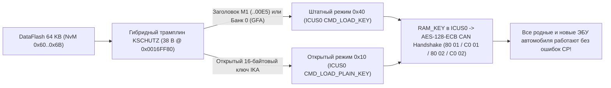

<div align="center">

# Continental VAG MQB Gateway J533 (`3Q0 907 530`)
### Renesas RH850/F1L — Component Protection (`KSCHUTZ`), Engineering Mode & `RSA-1024` / `SWaP` Toolkit

[-3776AB?style=for-the-badge&logo=python&logoColor=white)](#быстрый-старт)
[](#важно-выбор-микроконтроллера-в-программаторе-64-кб-против-32-кб)
[-00A88F?style=for-the-badge)](#интерактивный-оконный-интерфейс-tui)
[](#дисклеймер-и-условия-использования)

[](https://vwhacking.antonperk.com)
[](https://www.drive2.ru/users/perkthefox/)
[](https://t.me/perkthefox)

**Made by PerkTheFox** • **Zero Dependencies (Pure Python 3)** • **🇷🇺 Русский | [🇬🇧 Read in English (`README.en.md`)](README.en.md)**

</div>

---

## Дисклеймер и условия использования

> [!CAUTION]
> **ОТКАЗ ОТ ОТВЕТСТВЕННОСТИ (`AS IS`):**  
> Вы используете этот инструмент **исключительно на свой страх и риск**! Любое вмешательство в прошивку межсетевого шлюза (`J533`), криптохранилище `KSCHUTZ` или загрузчик может вывести ЭБУ из строя («усыпить» блок) или вызвать ошибки защиты компонентов в автомобиле.  
> **Если что-то сломается, уснёт или пойдёт не так — автор (`PerkTheFox`) НЕ ВИНОВАТ и не несёт никакой ответственности!**  
> Перед любыми действиями **всегда сохраняйте полный неизменённый бэкап всех областей памяти: `CodeFlash.bin` (`1.5 МБ`), `DataFlash.bin` (`64 КБ`), `Uflash.bin` (`32 КБ`) и внешней `95640` SPI EEPROM (`8 КБ`)**.

> [!WARNING]
> **СТРОГО НЕ ДЛЯ ПРОДАЖИ (`STRICTLY NOT FOR SALE`):**  
> Утилита создана для исследовательских и некоммерческих целей сообщества. Запрещается продавать этот скрипт, включать его в платные сборки/складчины или брать деньги за сам инструмент. При публикации материалов или доработок сохраняйте ссылки на автора: **[vwhacking.antonperk.com](https://vwhacking.antonperk.com)** • **[Drive2](https://www.drive2.ru/users/perkthefox/)** • **[Telegram](https://t.me/perkthefox)**.

---

## О проекте

`conti_cp_tool.py` — автономный комбайн на чистом **Python 3** (без единой сторонней библиотеки `pip`) для анализа, офлайн-привязки защиты компонентов (**Component Protection / KSCHUTZ `#MoLaLi`**), инженерной разблокировки и работы с криптографией **`RSA-1024 (e = 3)` / `SWaP` (`FeC` / `FSC`)** на гейтвеях **Continental VAG MQB J533** (`3Q0 907 530 AC / AG / AJ / AL / AM / AN / AP / AQ / AR` и совместимых на платформе **Renesas RH850/F1L**).

```text
 ◆ CONTINENTAL J533 • RH850/F1L TOOLKIT          Made by PerkTheFox • vwhacking.antonperk.com • [RU] • НЕ ДЛЯ ПРОДАЖИ 
  ╭── ГЛАВНОЕ МЕНЮ • CONTINENTAL J533 (3Q0 907 530) ───────────────────────────────────────────────────── [1/9] ──╮
  │ Автопоиск дампов рядом: CodeFlash = 1 • DataFlash = 1 • Uflash = 1   |   Язык [L]: Русский (RU)              │
  ├───────────────────────────────────────────────────────────────────────────────────────────────────────────────┤
  │  ▸ [1] ★ ПРИВЯЗКА БЛОКОВ CP «ПОД КЛЮЧ» (CodeFlash + ключи IKA в DataFlash)                     Рекомендуется │
  │    [2]   ИНЖЕНЕРНЫЙ РЕЖИМ («Инженерный юнит»: прошивка по OBD без RSA + живой CCP/RAM)      OBD UDS + CCP    │
  │    [3]   КЛЮЧИ RSA-1024 И ПОДПИСЬ SWaP / FeC / ODX (свои FSC для FPA Driving Mode и др.)     RSA-1024 (e=3)  │
  │    [4]   ИНСПЕКЦИЯ ДАМПОВ (анализ CodeFlash, Uflash и таблицы 12 банков CP + SWaP)            Чтение без за… │
  │    [5]   ТОЧЕЧНЫЕ СЕРВИСНЫЕ ОПЕРАЦИИ (отдельно пропатчить Cflash, записать/очистить банк)    Ручной режим    │
  │    [6]   ИНСТРУКЦИЯ И СПРАВОЧНИК 12 БАНКОВ CP (где брать IKA, CAN ID и распиновка Dflash)    Справка         │
  │    [A]   Об авторе, ссылки и дисклеймер (PerkTheFox)                                         vwhacking.anto… │
  │    [L]   Переключить язык интерфейса: Русский ⇄ English                                      RU -> EN        │
  │    [0]   Выход из программы                                                                                  │
  ├───────────────────────────────────────────────────────────────────────────────────────────────────────────────┤
  │ Подготовит сразу оба файла для записи программатором: пропатченный CodeFlash (с верным CRC-16) и DataFlash    │
  │ с ключами IKA выбранных блоков (5F MIB2, 17 Приборка, 13 ACC, 47 Звук, A5 Камера и др.).                      │
  ╰───────────────────────────────────────────────────────────────────────────────────────────────────────────────╯
 ↑↓ Навигация │ Enter Открыть │ 1-6 Быстрый запуск │ L Язык (RU/EN) │ A Автор │ 0/Q Выход                            
```

---

## Что нужно знать ДО запуска (это НЕ «однокнопочная таблетка»!)

> [!IMPORTANT]
> **Этот скрипт — НЕ однокнопочное решение из серии «подключил OBD-шнурок и нажал Сделать красиво»!**  
> Утилита не общается с машиной по диагностическому кабелю, не снимает защиту чтения с закрытых процессоров программно и не угадывает чужие ключи по воздуху. Это **низкоуровневый инструмент для подготовки уже вычитанных бинарных дампов**, рассчитанный на тех, у кого есть нужное железо для работы на столе и понимание архитектуры `VAG MQB` / `KSCHUTZ`.

Для реальной работы со скриптом вам **обязательно потребуются две вещи**:

1. **Полный дамп с реального гейтвея `J533`, вычитанный на столе через `Voltage Glitch`:**
   - Микроконтроллер `Renesas RH850/F1L` (`R7F7010543` / `R7F7010563`) внутри серийного шлюза Continental `3Q0 907 530` с завода закрыт от чтения (`Security Lock`).
   - Просто скачать дилерский `.frf` / `.odx` недостаточно: в нём нет вашего индивидуального `DataFlash.bin` (`64 КБ` с родными `SHE`-ключами остальных блоков авто, мастер-ключом `GFA`, `VCRN` и `SWaP`), нет загрузчика `Uflash.bin` (`32 КБ`) и нет бут-сектора `0x00000000..0x0000C1FF`.
   - Гейтвей необходимо снять с автомобиля, подключить на столе к программатору с аппаратным **глитчингом по питанию (`Voltage Glitch` / `Fault Injection`)** (`VVDI Multi-Prog`, `CG100X`, `Orange-5 RH850 Glitch` и др.), вычитать `CodeFlash.bin` + `DataFlash.bin` (+ `Uflash.bin`), обработать скриптом и записать обратно на столе.
2. **Заранее известный 16-байтовый ключ `K3` (`IKA`) того блока, который вы собираетесь «привязывать»:**
   - Чтобы прописать в гейтвей Б/У или дооснащаемый блок (`5F` MIB2, `17` приборку, `13` радар ACC, `47` усилитель, `A5` камеру и т.д.), нужно **заранее знать открытый 16-байтовый ключ защиты компонентов `K3` (`IKA` — Individual Key Application)** именно этого конкретного блока (`32` HEX-символа).
   - **По шине CAN / UDS, через диагностику или в трафике `ODIS` ключ `K3` в чистом виде НИКОГДА не передаётся и не попадает в логи!** Сервер `FAZIT` / `ODIS Online` отдаёт ключи исключительно в зашифрованных контейнерах (`SHE M1..M3` / `AES`), которые раскрываются только внутри аппаратного криптомодуля ЭБУ, а в самом CAN-рукопожатии ходят лишь одноразовые случайные числа и `AES-128`-ответы от них.
   - **Взять ключ `K3` (`IKA`) можно ТОЛЬКО из дампа памяти самого привязываемого ведомого блока** — вычитав его `EEPROM` / `DataFlash` / `SPI NOR` / `eMMC` на столе или через внутренний доступ к процессору этого конкретного ЭБУ (либо, если у вас есть полный доступ на запись дампа ведомого блока, положив одинаковый 16-байтовый ключ сразу в оба дампа: и в ведомый блок, и в банк гейтвея).

---

## Возможности

### 1. Офлайн-привязка защиты компонентов (`Component Protection` / `KSCHUTZ`)
- **Все 12 ведомых банков CP (`#1..#12`)** на гейтвее `19`: приборка `17`, `BCM 09`, радар `ACC 13`, `Airbag 15`, усилитель `47`, ТВ-тюнер `57`, мультимедиа `5F` (`MIB1` / `MIB2` / `MIB3`), радары слепых зон `3C` / `CF`, спецмодуль `3D`, камера ассистентов `A5`, батарея гибрида/EV `8C`.
- **Безопасный гибридный авто-трамплин (`38` байт в `CodeFlash`)**: скрипт автоматически находит коллбэк `KSCHUTZ` по машинной сигнатуре в любой поддерживаемой версии ПО и ставит компактный `RH850`-трамплин:
  - все **родные блоки автомобиля** с заводскими криптоблоками `SHE M1..M3` продолжают штатно проверяться через аппаратный HSM **`ICUS0`** (`CMD_LOAD_KEY`, код `0x40`);
  - все **дооснащаемые или меняемые Б/У блоки** одновременно работают на открытых 16-байтовых ключах **`IKA`** (`CMD_LOAD_PLAIN_KEY`, код `0x10`), записанных в `DataFlash.bin`!
- **Обход маски обученных банков во внешней `ST M95640` SPI EEPROM (`--bypass-eeprom-mask`)**: позволяет дооснащать автомобиль новыми блоками в ранее пустые (`FF..FF`) банки гейтвея **без выпаивания и правки микросхемы `95640`**.
- **Автоматический пересчёт `Application CRC-16/MODBUS`** (`poly 0xA001` по адресу `0x0000C21C`) — штатная проверка бутлодера `FF01` проходит как на заводском стоке.



### 2. Инженерный режим («Инженерный юнит» для работы по OBD-II)
- **Патч бутлодера `Uflash.bin` (`32 КБ` @ `0x0100342A`) -> `RSA-Free Engineering FBL`**: после однократной записи `Uflash.bin` программатором на столе гейтвей начинает принимать **любые кастомные `.odx` прошивки через обычный OBD-разъём** (`ODIS-E` / `VCP`, рутина `31 01 02 02`) без заводской подписи `RSA-1024`.
- **Полный доступ `ASAM CCP v2.1` по CAN (`0x1BFC8600` -> `0x1BFC8601`)**: разблокирует системный гейт `Feature 0x80 / 0x81 / 0x83` и снимает чёрный список адресов `CCP`, открывая живое чтение `CodeFlash` / `DataFlash` / `Uflash` / `RAM` и запись `RAM` на работающем блоке (включая мгновенное включение всех 13 функций `SWaP` в ОЗУ через `0xFEDE1394 = 0xFFFA`).
- **Активация заводского `CAN RAM-Loader` (`0x07FC80FE` -> `0x6F0 / 0x6F1`)**: снимает проверку одноразового байта `OTP 0x0000A167` для исполнения собственного `RH850`-кода из ОЗУ (`0xFEDE9000`).

### 3. Криптография `RSA-1024 (e = 3)` и собственные сертификаты `SWaP / FeC` (`FSC`)
- **Встроенный генератор ключевых пар `RSA-1024 (e = 3)`**: тест простоты Миллера — Рабина в чистом Python, экспорт в `.json` + стандартные ключи OpenSSL `.private.pem` (`PKCS#1`) и `.public.pem` (`SPKI`).
- **Синхронная подмена публичного модуля `SWaP RSA` и/или `FBL RSA`**: обновляет модуль в `CodeFlash.bin` и одновременно в зеркальном кэше `DataFlash.bin` (`NvM 0x7C @ 0xDB04`) с пересчётом `IEEE CRC-32 @ 0xDCE4` и полным сохранением родного аппаратного `VCRN` (`DID 0x3C03 @ 0xDC0C`).
- **Генератор и подписчик 171-байтовых (`0xAB`) сертификатов `VAG SWaP FSC`**: считает `RIPEMD-160` + `PKCS#1 v1.5` на чистом Python для штатной заливки кодов активации (`0x10000100` Выбор профиля движения `FPA / Mode`, `0x10000300` Распознавание усталости `MKE`, `0x10001800` `MKB` и др.) по OBD через `UDS 0x2E 0xDE01`.
- **Подпись `.odx` прошивок (`sign-odx`)**: формирует 128-байтную подпись `SHA-1 + PKCS#1 v1.5` (`<FW-SIGNATURE>`) под кастомный ключ `FBL RSA` (`Sector 5 @ 0x0000A2F7`).

### 4. Полноэкранный интерактивный TUI + CLI (`RU` / `EN`)
- Оконный интерфейс без «простыней» в консоли, живая адаптация под узкие и широкие окна терминала (`SIGWINCH`), встроенный браузер папок, предпросмотр дампов при наведении курсора и копирование ключей в буфер обмена в одно нажатие.

---

## Важно: выбор микроконтроллера в программаторе (`64 КБ` против `32 КБ`)

> [!IMPORTANT]
> В меню многих программаторов (`VVDI Multi-Prog`, `CG100X` и др.) профиль для гейтвея `3Q0 907 530` исторически подписан как **`Continental R7F7010343`**, хотя по официальному даташиту Renesas у чипа `R7F7010343AFP` всего **`32 КБ` Data Flash**, тогда как реальный кристалл внутри гейтвея относится к старшей подсерии **`R7F7010543AFP` / `R7F7010563AFP`** и физически имеет **`64 КБ` Data Flash (`65 536` байт)** + криптомодуль `ICU-S` (дескриптор `R_FDL_Init` в прошивке жёстко задаёт `fdlPoolSize = 0x0400 = 1024 × 64 Б`).
>
> **Практическое правило при чтении на столе:**
> - Всегда выбирайте готовый пресет ЭБУ **`3Q0 907 530` / `MQB Gateway Continental`** (он вычитывает полные `64 КБ`), **либо** при ручном выборе по маркировке чипа выбирайте **`R7F7010543` / `R7F7010563` (`64 KB DataFlash`)**.
> - **Никогда не выбирайте вручную профиль `R7F7010343` на `32 КБ`!** Все 12 банков CP, мастер-ключ `GFA` и сертификаты `SWaP / FeC` лежат в верхней половине `DataFlash` (`0xC000..0xF0BF`) — 32-килобайтный дамп их попросту обрежет, и скрипт сразу предупредит об ошибке размера.

---

## Быстрый старт

Никаких сторонних библиотек устанавливать не нужно — достаточно стандартного **Python 3.9+** на **macOS**, **Linux** или **Windows**:

```bash
git clone <URL_РЕПОЗИТОРИЯ>
cd <ПАПКА_РЕПОЗИТОРИЯ>
python3 conti_cp_tool.py
```

Положите считанные дампы (`CodeFlash.bin` / `Cflash.bin`, `DataFlash.bin` / `Dflash.bin`, опционально `Uflash.bin`) рядом со скриптом или в любую подпапку, либо просто **перетащите файл мышкой из Finder / Проводника прямо в окно программы**.

---

## Интерактивный оконный интерфейс (TUI)

| Клавиша | Действие |
| :--- | :--- |
| `↑` / `↓`, `PgUp` / `PgDn`, `Home` / `End` | Навигация по меню, списку банков, браузеру папок и прокрутка отчётов |
| `Enter` *(или цифры `1`–`9`)* | Открыть выбранный раздел / подтвердить действие |
| `Space` *(`A` — все, `N` — сбросить)* | Поставить / снять галочку `[✓]` при выборе сразу нескольких банков CP |
| `Tab` / `←` `→` | Переключение вкладок в инспекторе дампов и справочнике |
| `B` | Открыть встроенный браузер папок (при выборе файла) / Карточки банков с RAW HEX (в инспекторе) |
| `F2` или `Ctrl+G` | Мгновенно сгенерировать криптостойкий случайный 16-байтовый ключ `IKA` |
| `C` | Скопировать HEX-ключ / `VCRN` / команду в системный буфер обмена (`pbcopy` / `clip` / `wl-copy`) |
| `L` | Мгновенно переключить язык интерфейса **`Русский ⇄ English`** прямо в текущем окне |
| `Esc` | Вернуться на шаг назад / закрыть модальное окно |
| `0` или `Q` | Выход из программы с чистым восстановлением консоли |

> [!TIP]
> Если требуется классический построчный текстовый вывод (например, при работе через нестандартную консоль или для сохранения лога), запустите скрипт с флагом `--classic-ui`:  
> `python3 conti_cp_tool.py --classic-ui`

---

## Справочник всех 12 банков CP (`DataFlash 64 КБ`)

Каждый банк хранится в `DataFlash.bin` сразу в **двух зеркальных копиях** (основной + резервной через `+0x80`), обрамлённых заголовком `0x55555555` и контрольной суммой `IEEE CRC-32` (`zlib.crc32`, LE32):

| Банк | ЭБУ VAG | Назначение блока (MQB) | `DataFlash` (осн. / копия) | `NvM ID` | Маска `95640` | UDS Req / Resp | CP CAN TX / RX |
| :---: | :---: | :--- | :---: | :---: | :---: | :---: | :---: |
| **`#1`** | **`17`** | Приборная панель / Иммо (`J285`, AID / Virtual Cockpit) | `0xC000` / `0xC080` | `0x60` | `0x0001` (бит 0) | `714 / 77E` | `17FC0114 / 17FE0114` |
| **`#2`** | **`09`** | Блок бортовой сети `BCM` (`J519`) | `0xC100` / `0xC180` | `0x61` | `0x0002` (бит 1) | `70E / 778` | `17FC010E / 17FE010E` |
| **`#3`** | **`13`** | Адаптивный круиз-контроль / радар `ACC` (`J428`) | `0xC200` / `0xC280` | `0x62` | `0x0004` (бит 2) | `757 / 7C1` | `17FC0157 / 17FE0157` |
| **`#4`** | **`15`** | Подушки безопасности `Airbag` (`J234`) | `0xC300` / `0xC380` | `0x63` | `0x0008` (бит 3) | `715 / 77F` | `17FC0115 / 17FE0115` |
| **`#5`** | **`47`** | Акустическая система / усилитель (`J525`, Canton / Dynaudio / Fender) | `0xC400` / `0xC480` | `0x64` | `0x0010` (бит 4) | `76F / 7D9` | `17FC016F / 17FE016F` |
| **`#6`** | **`57`** | ТВ-тюнер (`R78`) | `0xC500` / `0xC580` | `0x65` | `0x0020` (бит 5) | `76D / 7D7` | `17FC016D / 17FE016D` |
| **`#7`** | **`5F`** | Мультимедиа / ГУ `MIB1 / MIB2 / MIB3` (`J794`) | `0xC600` / `0xC680` | `0x66` | `0x0040` (бит 6) | `773 / 7DD` | `17FC0173 / 17FE0173` |
| **`#8`** | **`3C`** | Ассистент смены полосы `Side Assist 1` Master (`J769` / `J1086`) | `0xC700` / `0xC780` | `0x67` | `0x0080` (бит 7) | `74E / 7B8` | `17FC014E / 17FE014E` |
| **`#9`** | **`CF`** | Ассистент смены полосы `Side Assist 2` Slave (`J770` / `J1087`) | `0xC800` / `0xC880` | `0x68` | `0x0100` (бит 8) | `78A / 7F4` | `17FC018A / 17FE018A` |
| **`#10`** | **`3D`** | Спецфункции / спецтранспорт (`J608`) | `0xC900` / `0xC980` | `0x69` | `0x0200` (бит 9) | `72C / 796` | `17FC012C / 17FE012C` |
| **`#11`** | **`A5`** | Передняя камера ассистентов `MFK` (`R242`, `3Q0` / `2Q0`) | `0xCA00` / `0xCA80` | `0x6A` | `0x0400` (бит 10) | `74F / 7B9` | `17FC014F / 17FE014F` |
| **`#12`** | **`8C`** | Управление ВВ-батареей гибрида / EV (`J840`, GTE / e-Golf) | `0xCB00` / `0xCB80` | `0x6B` | `0x0800` (бит 11) | `77B / 7E5` | `17FC017B / 17FE017B` |
| **`Mst`** | **`19`** | Собственный мастер-ключ шлюза `GFA` (`Master`, `key_type=3`) | `0xDA00` / `0xDA80` | `0x7B` | — | `710 / 77A` | *Не трогать на авто!* |

---

## Полная карта памяти `DataFlash.bin` (`64 КБ`)

| Диапазон в `Dflash.bin` | `NvM ID` | Содержимое и назначение |
| :---: | :---: | :--- |
| `0x0000 .. 0x007F` | Паспорт ZDC | Идентификатор и версия залитого набора параметрии (`DID F1A0` / `F1A1`) |
| `0x0080 .. 0x303F` | 7 блоков ZDC | Параметрия (`Base`, `MKE`, `FPA Driving Profile`, `Aux`, `Main GW`, `Cal`, `BEM` / Start-Stop), проверка только `IEEE CRC-32` |
| `0x3040 .. 0xBFFF` | Пул FDL | Свободный резерв `Data Flash` (`0xFF`) |
| `0xC000 .. 0xCBFF` | `0x60 .. 0x6B` | **12 ведомых банков защиты компонентов `CP` (`#1..#12`)**, по `2 × 128` байт на банк |
| `0xCC00 .. 0xD8FF` | `0x6C .. 0x78` | Резерв будущих слотов `NvM` |
| `0xD900 .. 0xD9FF` | `0x79 .. 0x7A` | Аппаратные `AES-CMAC` теги `ICUS0` для защиты списка `0x5E` в `95640` |
| `0xDA00 .. 0xDAFF` | `0x7B` | **Собственный прикладной мастер-ключ гейтвея `19` (`GFA`, Банк 0)** |
| `0xDB00 .. 0xDCFF` | `0x7C` | Кэш публичного модуля **`SWaP RSA-1024`** (`0xDB04`) + 5-байтовый **`VCRN`** (`0xDC0C`) + `CRC-32` (`0xDCE4`) |
| `0xDD00 .. 0xE83F` | `0x7D .. 0x8B` | **15 слотов сертификатов активации `SWaP FSC`** (содержат открытый `VIN` донора по смещению `+0x10`) |
| `0xE840 .. 0xF0BF` | `0x8C .. 0x94` | Служебные счётчики `SWaP` и маркер версии разметки `NvM` (`NvM 0x00..0x5F` живут во внешней `8 КБ` `ST M95640`) |

---

## Примеры работы из командной строки (CLI)

Все функции интерактивного TUI доступны напрямую из терминала или bash/python-скриптов (`-l ru` или `-l en`):

```bash
# 1. Полная инспекция дампов CodeFlash + DataFlash + Uflash
python3 conti_cp_tool.py inspect \
  --cflash CodeFlash.bin \
  --dflash DataFlash.bin \
  --uflash Uflash.bin

# 2. Офлайн-привязка Б/У или дооснащаемого блока (гибридный патч CodeFlash + запись ключей IKA в DataFlash)
#    (например, усилитель 47 Canton в ранее пустой банк #5 с обходом маски 95640)
python3 conti_cp_tool.py patch-cflash \
  -i CodeFlash.bin -o CodeFlash.patched.bin \
  --bypass-eeprom-mask

python3 conti_cp_tool.py set-cp-key \
  -i DataFlash.bin -o DataFlash.patched.bin \
  --bank 47 --key 00112233445566778899AABBCCDDEEFF

# 3. Превратить гейтвей в «Инженерный юнит» (прошивка любых .odx по OBD без RSA + полный CCP)
python3 conti_cp_tool.py patch-engineering \
  --cflash-in CodeFlash.bin   --cflash-out CodeFlash.eng.bin \
  --uflash-in Uflash.bin      --uflash-out Uflash.eng.bin

# 4. Сгенерировать свою пару RSA-1024 (e=3), вшить SWaP-ключ в дампы и выпустить FSC для FPA (0x10000100)
python3 conti_cp_tool.py set-rsa-key \
  --generate-key my_swap_rsa1024.json \
  --cflash-in CodeFlash.bin   --cflash-out CodeFlash.swap.bin \
  --dflash-in DataFlash.bin   --dflash-out DataFlash.swap.bin \
  --target swap

python3 conti_cp_tool.py sign-fsc \
  --key my_swap_rsa1024.json \
  --dflash DataFlash.swap.bin \
  --fec 10000100 \
  -o fpa_10000100.fsc

# 5. Справка по всем 12 банкам CP и пошаговая инструкция
python3 conti_cp_tool.py banks
python3 conti_cp_tool.py guide
```

---

## Технические заметки (подтверждено дизассемблированием `RH850`)

<details>
<summary><b>1. Зачем нужен прикладной мастер-ключ <code>GFA</code> (Банк 0, <code>0xDA00</code>) и почему его нельзя трогать на живой машине?</b></summary>

<br>

- `GFA` (`NvM 0x7B @ 0xDA00/0xDA80`, `key_type = 3`) — это **НЕ единый ключ автомобиля**, и из него невозможно вычислить ключи `IKA` ведомых блоков `1..12` (каждый `IKA` генерируется сервером `FAZIT` независимо).
- В прошивке `GFA` проверяет собственный статус обучения самого гейтвея `19` (`0xFEDFC988` бит 0) и подпись онлайн-контейнеров `ODIS` (`UDS 0x2E 02C5`). Если повредить или обнулить `0xDA00`, гейтвей принудительно подставляет случайный одноразовый ключ (`key_type = 8`) для **всех 12 банков**, мгновенно роняя всю машину в `Component Protection Active`!
- Поэтому гибридный трамплин намеренно оставляет `Банк 0` на родном аппаратном `SHE` (`0x40`), сохраняя полную совместимость с `ODIS Online`.

</details>

<details>
<summary><b>2. Почему нельзя просто записать нули (<code>00..00</code>) в слоты ключей гейтвея, чтобы обойти CP?</b></summary>

<br>

- Фактическая блокировка функций (отключение звука в `5F` MIB2, отключение радара `13` ACC, надпись на приборке `17`) зашита **внутри каждого ведомого блока**, а не в гейтвее!
- В 4-кадровом рукопожатии по CAN (`80 01 <R_GW>` -> `C0 01 <R_SLAVE>` -> `80 02 <Proof_GW>` -> `C0 02 <Proof_SLAVE>`) ведомый блок сам шифрует `AES-128-ECB(IKA_блока, R_GW || R_SLAVE)` и сверяет ответ гейтвея. Если в гейтвее записаны нули, а в ведомом блоке — его реальный `IKA`, ответы не совпадут и ведомый блок сам заблокирует свои функции (`U110100`).
- Ключ `00..00` (или любой произвольный 16-байтовый ключ, сгенерированный по `F2`) сработает **только если записать эти же 16 байт в обе стороны** — и в банк гейтвея, и в слот `IKA` ведомого блока. Проще и чище вычитать уже существующий `IKA` из ведомого блока (напр., из EEPROM `5F` MIB2) и положить его в соответствующий банк гейтвея, вообще не модифицируя ведомый ЭБУ.

</details>

---

## 🇬🇧 English Documentation

Complete English documentation, all 12 CP bank tables, `DataFlash` memory map, TUI shortcuts, and CLI examples are available in **[`README.en.md`](README.en.md)**.

---

<div align="center">

**Made by PerkTheFox**  
[vwhacking.antonperk.com](https://vwhacking.antonperk.com) • [Drive2: perkthefox](https://www.drive2.ru/users/perkthefox/) • [Telegram: @perkthefox](https://t.me/perkthefox)  
*Free for the VAG research community — Not for commercial sale.*

</div>
