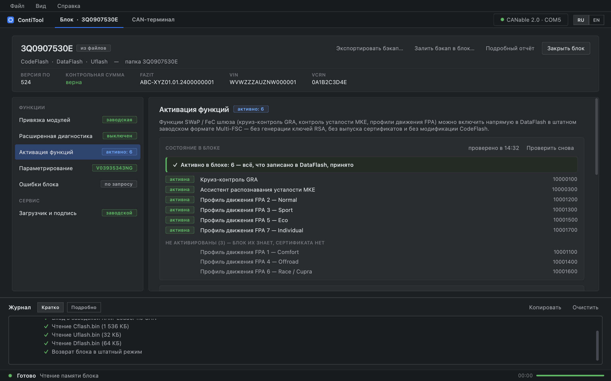
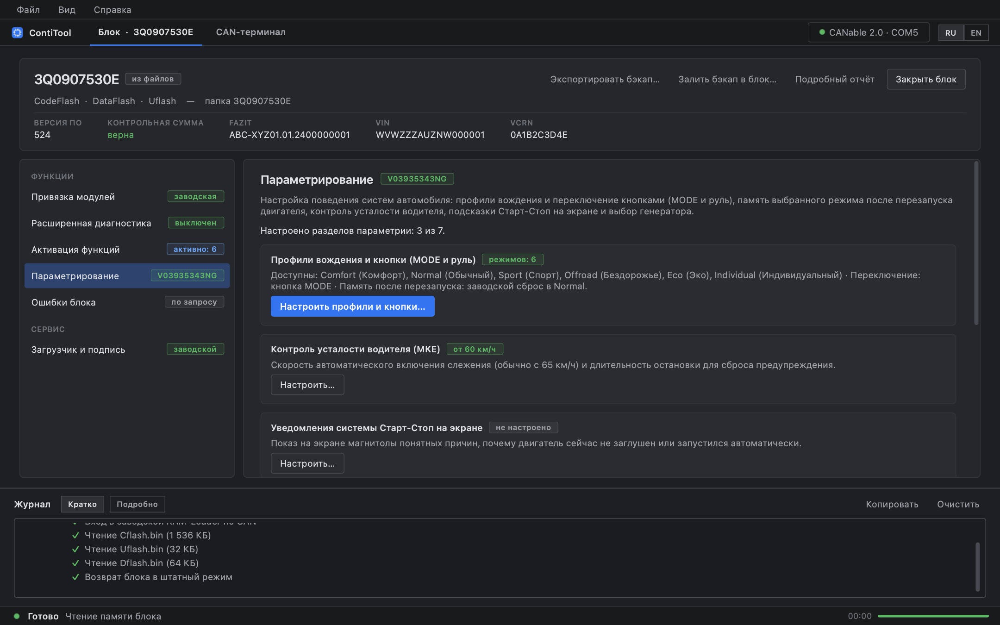
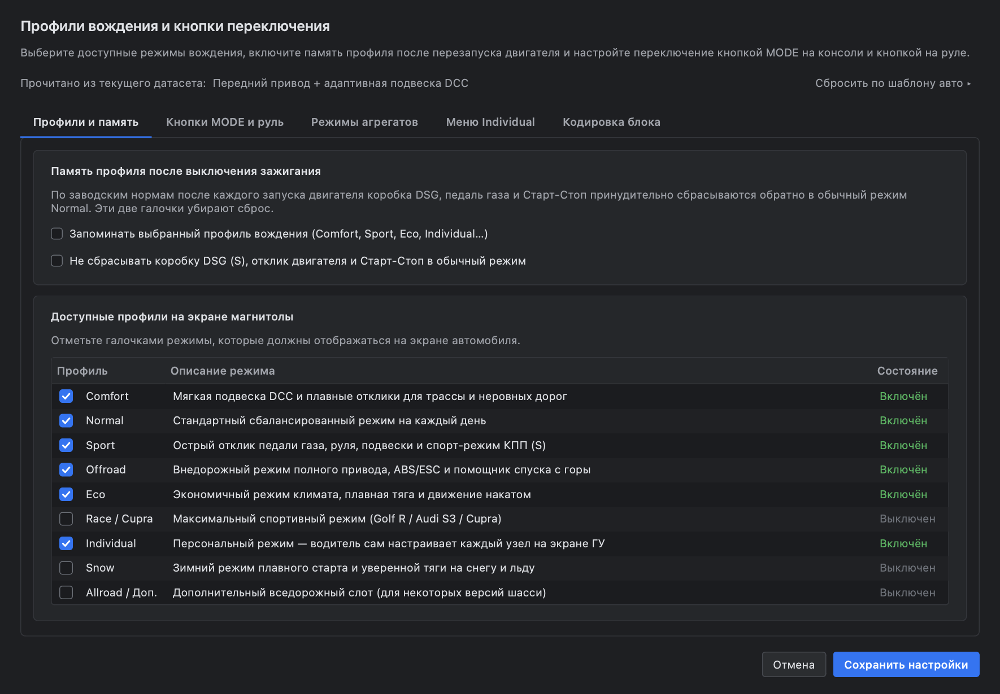
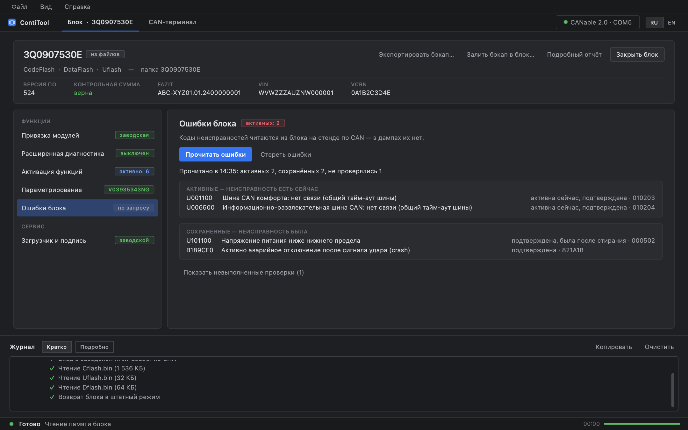
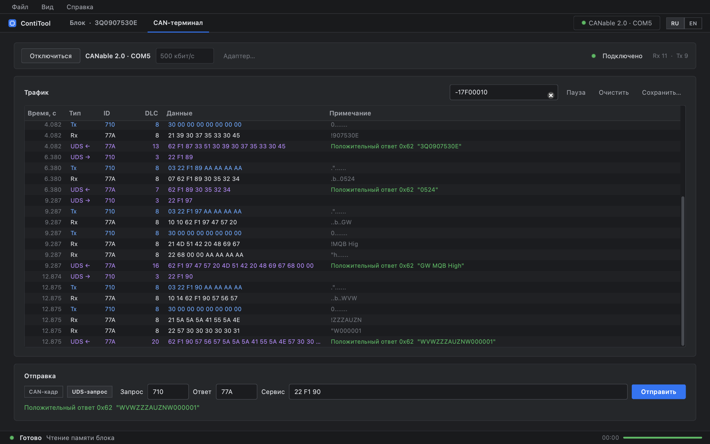
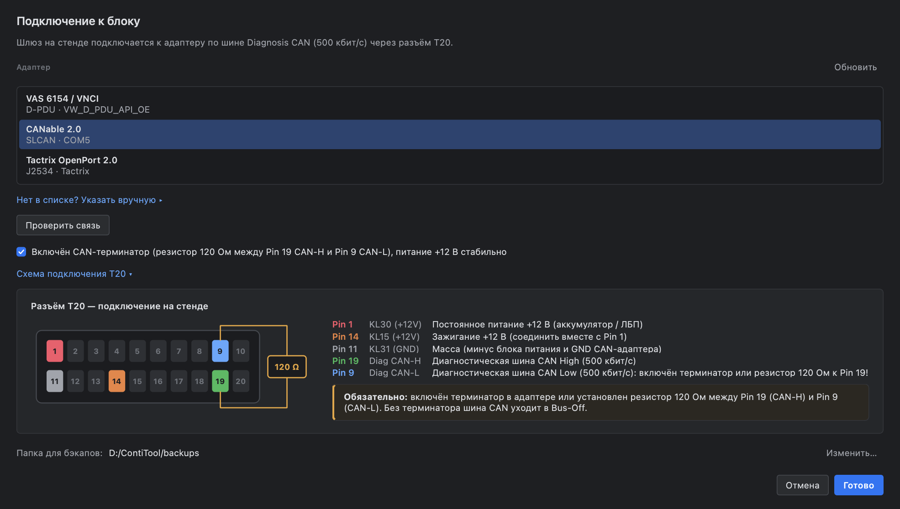
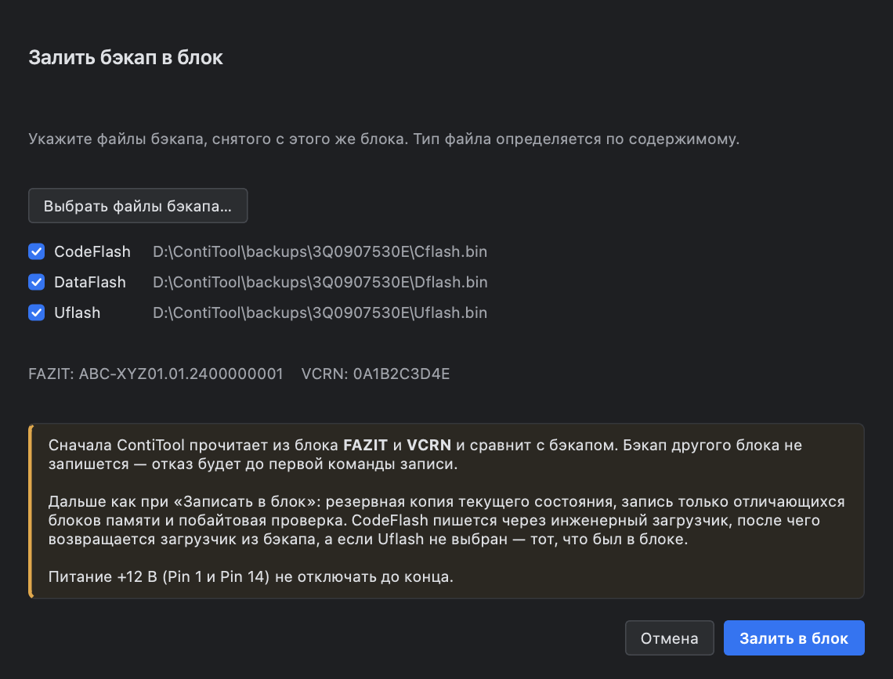
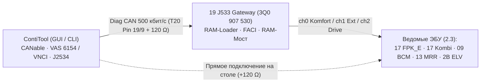

<div align="center">

# ContiTool

**Шесть блоков VAG MQB по CAN. Без вскрытия. Без пайки. Без платных токенов.**

`19 J533 Gateway` · `17 FPK_E / AID` · `17 Kombi VDD` · `09 BCM` · `13 ACC MRR` · `2B ELV`

<br>

[](README.en.md)
[](https://github.com/perkthefox/mqb_contitool/releases/latest)
[](https://github.com/perkthefox/mqb_contitool/releases/tag/v2.3.0-rc1)
[](#быстрый-запуск)
[](#лицензия)

[](https://vwhacking.antonperk.com)
[](https://www.drive2.ru/users/perkthefox/)
[](https://t.me/perkthefox)

**Made by PerkTheFox** · 🇷🇺 Русский · [🇬🇧 English](README.en.md) · [📜 История изменений](CHANGELOG.md) · [📚 Документация](docs/README.md)

</div>

<br>

| Стабильный релиз · **`v2.2.1a`** *(основной)* | Релиз-кандидат · **`v2.3.0-rc1`** *(ветка 2.3)* |
| :--- | :--- |
| Основная рабочая версия для шлюзов **`19 J533`** (`3Q0 907 530`). Проверена на реальных блоках и адаптерах. | Крупное обновление на **все шесть ЭБУ MQB**: приборки `17 FPK_E` и `17 Kombi VDD`, `09 BCM`, `13 ACC MRR`, `2B ELV`, сканер шины и прозрачный RAM-мост `J533`. |
| **Выбирайте её**, если нужна спокойная ежедневная работа со шлюзами J533. В «Настройках» можно в любой момент переключиться на канал `candidate`. | **Нестабильный канал:** часть функций может не работать, вести себя криво или быть сломана. Работайте только на столе с полным бэкапом и присылайте баги в [Issues](https://github.com/perkthefox/mqb_contitool/issues). |
| 👉 **[Скачать стабильный v2.2.1a](https://github.com/perkthefox/mqb_contitool/releases/latest)** | 👉 **[Попробовать v2.3.0-rc1](https://github.com/perkthefox/mqb_contitool/releases/tag/v2.3.0-rc1)** |

<p align="center">
  
</p>

---

## Зачем нужен ContiTool

Обычно для работы с блоками MQB приходится держать зоопарк из дорогих коммерческих пакетов, программаторов, онлайна и пайки. **ContiTool** закрывает это одним открытым инструментом с графическим интерфейсом (**Qt 6**) и консольным режимом (**CLI**) под **Windows, macOS и Linux**:

- **Без вскрытия и пайки:** чтение и запись `CodeFlash`, `DataFlash`, `UFlash`, `Extra Area` и `EEPROM` прямо по CAN — с аппаратным `FACI Blank-Check`, чтобы дампы годились даже для внешних программаторов (`VVDI`, `Multiprog`, `UPA`, `Orange5`).
- **Иммобилайзер, ключи и CP на своих условиях:** перенос иммо **A→B** (включая `Kombi VDD` → `FPK_E`), добавление ключей через штатную катушку **без стирания старых**, гибридный `Component Protection (#MoLaLi)` на все 12 банков шлюза, чтение/запись `GFA`/`IKA`/`K_ffb` и адаптация пультов ДУ `BCM` и `ELV`.
- **SWaP, параметры и восстановление «кирпичей»:** собственный `RSA-1024` + выпуск `SWaP FSC v2`, редакторы `FPA`/`DCC`/`MKE`/`Start-Stop`/`BEM`, отключение CP и активация `SWaP` на радарах `MRR`, прошивка `FRF`/`ODX` и поднятие шлюзов, застрявших в `FBL`.
- **Один шлюз = вся шина на столе:** подключитесь к диагностическому CAN шлюза `19 J533` — ContiTool просканирует ведомые блоки и при необходимости поднимет прозрачный RAM-мост `ch3 ↔ ch0/ch2`, чтобы достать `17`, `09`, `13` и `2B` без перетыкания проводов (включая `BURST-GO` для `FPK_E` через `VAS 6154 / VNCI`).

---

## Важно прочитать перед запуском

> [!CAUTION]
> - **Этой программой пользоваться НЕ НУЖНО**, если вы не понимаете, зачем она вам, не умеете работать с ODIS или VCTool, либо есть хоть малейшие сомнения в адаптере, проводке или питании. Дешёвые китайские клоны безопасными не считаются, даже если «работают».
> - **Только на столе.** Работайте со снятыми блоками и стабилизированным блоком питания (`12.5–13.8 В`). Просадка напряжения или обрыв связи в машине ведут к обездвиживанию авто и выходу блока из строя («кирпич»). Подключение к машине — полностью ваш риск.
> - **Всегда сохраняйте полный бэкап до любой записи.** Инструмент бесплатный, открытый и предоставляется **«КАК ЕСТЬ» (`AS IS`)** — продавать его запрещает [лицензия](#лицензия). **Если вам его продали — вас обманули.**
> - Вопросы и баги — **только в [GitHub Issues](https://github.com/perkthefox/mqb_contitool/issues)**, не в личные сообщения.

---

## Какие блоки поддерживаются

| Адрес | Блок | Платформа / MCU | Подтверждённые ПО | Адаптеры | Версия |
| :---: | :--- | :--- | :--- | :--- | :---: |
| **`19`** | **J533 Gateway**<br>`3Q0 907 530`, `8S0 907 468` | Renesas `RH850/F1L` | Все Continental `3Q0`/`8S0` (`HW 517–527+`) | `CANable` / `SLCAN` / `candleLight`<br>`VAS 6154 / VNCI` · `J2534` | **`2.2.x` + `2.3`** |
| **`17`** | **FPK_E / AID**<br>`83A`, `5E0`, `5NA`, `3G0` | Renesas `RH850/D1M2A` | `SW 83A (6181)`, `1701`, `1703`, `1711` | **Напрямую (`T18`):** `CANable` / `SLCAN` / `candleLight`¹<br>**Через мост `J533`:** также `VAS 6154 / VNCI` | **`2.3 RC`** |
| **`17`** | **Kombi VDD**<br>`EV_DashBoardVDDMQBAB` | Renesas `V850E2/Dx4` | `5NA 920 740 B (0310)`<br>`8V0 920 860 E (2220)` | `CANable` / `SLCAN` / `candleLight`<br>`VAS 6154 / VNCI` · `J2534` *(прямо и через шлюз)* | **`2.3 RC`** |
| **`09`** | **BCM MQBAB**<br>Continental `5Q0 937 084 ...` | Renesas `RH850` | `SW 0173`, `0175`, `0212`, `0253` (`BL`/`BQ`/`CJ`/`CG` и др.) | `CANable` / `SLCAN` / `candleLight`<br>`VAS 6154 / VNCI` *(полный RawMode, прямо и через мост)*² | **`2.3 RC`** |
| **`13`** | **ACC Radar MRRevo14F**<br>`3QF` / `5Q0` | NXP `MPC5674K` / `MPC5675K` | Gen1 / Gen2 (`0130`, `0192`, `0196`, `0272`, `0780` и др.) | `CANable` / `SLCAN` / `candleLight`<br>`VAS 6154 / VNCI` *(полный RawMode, прямо и через мост)*² | **`2.3 RC`** |
| **`2B`** | **ELV / J764**<br>`5Q0` / `3Q0` | Renesas `RH850/F1L` | Стенд: UDS + `32 КБ DataFlash` (`0x1BFD8A0B/0A`) | UDS: любой; `32 КБ DataFlash`: `CANable` / `SLCAN` / `candleLight` или `VAS 6154 / VNCI` *(RawMode)*² | **`2.3 RC`** |

> ¹ **Почему для прямого `17 FPK_E` нужен `CANable / candleLight`:** бесключевой вход level 8 шлёт ~1000 кадров с шагом **`0.35 мс/кадр`** (~0.36 с). `VAS 6154 / VNCI` по TCP отправляет 1 кадр за 3–7 мс и физически не попадает в окно. Зато **через шлюз `19 J533`** работает и `VNCI`: шлюз сам стреляет этот поток из RAM на полных 500 кбит/с (`BURST-GO`).
>
> ² **29-бит через `VAS 6154 / VNCI` (`BCM` / `MRR` / `ELV`):** 11-битный UDS (паспорт, статус, DTC, запись ключей/адаптации) работает на любом адаптере; 29-битный TX в D-PDU RawMode (`TxFlag 0x100`) добавлен по реверсу DLL `27.2` и ещё обкатывается на живых VNCI — при сбое 29-битных операций XCP/WFS/ELV используйте нативный CAN (`CANable / candleLight`).
>
> Шлюзы **`5Q0 907 530`** и **`Lear 3Q0 907 530`** (PowerPC `MPC5607B` / `MPC5748G`) **не поддерживаются** и блокируются до отправки команд загрузчика. Для ведомых блоков с неподтверждённой парой `PN + SW` ContiTool показывает жёлтое предупреждение.

---

## Возможности по блокам

### `19 J533` — Шлюз Continental MQB (`2.2.x` + `2.3`)
- **Полный дамп и запись по Diagnosis CAN (`500 кбит/с`):** `Cflash` (`1.5 МБ` за ~61 с пакетным `FED_READER`), `Uflash` (`32 КБ`), `Dflash` (`64 КБ` с аппаратным `FACI Blank-Check`), `EEPROM 95640` (`8 КБ`), `OPBT` + `IDCODE`/`CHIP ID`. Дифференциальная запись `DataFlash` с сохранением `ECC` и защитой `ICUSB`, разблокировка `Uflash` (в т.ч. при OTP-замке `OTPEUA`), восстановление блоков, **застрявших в `FBL`**, лечение ненулевого `F15B` и прошивка заводских `FRF`/`ODX`.
- **Гибридный Component Protection (`#MoLaLi`):** все **12 банков ведомых ЭБУ (`#1..#12`)** — штатные блоки работают через `SHE M1..M3` и мастер-ключ `GFA`, а дооснащённые проходят по 16-байтным ключам `IKA`, с автоматическим обходом маски `95640` без выпаивания.
- **Инженерный режим, `SWaP / RSA-1024`, параметрия `ZDC` и DTC:** патч инженерки + `ASAM CCP v2.1`, свой генератор `RSA-1024 (e = 3)` и выпуск 171-байтных `SWaP FSC v2` (с живой проверкой `22 3C 00`), редакторы **`FPA`** (`On/Off`, 15-ступенчатый `DCC`), `MKE`, `Start-Stop`, `BEM`, заливка `ZDC` с автосогласованием кодировки `0x0600` и полная база **770 кодов DTC ODIS**.

### `17 FPK_E / AID` — Цифровые приборки Continental (`2.3 RC`)
- **Бесключевой доступ level 8 и полная вычитка:** `SW 83A (6181)`, `1701`, `1703`, `1711` — чтение `DataFlash 64 КБ`, `Extra Area 256 Б` + `IDAUTH`, `UFlash 32 КБ`, `BFlash 96 КБ` и `CodeFlash 2 МБ` быстрым стримом `0x6F1` с автооткатом на `UDS 0x23`.
- **Честный `Dflash.bin` с аппаратным RV40F Blank-Check (`0x71`):** все стёртые ячейки очищаются от шума плавающего затвора в `0xFF` — дамп сразу безопасен для заливки и через ContiTool, и внешним программатором (`VVDI Prog`, `Multiprog`, `UPA`, `Orange5`).
- **Умная запись + `SWRESA`:** безстирательное дописывание `smart_eel_append` (`0` стираний), `smart_tail_update`, `full_blank_checked_diff`, защита от чужого `FD11` и дампов `Kombi VDD`.
- **Иммо A→B, ключи по штатной катушке LF и `FBL RSA`:** редактор `EEL T01` (`VIN`, пробег, кодировка, `PowerClass`, партнёры, `KESSY`, `K_c`, `IKA/CP`, `K_ffb`, транспондеры), кросс-семейный перенос с `Kombi VDD`, извлечение `S0/S1` из ОЗУ + **добавление ключа в режиме 5 без удаления старых**, замена `.FBL_RSAKEY` / патч `BOLO` / подпись ODX и стендовая панель (KL15, движение, MFL, DTC).

### `17 Kombi VDD` — Аналоговые и гибридные приборки VDO/VDD (`2.3 RC`)
- Свой рабочий стол и CLI для `EV_DashBoardVDDMQBAB` (`SW 0310` и `SW 2220`, включая 75-байтный `EEL 0x0068`).
- Доступ `FD11 SL 7` по известному ключу или `10 4F + SA1` со **встроенным сбросом таймера блокировки `7F 27 37` (`+0x62EF`)**, чтение/запись EEL по чистому 11-бит UDS (напрямую и через любой шлюз), обучение ключей через катушку (режим 5) и перенос A→B.

### `09 BCM`, `13 ACC MRR`, `2B ELV` и RAM-мост `J533` (`2.3 RC`)
- **`09 BCM` (Continental MQBAB):** профили `SW 0173 / 0175 / 0212 / 0253`, pre-bridge проверка по UDS, чтение `GFA`/`IKA`/`K_ffb` с автоматическим Fail-closed бэкапом и восстановлением `FFB`, ручная и автоматическая (с приборки `FPK_E` / `Kombi VDD`) адаптация пультов ДУ.
- **`13 ACC MRR` (Bosch MRRevo14F):** чтение/запись `DFlash` (FEE) и `CFlash` по XCP/SRAM с проверкой контрольных сумм, ключи `GFA`/`IKA`, сброс счётчика CP, **отключение CP**, **активация `SWaP` (Gen1 / Gen2)** с откатом в сток и прошивка заводских `FRF`/`ODX`.
- **`2B ELV` (J764):** паспорт/статус/DTC, чтение 32 КБ `DataFlash`, оффлайн-редактор `EeeLib`, привязка `2E 02E2` (или из дампа приборки), обнуление (`virginize`), сброс `IDAC` и проверка загрузчика `31 01 02 03` + WFS5.
- **Сканер шины, CAN-терминал и приватные отчёты:** единая топология шины, переключение открытых блоков в шапке, терминал 11/29-бит raw CAN + ISO-TP UDS, прозрачный RAM-мост `J533CanBridge` (с фильтром `GAFL` и `BURST-GO`), а «Отчёт о проблеме» автоматически вырезает все ключи, `VIN` и `FAZIT`, когда не приложены дампы.

---

## Скриншоты

| | |
|:---:|:---:|
| <br>**Параметрирование** — профили вождения, MKE, Старт-Стоп, генератор | <br>**Профили вождения и кнопки** — редактор FPA |
| <br>**Регистратор DTC** — коды ODIS и понятные описания | <br>**CAN-терминал** — UDS по ISO-TP с расшифровкой ответов |
| <br>**Подключение** — найденные адаптеры и схема разъёма T20 | <br>**Заливка бэкапа** — только в тот же блок (FAZIT / VCRN) |

---

## Быстрый запуск

### Готовые сборки (без установки Python)

Все архивы лежат в **[GitHub Releases](https://github.com/perkthefox/mqb_contitool/releases)**. В Windows-сборку уже вложен проверенный драйвер D-PDU `27.2` (`dpdu/VW_PDUAPI_27.2`).

| ОС | Стабильный **`v2.2.1a`** *(основной)* | Релиз-кандидат **`v2.3.0-rc1`** *(нестабильный)* |
| :--- | :--- | :--- |
| **Windows x64** | `ContiTool-v2.2.1a-windows-amd64.zip` → `ContiTool.exe` | `ContiTool-v2.3.0-rc1-windows-amd64.zip` → `ContiTool.exe` |
| **macOS Apple Silicon** | `ContiTool-v2.2.1a-macos-arm64.dmg` → `ContiTool.app` | `ContiTool-v2.3.0-rc1-macos-arm64.dmg` → `ContiTool.app` |
| **Linux x86_64** | `ContiTool-v2.2.1a-linux-x86_64.tar.gz` → `ContiTool/ContiTool` | `ContiTool-v2.3.0-rc1-linux-x86_64.tar.gz` → `ContiTool/ContiTool` |

### Запуск из исходного кода (`Python 3.12+`)

```bash
python3 -m venv .venv
source .venv/bin/activate        # Windows: .venv\Scripts\activate
pip install -r requirements.txt

python3 conti_cp_tool.py         # без аргументов — GUI; с подкомандой — CLI
```

Сборка `.exe` / `.app` / `.dmg` локально: `pip install -r requirements-dev.txt && python3 scripts/build_release.py` (выход в `dist/release/`).

---

## Стендовое подключение (распиновки)



### Шлюз `19 J533` — разъём `T20`

| Пин `T20` | Цепь | Назначение |
| :---: | :--- | :--- |
| **Pin 1** | `KL30 (+12V)` | Постоянное питание `+12 В` (`12.5–13.8 В`) |
| **Pin 14** | `KL15 (+12V)` | Зажигание `+12 В` (на столе соединить с `Pin 1`) |
| **Pin 11** | `KL31 (GND)` | Общий минус блока питания и `GND` адаптера |
| **Pin 19** | `Diag CAN-H` | Диагностическая шина `CAN High` (`500 кбит/с`) |
| **Pin 9** | `Diag CAN-L` | Диагностическая шина `CAN Low` (`500 кбит/с`) — **терминатор `120 Ом` к Pin 19** |

### Приборная панель `17 FPK_E / Kombi VDD` — разъём `T18`

| Пин `T18` | Цепь | Назначение |
| :---: | :--- | :--- |
| **Pin 1** | `KL30 (+12V)` | Постоянное питание `+12 В` (пробуждение по CAN) |
| **Pin 10** | `KL31 (GND)` | Общий минус блока питания и `GND` адаптера |
| **Pin 8 / 9** | `D2 Coil 1 / 2` | Штатная катушка иммобилайзера `125 кГц` (полярность не важна) |
| **Pin 18** | `CAN-H` | Шина CAN приборной панели `High` (`500 кбит/с`) |
| **Pin 17** | `CAN-L` | Шина CAN приборной панели `Low` (`500 кбит/с`) — **терминатор `120 Ом` к Pin 18** |

### Блокиратор руля `2B ELV (J764)` — разъём `T4` (`T4dg` / `T4al`)

| Пин `T4` | Цепь | Назначение |
| :---: | :--- | :--- |
| **Pin 1** | `CAN-H` | `CAN Komfort High` (`500 кбит/с`, к J533 `T20 Pin 15`) |
| **Pin 2** | `CAN-L` | `CAN Komfort Low` (`500 кбит/с`) — **терминатор `120 Ом` к Pin 1** |
| **Pin 3** | `KL30 (+12V)` | Постоянное питание `+12 В` (пробуждение по CAN `0x1B000010`) |
| **Pin 4** | `KL31 (GND)` | Общий минус блока питания и `GND` адаптера |

> [!IMPORTANT]
> При прямом подключении на столе всегда проверяйте терминатор **`120 Ом`** между `CAN-H` и `CAN-L` (`VAS 6154 / VNCI` и `J2534` обычно терминируют линию сами, а на `CANable / SLCAN` нужно включить перемычку `120 Ω` или повесить резистор).

<details>
<summary><b>Правило 64 КБ DataFlash для программаторов и карта всех 12 банков CP (19 J533)</b></summary>

<br>

> [!WARNING]
> На корпусе процессора шлюзов `3Q0 907 530 xx` написано `R7F7010343AFP`, но физически внутри кристалл **`R7F7010543AFP / R7F7010563AFP` с полными `64 КБ` DataFlash (`65 536` байт)** — все 12 банков `CP` и ключи `SWaP` лежат во второй половине (`0xC000..0xFFFF`). **Никогда не выбирайте 32 КБ профиль `R7F7010343`** в программаторах.

| Банк | ЭБУ | Блок MQB | Смещение `Dflash` | `NvM` | Маска `95640` | UDS ID | CP CAN TX / RX |
| :---: | :---: | :--- | :---: | :---: | :---: | :---: | :---: |
| `#1` | **`17`** | Приборная панель / Иммо (`J285`) | `0xC000` / `0xC080` | `0x60` | `0x0001` | `714 / 77E` | `17FC0114 / 17FE0114` |
| `#2` | **`09`** | Бортовая сеть `BCM` (`J519`) | `0xC100` / `0xC180` | `0x61` | `0x0002` | `70E / 778` | `17FC010E / 17FE010E` |
| `#3` | **`13`** | Радар адаптивного круиза `ACC` (`J428`) | `0xC200` / `0xC280` | `0x62` | `0x0004` | `757 / 7C1` | `17FC0157 / 17FE0157` |
| `#4` | **`15`** | Подушки безопасности `Airbag` (`J234`) | `0xC300` / `0xC380` | `0x63` | `0x0008` | `715 / 77F` | `17FC0115 / 17FE0115` |
| `#5` | **`47`** | Цифровой усилитель звука (`J525`) | `0xC400` / `0xC480` | `0x64` | `0x0010` | `76F / 7D9` | `17FC016F / 17FE016F` |
| `#6` | **`57`** | ТВ-тюнер (`R78`) | `0xC500` / `0xC580` | `0x65` | `0x0020` | `76D / 7D7` | `17FC016D / 17FE016D` |
| `#7` | **`5F`** | Мультимедиа `MIB1 / MIB2 / MIB3` (`J794`) | `0xC600` / `0xC680` | `0x66` | `0x0040` | `773 / 7DD` | `17FC0173 / 17FE0173` |
| `#8` | **`3C`** | Ассистент смены полосы `Master` (`J769`) | `0xC700` / `0xC780` | `0x67` | `0x0080` | `74E / 7B8` | `17FC014E / 17FE014E` |
| `#9` | **`CF`** | Ассистент смены полосы `Slave` (`J770`) | `0xC800` / `0xC880` | `0x68` | `0x0100` | `78A / 7F4` | `17FC018A / 17FE018A` |
| `#10` | **`3D`** | Спецфункции (`J608`) | `0xC900` / `0xC980` | `0x69` | `0x0200` | `72C / 796` | `17FC012C / 17FE012C` |
| `#11` | **`A5`** | Передняя камера ассистентов (`R242`) | `0xCA00` / `0xCA80` | `0x6A` | `0x0400` | `74F / 7B9` | `17FC014F / 17FE014F` |
| `#12` | **`8C`** | ВВ-батарея гибрида / EV (`J840`) | `0xCB00` / `0xCB80` | `0x6B` | `0x0800` | `77B / 7E5` | `17FC017B / 17FE017B` |
| `Mst` | **`19`** | Мастер-ключ самого шлюза `GFA` (`Master`) | `0xDA00` / `0xDA80` | `0x7B` | — | `710 / 77A` | *Не трогать!* |

</details>

---

## Консольный режим (`CLI`)

```bash
# Поиск адаптеров и сканирование шины CAN:
python3 conti_cp_tool.py can ports
python3 conti_cp_tool.py can scan --port /dev/ttyACM0

# 19 J533 Gateway — бэкап, инспекция, гибридный CP, SWaP и цикл в 1 команду:
python3 conti_cp_tool.py can backup --port /dev/ttyACM0
python3 conti_cp_tool.py inspect --cflash Cflash.bin --dflash Dflash.bin --uflash Uflash.bin
python3 conti_cp_tool.py can turnkey --port COM4 --set 5F=A1B2C3D4E5F60718293A4B5C6D7E8F90 --clear-dtc --yes
python3 conti_cp_tool.py set-rsa-key --generate-key swap_key.json --cflash-in Cflash.bin --cflash-out Cflash_swap.bin --dflash-in Dflash.bin --dflash-out Dflash_swap.bin --target swap
python3 conti_cp_tool.py sign-fsc --key swap_key.json --dflash Dflash_swap.bin --fec 10000100 -o fpa_10000100.fsc

# 17 FPK_E / AID (2.3) — чтение с аппаратным Blank-Check, инспекция и перенос A->B:
python3 conti_cp_tool.py fpke read --port /dev/ttyACM0
python3 conti_cp_tool.py fpke read --interface dpdu --via-gateway --gateway-channel 0
python3 conti_cp_tool.py fpke inspect --dflash Dflash.bin --extra ExtraArea.bin
python3 conti_cp_tool.py fpke plan-transfer --donor-dflash donor/Dflash.bin --recipient-dflash target/Dflash.bin

# 17 Kombi VDD · 09 BCM · 13 MRR · 2B ELV (2.3):
python3 conti_cp_tool.py kombi read --port /dev/ttyACM0
python3 conti_cp_tool.py bcm read --port /dev/ttyACM0 --via-gateway
python3 conti_cp_tool.py mrr status --port /dev/ttyACM0
python3 conti_cp_tool.py elv status --port /dev/ttyACM0
```

---

## Частые вопросы (FAQ)

**Какую версию ставить: `v2.2.1a` или `v2.3.0-rc1`?**
Для спокойной работы со шлюзами **`19 J533`** — стабильный **[`v2.2.1a`](https://github.com/perkthefox/mqb_contitool/releases/latest)** (в окне **«Настройки»** можно выбрать канал автообновлений `stable` или `candidate`). Если нужны приборки `FPK_E` / `Kombi VDD`, `BCM`, `MRR`, `ELV` или RAM-мост `J533` — пробуйте релиз-кандидат **[`v2.3.0-rc1`](https://github.com/perkthefox/mqb_contitool/releases/tag/v2.3.0-rc1)**, но помните, что это тестовая сборка и бэкапы обязательны.

**Можно ли залить `Dflash.bin` от `FPK_E / AID`, считанный ContiTool, внешним программатором (VVDI / Multiprog / UPA)?**
Да, начиная с `2.3.0-rc1`. При чтении `FPK_E` ContiTool прогоняет аппаратный RV40F FACI Blank-Check (`0x71`) по всем 64 КБ и очищает пустые ячейки в честный `0xFF` (`fpke_report.json` → `dflash.blank_checked: true`). Если на неподтверждённом ПО Blank-Check был пропущен (`blank_checked: false`), программа прямо предупредит — такой сырой дамп программатором лить нельзя (обратно через ContiTool по CAN всё равно безопасно).

**Работает ли `VAS 6154 / VNCI` напрямую с ведомыми блоками без шлюза?**
- **`17 Kombi VDD`:** да, напрямую и через любой шлюз (чистый 11-бит UDS).
- **`09 BCM`, `13 ACC MRR`, `2B ELV`:** да, напрямую и через мост `J533` на VNCI с полным RawMode (11-бит UDS работает на любом VNCI; 29-битный TX в D-PDU RawMode ещё обкатывается — при сбое XCP/WFS/ELV переключитесь на `CANable / candleLight`).
- **`17 FPK_E / AID`:** напрямую к `T18` физически нельзя (потоку level 8 нужно `0.35 мс/кадр`, а VNCI отдаёт кадр за 3–7 мс по TCP). Зато **через шлюз `19 J533`** (`BURST-GO`) работает и `VAS 6154 / VNCI`!

**Нужен ли ODIS для VAS 6154 / VNCI, и нормально ли, что драйвер перепрошивает адаптер?**
ODIS не нужен — проверенный драйвер D-PDU `27.2` лежит в папке `dpdu/` рядом с программой (достаточно USB-драйвера адаптера). Автоперепрошивка VCI при первом подключении (~30 с) — норма; держите ODIS и VCTool закрытыми. Драйверы `30+` требуют явной галочки из-за риска зависаний посреди UDS-прошивки.

**Шлюз после прошивки молчит на этапе 1 входа в `RAM-Loader` или застрял в `FBL` — как поднять?**
Если в `F15B` попал ненулевой отпечаток, ContiTool сам предупредит до отправки ключа и предложит одношаговое лечение прошивкой родного `CodeFlash` или `FRF`/`ODX` с нулевым отпечатком. Если шлюз в `FBL`, нажмите на стартовом экране **«Залить бэкап…»** — программа проверит `FAZIT` по UDS без `RAM-Loader` и сразу восстановит приложение.

**Как сообщить об ошибке?**
Нажмите **«Создать отчёт…»** (или «Справка → Сообщить о проблеме…») — ContiTool соберёт архив с логами (без дампов и с автоматической очисткой секретных ключей по умолчанию) и откроет новый [GitHub Issue](https://github.com/perkthefox/mqb_contitool/issues).

---

## Техническая документация (`docs/`) и структура проекта

Побайтовые спецификации протоколов `J533` собраны в **[`docs/`](docs/README.md)**:
- **[`docs/can-read-write.md`](docs/can-read-write.md)** — `CAN RAM-Loader` (`0x0100120E`), чтение памяти, `FACI` и UDS-прошивка `FD_0DATA`.
- **[`docs/component-protection.md`](docs/component-protection.md)** — `KSCHUTZ`, `ICUS0`, 38-байтный гибридный трамплин, обход `95640` и карта `DataFlash 64 КБ`.
- **[`docs/engineering-and-swap.md`](docs/engineering-and-swap.md)** — Инженерный режим, `ASAM CCP v2.1`, `ZDC`, `RSA-1024 (e = 3)`, `SWaP FSC v2` и подпись `ODX`.

```text
├── conti_cp_tool.py              # Точка входа (без аргументов — Qt 6 GUI, с аргументами — CLI)
├── CHANGELOG.md                  # Полная история релизов (RU / EN)
├── docs/                         # Техническая документация по железу и протоколам (RU / EN)
├── scripts/build_release.py      # Кроссплатформенная сборка (.exe / .app / .dmg / .tar.gz)
├── src/
│   ├── contitool/
│   │   ├── core/                 # Анализаторы, криптография и патчеры (J533, FPK_E, Kombi, BCM, MRR, ELV, ZDC, FRF)
│   │   ├── can/                  # ISO-TP / D-PDU / J2534, RAM-мост J533, RH850/VLE-апплеты и CAN-сценарии
│   │   ├── cli/                  # Терминальные таблицы, прогресс-бар и команды CLI
│   │   └── gui/                  # Интерфейс Qt 6 / PySide6, сканер шины и CAN-терминал
│   └── openpdu/                  # Экспериментальный кроссплатформенный TCP-клиент VAS 6154 (без драйвера D-PDU)
└── tests/                        # 640+ автотестов алгоритмов, протоколов, эмуляторов и GUI (pytest)
```

---

## Лицензия

ContiTool © 2026 PerkTheFox распространяется под **[PolyForm Noncommercial 1.0.0 с дополнительными условиями](LICENSE)**. Коротко (юридически действует только текст `LICENSE`):

- **код открыт** — его можно читать, изучать и дорабатывать;
- **бесплатно** для личного и некоммерческого использования, а также **для платного ремонта и диагностики** (автосервису можно работать с клиентами);
- **продавать нельзя** — ни саму программу, ни копии, ни доступ к ней, ни в составе платных сборок;
- **доработанные версии** распространяются только с открытым исходным кодом на тех же условиях и с сохранением строки об авторстве (`Required Notice`).

Лицензии сторонних компонентов сборок — в [`THIRD_PARTY_NOTICES.md`](THIRD_PARTY_NOTICES.md). Участие в разработке — [`CONTRIBUTING.md`](CONTRIBUTING.md), безопасность — [`SECURITY.md`](SECURITY.md).

---

<div align="center">

**Made by PerkTheFox**  
[vwhacking.antonperk.com](https://vwhacking.antonperk.com) · [Drive2: perkthefox](https://www.drive2.ru/users/perkthefox/) · [Telegram: @perkthefox](https://t.me/perkthefox)  
*Бесплатно для сообщества исследователей VAG. Если вам её продали — вас обманули.*

</div>
