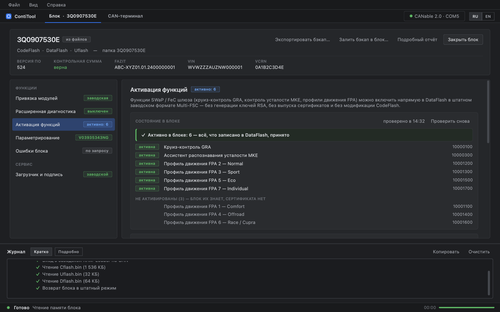
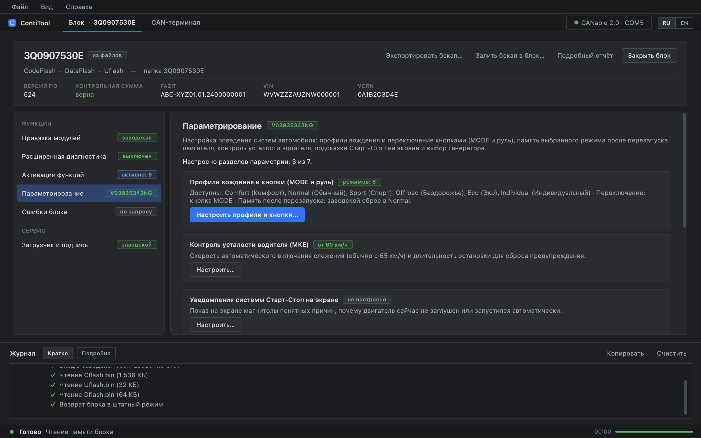
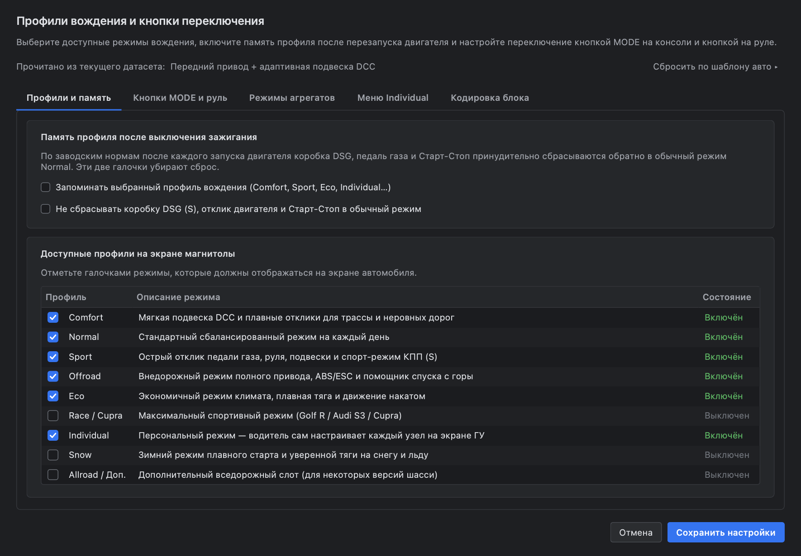
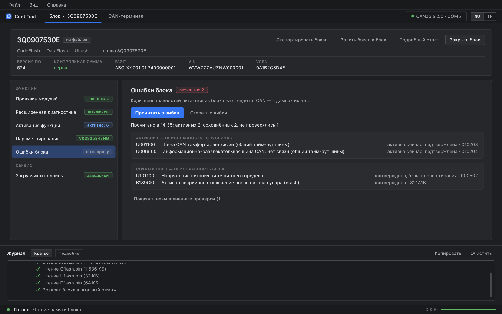
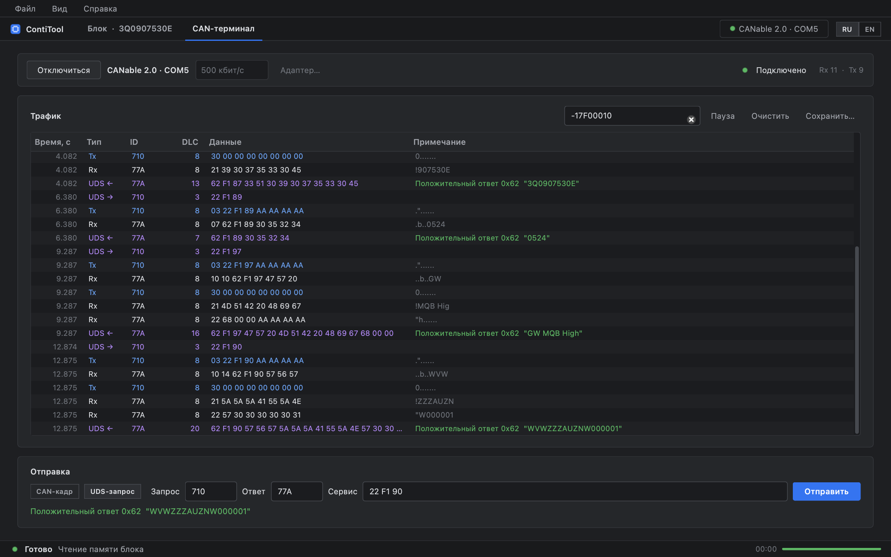
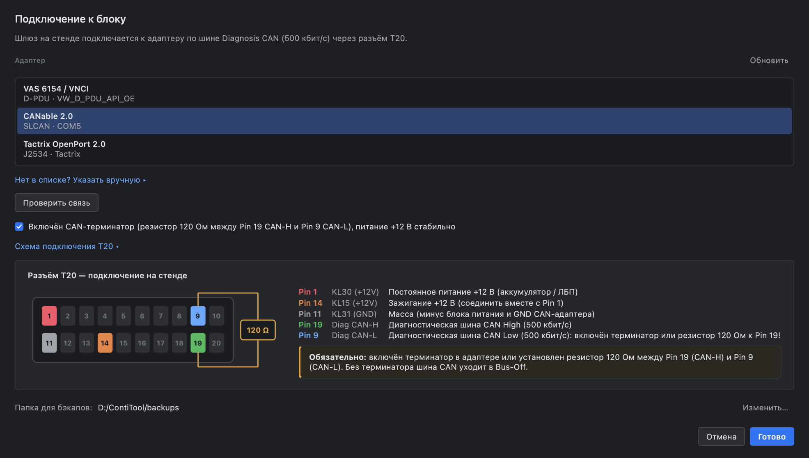
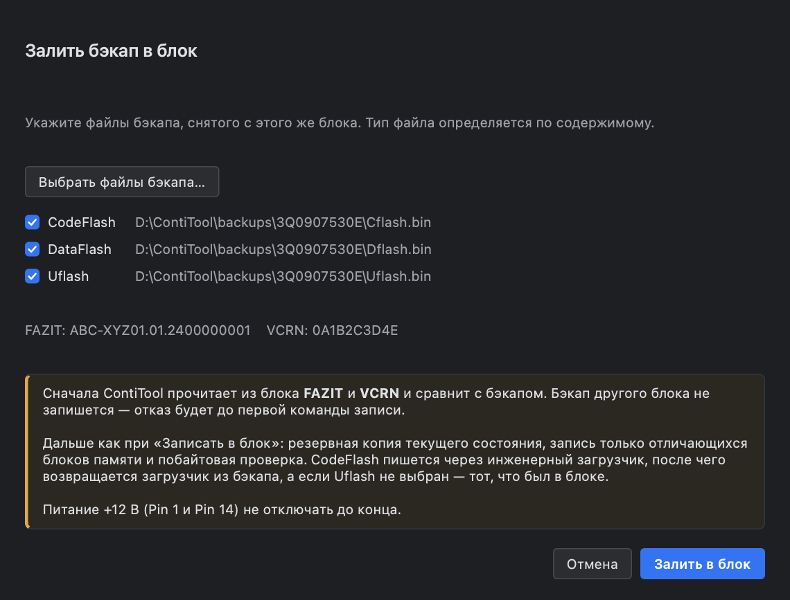
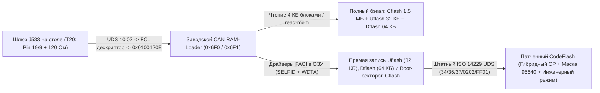

<div align="center">

# ContiTool v2.0 — Continental VAG MQB Gateway J533 (`3Q0 907 530`)
### Renesas RH850/F1L — Diagnosis CAN Studio, Component Protection (`KSCHUTZ`), Engineering Mode & `SWaP / RSA-1024`

[](README.en.md)
[](#быстрый-запуск)
[-0284C7?style=for-the-badge)](#правило-64-кб-dataflash-для-программаторов)
[](#назначение-и-условия-использования)
[](#лицензия)

[](https://vwhacking.antonperk.com)
[](https://www.drive2.ru/users/perkthefox/)
[](https://t.me/perkthefox)

**Made by PerkTheFox** • **🇷🇺 Русский | [🇬🇧 Read in English (`README.en.md`)](README.en.md)** • **[📚 Подробная документация (`docs/`)](docs/README.md)**

</div>

<p align="center">
  
</p>

---

## Назначение и условия использования

- **Область применения**: **ContiTool** — профессиональный стендовый инструмент с графическим интерфейсом (**Qt 6 / PySide6**) и консольным режимом (**CLI**) для автоэлектриков, диагностов и владельцев автомобилей платформы **VAG MQB**, предназначенный для обслуживания шлюзов **Continental J533 (`3Q0 907 530 xx`, Renesas `RH850/F1L`)** на столе: полного резервного копирования памяти по CAN, ремонта/замены гейтвеев, адаптации дооснащаемых блоков (**Component Protection**) и работы с сертификатами **SWaP / FeC**.
- **Этой программой пользоваться НЕ НУЖНО**, если вы не понимаете, зачем она вам «нужна», не умеете работать с ODIS или VCTool, или есть хоть какие-то, даже малейшие подозрения на неисправность адаптера, проводки или питания. Дешёвые китайские адаптеры безопасными не считаются, даже если программа с ними «дружит».
- **Не подключайте программу к рабочей машине.** Работайте со снятым шлюзом на столе и стабилизированным блоком питания. В машине шлюз связывает все блоки: пока он в загрузчике или если запись сорвётся, блоки перестают видеть друг друга — машина может не завестись и не поехать. Кроме того, за время записи напряжение бортсети проседает, а любая просадка или обрыв во время записи ведёт к кирпичу. Если вы всё же подключаетесь к автомобилю — это ваш риск: автор не несёт никакой ответственности за испорченный блок. В личные сообщения об этом не пишите — создайте [Issue на GitHub](https://github.com/perkthefox/mqb_contitool/issues) и ждите ответа.
- **БЕСПЛАТНЫЙ ИНСТРУМЕНТ СООБЩЕСТВА.** Программа бесплатна и всегда лежит на [GitHub](https://github.com/perkthefox/mqb_contitool/releases); продавать её запрещает [лицензия](#лицензия). **Если вам её продали — вас обманули.**
- Программное обеспечение предоставляется **«КАК ЕСТЬ» (`AS IS`)**, без каких-либо гарантий, и предназначено для законного стендового обслуживания собственных блоков и инженерных исследований. Автор (`PerkTheFox`) не несёт ответственности за любой прямой или косвенный ущерб. **Перед любой записью обязательно сохраняйте проверенный полный бэкап всех областей памяти (`Cflash.bin` `1.5 МБ`, `Uflash.bin` `32 КБ`, `Dflash.bin` `64 КБ`)!**

---

## Ключевые возможности

1. **Один рабочий экран вокруг конкретного блока (`GUI`)**:
   - Шлюз открывается один раз — чтением по CAN или из папки с дампами, — после чего весь интерфейс показывает именно его: номер блока, контрольную сумму, `VIN`, `VCRN` и состояние каждой функции отдельной строкой.
   - Слева — список функций блока с их состоянием, справа — страница выбранной функции: что она делает, пошаговые действия (например, для SWaP: свой ключ → сертификат → отправка в блок) и список включённых функций с названиями.
   - Изменения пишутся в копии файлов, оригинальные дампы не трогаются; все чтения и записи складываются по папкам конкретных блоков `contitool_runs/<номер>_<FAZIT>/` (`dumps/base_read` — первый полный слепок блока, `*_flashed` с `manifest.json` — что оказалось в памяти после записи, `writes/` — журналы и пред-бэкапы). Панель внизу показывает статус каждого дампа (`CodeFlash`, `DataFlash`, `Uflash`), сохраняет изменённые файлы в любую папку и одной кнопкой **«Записать в блок»** прошивает **все** изменённые области памяти прямо по шине **Diagnosis CAN** (полностью заменяя стендовый программатор).
   - Перед записью `CodeFlash` по CAN ContiTool сам активирует инженерный загрузчик через `FACI`, если в блоке ещё заводской, пишет нулевой серийник тестера в `F15A` (чтобы блок всегда читался повторно), а при изменении бут-секторов `0x0000..0xBFFF` (ключ `FBL RSA`, Блок `4` и др.) и внутренней `DataFlash` (`64 КБ`) записывает их напрямую через контроллер `FACI` в ОЗУ.
   - **«Залить бэкап в блок»** (в том числе если шлюз **застрял в загрузчике `FBL`** после прерванной записи) и **лечение отпечатка `F15B`**: вы указываете файлы бэкапа, а ContiTool сначала сверяет `FAZIT` / `VCRN` по UDS и отказывает на чужом дампе до первой команды записи; если же блок «молчит» на этапе 1 из-за старого ненулевого отпечатка `F15B`, программа сама предлагает вылечить его одной UDS-перепрошивкой родного `CodeFlash`. **«Экспортировать бэкап»** копирует считанные дампы в удобную папку.
   - **Пошаговая запись параметрии по CAN и ответ самого шлюза**: диалог **«Записать параметрию по CAN»** сам проверяет активные лицензии `SWaP` (`22 3C 00`) и кодировку (`22 06 00`), при необходимости включает недостающие функции `SWaP` прямо в `DataFlash` блока, заливает датасеты `ZDC` по UDS и выставляет нужные биты кодировки `0x0600`. Страница «Активация функций» читает `22 3C 00` — какие функции приняты, а какие отклонены и почему.
   - Во время **каждой** операции строка состояния показывает текущий шаг, прогресс в `%`, объём и скорость передачи (`KB/s`), прошедшее время и оставшееся; при старте ненавязчиво проверяется выход новой версии на GitHub. Журнал внизу окна по умолчанию краткий — операция, её шаги и итог; режим «Подробно» показывает полный технический лог с адресами, UDS и CAN.
   - Мгновенное переключение языка интерфейса **Русский ⇄ English** в один клик.
2. **Полная замена стендового программатора по шине Diagnosis CAN (`500 кбит/с`, без вскрытия корпуса)**:
   - Автопоиск подключённых CAN-адаптеров (`CANable` / `SLCAN`, `SocketCAN`, `PCAN`, `Vector`, `Kvaser`, а на Windows — `J2534 PassThru` (Tactrix, Mongoose…) и `VAS 6154` / `VNCI 6154A` через D-PDU-драйвер ODIS с аппаратным `ISO-TP` в режиме прошивки) с кнопкой «Проверить связь», автоотсевом неподдерживаемых блоков `5Q0` и `Lear` (`PowerPC`), встроенной схемой распиновки **J533 `T20`** и подтверждением CAN-терминатора (`VAS 6154` / `VNCI` и `J2534`-адаптеры терминируют шину сами). Пока идёт операция, второй канал к адаптеру не открывается. Драйвер D-PDU берётся установленный; без вопросов работают версии `27.2` и `31.0` / `31.1`, другие — только после явного подтверждения (при подключении драйвер перепрошивает VCI под свою версию). Для чтения памяти нужен адаптер с прямым USB: SLCAN-клоны с последовательным портом (CH340 и т. п.) теряют кадры.
   - Полное чтение резервной копии по CAN: **`Cflash.bin` (`1.5 МБ` за `~61 с` пакетным `FED_READER`)** + **`Uflash.bin` (`32 КБ`)** + **`Dflash.bin` (`64 КБ`, детерминированное чтение через `FACI Blank Check`)** с контролем `SHA-256`, а также вычитывание произвольного диапазона физических адресов (`can read-mem` — флеш-память, `Local RAM`, регистры).
   - Прямая дифференциальная запись **`DataFlash.bin` (`64 КБ`, `0xFF200000..0xFF20FFFF`)** по CAN через нативный драйвер `FACI` в ОЗУ (`FENTRYR = 0xAA80`, блоки по `64` Б, полная 16-словная запись зоны `ZDC < 0x3040` без ошибки `DTC 000401`, сохранение `ECC` для `R_FDL`, защита `ICUSB 0xF800..0xFFFF`, автосогласование кодировки `0x0600` и 100 % обратная вычитка).
   - Атомарная разблокировка и запись загрузчика **`Uflash` (`32 КБ`)** через контроллер `FACI` в ОЗУ с пред-бэкапом, обратной вычиткой всех `32 КБ` и проверкой живым `RSA`-пробником.
   - Полная запись **`CodeFlash.bin` (`1.5 МБ`)**: бут-секторы `0x00000000..0x0000BFFF` (включая `Sector 5` с ключом `FBL RSA` по `0x0000A2F7` и автосохранением родного 128-битного `SELFID` по `0x0000AB00`) прошиваются напрямую через `FACI`, а основное приложение `FD_0DATA` — по штатному UDS (либо целиком через `--raw-faci`) с побайтовой верификацией всех `1.5 МБ`, проверкой связи (`10 03` / `3E 00`) и чтением/сбросом `DTC`.
   - **CAN-терминал**: отправка своих CAN-кадров (11/29 бит) или UDS-запросов по ISO-TP (ответ собирается целиком, `7F xx 78` обрабатывается, коды отказа расшифровываются), живая таблица трафика с фильтром по ID, паузой, копированием и сохранением в файл, история команд.
   - **Полный цикл одной командой CLI** (`can turnkey`): `Полный бэкап → Разблокировка Uflash → Запись ключей CP в DataFlash → Патчинг и прошивка CodeFlash → Проверка и сброс DTC`.
   - **Расшифровка ошибок**: коды из `19 02` показываются с кодом ODIS (`U023500`, `B189CF0`, …) и описанием на русском или английском для всего набора гейтвея MQB (770 кодов); активные, сохранённые и не проверявшиеся после стирания разделены — последние не являются неисправностями.
3. **Гибридная привязка Component Protection (`KSCHUTZ` `#MoLaLi`)**:
   - Все **12 ведомых банков ЭБУ VAG (`#1..#12`)** с отображением статуса каждого слота и защитой от ошибочной записи нулевого ключа `00..00` или заголовка `SHE M1` (`00..00E5`).
   - 38-байтный гибридный трамплин в `CodeFlash`: все родные заводские ЭБУ автомобиля (`SHE M1..M3` и мастер-ключ `GFA`) продолжают работать штатно, а выбранные дооснащаемые блоки работают на прямых 16-байтных открытых ключах `IKA`.
   - Автоматический обход битовой маски внешней `ST M95640 SPI EEPROM` при записи в ранее пустые банки (`47`, `57`, `3C`, `CF`, `3D`, `A5`, `8C` и др.) без выпаивания микросхемы `95640`.
4. **Инженерный режим (`Developer / Engineering Unit`)**:
   - `CodeFlash`: открытие `Feature 0x80/0x81/0x83`, снятие фильтра адресов живого сервера `ASAM CCP v2.1` (`0x1BFC8600 / 0x1BFC8601`) и разрешение входа в заводской `CAN RAM-Loader` (полностью обратимо в сток).
   - `Uflash`: 4-байтный патч `+0x342A` для приёма любых прошивок и `.odx` по UDS с верным `App CRC-16` без заводской подписи `RSA-1024` (полностью обратимо в сток).
5. **Студия `RSA-1024 (e = 3)`, сертификатов `SWaP FSC v2` и подписи `ODX`**:
   - Генератор ключевых пар `RSA-1024 (e = 3)` на чистом Python с экспортом `.json` + OpenSSL `.private.pem` / `.public.pem`.
   - Синхронная замена публичного модуля в `CodeFlash.bin` и зеркальном кэше `DataFlash.bin` (`NvM 0x7C @ 0xDB04` с пересчётом `CRC-32 @ 0xDCE4` и сохранением родного 5-байтового `VCRN @ 0xDC0C`).
   - Выпуск 171-байтных (`0xAB`) сертификатов активации **VAG SWaP `FSC` v2** (`RIPEMD-160 + RSA-1024`, включая `FPA Driving Profile 10000100`, `MKE 10000300` и др.) для заливки по OBD (`2E 3C 01` + `31 01 C0 01`) и подпись `<FW-SIGNATURE>` (`SHA-1 + RSA-1024`) для `.odx`.

---

## Скриншоты

| | |
|:---:|:---:|
| <br>**Параметрирование** — профили вождения, MKE, Старт-Стоп, генератор | <br>**Профили вождения и кнопки** — редактор FPA |
| <br>**Ошибки блока** — коды ODIS и понятные описания | <br>**CAN-терминал** — UDS по ISO-TP с расшифровкой ответов |
| <br>**Подключение** — найденные адаптеры и схема разъёма T20 | <br>**Заливка бэкапа** — только в тот же блок (FAZIT / VCRN) |

---

## Как работают применённые техники и что важно знать до старта



1. **Полное чтение и запись закрытого шлюза по CAN без вскрытия и без программатора ([подробнее в `docs/can-read-write.md`](docs/can-read-write.md))**:
   - На серийном шлюзе внешний интерфейс процессора закрыт (`Security Lock`), однако переход в бутлодер `Uflash.bin` (`ProgrammingSession 10 02`) доступен штатно. Внутри `Uflash` утилита в два прохода перенаправляет указатель дескриптора флеш-драйвера `Renesas FCL` (`0xFEDE0C68`) на точку входа второго этапа встроенного заводского **`CAN RAM-Loader` (`0x0100120E`, поток `0x6F0 / 0x6F1`)**.
   - Из `RAM-Loader` пакетный стаб `FED_READER` с подпиткой сторожевого таймера вычитывает `Cflash` (`1.5 МБ` за `~61 с`) и `Uflash` (`32 КБ`), а стаб `DFLASH_READER_STUB` детерминированно вычитывает `DataFlash` (`64 КБ`) через диагностический `FACI Blank Check` без шума стёртых ячеек.
   - Для записи любой области памяти в ОЗУ загружаются автономные нативные драйверы `RH850 FACI` с обслуживанием сторожевых таймеров `WDTA0 / WDTA1` и автоподгрузкой 128-битного `SELFID` кристалла из `Cflash + 0xAB00`:
     - **`Uflash` (`32 КБ`)** прошивается единым пакетом в ОЗУ с 4-байтным патчем `+0x342A` и обратной проверкой;
     - **`DataFlash` (`64 КБ`, `0xFF200000..0xFF20FFFF`)** прошивается дифференциально 64-байтными блоками (`FENTRYR = 0xAA80`) с 4-байтной пословной записью, сохраняющей аппаратный `ECC` для драйвера `Renesas FDL` и защищающей системную зону `ICUSB` (`0xF800..0xFFFF`);
     - **`CodeFlash` (`1.5 МБ`)**: бут-секторы `0x00000000..0x0000BFFF` (включая `Sector 5` с ключом `FBL RSA`) записываются через `FACI` с автосохранением родного `SELFID`, а прикладная область `FD_0DATA` заливается по штатному протоколу `UDS` с контролем `App CRC-16/MODBUS` (`0x0000C21C`) — либо целиком через `--raw-faci`.
2. **Гибридный механизм Component Protection ([подробнее в `docs/component-protection.md`](docs/component-protection.md))**:
   - Родные блоки автомобиля хранят ключи в `DataFlash` в виде 64-байтных контейнеров `SHE M1..M3`, раскрываемых аппаратным модулем `ICUS0` (`CMD_LOAD_KEY = 0x40`). Трамплин `ContiTool` (`38` байт по `0x0016FF80`) проверяет хвост буфера `M2/M3`: для заводских контейнеров и мастер-ключа `GFA` (`0xDA00`) вызывается штатный режим `0x40`, а для банков с 16-байтным открытым ключом `IKA` и нулевым хвостом автоматически выбирается `CMD_LOAD_PLAIN_KEY = 0x10`.
3. **Практические особенности при привязке блоков `CP`**:
   - **Ключ `K3` (`IKA`) привязываемого блока должен быть известен заранее**: в трафике CAN и `ODIS` открытый `K3` никогда не передаётся — его необходимо заранее вычитать из дампа памяти самого дооснащаемого или донорского ведомого блока (`5F`, `17`, `13`, `47`, `A5` и т.д.).
   - **100 % запись по Diagnosis CAN**: и патченный `CodeFlash.bin`, и обновлённый `DataFlash.bin` (`64 КБ` с ключами `IKA` или публичным модулем `SWaP RSA`) прошиваются в шлюз напрямую по **Diagnosis CAN** кнопкой **«Записать в блок»** в GUI или командами `can write-dflash` / `can write-cflash` / `can turnkey --set ...` в CLI — внешний стендовый программатор не требуется!

---

## Быстрый запуск

### Вариант 1 — Готовая программа (рекомендуется)

Скачайте архив из раздела **Releases**:
- **Windows**: распакуйте `ContiTool-v2.0.2-windows-amd64.zip` и запустите **`ContiTool.exe`**.
- **macOS**: откройте `ContiTool-v2.0.2-macos-arm64.dmg` (или `.zip`) и запустите **`ContiTool.app`**.
- **Linux**: распакуйте `ContiTool-v2.0.2-linux-x86_64.tar.gz` и запустите **`ContiTool/ContiTool`**.

Установка Python и сторонних библиотек не требуется.

### Вариант 2 — Запуск из исходного кода (`Python 3.12+`)

```bash
python3 -m venv .venv
source .venv/bin/activate        # Windows: .venv\Scripts\activate
pip install -r requirements.txt

# Запуск графического интерфейса (GUI):
python3 conti_cp_tool.py
```

Для самостоятельной сборки `.exe` / `.app`: `pip install -r requirements-dev.txt && python3 scripts/build_release.py` (результат в `dist/release/`).

---

## Подключение шлюза на столе (разъём J533 `T20`)

Для работы по **Diagnosis CAN (`500 кбит/с`)** через адаптер `CANable` / `SLCAN` подключите 5 проводов к 20-пиновому разъёму шлюза:

| Пин J533 `T20` | Цепь | Назначение |
| :---: | :--- | :--- |
| **Pin 1** | `KL30 (+12V)` | Постоянное питание `+12 В` (лабораторный БП `12.5–13.8 В`) |
| **Pin 14** | `KL15 (+12V)` | Зажигание `+12 В` (на столе соединить с `Pin 1`) |
| **Pin 11** | `KL31 (GND)` | Общий минус блока питания и `GND` CAN-адаптера |
| **Pin 19** | `Diag CAN-H` | Диагностическая шина `CAN High` (`500 кбит/с`) |
| **Pin 9** | `Diag CAN-L` | Диагностическая шина `CAN Low` (`500 кбит/с`) |

> [!IMPORTANT]
> **Обязательно установите резистор `120 Ом` между `Pin 19` (`CAN-H`) и `Pin 9` (`CAN-L`)** (либо включите терминатор `120 Ω` на адаптере)! Внутри шлюза `J533` терминатора на линии диагностики нет — без него шина уходит в `Bus-Off`.

### Правило `64 КБ DataFlash` для программаторов

> [!WARNING]
> На корпусе процессора шлюзов `3Q0 907 530 xx` выгравирована маркировка `R7F7010343AFP`, однако физически внутри установлен кристалл подсерии **`R7F7010543AFP / R7F7010563AFP` с полными `64 КБ` DataFlash (`65 536` байт)**, и **все 12 банков `CP` и ключи `SWaP` лежат во второй половине (`0xC000..0xFFFF`)**!
> - **Никогда не выбирайте** профиль `R7F7010343` на `32 КБ` — он обрежет все ключи.
> - **Всегда выбирайте** пресет блока `3Q0907530` или профиль чипа **`R7F7010543` / `R7F7010563` (`64 КБ Dflash`)** при работе со сторонними дампами (при чтении и записи по CAN через **ContiTool** все `64 КБ` обрабатываются автоматически без внешнего программатора).

---

## Сводная таблица 12 банков Component Protection (`DataFlash 64 КБ`)

| Банк | ЭБУ | Блок платформы MQB | Смещение `Dflash` | `NvM` | Маска `95640` | UDS ID | CP CAN TX / RX |
| :---: | :---: | :--- | :---: | :---: | :---: | :---: | :---: |
| `#1` | **`17`** | Приборная панель / Иммо (`J285`) | `0xC000` / `0xC080` | `0x60` | `0x0001` | `714 / 77E` | `17FC0114 / 17FE0114` |
| `#2` | **`09`** | Бортовая сеть `BCM` (`J519`) | `0xC100` / `0xC180` | `0x61` | `0x0002` | `70E / 778` | `17FC010E / 17FE010E` |
| `#3` | **`13`** | Радар адаптивного круиза `ACC` (`J428`) | `0xC200` / `0xC280` | `0x62` | `0x0004` | `757 / 7C1` | `17FC0157 / 17FE0157` |
| `#4` | **`15`** | Подушки безопасности `Airbag` (`J234`) | `0xC300` / `0xC380` | `0x63` | `0x0008` | `715 / 77F` | `17FC0115 / 17FE0115` |
| `#5` | **`47`** | Цифровой усилитель звука (`J525`) | `0xC400` / `0xC480` | `0x64` | `0x0010` | `76F / 7D9` | `17FC016F / 17FE016F` |
| `#6` | **`57`** | ТВ-тюнер (`R78`) | `0xC500` / `0xC580` | `0x65` | `0x0020` | `76D / 7D7` | `17FC016D / 17FE016D` |
| `#7` | **`5F`** | Мультимедиа `MIB1 / MIB2 / MIB3` (`J794`) | `0xC600` / `0xC680` | `0x66` | `0x0040` | `773 / 7DD` | `17FC0173 / 17FE0173` |
| `#8` | **`3C`** | Ассистент смены полосы `Master` (`J769`) | `0xC700` / `0xC780` | `0x67` | `0x0080` | `74E / 7B8` | `17FC014E / 17FE014E` |
| `#9` | **`CF`** | Ассистент смены полосы `Slave` (`J770`) | `0xC800` / `0xC880` | `0x68` | `0x0100` | `78A / 7F4` | `17FC018A / 17FE018A` |
| `#10` | **`3D`** | Спецфункции (`J608`) | `0xC900` / `0xC980` | `0x69` | `0x0200` | `72C / 796` | `17FC012C / 17FE012C` |
| `#11` | **`A5`** | Передняя камера ассистентов (`R242`) | `0xCA00` / `0xCA80` | `0x6A` | `0x0400` | `74F / 7B9` | `17FC014F / 17FE014F` |
| `#12` | **`8C`** | ВВ-батарея гибрида / EV (`J840`) | `0xCB00` / `0xCB80` | `0x6B` | `0x0800` | `77B / 7E5` | `17FC017B / 17FE017B` |
| `Mst` | **`19`** | Мастер-ключ самого шлюза `GFA` (`Master`) | `0xDA00` / `0xDA80` | `0x7B` | — | `710 / 77A` | *Не трогать!* |

---

## Консольный режим (`CLI`)

Запуск `python3 conti_cp_tool.py` без аргументов открывает графическую студию; любая подкоманда запускает `CLI` с живым прогресс-баром (`-l ru` / `-l en`):

```bash
# Справка по всем командам и инспекция дампов:
python3 conti_cp_tool.py --help
python3 conti_cp_tool.py inspect --cflash Cflash.bin --dflash Dflash.bin --uflash Uflash.bin

# Привязка CP под ключ (гибридный трамплин + авто-обход 95640 для пустых банков + запись IKA):
python3 conti_cp_tool.py bind-cp \
  --cflash-in Cflash.bin --dflash-in Dflash.bin \
  --cflash-out Cflash_cp.bin --dflash-out Dflash_cp.bin \
  --set 5F=A1B2C3D4E5F60718293A4B5C6D7E8F90

# Включение Инженерного режима и выпуск собственного сертификата SWaP FSC (FPA 10000100):
python3 conti_cp_tool.py patch-engineering --cflash-in Cflash.bin --cflash-out Cflash_eng.bin --uflash-in Uflash.bin --uflash-out Uflash_eng.bin
python3 conti_cp_tool.py set-rsa-key --generate-key swap_key.json --cflash-in Cflash.bin --cflash-out Cflash_swap.bin --dflash-in Dflash.bin --dflash-out Dflash_swap.bin --target swap
python3 conti_cp_tool.py sign-fsc --key swap_key.json --dflash Dflash_swap.bin --fec 10000100 -o fpa_10000100.fsc

# Операции по шине Diagnosis CAN (автопоиск адаптеров, чтение/запись всех областей и цикл в 1 команду):
python3 conti_cp_tool.py can ports
python3 conti_cp_tool.py can backup --port /dev/ttyACM0
python3 conti_cp_tool.py can write-dflash --port /dev/ttyACM0 --dflash Dflash_cp.bin --yes
python3 conti_cp_tool.py can write-cflash --port /dev/ttyACM0 --cflash Cflash_cp.bin --yes
python3 conti_cp_tool.py can read-mem --port /dev/ttyACM0 --address 0xFF20C000 --length 0x1000 --out-file cp_banks.bin
python3 conti_cp_tool.py can turnkey --port COM4 --set 5F=A1B2C3D4E5F60718293A4B5C6D7E8F90 --clear-dtc --yes
```

---

## Частые вопросы (FAQ)

**Почему ContiTool отказывается работать с гейтвеями `5Q0 907 530` или `3Q0 907 530` от `Lear`?**
Потому что внутри них стоит совершенно другой процессор — **NXP PowerPC (`MPC5607B` / `MPC5748G` VLE)** без `Uflash`, `FACI` и `ICUS0`, даже если каталожный номер совпадает (`3Q0 907 530 AA` у Lear) или блок отвечает как `EV_GatewConti` (`5Q0` от Continental). ContiTool распознаёт их при проверке связи (`F191` / `F187` / `F1A3` / `F19E` / `F17C`) и блокирует запуск до отправки команд загрузчика. Поддерживаются только блоки **Continental `3Q0 907 530 xx` на Renesas `RH850/F1L`**.

**Шлюз после прошивки перестал читаться («молчит» на этапе 1 входа в `RAM-Loader`). Поможет ли прошить его через ODIS?**
**Нет — ODIS это не лечит, а сам вызывает ту же самую проблему.** Причина в том, что последний `F15B` в набивке этапа 1 укладывает байты `2..5` серийного номера тестера на служебную ячейку загрузчика `0xFEDE0C62` (флаг «не отвечать»). И `ContiTool` до `v2.0.1d` (`01 02 03 04 05 06` → `0x03`), и `ODIS` (свой ненулевой серийник → напр. `0xC8`) оставляли там ненулевой байт, после чего этап 1 молчал. Начиная с `v2.0.1e`, `ContiTool` всегда пишет нулевой серийник, а в `v2.0.2` при таком молчании останавливается до отправки ключа (чтобы не вызвать `7F 27 37`) и сам предлагает **лечение**: одну штатную перепрошивку приложения этого же блока по UDS с нулевым серийником (проверено на стенде).

**Как восстановить блок, застрявший в загрузчике (`FBL`) после прерванной записи?**
Нажмите на стартовом экране **«Залить бэкап…»** и выберите папку бэкапа этого блока. ContiTool сам распознаёт, что шлюз сидит в `FBL`, проверит принадлежность дампа по `22 F1 7C` (`FAZIT`) по UDS без входа в `RAM-Loader` и сразу зальёт приложение. Если загрузчик отвечает `7F 27 37` (защитная задержка), программа попросит отключить питание `+12 В` на `10` секунд и сама продолжит запись после включения.

**VNCI не подключается, хотя драйвер поддерживается.**
Переподключите адаптер или нажмите «Проверить связь» несколько раз подряд. При подключении драйвер D-PDU сам перепрошивает адаптер под свою версию (около 30 секунд), и ContiTool принимает это за ошибку связи CAN. Если не помогло — перезагрузите компьютер.

**Дешёвый китайский адаптер «работает» — значит, им можно пользоваться?**
Нет. Любые дешёвые китайские адаптеры не считаются безопасными, даже если программа с ними «дружит». Адаптер за 2 доллара повышает шанс окирпичивания на 99,9 %.

**Во время первичного чтения связь оборвалась, и шлюз не выходит на связь.**
Выключите зажигание на несколько секунд и включите снова, в крайнем случае снимите клемму аккумулятора. На столе — снимите питание +12 В на несколько секунд. И вообще, на живой машине лучше с этим не играть.

**Нужен ли ODIS, чтобы работать с VAS 6154 / VNCI?**
Нет. Нужен только драйвер **VW D-PDU API** — это отдельный пакет (`VW_D-PDU_API_Win_x64` плюс дополнение для VAS 6154), сам ODIS не требуется.

**На компьютере несколько драйверов D-PDU — какой возьмёт программа?**
Все найденные показываются отдельными строками в окне «Подключение» (например `OE`, `OS`, `VCTOOL`) с версией каждого. По умолчанию выбирается вариант ODIS-E, но можно выбрать любой другой — выбор запоминается. Если адаптер не отвечает через один драйвер, попробуйте другой.

**Обновите прошивку адаптера VAS 6154 / VNCI.** Часть адаптеров со старой прошивкой отказывает в сыром канале CAN, без которого чтение памяти не работает. Прошивку обновляет сам драйвер D-PDU при первом подключении (около 30 секунд) — дождитесь окончания и не отключайте адаптер.

**«Адаптер не даёт сырой канал CAN» — что это значит?**
ContiTool читает память через RawMode на контактах 6/14. Часть адаптеров его не предоставляет: чужие драйверы J2534, а также часть VAS 6154 / VNCI, в том числе настоящих, — отказ приходит от самого адаптера на всех драйверах. В этом случае программа пробует запасной режим (связь в стиле ODIS по фиксированным идентификаторам) и сама проверяет его одним запросом. Если и он не отвечает — адаптер не подойдёт; попробуйте другой драйвер D-PDU, иначе другой адаптер.

**Драйвер не установлен или ставить его нельзя.**
Скопируйте папку установленного драйвера в `dpdu/` рядом с ContiTool — программа найдёт её сама и покажет первой в списке. Запись в реестр и права администратора не нужны, нужна 64-разрядная сборка. Свой драйвер ContiTool не распространяет: это файлы Volkswagen, копию берёте свою.

**Как сообщить о проблеме?**
После ошибки ContiTool сам предложит отчёт (или «Справка → Сообщить о проблеме…»): соберёт архив с журналами программы, операции и драйвера D-PDU (дампы памяти `*.bin` по умолчанию не включаются, но при необходимости их можно приложить отдельной галочкой) и откроет страницу нового [issue на GitHub](https://github.com/perkthefox/mqb_contitool/issues) с заполненным текстом — останется перетащить туда архив. В личные сообщения автору не пишите.

## Подробная техническая документация (`docs/`)

В папке **[`docs/`](docs/README.md)** собрано конкретное побайтовое описание работы всех механизмов без лишнего отладочного шума:

- **[`docs/can-read-write.md`](docs/can-read-write.md)** — как именно устроены вход в заводской `CAN RAM-Loader` (`0x0100120E`) через подготовку дескриптора `FCL` (`0xFEDE0548`), чтение всех областей памяти (`can backup` / `read-mem`), прямая запись `Uflash` (`32 КБ`), `DataFlash` (`64 КБ`) и бут-секторов `CodeFlash` через регистры `FACI` с автозагрузкой `SELFID`, а также штатная UDS-прошивка `FD_0DATA`.
- **[`docs/component-protection.md`](docs/component-protection.md)** — архитектура `KSCHUTZ` и `ICUS0`, дизассемблер 38-байтного гибридного трамплина, обход маски `95640`, полная карта `DataFlash` (`64 КБ`), 4-кадровое рукопожатие `80 01 / C0 01 / 80 02 / C0 02` и двухшаговая UDS-адаптация ведомого блока (`2E 00 BE → 2E 00 BD`).
- **[`docs/engineering-and-swap.md`](docs/engineering-and-swap.md)** — бинарные патчи Инженерного режима, протокол `ASAM CCP v2.1` (`0x1BFC8600`), заливка параметрии `ZDC` без `RSA`, сервисные `DID` / `RoutineControl`, устройство ключей `RSA-1024 (e = 3)`, сертификатов `SWaP FSC v2` и подписи `ODX`.

> [!NOTE]
> **Важно при работе с ИИ-агентами (Claude Code и др.):**  
> Файлы в папке `docs/` содержат низкоуровневые спецификации загрузчика, регистров флеш-памяти и криптопротоколов ЭБУ, из-за чего их чтение через ИИ-агентов может вызывать ложные срабатывания автоматических фильтров безопасности (`safeguards`). В `CLAUDE.md` прописан запрет на автоматическое чтение `docs/` — **не просите агентов читать папку `docs/` целиком**, а при необходимости указывайте им только конкретный нужный раздел.

---

## Структура проекта

```text
├── conti_cp_tool.py              # Точка входа (без аргументов открывает GUI, с аргументами — CLI)
├── CLAUDE.md                     # Правила репозитория для разработчиков и ИИ-ассистентов
├── docs/                         # Подробная инженерная документация по протоколам и памяти (RU / EN)
├── scripts/build_release.py      # Кроссплатформенная сборка релизов .exe / .app / .dmg
├── src/contitool/
│   ├── core/                     # Анализ дампов, CRC-16/32, патчи CP/Engineering и криптография RSA/SWaP
│   ├── can/                      # Драйвер ISO-TP / 0x6F0 RAM-Loader, автопоиск портов и CAN-сценарии
│   ├── cli/                      # Терминальные таблицы, прогресс-бар и команды CLI
│   └── gui/                      # Настольное приложение на Qt 6 / PySide6 и встроенный CAN-терминал
└── tests/                        # Автотесты алгоритмов, протоколов и интерфейса (pytest)
```

## Участие и обратная связь

- **Ошибка или сбой операции** — [Issue](https://github.com/perkthefox/mqb_contitool/issues/new/choose) по форме «Проблема». Проще всего — кнопкой **«Создать отчёт…»** в программе после ошибки: архив с журналами сохранится, а форма откроется уже заполненной.
- **Вопросы** («как подключить», «какой адаптер») — в [Discussions](https://github.com/perkthefox/mqb_contitool/discussions). В личные сообщения не пишите.
- **Доработки** — см. [`CONTRIBUTING.md`](CONTRIBUTING.md). Уязвимость в самой программе — [`SECURITY.md`](SECURITY.md).

## Лицензия

ContiTool © 2026 PerkTheFox распространяется под **[PolyForm Noncommercial 1.0.0 с дополнительными условиями](LICENSE)**. Коротко (юридически действует только текст `LICENSE`):

- **код открыт** — его можно читать, изучать и дорабатывать;
- **бесплатно** для личного и некоммерческого использования, а также **для платного ремонта и диагностики**: автосервису можно работать программой с клиентами;
- **продавать нельзя** — ни саму программу, ни копии, ни доступ к ней, ни в составе платных сборок;
- **доработанные версии** можно распространять только с открытым исходным кодом на тех же условиях и с сохранением строки об авторстве (`Required Notice`).

Сторонние компоненты готовых сборок (Qt / PySide6 и python-can под LGPL-3.0 и другие) — в [`THIRD_PARTY_NOTICES.md`](THIRD_PARTY_NOTICES.md).

---

<div align="center">

**Made by PerkTheFox**  
[vwhacking.antonperk.com](https://vwhacking.antonperk.com) • [Drive2: perkthefox](https://www.drive2.ru/users/perkthefox/) • [Telegram: @perkthefox](https://t.me/perkthefox)  
*Бесплатно для сообщества исследователей VAG. Если вам её продали — вас обманули.*

</div>
