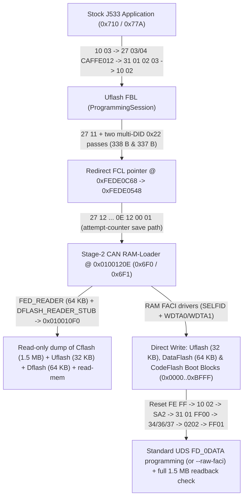

# Live Diagnosis CAN (`500 kbit/s`) Read & Write Mechanism on J533

[](can-read-write.md) • [Back to `docs/` Index](README.md)

This document explains concretely — with exact RAM/Flash addresses, `FACI` hardware registers, RH850 opcodes, and CAN frames — how **ContiTool** 100% replaces an external bench programmer over the 20-pin `T20` Diagnosis CAN connector on an unmodified, factory-locked **Continental VAG MQB J533 Gateway (`3Q0 907 530 xx`, Renesas `RH850/F1L`)**: reading all memory regions (`Cflash`, `Uflash`, `Dflash`, plus arbitrary `read-mem` ranges), unlocking and programming `Uflash` (`32 KB`), differentially programming `DataFlash` (`64 KB`), and flashing all of `CodeFlash` (`1.5 MB`, including boot blocks `0x00000000..0x0000BFFF` and `FD_0DATA`) without opening the ECU housing.

---

## 1. Physical Layer & `RH850/F1L` Memory Map

### Bench Harness Wiring (`J533 T20`, `500 kbit/s`)

| `T20` Pin | Signal | Function |
| :---: | :--- | :--- |
| **Pin 1** | `KL30 (+12V)` | Permanent `+12V` bench supply (`12.5–13.8 V`, `>= 1 A`) |
| **Pin 14** | `KL15 (+12V)` | Ignition `+12V` (bridge together with `Pin 1` on bench) |
| **Pin 11** | `KL31 (GND)` | Common ground (power supply minus & CAN adapter `GND`) |
| **Pin 19** | `Diag CAN-H` | Diagnosis `CAN High` (`500 kbit/s`) |
| **Pin 9** | `Diag CAN-L` | Diagnosis `CAN Low` (`500 kbit/s`) |

A **`120 Ω` termination resistor** across **`Pin 19`** and **`Pin 9`** is mandatory (`J533` has no internal termination on its diagnostic CAN pair).

### CAN Identifier Pairs on Diagnosis CAN

1. **Standard `ISO 14229 UDS` over `ISO 15765-2 (ISO-TP)`**:
   - **`0x710`** (11-bit, Tester TX → Gateway, SingleFrame padded with `0xAA`, ConsecutiveFrame with `0x00`);
   - **`0x77A`** (11-bit, Gateway RX → Tester).
2. **Continental Factory Stream Loader (`CAN RAM-Loader`)**:
   - **`0x6F0`** (11-bit, raw 8-byte stream frames without `ISO-TP` headers);
   - **`0x6F1`** (11-bit, sync replies, status frames, and raw memory dump stream).

### `R7F7010543AFP / R7F7010563AFP` Address Space

| Region | Address Range | Size | Contents |
| :--- | :---: | :---: | :--- |
| **`Cflash` (Boot + OTP)** | `0x00000000 .. 0x0000BFFF` | `49,152` B | Reset vector, `Block 4` (`0x00008000..0x00009FFF`: `FBL` `"NIGB"` programming record, status at `0x00008023`), `Block 5` (`OTP` byte at `0x0000A167`, `FAZIT` at `0x0000A240`, `FBL RSA-1024` modulus at `0x0000A2F7`, `SA2` bytecode at `0x0000A377`, chip 128-bit `SELFID` at `0x0000AB00`) |
| **`Cflash` (Presence)** | `0x0000C000 .. 0x0000C1FF` | `512` B | Application presence header (`0x90482442` LE at `0x0000C000`, `0xFFFFFFFF` at `0x0000C100`) |
| **`Cflash` (`FD_0DATA`)** | `0x0000C200 .. 0x0017FFFF` | `1,523,200` B | Main Gateway Application (`App CRC-16/MODBUS` at `0x0000C21C`, range count `1` at `0x0000C21E`, `[start, end]` bounds at `0x0000C220..0x0000C227`) |
| **`Uflash` (`Ext. User Area`)** | `0x01000000 .. 0x01007FFF` | `32,768` B | Flash Bootloader (`FBL`) + embedded Continental `CAN RAM-Loader` (`Stage 1 @ 0x01000BCC`, `Stage 2 @ 0x0100120E`, `RSA` verifier @ `0x010033FC / +0x342A`) |
| **`Dflash` (`Data Flash`)** | `0xFF200000 .. 0xFF20FFFF` | `65,536` B | `ZDC` datasets (`0x0000..0x303F`), 12 `CP` banks (`0xC000..0xCBFF`), Master Key `GFA` (`0xDA00`), `SWaP RSA` cache + `VCRN` (`0xDB00`), 15 `FSC` slots (`0xDD00..0xE83F`) |
| **`Local RAM`** | `0xFEDE0000 .. 0xFEDFFFFF` | `131,072` B | `FBL` working variables (`0xFEDE0000..`), `RAM-Loader` staging window (`0xFEDF8020..0xFEDFFEFF`), and reset-retention word (`0xFEDFFFF0`) |

### Supported vs. Unsupported `J533` Hardware Platforms

Within the **VAG MQB J533** family, gateways with similar — or even identical — VAG part numbers were built on completely different microcontroller architectures. During link verification (`can_identify` / `unsupported_ecu_reason`), **ContiTool** inspects `F187` / `F191` / `F189` / `F1A3` / `F17C` / `F19E` and blocks `RAM-Loader` entry on non-`RH850` hardware:

| Generation & Vendor | Part Number (`F187` / `F191`) | `HW` (`F1A3`) / `SW` (`F189`) / `ODX` (`F19E`) | Microcontroller | ContiTool Status |
| :--- | :--- | :--- | :--- | :---: |
| **Continental MQB Gen 2** | `3Q0 907 530 A..AR`, pre-series `V03 825 216 A..G` | `HW 5xx`, `SW 5xxx`, `EV_GatewConti`, `FAZIT SJ8-FST…` | **Renesas `RH850/F1L`** (`R7F7010543AFP` / `R7F7010563AFP`) | **Supported** |
| **Continental MQB Gen 1** | `5Q0 907 530 .. AF`, `8V0 907 468`, `5QE 907 530`, `8S0 907 468` (plus early `3Q0` with `HW 2xx`) | `HW 201..212`, `SW 2120..2227`, `EV_GatewConti` | **NXP `MPC5607B`** (*Bolero*, 32-bit BE PowerPC VLE, `1 MB` Flash, no `Uflash`) | Unsupported |
| **Lear MQB Gen 1 / Gen 2** | `5Q0 907 530 .. AJ` and **`3Q0 907 530 AA / AC / AG / AL / AN…`** | `HW 1xx / X2x / 4xx / H4x`, `SW 1xxx / 4xxx`, `EV_GatewLear`, `FAZIT LG… / LCE…` | **NXP `MPC5607B` / `MPC5748G`** (*Calypso*, PowerPC VLE) | Unsupported |
| **MQB-A0 / MQB-Evo** | `2Q0 907 530 …`, `5WA 907 530 …` | Different architecture generations & `SFD` | Other platforms | Unsupported |

> [!NOTE]
> Early **Continental `5Q0`** gateways (`MPC5607B`) share the same `EV_GatewConti` ODX name, `20103` login, static `0xCAFFE012` precondition password, and `SA2` polynomial (`0x1EDC6F41`) as `3Q0`, so without an explicit hardware check they would pass `10 03 → 27 03/04 → 10 02` and fail only inside the PowerPC bootloader. Meanwhile, **Lear Gen 2** gateways use **the exact same `3Q0 907 530 AA` part numbers** as Continental `RH850` units and are distinguished by `EV_GatewLear`, `FAZIT LG…`, and `HW 4xx / SW 4xxx`.

---

## 2. End-to-End CAN Pipeline Overview



On a factory-sealed production gateway, three protections are active:
1. The MCU serial programming interface is locked (`Security Lock`).
2. The application-level `CAN RAM-Loader` trigger (`0x07FC80FE`) is blocked by `Feature 0x81` and `OTP [0x0000A167] != 0x00`.
3. Standard UDS flashing in `Uflash` requires a factory `RSA-1024` signature during `CheckMemory (31 01 02 02)`.

To operate without opening the unit, **ContiTool** enters the standard `Uflash` `ProgrammingSession (10 02)` and transfers execution directly to **`0x0100120E`** — Stage 2 of Continental's own `CAN RAM-Loader` already compiled into every stock `Uflash.bin`.

---

## 3. Entering the Factory `CAN RAM-Loader` (`0x0100120E`) on Stock Firmware

### Phase 1 — Entering `ProgrammingSession (10 02)` from Application (or Directly from `FBL`)

When the normal Gateway Application is running, the tester unlocks programming preconditions using the static password `CA FF E0 12` and switches into `Uflash`:

```text
TX 0x710: 02 10 03 AA AA AA AA AA          -> RX 0x77A: 06 50 03 00 32 01 F4 AA
TX 0x710: 02 27 03 AA AA AA AA AA          -> RX 0x77A: 06 67 03 <S0 S1 S2 S3> AA
TX 0x710: 06 27 04 CA FF E0 12 AA          -> RX 0x77A: 02 67 04 AA AA AA AA AA
TX 0x710: 04 31 01 02 03 AA AA AA          -> RX 0x77A: 05 71 01 02 03 00 AA AA
TX 0x710: 02 10 02 AA AA AA AA AA          -> RX 0x77A: 03 7F 10 78 AA -> 06 50 02 00 19 01 F4 AA
```

Upon receiving `10 02`, the application writes magic `0xA5430911` to retained SRAM word `0xFEDFFFF0` and performs a software reset into `Uflash.bin` (`0x01000000`).

If the gateway is **already sitting in `FBL`** — either after an interrupted flash (`10 03` returns `7F 10 7E` / `7F 10 12`) or after a cold power-on with erased application flash (`FBL` boots in `DefaultSession`, answers `50 03` to `10 03`, rejects `27 03` with `7F 27 7F` / `7F 27 12`, lacks application-only DIDs `F197`/`0600`, and sets bit `0x04` = `0x44` in `22 F1 DF`) — precondition refusals are ignored and `10 02` is sent directly.

### Phase 2 — Two-Stage `0x22` Response Buffer Overrun & `Renesas FCL` Descriptor Staging in RAM

There is no stock UDS command to enter `RAM-Loader` on a locked unit — instead, `Uflash`'s `ReadDataByIdentifier (0x22)` response buffer overrun is used. Inside `Uflash`, key structures occupy fixed `Local RAM` addresses:

| `Local RAM` Address | Role in `Uflash.bin` |
| :---: | :--- |
| `0xFEDE0052` | 1-byte RAM scratch cell: `2E 04 10 <XX>` writes `<XX>`, and `22 04 10` returns `04 10 <XX>` (`1` data byte) |
| `0xFEDE0536` | Incoming multi-frame UDS request buffer (`ISO-TP RX`): request offset `+0x12` maps to aligned **`0xFEDE0548`**, and the tail of a 22-byte `27 12` frame lands at `0xFEDE0558` (`0xFEDE0548 + 0x10`) |
| `0xFEDE0AF3` | `SecurityAccess` state byte (`0x03` after `27 11` issues a `Seed`; `0x22` reads do not reset it) |
| `0xFEDE0AF8` | 9-byte RAM staging buffer written by `2E F1 5A` (`0x0100440E`) until application flash erase commits it |
| `0xFEDE0B18` | Outgoing `0x22` response buffer cleared via `memset(..., 0, 0x14A)` — **`330` bytes** (`0xFEDE0B18 .. 0xFEDE0C61`) |
| **`0xFEDE0C62 .. 0xFEDE0C69`** | `FBL` request-dispatcher state cells immediately past `0xFEDE0B18`: **`0xFEDE0C62` is the suppress-positive-response ("do not answer") flag**, and **`0xFEDE0C68`** (`+336` B past `0xFEDE0B18`) is the active `Renesas FCL` descriptor pointer (boot value `0xFEDE0014` = `14 00 DE FE` LE) |

The `0x22` handler (`0x01003DC2`) accepts up to **19 DIDs** in one 39-byte request and appends their payloads into `0xFEDE0B18` without checking the `330`-byte boundary:
- **Target descriptor `0x0100120E`**: three unsupported DIDs (`0x000E`, `0x1200`, `0x0100`) are omitted from the assembled response while remaining intact inside the `ISO-TP` request buffer, where their IDs form target address **`0x0100120E`**.
- **Fixed-length padding**: the remaining DIDs — `F17C` (`23` B data), `F1A2` (`6` B), `F15B` (`20` B: FBL's loop always copies two 10-byte `NvM` records), and `0410` (`1` B) — calibrate the exact output length on every gateway so the overrun lands squarely on `0xFEDE0C62..0xFEDE0C69`.

Staging `0xFEDE0C68 → 0xFEDE0548` proceeds in three steps:

1. **`27 11`** → `FBL` replies `67 11 <Seed>` and places `0xFEDE0AF3` into state `3` (awaiting `27 12`).
2. **Stage 1 (`338`-byte response — 8-byte overrun onto `0xFEDE0C62..0xFEDE0C69`, writing `0x05` to `0xFEDE0C69`)**:
   - `2E 04 10 05` writes `0x05` to `0xFEDE0052`.
   - 19-DID `0x22` request (`39` bytes): `6 × F17C` + `F1A2` + `F15B` + `[000E, 1200, 0100]` + `7 × F15B` + `0410`.
   - The `338`-byte response (`62 ... 04 10 05`) spills `resp[330..337]` onto `0xFEDE0C62..0xFEDE0C69`, writing `0x10` to `0xFEDE0C68` and `0x05` to `0xFEDE0C69` (`0xFEDE0C68` becomes `0xFEDE0510`, upper bytes `DE FE` untouched).
3. **Stage 2 (`337`-byte response — writes `0x48` to `0xFEDE0C68`, never answered on CAN)**:
   - `2E 04 10 48` writes `0x48` to `0xFEDE0052`.
   - 19-DID `0x22` request: `8 × F15B` + `[000E, 1200, 0100]` + `6 × F15B` + `F17C` + `0410`.
   - The assembled **`337`-byte** response overwrites `0xFEDE0C62..0xFEDE0C68` while preserving `0xFEDE0C69 = 0x05`. Because non-zero ASCII `FAZIT` digits from `F17C` land on `0xFEDE0C62` (the suppress-response flag), **FBL never transmits a CAN reply to Stage 2** — yet in RAM `0xFEDE0C68` is now **`0xFEDE0548`** (`48 05 DE FE`).

### Phase 3 — Dispatch to `0x0100120E` via Deliberate Wrong-Key Trigger `27 12`

Immediately after Stage 2, the tester sends a 22-byte `SendKey` frame:

```text
27 12 DE AD BE EF 00 00 00 00 00 00 00 00 00 00 00 00 0E 12 00 01
```

1. Stored at `0xFEDE0536` in the `ISO-TP` RX buffer, its trailing 4 bytes `0E 12 00 01` (**`0x0100120E`** LE) land at `0xFEDE0558 = 0xFEDE0548 + 0x10`.
2. `SendKey` (`0x01002F92`) sees the mismatching key `DE AD BE EF`, increments the attempt counter (`0xFEDE0AEE`), and invokes the `FCL` persistence path (`0x01001002` → `0x01001AA8` → dispatcher `0x01004B66`).
3. With the staged state in place, `0x01004B66` dereferences `0xFEDE0C68` (`0xFEDE0548`), fetches `*(uint32_t *)(0xFEDE0548 + 0x10) == 0x0100120E`, and jumps into **`CAN RAM-Loader`**, which answers with the **`J533-RCE-OK`** beacon on `0x6F1`.

### Descriptor & Programming Fingerprint (`F15B` / `0xFEDE0C62`): Why Some Gateways Went Silent on Stage 1 & How It Is Cured

Some gateways that had previously had their application reflashed over UDS stayed completely silent on Stage 1, even though `10 02`, `27 11`, and `2E 04 10 05` succeeded normally:

1. **What `F15B` places onto `0xFEDE0C62`:**
   - In `FBL`, `22 F1 5B` returns two 10-byte records: `[3 B BCD date, 6 B tester serial, 1 B status]`.
   - The final `F15B` copy in Stage 1's padding lands bytes `5..9` of the second record squarely onto **`0xFEDE0C62 .. 0xFEDE0C66`** — specifically **bytes `2..5` of the 6-byte tester serial** (`0xFEDE0C62..0xFEDE0C65`) and the status byte (`0xFEDE0C66`).
   - Cell **`0xFEDE0C62`** is FBL's **suppress-positive-response ("do not answer") flag**. Whenever a non-zero byte lands there, FBL silently drops the Stage 1 reply!
   - **`ContiTool <= v2.0.1d`** wrote `2E F1 5A` with tester serial `01 02 03 04 05 06` when flashing the application: byte `0x03` landed on `0xFEDE0C62`, causing Stage 1 to stay silent on every subsequent entry.
   - **ODIS writes its own non-zero tester serial** (e.g. `01 81 C8 F6 30 39` in a `2026-11-08` log, placing `0xC8` on `0xFEDE0C62`). The effect is identical — so **"flashing via ODIS cures it" is false; ODIS triggers the exact same silence**.
2. **Disproved hypotheses & preventing `7F 27 37` security lockouts:**
   - In `v2.0.1d`, a misread `rizin` disassembly led to a "`0xFEDE0C66` gate byte" theory with per-ECU request rebuilding; checking real bench logs disproved it (`0x00` in every working response), and request rebuilding was removed.
   - `v2.0.1e` still sent `27 12 deadbeef` even when Stage 1 stayed silent. Without the prepared overrun, FBL treated `deadbeef` as a genuine wrong key! On a gateway stuck in `FBL` without a valid app, after reset `27 11` then answered **`7F 27 37` (`requiredTimeDelayNotExpired`) until full `+12 V` power-off**. Reverted in `v2.0.2`: if Stage 1 times out, **ContiTool stops immediately BEFORE sending `27 12`**, safely reads `22 F1 5B` for the diagnostic report (`0x22` leaves `0xFEDE0AF3 = 3` intact), and raises `Stage1SilentError`.
3. **Why `2E F1 5A` alone cannot fix flash before reading, and the bench-verified fix + cure (`v2.0.1e+` / `v2.0.2`):**
   - `2E F1 5A` (`0x0100440E`) writes the fingerprint **only to RAM (`0xFEDE0AF8`)**. FBL commits it to flash **exclusively inside `EraseMemory` (`31 01 FF 00 01 01`, `0x0100323E`)** — no other flash path exists.
   - **Prevention (`>= v2.0.1e`):** `ContiTool` always writes a **zero tester serial** (`FBL_TESTER_SERIAL = 00 00 00 00 00 00`, matching factory blank records), keeping `0xFEDE0C62..0xFEDE0C65` zero.
   - **Curing an already-affected gateway (`can_cure_fbl_fingerprint` in `v2.0.2`):** on `Stage1SilentError`, `ContiTool` offers **one UDS reflash of the unit's own `CodeFlash` application (`FD_0DATA`) with a zero serial** (ownership verified upfront against `22 F1 7C` `FAZIT` without `RAM-Loader`, bench-verified). If the gateway still has a factory `Uflash` (`rsa_status != 0`) that rejects the unsigned image at `31 01 02 02`, `F15B` has **already** been overwritten with zeros by `31 01 FF 00 01 01` — so `RAM-Loader` entry works again immediately and `ContiTool` finishes automatically via the stuck-gateway restore path.

---

## 4. `0x6F0 / 0x6F1` Stream Framing & Read-Only Memory Dumping

Inside `0x0100120E`, the RH850 CPU runs in `Supervisor Mode` and listens for raw 8-byte frames on **`0x6F0`**.

### `build_loader_packet` Framing

Before each packet, the link synchronizes:
- Tester sends on `0x6F0`: `84 00 00 00 00` (`DLC = 5`).
- Gateway echoes on `0x6F1`: `84 00 00 00 00`.

A packet of total length `size + 3` bytes (where `size = max(0x120, align16(0x118 + len(payload)))`, enforced up to the `0x0100120E` hardware buffer cap of **`0x7DB8` = `32,184` bytes**) is then streamed in sequential 8-byte frames on `0x6F0`:

| Packet Offset | `Local RAM` Address | Field |
| :---: | :---: | :--- |
| `0x000 .. 0x001` | Length header | `[size & 0xFF, 0x80 \| (size >> 8)]` (15-bit LE length with bit 15 `0x8000` set) |
| `0x002 .. 0x10F` | `0xFEDF8022 .. 0xFEDF812F` | Zero padding up to base pointer `r28` (`0xFEDF8130`) |
| **`0x110 .. 0x117`** | **`0xFEDF8130 .. 0xFEDF8137`** | Mandatory 8-byte Continental password: **`DE 42 56 5E E5 65 24 ED`** |
| **`0x118 ..`** | **`0xFEDF8138 ..`** | Native `RH850` machine code invoked via `jarl [r28 + 8], lp` (returns to loader loop via `7F 00` = `jmp [lp]`) |
| `size + 2` | Checksum | Bytewise `XOR` over packet bytes `0 .. size + 1` |

Sending the 2-byte payload `FE FF` at `0x118` triggers the factory loader's clean MCU reset back into normal Application mode.

Whenever **any** RAM applet returns via `jmp [lp]`, the `0x0100120E` dispatcher (`0x01001410 -> 0x010011C2`) sends a closing 2-byte **`00 00`** status frame on `0x6F1`. **ContiTool** explicitly consumes this `00 00` frame after every applet (beacon, memory read, RSA probe, and FACI write) so it can never collide with the next `84 00 00 00 00` loader sync.

### Readiness Beacon, 28-Byte `Cflash`/`Uflash` Reader & 652-Byte `FACI Blank-Check` `Dflash` Reader

1. **Readiness Beacon (`35` bytes)**: transmits literal ASCII `J533-RCE-OK` on `0x6F1` via FBL's internal CAN TX helper `0x010010F0` (followed by the closing `00 00` frame) to confirm RAM code execution before any other operation.
2. **Direct `Cflash`, `Uflash` & `RAM` Reader (`28`-byte stub & watchdog-fed `FED_READER` batch stub)**:
   - For short single-range reads (`build_reader_payload`, `28` bytes), `ContiTool` loads `[address, length]` and calls `0x010010F0`:
   ```text
   26 06 <addr_le32>        ; mov  imm32(address), r6
   27 06 <len_le32>         ; mov  imm32(length),  r7
   1F D8                    ; mov  lp, r27              (save return address)
   21 06 F0 10 00 01        ; mov  0x010010F0, r1       (FBL internal CAN frame sender)
   E1 C7 60 F9              ; jarl [r1], lp             (streams r7 bytes from [r6] over 0x6F1)
   1B F8                    ; mov  r27, lp
   7F 00                    ; jmp  [lp]                 (return to 0x0100120E -> 00 00 frame)
   ```
   - For full `CodeFlash` and `Uflash` backups, `ContiTool` uses **`build_fed_reader_payload`**: `FBL` arms hardware watchdogs `WDTA0/1` to a **`273 ms`** window (`2^16 / 240 kHz`), and `0x010010F0` does not service them while streaming. `FED_READER` therefore batches up to **`16 × 4,096`-byte reads (`64 KB` per `0x6F0` packet)**, kicking FBL's native watchdog routine **`0x01000EF0`** before each `4 KB` `0x010010F0` call (~`130 ms`). This cuts a full `1.5 MB CodeFlash` read from `148 s` down to **`~61 s`** with 100% byte-for-byte identity.
3. **Deterministic `DataFlash` Reader with Hardware `FACI Blank Check` (`652` + `16` bytes, `DFLASH_READER_STUB`)**:
   on `Renesas RV40F` silicon (`R7F7010543AFP`), physically erased 4-byte `DataFlash` words (`0xFF200000 .. 0xFF20FFFF`) carry no programmed ECC syndrome, so raw CPU bus reads (`ld.w`) return random floating-gate analog noise (causing consecutive dumps to diverge by thousands of bytes and latching `DFERSTR` ECC flags).
   **ContiTool** eliminates this completely using the two-pass `DFLASH_READER_STUB` staged through `0xFEDFA000`:
   - **Pass 1 (`DataFlash P/E Mode`, `FENTRYR = 0xAA80`)**: loads the MCU's `SELFID` from `0x0000AB00` into `0xFFA08000..0xFFA0800C` (leaving `FPROTR = 0xFFA10088` untouched, since it is valid only in CodeFlash P/E mode) and issues the hardware **Blank Check (`0x71` → `0xD0`)** command to `0xFFA20000` for each 4-byte word (`FSADDR = off`, `FEADDR = off + 3`), recording `FBCSTAT.BCSTAT` (`0xFFA100D4` bit `0`).
   - **Pass 2 (`Read Mode`, `FENTRYR = 0xAA00`)**: physically blank words (`BCSTAT == 0`) are written as deterministic `FF FF FF FF` into `0xFEDFA000` without ever executing a CPU `ld.w` on `0xFF20xxxx`; ECC-checked `ld.w` reads are performed **only** on genuinely programmed words (`BCSTAT == 1`), and the clean chunk is streamed out via `0x010010F0`.
   - **`273 ms` Hardware Watchdog Budget (`WDTA0/1` @ `240 kHz`)**: the stub calls the FBL's native watchdog service **`0x01000EF0`** at chunk entry, **every `256` bytes (`64` words ≈ `0.7 ms`)** inside the Blank Check loop, on `P/E` exit, and immediately before/after `0x010010F0` (`4 KB` stream ≈ `115 ms`), staying well inside the `273 ms` hardware window.

   **ContiTool** reads memory regions as follows:
   - `Cflash.bin`: `0x00000000 .. 0x0017FFFF` (`1,572,864` B, batched `FED_READER` in `16 × 4,096 = 64 KB` packets);
   - `Uflash.bin`: `0x01000000 .. 0x01007FFF` (`32,768` B, `FED_READER` `8 × 4,096` B);
   - `Dflash.bin`: `0xFF200000 .. 0xFF20FFFF` (`16 × 4,096` B = `65,536` B, Blank-Checked `DFLASH_READER_STUB` guaranteeing byte-exact repeatability and `can write-dflash` readback verification);
   - any custom physical address range (`can read-mem --address <ADDR> --length <LEN>`), automatically routing `0xFF200000..0xFF20FFFF` through `DFLASH_READER_STUB` and other regions through the direct reader stub.

   Because `FACI Blank Check (0x71)` is strictly non-destructive, `can backup` never alters flash contents. If the user clicks **"Cancel"** during a read (or before flash erase begins), `_hand_back_after_cancel` automatically resets the gateway out of `RAM-Loader` back into normal Application mode; during active flash writes, cancellation waits for the current indivisible write step (`uninterruptible`) to finish so the unit is never left with half-erased flash.

---

## 5. Atomic One-Shot `FACI` Programming of Engineering `Uflash`

### What the 4-Byte `Engineering RSA-Free` Patch Changes (`+0x342A`)

Inside `Uflash.bin`, the `RSA-1024 PKCS#1 v1.5` verifier `0x010033FC` sets its return code at offset **`+0x342A`** (`0x0100342A`):

- **Factory Stock (`rsa_status = 2` on signature mismatch):**
  `E2 57 14 EB` — `cmov ne, 2, r10, r29`
- **Engineering `RSA-Free` FBL (`rsa_status = 0` unconditionally):**
  `00 EA 00 00` — `mov 0, r29; nop`

All structural safety checks — sector range limits, `TransferData` sequence checks, and **`App CRC-16/MODBUS` @ `0x0000C21C`** verification in `CheckProgrammingDependencies (31 01 FF 01)` — remain completely intact. Before programming, **ContiTool** verifies that the candidate `Uflash` differs from the gateway's physical `Uflash_before.bin` **nowhere outside `+0x342A .. +0x342D`**.

### Why `Uflash` Must Be Written in One Self-Contained RAM Packet

The entire `Extended User Area` (`0x01000000 .. 0x01007FFF`, `32 KB`) is a **single hardware erase block** that holds the active `CAN RAM-Loader` (`0x0100120E`) itself. Erasing `Uflash` destroys the loader until reprogramming completes, so fetching a second chunk over CAN is impossible.

**ContiTool** therefore packs the entire operation into a single RAM packet (~`26 KB`):
- **`436` bytes** of self-contained RH850 `FACI` driver code (`0xFEDF8138 .. 0xFEDF82EB`);
- **`N × 256` bytes** of non-`0xFF` `Uflash` pages placed immediately at `0xFEDF82EC` (typically `99` pages = `25,344` bytes).

### Step-by-Step Execution Inside the 436-Byte `FACI` RAM Stub

1. **Disable interrupts (`di`)** so the CPU never vectors into flash while Code Flash is in `P/E` mode.
2. **Load 128-bit `SELFID` from `Cflash + 0xAB00`**: copies the MCU's own 4-word `SELFID` from `0x0000AB00` into `FACI` authentication registers `0xFFA08000 .. 0xFFA0800C` (no external programmer `IDCODE` is required).
3. **Enter Extended User Area `P/E` Mode**:
   - `FENTRYR` (`0xFFA10084`) `= 0xAA01` (Code Flash P/E mode);
   - `FPROTR` (`0xFFA10088`) `= 0x5501` (unlock protection);
   - `FAREASELC` (`0xFFA10020`) `= 0x3B02` (select Extended User Area `0x01000000`).
4. **Block Erase (`0x01000000 .. 0x01007FFF`)**:
   - sets `FSADDR = 0x01000000` (`0xFFA10030`) and `FEADDR = 0x01007FFF` (`0xFFA10034`);
   - writes `0x50` (`Clear Status`), `0x20`, `0xD0` (`Block Erase`) to the `FACI` command window (`0xFFA20000`);
   - polls `FSTATR.FRDY == 1` (`bit 15` at `0xFFA10080`) and checks error mask `0x7000 == 0`.
5. **256-Byte Page Programming (`99 × 256` B)**:
   - for each page, sets `FSADDR` / `FEADDR` and issues `0x50`, `0xE8`, `0x80` (`128` 16-bit halfwords);
   - writes `128` halfwords from `0xFEDF82EC+`, polling `FSTATR.DBFULL == 0` (`bit 10`) on every halfword;
   - writes `0xD0`, waits for `FSTATR.FRDY == 1`, and checks `FSTATR & 0x7000 == 0`.
6. **Exit `P/E` Mode & Report**:
   - writes `FENTRYR = 0xAA00` and `FAREASELC = 0x3B00`;
   - stores completion marker `1` and final `FSTATR` at `0xFEDE9000..0xFEDE9007`;
   - re-enables interrupts (`ei`), transmits `00 00` on `0x6F1`, and returns via `jmp [lp]` into the newly written `Uflash`.

**ContiTool** immediately reads back all `32,768` bytes over CAN to verify a 100% byte-for-byte match and runs a **92-byte live `RSA` probe** (calling `0x010033FC` on 128 `0xFF` bytes to confirm `rsa_status == 0`).

---

## 6. Standard UDS Programming of `CodeFlash` (`FD_0DATA`)

Once Engineering `Uflash` is active (`rsa_status == 0`), programming the main Gateway Application (`0x0000C200 .. 0x0017FFFF`, `1,523,200` bytes) uses **standard `ISO 14229 UDS` services** (`0x710` → `0x77A`):

1. **Enter `ProgrammingSession`**: `10 03` → `27 03 / 27 04 CA FF E0 12` → `31 01 02 03` → `10 02` (if the unit is already in `FBL`, precondition refusals are skipped and `10 02` decides).
2. **Unlock `FBL SecurityAccess` (`27 11` → `27 12`)**: computes the exact 4-byte key from the `27 11` seed using the `VAG SA2` bytecode algorithm (`fbl_sa2`: 8 shift/XOR rounds with `0x1EDC6F41` + 11 borrow-subtractions of `0x80361423` with `0x04000200`).
3. **Write Workshop `Fingerprint` with a Strictly Zero Tester Serial**: `2E F1 5A <BCD YY MM DD> 00 00 00 00 00 00` (`9` bytes; the zero serial `FBL_TESTER_SERIAL` is mandatory so future Stage 1 `RAM-Loader` replies are never suppressed — see Section 3).
4. **Erase Application Flash (`EraseMemory`)**: `31 01 FF 00 01 01` — erases `0x0000C000 .. 0x0017FFFF` and commits the staged `0xFEDE0AF8` fingerprint into flash (`7F 31 78` pending responses until `71 01 FF 00 00`).
5. **`RequestDownload`**:
   ```text
   34 00 44 00 00 C2 00 00 17 3E 00
   ```
   (`address = 0x0000C200`, `size = 0x00173E00 = 1,523,200` bytes).
6. **`TransferData (0x36)` in `512`-Byte Blocks**:
   - The FBL's internal ISO-TP receive buffer is capped at `0x202 = 514` bytes (`2`-byte `36 <seq>` header + **`512` payload bytes**, aligned to two 256-byte `FACI` pages).
   - Streams `2,975` blocks (`2,975 × 512 = 1,523,200` B) with rolling `seq = 0x01 .. 0xFF`, followed by `RequestTransferExit` (`37` → `77`).
7. **Memory & Dependency Verification**:
   - `CheckMemory`: `31 01 02 02 44 00 00 C2 00 00 17 3E 00 00 80 <128 signature or zero bytes>` → `71 01 02 02 00`.
   - `CheckProgrammingDependencies`: `31 01 FF 01` — FBL recomputes **`App CRC-16/MODBUS`** across `FD_0DATA`, verifies it against `0x0000C21C`, and writes the 4-byte application presence magic **`0x90482442`** (`42 24 48 90` LE) to `0x0000C000`.
8. **`Block 4` (`0x00008000..0x00009FFF`) Sync, Full 1.5 MB Readback & Running-App Verification**:
   - Every UDS flash rewrites FBL's own `"NIGB"` programming record in **`Block 4`** (`0x8000..0x9FFF`: counter `0x800C`, date `0x801A`, status `0x8023`, checksum `0x82FA`). When the target full `CodeFlash` image has a completed record (`0x8023 == 0x00`), **ContiTool** enters `RAM-Loader` after UDS download and writes `Block 4` from the image via `CFLASH_FACI_STUB` so flash matches the backup byte for byte (if the image had an incomplete download `0x8023 != 0x00`, FBL's fresh record is preserved so the gateway can boot).
   - All `1,572,864` bytes of `Cflash` are read back and verified byte for byte.
   - After reset, exit into the running Gateway Application is verified via **`22 F1 97` or `22 06 00`** (`APP_ONLY_DIDS`), which are absent from `FBL`'s DID table (`10 03 → 50 03` alone is insufficient because `FBL` answers `50 03` too!).

### Restoring a Gateway Stuck in `FBL` (`can_restore_backup`) & `7F 27 37` Power-Cycle Recovery

If an application write was interrupted, the unit stays in `Uflash FBL` with no valid application. On real hardware this state has a critical quirk: **once a stuck gateway enters `RAM-Loader` and resets (`FE FF`) without a valid app, `FBL` answers `27 11` with `7F 27 37` (`requiredTimeDelayNotExpired`) across `11 01` resets — until full `+12 V` power removal**.

To avoid triggering that lockout when restoring a stuck gateway, **ContiTool** avoids unnecessary `RAM-Loader` entries:
1. **Ownership check over UDS (`22 F1 7C`)**: `FAZIT` is in `FBL`'s own DID table, so backup ownership is verified directly over UDS without `RAM-Loader` and without taking an empty pre-backup.
2. **Direct UDS `FD_0DATA` programming first**: `FD_0DATA` (`1,523,200` B) is flashed straight through `FBL` over UDS. Only if the gateway still holds a stock `Uflash` that rejects the unsigned image at `31 01 02 02` (`FblRejectedAppError`) does `ContiTool` unlock `Uflash` once via `RAM-Loader` and retry; once the application is running again, boot blocks, `DataFlash`, and the backup's `Uflash` are written with a single reset at the end.
3. **Guided `+12 V` power-cycle wait on `7F 27 37` (`_fbl_seed`)**: if `FBL` answers `7F 27 37` to `27 11`, `ContiTool` tries one `11 01` reset; if still locked, it prompts the technician to cut `+12 V` for `10` seconds and reconnect, automatically resuming as soon as the ECU answers (up to `5` minutes).

### Hardware `ISO-TP` on `VAS 6154 / VNCI` (`D-PDU`) & `J2534`

Flashing `1.5 MB` of `FD_0DATA` over UDS spans ~`220,000` CAN frames. Sending them frame-by-frame over `RawMode` turned every frame into an individual network round-trip to a `VAS 6154 / VNCI` (~`7 ms` → `0.9 KB/s`), and around the **`125,000`th call per module** the VCI service stopped confirming transmissions and restarted (previously misdiagnosed as a full VCI TX queue).

`ContiTool` therefore runs the entire UDS flash and `ZDC` upload session over **a single adapter-managed hardware `ISO_15765_3` / `ISO15765` channel** aligned with `ODIS-E`:
- In Volkswagen's MDF, bus `ISO_11898_2_DWCAN` and pin `HI` legitimately carry object ID `0` (`id == 0` is valid); the channel opens with flag `0x40`, `CP_ModifyTiming=1`, adapter-side `7F xx 78` / `7F xx 21` handling (`CP_RC78Handling=1`, `CP_RC21Handling=1`), `0x55` padding, and zero `Flow Control` separation time.
- Replies are matched strictly against the request's expected echo (`76 <seq>`, `71 01 FF 00`, `6E F1 5A`, `62 <DID>` — on both `D-PDU` and `J2534`), preventing late replies from an earlier block from slipping in.
- If hardware `ISO-TP` hiccups on an individual request, that single request transparently falls back to software `J533CanLink` framing without aborting the flash; if hardware `ISO-TP` could not open at all, the exact reason is logged and an explicit speed/stability warning is shown before a long write.

---

## 7. Native CAN Programming of `DataFlash` (`64 KB`, `0xFF200000..0xFF20FFFF`) (`DFLASH_FACI_STUB`)

On `R7F7010543AFP / R7F7010563AFP`, internal `64 KB` `Data Flash` consists of **`1,024` erasable `64`-byte blocks** and is programmed in **`4`-byte words** (two 16-bit halfwords with hardware `ECC`). **ContiTool** writes `DataFlash.bin` directly over **Diagnosis CAN** (`can write-dflash` / **"Write to ECU"** in GUI / `can turnkey --set ...`), eliminating any need for a bench programmer.

### Inside the 784-Byte `DFLASH_FACI_STUB` RAM Driver (`0xFEDF8138 .. 0xFEDF8447`)

1. **Full EABI Register Preservation & `WDTA0 + WDTA1` Servicing**:
   - saves `r20..r29, ep, lp` (`48` bytes on `sp = 0xFEDFFFE0`) so `0x0100120E` loop pointers (`r28 = 0xFEDF8130`, `r29 = 0xFEDF8000`) remain intact across unlimited back-to-back `0x6F0` packets;
   - invokes an embedded 30-byte RAM watchdog helper before starting, after every 64-byte block erase, and after every 4-byte word write to kick both `WDTA0` (`0xFFED0000`) and `WDTA1` (`0xFFED1000`) (`0xAC` + `-0x54 - WDTAnREF`).
2. **`SELFID` Load & `Data Flash P/E` Entry**:
   - copies the 128-bit `SELFID` from `0x0000AB00..0x0000AB0F` to `FLID` (`0xFFA08000..0xFFA0800C`) with a dummy read of `0xFFA0800C` prior to entering `P/E`;
   - writes **`FENTRYR` (`0xFFA10084`) `= 0xAA80`** and polls `(FENTRYR & 0x00FF) == 0x0080`. Unlike `Code Flash`, `FPROTR` does not apply to `Data Flash` on `RH850/F1L` and is intentionally left untouched to avoid raising `FSTATR.ILGLERR`.
3. **Zero-Based `FSADDR / FEADDR` & `64`-Byte Block Erase**:
   - `Data Flash` `FACI` registers `FSADDR` (`0xFFA10030`) and `FEADDR` (`0xFFA10034`) take **zero-based byte offsets (`0x00000000 .. 0x0000F7FF`)** rather than CPU read-window addresses (`0xFF200000+`);
   - for each modified block `b`, sets `FSADDR = b * 64` and `FEADDR = b * 64 + 63`, writes bytes `0x50` (`Clear Status`), `0x20`, `0xD0` to `0xFFA20000`, waits for `FSTATR.FRDY == 1` (`bit 15`), and verifies `(FSTATR & 0x7000) == 0`.
4. **`4`-Byte Word Programming: Separating the `ZDC` (`memcpy`) Region from the `R_FDL` Pool**:
   - In the `R_FDL / EEL` pool (`offsets >= 0x3040`: `CP` banks, `GFA`, `SWaP`), an erased word (`0xFFFFFFFF`) must stay physically blank (`BCST == 0`), so `dflash_active_word_count()` strips trailing `0xFFFFFFFF` words in each 64-byte block (`words_to_write = 0..16`).
   - Conversely, the **`ZDC` passport and datasets (`0x0000 .. 0x303F`, `< DFLASH_MEMCPY_END = 0x3040`)** are read by gateway firmware **via direct CPU bus `memcpy` (loop `0x0007EE04`), not `R_FDL`**, and then `CRC-32`-checked in RAM! Leaving trailing `0xFFFFFFFF` words of a data-bearing `ZDC` block physically erased causes the CPU to read floating-gate `RV40F` noise and raise **`DTC 000401` (`Dataset implausible`)**, even though `DFLASH_READER_STUB`'s `Blank Check` displays `0xFF`. Any non-blank 64-byte block in `0x0000..0x303F` is therefore **programmed across all `16` words (`64` bytes)** with valid hardware `ECC` (and force-rewritten if blank tails remained from an older write).
   - Blocks being erased back to all-`0xFF` (`64 × 0xFF`) are erased only (`words_to_write = 0`).
   - For each word written, sets `FSADDR = word_offset`, writes byte `0x50` and halfwords `0x00E8`, `0x0002`, two data halfwords (polling `FSTATR.DBFULL == 0` bit 10), and `0x00D0` to `0xFFA20000`, then checks `FRDY == 1` and `(FSTATR & 0x7000) == 0`.
5. **Hardware `ICUSB` Tail Guard (`0xF800 .. 0xFFFF`)**:
   - the top `2,048` bytes (`blocks 992..1023`, `0xF800..0xFFFF`) are hardware-guarded (`OPBT8` + `Flash Guard`) for `ICUSB` secure storage, while all gateway structures (`ZDC`, 12 `CP` banks, `GFA`, `SWaP RSA`, `VCRN`, 15 `FSC` slots) reside within `0x0000..0xF0BF`. Modifying `0xF800..0xFFFF` is blocked by `DFLASH_ICUS_RESERVED_OFFSET` unless `--allow-icus-tail` is passed explicitly.
6. **Differential Execution, Full Readback & Automatic `0x0600` Coding Sync**:
   - **ContiTool** saves `Dflash_before.bin` (`64 KB`), packs only modified 64-byte blocks (up to `360` blocks per `0x6F0` packet, or automatic multi-packet batching under `--full-rewrite`), executes `DFLASH_FACI_STUB`, and reads back all `65,536` bytes to verify 100% byte identity;
   - whenever `ZDC` dataset blocks were among those written, `_sync_coding_for_zdc` automatically reads `22 06 00` (`30` bytes) after reboot, sets the enable bits for every populated dataset (without which the gateway ignores the dataset at startup!), writes `2E 06 00` with workshop fingerprint `F198`/`F199`, and restarts the gateway.

---

## 8. Direct `CodeFlash` Boot-Block Programming (`0x00000000..0x0000BFFF`) & `--raw-faci` Mode (`CFLASH_FACI_STUB`)

Standard UDS `EraseMemory (31 01 FF 00)` only erases `0x0000C000 .. 0x0017FFFF`, leaving the first `48 KB` (`blocks 0..5`, including `Sector 5` `0x0000A000..0x0000BFFF` holding `OTP @ 0x0000A167` and the `FBL RSA-1024` modulus `@ 0x0000A2F7`) untouched. To write **any** `CodeFlash.bin` change over CAN — including custom `FBL RSA` keys (`--target fbl`) or pure UDS-free flashing (`--raw-faci`) — **ContiTool** includes the 696-byte **`CFLASH_FACI_STUB`** RAM driver.

### Physical `CodeFlash` Block Geometry (`54` Erase Blocks = `1.5 MB`)

- **Blocks `0 .. 7`** (`0x00000000 .. 0x0000FFFF`): **`8 × 8 KB` blocks** (`32 × 256` B pages per block; `Block 5` = `0x0000A000 .. 0x0000BFFF`, `Block 6` = `0x0000C000 .. 0x0000DFFF` spans the presence header and start of `FD_0DATA`).
- **Blocks `8 .. 53`** (`0x00010000 .. 0x0017FFFF`): **`46 × 32 KB` blocks** (`128 × 256` B pages per block).

### How `CFLASH_FACI_STUB` (`0xFEDF8138 .. 0xFEDF83EF`) Operates

1. **Packet Splitting Within the `0x7DB8` Loader Cap**:
   - any `8 KB` block (`<= 32` pages) fits into a single `0x6F0` packet (`erase_flag = 1`);
   - a dense `32 KB` block (`128` pages) automatically splits into two packets: packet 1 (`erase_flag = 1`) erases `[block_start .. block_end]` and programs the first page batch, and packet 2 (`erase_flag = 0`) programs the remaining pages without re-erasing.
2. **`Code Flash` `FACI` Sequence**:
   - loads `SELFID` from `0x0000AB00` → `FENTRYR = 0xAA01` → `FPROTR = 0x5501` → **`FAREASELC = 0x3B00`** (`User Area`, or `0x3B02` when writing full 128-page `Extended User Area` images);
   - when `erase_flag == 1`, issues `0x50`, `0x20`, `0xD0` over `[block_start .. block_end]`;
   - programs each non-`0xFF` 256-byte page via `0x50`, `0x00E8`, `0x0080`, `128` halfwords (`DBFULL == 0`), and `0x00D0`, kicking `WDTA0 + WDTA1` throughout.
3. **Automatic `SELFID` Preservation (`0x0000AB00 .. 0x0000AB0F`)**:
   - before writing `CodeFlash.bin` (especially donor dumps), **ContiTool** automatically splices the target MCU's live 128-bit `SELFID` (`0x0000AB00..0x0000AB0F`) into the outgoing image so the gateway's own `FACI` authentication ID is never clobbered (override only with `--overwrite-selfid`).
   - if only boot blocks `0x00000000..0x0000BFFF` changed (e.g. a custom `FBL RSA` modulus), **ContiTool** writes just the affected `8 KB` block via `CFLASH_FACI_STUB` and verifies `Cflash` without re-flashing `1.5 MB` of `FD_0DATA`.
