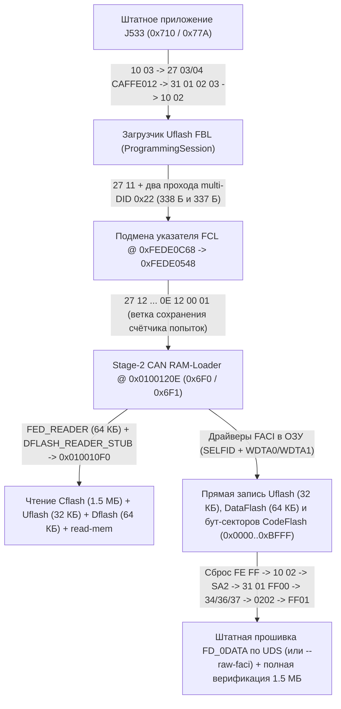

# Чтение и запись шлюза J533 по шине Diagnosis CAN (`500 кбит/с`)

[](can-read-write.en.md) • [К оглавлению `docs/`](README.md)

В этом документе без абстракций, с точными адресами ОЗУ/флеш-памяти, регистрами контроллера `FACI` и форматами кадров описано, как **ContiTool** полностью заменяет стендовый программатор по штатному 20-пиновому разъёму `T20` без вскрытия корпуса: вычитывает все области памяти (`Cflash`, `Uflash`, `Dflash` и произвольные диапазоны `read-mem`), разблокирует и прошивает загрузчик `Uflash` (`32 КБ`), дифференциально программирует `DataFlash` (`64 КБ`) и прошивает весь `CodeFlash` (`1.5 МБ`, включая бут-секторы `0x00000000..0x0000BFFF` и прикладную область `FD_0DATA`) на серийном закрытом шлюзе **Continental VAG MQB J533 (`3Q0 907 530 xx`, Renesas `RH850/F1L`)**.

---

## 1. Физический уровень и адресное пространство `RH850/F1L`

### Подключение на столе (`J533 T20`, `500 кбит/с`)

| Пин `T20` | Цепь | Назначение |
| :---: | :--- | :--- |
| **Pin 1** | `KL30 (+12V)` | Постоянное питание `+12 В` (`12.5–13.8 В`, не менее `1 А`) |
| **Pin 14** | `KL15 (+12V)` | Зажигание `+12 В` (на столе соединяется с `Pin 1`) |
| **Pin 11** | `KL31 (GND)` | Общий минус питания и линия `GND` CAN-адаптера |
| **Pin 19** | `Diag CAN-H` | Диагностическая шина `CAN High` (`500 кбит/с`) |
| **Pin 9** | `Diag CAN-L` | Диагностическая шина `CAN Low` (`500 кбит/с`) |

Между **`Pin 19`** и **`Pin 9`** обязателен согласующий резистор **`120 Ом`** (внутри самого шлюза `J533` терминатора на диагностической паре нет).

### Две пары идентификаторов на одной шине Diagnosis CAN

1. **Штатный `ISO 14229 UDS` поверх `ISO 15765-2 (ISO-TP)`**:
   - **`0x710`** (11-бит, запрос тестера → шлюз, паддинг одиночных кадров `0xAA`, последовательных `0x00`);
   - **`0x77A`** (11-бит, ответ шлюза → тестер).
2. **Заводской потоковый загрузчик Continental (`CAN RAM-Loader`)**:
   - **`0x6F0`** (11-бит, сырые 8-байтные кадры потока данных без заголовков `ISO-TP`);
   - **`0x6F1`** (11-бит, синхроответы, маяки и поток вычитываемых данных из памяти).

### Карта памяти микроконтроллера `R7F7010543AFP / R7F7010563AFP`

| Область | Диапазон адресов | Объём | Содержимое |
| :--- | :---: | :---: | :--- |
| **`Cflash` (Boot + OTP)** | `0x00000000 .. 0x0000BFFF` | `49 152` Б | Стартовый вектор, `Блок 4` (`0x00008000..0x00009FFF`: запись `FBL` о программировании `"NIGB"`, статус по `0x00008023`), `Блок 5` (`OTP` по `0x0000A167`, `FAZIT` по `0x0000A240`, модуль `FBL RSA-1024` по `0x0000A2F7`, скрипт `SA2` по `0x0000A377`, 128-бит `SELFID` кристалла по `0x0000AB00`) |
| **`Cflash` (Presence)** | `0x0000C000 .. 0x0000C1FF` | `512` Б | Сектор флага присутствия приложения (`0x90482442` LE по `0x0000C000`, `0xFFFFFFFF` по `0x0000C100`) |
| **`Cflash` (`FD_0DATA`)** | `0x0000C200 .. 0x0017FFFF` | `1 523 200` Б | Основное приложение шлюза (`App CRC-16/MODBUS` хранится по `0x0000C21C`, счётчик диапазонов `1` — по `0x0000C21E`, границы `[start, end]` — по `0x0000C220..0x0000C227`) |
| **`Uflash` (`Ext. User Area`)** | `0x01000000 .. 0x01007FFF` | `32 768` Б | Перепрошивочный бутлодер `FBL` + встроенный заводской `CAN RAM-Loader` (`Stage 1 @ 0x01000BCC`, `Stage 2 @ 0x0100120E`, проверка `RSA` @ `0x010033FC / +0x342A`) |
| **`Dflash` (`Data Flash`)** | `0xFF200000 .. 0xFF20FFFF` | `65 536` Б | Параметрия `ZDC` (`0x0000..0x303F`), 12 банков `CP` (`0xC000..0xCBFF`), мастер-ключ `GFA` (`0xDA00`), кэш `SWaP RSA` + `VCRN` (`0xDB00`), 15 слотов `FSC` (`0xDD00..0xE83F`) |
| **`Local RAM`** | `0xFEDE0000 .. 0xFEDFFFFF` | `131 072` Б | Рабочее ОЗУ `FBL` (`0xFEDE0000..`), буфер пакетов `RAM-Loader` (`0xFEDF8020..0xFEDFFEFF`) и ячейка режима сброса (`0xFEDFFFF0`) |

### Поддерживаемые и неподдерживаемые аппаратные платформы шлюзов `J533`

В семействе **VAG MQB J533** под близкими или даже одинаковыми каталожными номерами выпускались блоки на совершенно разных микроконтроллерах. При проверке связи (`can_identify` / `unsupported_ecu_reason`) **ContiTool** автоматически распознаёт платформу по `F187` / `F191` / `F189` / `F1A3` / `F17C` / `F19E` и блокирует запуск `RAM-Loader` на чужой архитектуре:

| Линейка и производитель | Номер детали (`F187` / `F191`) | `HW` (`F1A3`) / `SW` (`F189`) / `ODX` (`F19E`) | Микроконтроллер | Статус в ContiTool |
| :--- | :--- | :--- | :--- | :---: |
| **Continental MQB Gen 2** | `3Q0 907 530 A..AR`, предсерийные `V03 825 216 A..G` | `HW 5xx`, `SW 5xxx`, `EV_GatewConti`, `FAZIT SJ8-FST…` | **Renesas `RH850/F1L`** (`R7F7010543AFP` / `R7F7010563AFP`) | **Поддерживается** |
| **Continental MQB Gen 1** | `5Q0 907 530 .. AF`, `8V0 907 468`, `5QE 907 530`, `8S0 907 468` (и ранние `3Q0` с `HW 2xx`) | `HW 201..212`, `SW 2120..2227`, `EV_GatewConti` | **NXP `MPC5607B`** (*Bolero*, 32-бит BE PowerPC VLE, `1 МБ` Flash, без `Uflash`) | Не поддерживается |
| **Lear MQB Gen 1 / Gen 2** | `5Q0 907 530 .. AJ` и **`3Q0 907 530 AA / AC / AG / AL / AN…`** | `HW 1xx / X2x / 4xx / H4x`, `SW 1xxx / 4xxx`, `EV_GatewLear`, `FAZIT LG… / LCE…` | **NXP `MPC5607B` / `MPC5748G`** (*Calypso*, PowerPC VLE) | Не поддерживается |
| **MQB-A0 / MQB-Evo** | `2Q0 907 530 …`, `5WA 907 530 …` | Другие поколения архитектуры и `SFD` | Иные платформы | Не поддерживается |

> [!NOTE]
> Ранние блоки **Continental `5Q0`** (`MPC5607B`) разделяют с `3Q0` идентификатор `EV_GatewConti`, логин `20103`, статический пароль предпосылок `0xCAFFE012` и полином `SA2` (`0x1EDC6F41`), поэтому без предварительной проверки они успешно проходили бы предусловия `10 03 → 27 03/04 → 10 02` и отказывали уже внутри PowerPC-загрузчика. А блоки **Lear Gen 2** имеют **буквально те же номера `3Q0 907 530 AA`**, что и Continental `RH850`, но отличаются по `EV_GatewLear`, `FAZIT LG…` и версиям `HW 4xx / SW 4xxx`.

---

## 2. Общая схема работы конвейера CAN



На серийном блоке с завода закрыты три двери:
1. Внешний отладочный интерфейс микроконтроллера заблокирован битами `Security Lock`.
2. Штатная команда входа из приложения в `CAN RAM-Loader` (`0x07FC80FE`) заблокирована проверками `Feature 0x81` и одноразового байта `OTP [0x0000A167] != 0x00`.
3. Штатная перепрошивка через `Uflash` требует закрытый ключ `RSA-1024` концерна для прохождения `CheckMemory (31 01 02 02)`.

Чтобы работать с таким блоком без вскрытия, **ContiTool** переводит шлюз в штатную сессию программирования `10 02` и передаёт управление напрямую во **второй этап встроенного заводского `CAN RAM-Loader` (`0x0100120E`)**, который уже физически присутствует внутри каждого заводского `Uflash.bin`.

---

## 3. Вход в заводской `CAN RAM-Loader` (`0x0100120E`) на стоковом блоке

### Фаза 1 — Переход из приложения (или напрямую из `FBL`) в `ProgrammingSession (10 02)`

Если в блоке запущено штатное приложение, тестер открывает расширенную сессию, разблокирует предпосылки программирования статическим паролем `CA FF E0 12`, проверяет готовность и запрашивает `ProgrammingSession`:

```text
TX 0x710: 02 10 03 AA AA AA AA AA          -> RX 0x77A: 06 50 03 00 32 01 F4 AA
TX 0x710: 02 27 03 AA AA AA AA AA          -> RX 0x77A: 06 67 03 <S0 S1 S2 S3> AA
TX 0x710: 06 27 04 CA FF E0 12 AA          -> RX 0x77A: 02 67 04 AA AA AA AA AA
TX 0x710: 04 31 01 02 03 AA AA AA          -> RX 0x77A: 05 71 01 02 03 00 AA AA
TX 0x710: 02 10 02 AA AA AA AA AA          -> RX 0x77A: 03 7F 10 78 AA -> 06 50 02 00 19 01 F4 AA
```

При приёме `10 02` приложение записывает сигнатуру `0xA5430911` в сохраняемое слово ОЗУ `0xFEDFFFF0` и выполняет программный сброс в загрузчик `Uflash.bin` (`0x01000000`).

Если же блок **уже находится в загрузчике `FBL`** — после прерванной записи (`10 03` возвращает `7F 10 7E` / `7F 10 12`) или после холодной подачи питания со стёртым приложением (`FBL` стартует в `DefaultSession`, отвечает `50 03` на `10 03`, отклоняет `27 03` с `7F 27 7F` / `7F 27 12`, не поддерживает прикладные `F197`/`0600` и выставляет бит `0x04` = `0x44` в `22 F1 DF`), — отказ предусловий игнорируется и отправляется сразу `10 02`.

### Фаза 2 — Двухэтапное переполнение буфера `0x22` и подготовка дескриптора `Renesas FCL` в ОЗУ

Штатного входа в `RAM-Loader` на закрытом блоке нет — используется контролируемое переполнение буфера ответа `ReadDataByIdentifier (0x22)` в загрузчике `Uflash`. В ОЗУ работающего `FBL` ключевые структуры лежат по фиксированным адресам:

| Адрес в `Local RAM` | Назначение в `Uflash.bin` |
| :---: | :--- |
| `0xFEDE0052` | Однобайтовая ячейка в ОЗУ: `2E 04 10 <XX>` записывает туда `<XX>`, а `22 04 10` возвращает 3 байта `04 10 <XX>` (`1` байт данных) |
| `0xFEDE0536` | Приёмный буфер многокадрового UDS-запроса (`ISO-TP RX`): смещение `+0x12` соответствует выровненному адресу **`0xFEDE0548`**, а хвост 22-байтного кадра `27 12` попадает в `0xFEDE0558` (`0xFEDE0548 + 0x10`) |
| `0xFEDE0AF3` | Состояние автомата `SecurityAccess` (`0x03` после выдачи `Seed` по `27 11`; чтение `0x22` его не сбрасывает) |
| `0xFEDE0AF8` | Буфер ОЗУ, куда `2E F1 5A` (`0x0100440E`) временно складывает 9-байтный отпечаток программирования до стирания флеш-памяти |
| `0xFEDE0B18` | Буфер формирования ответа `0x22`, очищаемый `memset(..., 0, 0x14A)` — ровно **`330` байт** (`0xFEDE0B18 .. 0xFEDE0C61`) |
| **`0xFEDE0C62 .. 0xFEDE0C69`** | Служебные ячейки диспетчера запросов `FBL` сразу за концом буфера `0xFEDE0B18`: **`0xFEDE0C62` — флаг подавления положительного ответа («не отвечать»)**, а **`0xFEDE0C68`** (`+336` Б от `0xFEDE0B18`) — активный указатель на дескриптор `Renesas FCL` (при старте `0xFEDE0014` = `14 00 DE FE` LE) |

Обработчик `0x22` (`0x01003DC2`) принимает до **19 DID** в одном запросе (39 байт запроса) и подряд дописывает их ответы в `0xFEDE0B18` без проверки границы `330` байт:
- **Дескриптор `0x0100120E`**: три «несуществующих» DID (`0x000E`, `0x1200`, `0x0100`) блок не поддерживает и в собираемый ответ не включает, но в приёмном буфере запроса они остаются, и их номера складываются в целевой адрес **`0x0100120E`**.
- **Набивка фиксированной длины**: остальные DID — `F17C` (`23` Б данных), `F1A2` (`6` Б), `F15B` (`20` Б: цикл в `FBL` всегда копирует ровно две 10-байтные записи `NvM`) и `0410` (`1` Б) — подбирают точную длину ответа на любом шлюзе так, чтобы хвост лёг строго на `0xFEDE0C62..0xFEDE0C69`.

Последовательность подготовки указателя `0xFEDE0C68 → 0xFEDE0548`:

1. **`27 11`** → `FBL` выдаёт `67 11 <Seed>` и переводит `0xFEDE0AF3` в состояние `3` (ожидание `27 12`).
2. **Этап 1 (`338` байт ответа — переполнение `8` байт на `0xFEDE0C62..0xFEDE0C69` и запись `0x05` в `0xFEDE0C69`)**:
   - `2E 04 10 05` записывает `0x05` в `0xFEDE0052`.
   - Запрос `0x22` из 19 DID (`39` байт): `6 × F17C` + `F1A2` + `F15B` + `[000E, 1200, 0100]` + `7 × F15B` + `0410`.
   - Ответ `62 ... 04 10 05` составляет ровно **`338` байт** (`resp[330..337]` ложатся на `0xFEDE0C62..0xFEDE0C69`): предпоследний байт `0x10` попадает в `0xFEDE0C68`, а последний `0x05` — в `0xFEDE0C69` (`0xFEDE0C68` становится `0xFEDE0510`, старшие `DE FE` не затронуты).
3. **Этап 2 (`337` байт ответа — дозапись `0x48` в `0xFEDE0C68`, без ответа в шину)**:
   - `2E 04 10 48` записывает `0x48` в `0xFEDE0052`.
   - Запрос `0x22` из 19 DID: `8 × F15B` + `[000E, 1200, 0100]` + `6 × F15B` + `F17C` + `0410`.
   - Собранный в ОЗУ ответ составляет **`337` байт** (`resp[330..336]` переписывают `0xFEDE0C62..0xFEDE0C68`, не трогая `0xFEDE0C69 = 0x05`). При этом на `0xFEDE0C62` (флаг подавления ответа) ложатся ненулевые ASCII-символы `FAZIT` из `F17C`, поэтому **на этап 2 загрузчик никогда не отвечает в CAN** — но указатель `0xFEDE0C68` в ОЗУ уже равен **`0xFEDE0548`** (`48 05 DE FE`).

### Фаза 3 — Передача управления через триггер `27 12` с заведомо неверным ключом

Сразу после этапа 2 отправляется 22-байтный UDS-кадр:

```text
27 12 DE AD BE EF 00 00 00 00 00 00 00 00 00 00 00 00 0E 12 00 01
```

1. Кадр ложится в приёмный буфер `0xFEDE0536`, и его последние 4 байта `0E 12 00 01` (**`0x0100120E`** LE) оказываются по адресу `0xFEDE0558 = 0xFEDE0548 + 0x10`.
2. Обработчик `SendKey` (`0x01002F92`) фиксирует несовпадение ключа `DE AD BE EF`, увеличивает счётчик попыток в `0xFEDE0AEE` и вызывает сохранение счётчика через обёртку `FCL` (`0x01001002` → `0x01001AA8` → диспетчер `0x01004B66`).
3. Благодаря подготовленному дескриптору `0x01004B66` разыменовывает `0xFEDE0C68` (`0xFEDE0548`), берёт адрес `*(uint32_t *)(0xFEDE0548 + 0x10) == 0x0100120E` и передаёт управление в **`CAN RAM-Loader`**, который подтверждает готовность маяком **`J533-RCE-OK`** на `0x6F1`.

### Дескриптор и отпечаток программирования (`F15B` / `0xFEDE0C62`): почему часть блоков «молчала» на этапе 1 и как это лечится

На части блоков, ранее прошивавшихся по UDS, этап 1 не возвращал ответа в CAN, хотя все предыдущие запросы (`10 02`, `27 11`, `2E 04 10 05`) проходили штатно:

1. **Что кладёт `F15B` на ячейку `0xFEDE0C62`:**
   - `22 F1 5B` в загрузчике возвращает две записи по `10` байт: `[3 Б дата BCD, 6 Б серийный номер тестера, 1 Б статус]`.
   - Последняя копия `F15B` в набивке этапа 1 укладывает байты `5..9` второй (последней) записи ровно на **`0xFEDE0C62 .. 0xFEDE0C66`** — это **байты `2..5` шестибайтного серийника тестера** (`0xFEDE0C62..0xFEDE0C65`) и байт статуса (`0xFEDE0C66`).
   - Ячейка **`0xFEDE0C62`** — флаг «не отвечать» (`suppressPositiveRspMsgIndicationBit`). Как только туда попадает ненулевой байт, загрузчик молча подавляет ответ этапа 1!
   - **ContiTool до `v2.0.1d`** при прошивке приложения писал в `2E F1 5A` серийник `01 02 03 04 05 06`: на `0xFEDE0C62` ложился байт `0x03`, и после первой же прошивки этап 1 замолкал на каждом следующем входе.
   - **ODIS пишет собственный ненулевой серийник** (например, в журнале от `2026-11-08` — `01 81 C8 F6 30 39`, кладущий `0xC8` на `0xFEDE0C62`). Эффект идентичен: **перепрошивка через ODIS эту проблему не лечит, а сама её вызывает**.
2. **Опровергнутые гипотезы и защита от блокировки `7F 27 37`:**
   - В `v2.0.1d` по неверному чтению дизассемблера (`rizin`) строилась теория «проверочного байта `0xFEDE0C66`» с пересборкой запроса под блок; проверка по реальным журналам показала, что во всех рабочих ответах на `0xFEDE0C66` лежит `0x00`, и пересборка удалена.
   - В `v2.0.1e` при молчании этапа 1 утилита всё равно отправляла триггер `27 12 deadbeef`. Если переполнение не сработало, загрузчик воспринимал `deadbeef` как настоящий неверный ключ! На блоке без работающего приложения после этого и программного сброса `27 11` начинал отвечать **`7F 27 37` (`requiredTimeDelayNotExpired`) вплоть до полного отключения питания**. Начиная с `v2.0.2`, при таймауте этапа 1 **ContiTool немедленно останавливается ДО отправки `27 12`**, безопасно вычитывает `22 F1 5B` для отчёта (команда `0x22` не трогает `0xFEDE0AF3 = 3`) и возбуждает `Stage1SilentError`.
3. **Почему нельзя «просто перезаписать `2E F1 5A`» перед чтением, и как устроено лечение (`v2.0.1e+` / `v2.0.2`):**
   - Обработчик `2E F1 5A` (`0x0100440E`) сохраняет отпечаток **только в буфер ОЗУ `0xFEDE0AF8`**. Во флеш-память запись `F15B` переносится **исключительно внутри процедуры стирания блока приложения `31 01 FF 00 01 01`** (`0x0100323E`) — других путей записи отпечатка в `Uflash` нет.
   - **Предотвращение (`>= v2.0.1e`):** `ContiTool` всегда передаёт в `2E F1 5A` **нулевой серийник тестера** (`FBL_TESTER_SERIAL = 00 00 00 00 00 00`, как в заводской записи), поэтому на `0xFEDE0C62..0xFEDE0C65` всегда ложатся нули.
   - **Лечение уже «замолчавшего» блока (`can_cure_fbl_fingerprint` в `v2.0.2`):** при обнаружении `Stage1SilentError` программа предлагает **одну штатную перепрошивку приложения `FD_0DATA` по UDS с нулевым серийником** из файла `CodeFlash` этого же блока (бэкап или ранее записанный файл, владелец сверяется по `22 F1 7C` `FAZIT` без `RAM-Loader`). В ходе `31 01 FF 00 01 01` загрузчик перезаписывает `F15B` нулями, и вход в `RAM-Loader` сразу восстанавливается (проверено на стенде). Если же в блоке стоит заводской `Uflash` (`rsa_status != 0`), он отклонит неподписанное приложение на шаге `31 01 02 02`, **но отпечаток `F15B` к этому моменту уже исправлен** — вход в `RAM-Loader` снова открыт, и `ContiTool` автоматически завершает восстановление через штатный сценарий блока, застрявшего в `FBL`.

---

## 4. Потоковый протокол `0x6F0 / 0x6F1` и чтение всей памяти

Оказавшись по адресу `0x0100120E`, микроконтроллер работает в привилегированном режиме ядра (`Supervisor Mode`) и слушает сырые 8-байтные кадры на идентификаторе **`0x6F0`**.

### Структура пакета `build_loader_packet`

Перед отправкой каждого пакета выполняется рукопожатие синхронизации:
- Тестер отправляет в `0x6F0`: `84 00 00 00 00` (`DLC = 5`).
- Шлюз эхом отвечает в `0x6F1`: `84 00 00 00 00`.

Затем пакет длиной `size + 3` байт (где `size = max(0x120, align16(0x118 + len(payload)))`, аппаратный максимум загрузчика `0x0100120E` — **`0x7DB8` = `32 184` байта**, свыше которого возвращается ошибка `04`) нарезается подряд по 8 байт и передаётся в `0x6F0`:

| Смещение в пакете | Адрес в `Local RAM` | Содержимое |
| :---: | :---: | :--- |
| `0x000 .. 0x001` | Заголовок длины | `[size & 0xFF, 0x80 \| (size >> 8)]` (15-битная длина LE со взведённым старшим битом `0x8000`) |
| `0x002 .. 0x10F` | `0xFEDF8022 .. 0xFEDF812F` | Нулевое заполнение до базового указателя `r28` (`0xFEDF8130`) |
| **`0x110 .. 0x117`** | **`0xFEDF8130 .. 0xFEDF8137`** | Обязательный 8-байтный пароль Continental: **`DE 42 56 5E E5 65 24 ED`** |
| **`0x118 ..`** | **`0xFEDF8138 ..`** | Машинный код `RH850`, вызываемый загрузчиком инструкцией `jarl [r28 + 8], lp` (возврат в цикл загрузчика — инструкцией `7F 00` = `jmp [lp]`) |
| `size + 2` | Контрольный байт | Побайтовый `XOR` всех предыдущих байт пакета (`0 .. size + 1`) |

Для штатного выхода из `RAM-Loader` обратно в основное приложение шлюза по смещению `0x118` передаётся 2-байтная команда `FE FF`, выполняющая аппаратный сброс микроконтроллера.

После возврата **любого** RAM-апплета по `jmp [lp]` диспетчер `0x0100120E` (`0x01001410 -> 0x010011C2`) обязательно отправляет в `0x6F1` завершающий 2-байтный кадр статуса **`00 00`**. **ContiTool** явно вычитывает этот кадр `00 00` после каждого вызова (маяка, чтения блока памяти, `RSA`-пробы и `FACI`-записи), исключая рассинхронизацию при следующей посылке `84 00 00 00 00`.

### Маяк готовности, 28-байтный стаб `Cflash`/`Uflash` и 652-байтный `FACI Blank-Check` стаб `Dflash`

1. **Маяк готовности (`35` байт)**: сразу после входа в `0x6F0` утилита загружает короткий стаб, который вызывает внутреннюю процедуру CAN-передатчика бутлодера `0x010010F0` и отправляет в `0x6F1` ASCII-строку `J533-RCE-OK` (за которой следует финальный кадр `00 00`). Это гарантирует, что исполнение кода в ОЗУ активно и линия связи безошибочна.
2. **Прямое чтение `Cflash`, `Uflash` и `RAM` (28-байтный стаб и пакетный `FED_READER` с подпиткой `WDTA`)**:
   - Для коротких одиночных чтений (`build_reader_payload`, `28` байт) задаются адрес/длина и вызывается `0x010010F0`:
   ```text
   26 06 <addr_le32>        ; mov  imm32(address), r6
   27 06 <len_le32>         ; mov  imm32(length),  r7
   1F D8                    ; mov  lp, r27              (сохранение адреса возврата)
   21 06 F0 10 00 01        ; mov  0x010010F0, r1       (штатная функция отправки CAN в Uflash)
   E1 C7 60 F9              ; jarl [r1], lp             (стриминг r7 байт из [r6] в кадры 0x6F1)
   1B F8                    ; mov  r27, lp
   7F 00                    ; jmp  [lp]                 (возврат в 0x0100120E -> кадр 00 00)
   ```
   - При полном чтении `CodeFlash` и `Uflash` используется пакетный стаб **`build_fed_reader_payload`**: `FBL` взводит сторожевые таймеры `WDTA0/1` на окно **`273 мс`** (`2^16 / 240 кГц`), а сама `0x010010F0` во время стриминга их не сбрасывает. Поэтому `FED_READER` объединяет до **`16` чтений по `4096` байт (`64 КБ` за один пакет `0x6F0`)**, вызывая штатную процедуру сброса `WDTA` загрузчика **`0x01000EF0`** перед каждым 4-килобайтным вызовом `0x010010F0` (~`130 мс`). Это сокращает время полного чтения `1.5 МБ CodeFlash` со `148 с` до **`~61 с`** при 100 % побайтовой идентичности.
3. **Детерминированное чтение `DataFlash` с аппаратным `FACI Blank Check` (`652` + `16` байт, `DFLASH_READER_STUB`)**:
   на технологии `Renesas RV40F` (`R7F7010543AFP`) физически стёртые 4-байтные слова `DataFlash` (`0xFF200000 .. 0xFF20FFFF`) не имеют валидного ECC-синдрома, поэтому прямое чтение шиной ЦП (`ld.w`) возвращает случайный аналоговый шум плавающих затворов (из-за чего два чтения подряд расходятся на тысячи байт и защёлкивают ошибки `DFERSTR`).
   Для стопроцентно воспроизводимого чтения `DataFlash` **ContiTool** использует двухпроходный стаб `DFLASH_READER_STUB` с буфером в `0xFEDFA000`:
   - **Проход 1 (`DataFlash P/E Mode`, `FENTRYR = 0xAA80`)**: загружает `SELFID` из `0x0000AB00` в `0xFFA08000..0xFFA0800C` (без обращения к `FPROTR = 0xFFA10088`, допустимому только для `CodeFlash`) и для каждого 4-байтного слова (`FSADDR = off`, `FEADDR = off + 3`) подаёт в `0xFFA20000` аппаратную команду **Blank Check (`0x71` → `0xD0`)**, считывая бит `BCSTAT` регистра `FBCSTAT` (`0xFFA100D4`).
   - **Проход 2 (`Read Mode`, `FENTRYR = 0xAA00`)**: для физически чистых слов (`BCSTAT == 0`) записывает в буфер `0xFEDFA000` детерминированное `FF FF FF FF` вообще без чтения `0xFF20xxxx` по шине ЦП; к физическому чтению `ld.w` с проверкой ECC обращается **только** для реально запрограммированных слов (`BCSTAT == 1`), после чего передаёт готовый блок через `0x010010F0`.
   - **Бюджет сторожевого таймера `273 мс` (`WDTA0/1` @ `240 кГц`)**: стаб вызывает штатную процедуру сброса `WDTA0/1` загрузчика **`0x01000EF0`** в начале блока, **каждые `256` байт (`64` слова ≈ `0,7 мс`)** внутри цикла `Blank Check`, при выходе из `P/E` и до/после стриминга `0x010010F0` (`4 КБ` ≈ `115 мс`), оставаясь кратно внутри окна `273 мс`.

   **ContiTool** вычитывает области памяти следующим образом:
   - `Cflash.bin`: `0x00000000 .. 0x0017FFFF` (`1 572 864` Б, пакетный `FED_READER` по `16 × 4096 = 64 КБ`);
   - `Uflash.bin`: `0x01000000 .. 0x01007FFF` (`32 768` Б, `FED_READER` `8 × 4096` Б);
   - `Dflash.bin`: `0xFF200000 .. 0xFF20FFFF` (`16` блоков по `4096` Б = `65 536` Б, `DFLASH_READER_STUB` с `FACI Blank Check`, гарантирующий побайтовое совпадение повторных чтений и верификации после `can write-dflash`);
   - произвольный физический диапазон (`can read-mem --address <ADDR> --length <LEN>`): автоматически задействует `DFLASH_READER_STUB` для `0xFF200000..0xFF20FFFF` и прямой читающий стаб для остальных областей.

   Команда `FACI Blank Check (0x71)` является строго диагностической (не стирает и не изменяет ни одной ячейки), поэтому `can backup` остаётся на 100 % неразрушающим. Если пользователь нажимает **«Отмена»** во время чтения (или до начала стирания), `_hand_back_after_cancel` автоматически возвращает шлюз из `RAM-Loader` обратно в штатное приложение; во время активной записи во флеш отмена дожидается завершения текущего неделимого шага записи (`uninterruptible`), чтобы блок никогда не остался со стёртым приложением.

---

## 5. Атомарная запись инженерного `Uflash` через контроллер `FACI` в ОЗУ

### В чём состоит патч `Engineering RSA-Free Uflash` (`+0x342A`)

Внутри `Uflash.bin` процедура проверки подписи `0x010033FC` в конце сравнения `RSA-1024 PKCS#1 v1.5` содержит по смещению **`+0x342A`** (`0x0100342A`) 4-байтную инструкцию условной пересылки кода ошибки:

- **Заводской сток (`rsa_status = 2` при несовпадении подписи):**
  `E2 57 14 EB` — `cmov ne, 2, r10, r29`
- **Инженерный `RSA-Free` загрузчик (`rsa_status = 0` всегда):**
  `00 EA 00 00` — `mov 0, r29; nop`

При этом все остальные проверки бутлодера — контроль границ секторов, последовательность блоков `TransferData` и обязательная проверка контрольной суммы приложения **`App CRC-16/MODBUS` @ `0x0000C21C`** в `CheckProgrammingDependencies (31 01 FF 01)` — сохраняются полностью штатными.

Перед записью **ContiTool** побайтово сравнивает подготовленный образ с физически вычитанным `Uflash_before.bin` и блокирует операцию, если отличается хотя бы один байт за пределами 4-байтного окна `+0x342A .. +0x342D`.

### Почему `Uflash` прошивается строго одним автономным пакетом

Вся область `Extended User Area` (`0x01000000 .. 0x01007FFF`, `32 КБ`) на кристалле `RH850/F1L` образует **единый стираемый блок флеш-памяти**, внутри которого находится и сам код `CAN RAM-Loader` (`0x0100120E`). Если стереть `Uflash` и попытаться вернуться в бутлодер за следующей порцией данных по CAN, возвращаться будет уже некуда.

Поэтому весь процесс стирания и программирования выполняется **за один вызов полностью из `Local RAM`** единым пакетом размером около `26 КБ`, содержащим:
- **`436` байт** автономного машинного драйвера `RH850 FACI` (`0xFEDF8138 .. 0xFEDF82EB`);
- **`N × 256` байт** всех непустых страниц `Uflash` подряд начиная с `0xFEDF82EC` (для типового загрузчика `99` страниц = `25 344` байта; хвостовые `0xFF` после стирания записывать не требуется).

### Последовательность работы 436-байтного драйвера `FACI` в ОЗУ

1. **Запрет прерываний (`di`)** — на всё время нахождения Code Flash в режиме `P/E` ядро не обращается ни к таблице векторов во флеш-памяти, ни к коду `Uflash`.
2. **Автоматическая подгрузка `SELFID` кристалла**: перед входом в режим `P/E` драйвер считывает 4 машинных слова (`128` бит) индивидуального заводского идентификатора чипа прямо из системной области `Cflash + 0xAB00` и записывает их в регистры аутентификации `FACI` (`0xFFA08000 .. 0xFFA0800C`). Благодаря этому внешний `IDCODE` программатора не нужен.
3. **Вход в режим программирования `Extended User Area`**:
   - `FENTRYR` (`0xFFA10084`) `= 0xAA01` — перевод Code Flash в режим `P/E`;
   - `FPROTR` (`0xFFA10088`) `= 0x5501` — отключение защиты от стирания/записи;
   - `FAREASELC` (`0xFFA10020`) `= 0x3B02` — выбор банка `Extended User Area` (`0x01000000`).
4. **Стирание блока `0x01000000 .. 0x01007FFF`**:
   - установка `FSADDR = 0x01000000` (`0xFFA10030`), `FEADDR = 0x01007FFF` (`0xFFA10034`);
   - подача команд `0x50` (`Clear Status`), `0x20` и `0xD0` (`Block Erase`) в командное окно `FACI` (`0xFFA20000`);
   - ожидание готовности `FSTATR.FRDY == 1` (`бит 15` по `0xFFA10080`) и проверка отсутствия битов ошибок `ILGLERR | ERSERR | PRGERR` (`маска 0x7000`).
5. **Постраничное программирование (`99 × 256` байт)**:
   - для каждой 256-байтной страницы задаются `FSADDR` / `FEADDR`, подаются команды `0x50`, `0xE8`, `0x80` (`128` 16-битных полуслов);
   - записываются все `128` полуслов из буфера ОЗУ `0xFEDF82EC+` с ожиданием `FSTATR.DBFULL == 0` (`бит 10`) после каждого полуслова;
   - подаётся завершающая команда `0xD0`, ожидается `FSTATR.FRDY == 1` и проверяется отсутствие ошибок `0x7000`.
6. **Возврат в режим чтения и отчёт**:
   - `FENTRYR = 0xAA00`, `FAREASELC = 0x3B00`;
   - сохранение маркера `1` и итогового регистра `FSTATR` в `0xFEDE9000..0xFEDE9007`;
   - разрешение прерываний (`ei`), отправка кадра успеха `00 00` в `0x6F1` и возврат `jmp [lp]` в уже обновлённый `Uflash`.

Сразу после этого **ContiTool** заново вычитывает все `32 768` байт `Uflash` по CAN, сверяет их побайтово с эталоном и запускает **92-байтный живой `RSA`-пробник** (вызывающий `0x010033FC` на тестовом буфере из 128 байт `0xFF` и проверяющий, что `rsa_status == 0`).

---

## 6. Штатная перепрошивка `CodeFlash` (`FD_0DATA`) по UDS

Когда в блоке активен инженерный `Uflash` (`rsa_status == 0`), запись основного приложения шлюза (`0x0000C200 .. 0x0017FFFF`, `1 523 200` байт) выполняется **на 100 % штатными сервисами `ISO 14229 UDS`** (`0x710` → `0x77A`), идентично дилерскому обновлению:

1. **Вход в `ProgrammingSession`**: `10 03` → `27 03 / 27 04 CA FF E0 12` → `31 01 02 03` → `10 02` (если блок уже в `FBL`, отказ предусловий пропускается и решает ответ на `10 02`).
2. **Разблокировка `FBL SecurityAccess` (`27 11` → `27 12`)**: бутлодер выдаёт 4-байтный `Seed`, а **ContiTool** вычисляет точный ключ по алгоритму байт-код-интерпретатора `VAG SA2` (`fbl_sa2`: 8 шагов сдвига с полиномом `0x1EDC6F41` + 11 вычитаний `0x80361423` с заёмом `0x04000200`).
3. **Запись паспорта программатора (`Fingerprint`) со строго нулевым серийником**: `2E F1 5A <YY MM DD в BCD> 00 00 00 00 00 00` (`9` байт; нулевой серийник `FBL_TESTER_SERIAL` обязателен, чтобы впоследствии не подавлялся ответ этапа 1 входа в `RAM-Loader` — см. раздел 3).
4. **Стирание прикладной области (`EraseMemory`)**: `31 01 FF 00 01 01` — штатная процедура бутлодера стирает сектора `0x0000C000 .. 0x0017FFFF` и сохраняет отпечаток из `0xFEDE0AF8` во флеш (сопровождая процесс ответами ожидания `7F 31 78` до финального `71 01 FF 00 00`).
5. **Запрос загрузки (`RequestDownload`)**:
   ```text
   34 00 44 00 00 C2 00 00 17 3E 00
   ```
   (`адрес = 0x0000C200`, `размер = 0x00173E00 = 1 523 200` байт).
6. **Передача данных (`TransferData 0x36`) блоками строго по `512` байт**:
   - Фактическая ёмкость приёмного буфера ISO-TP внутри `Uflash` ограничена `0x202 = 514` байтами (`2` байта заголовка `36 <seq>` + **`512` байт полезных данных**, кратных странице `FACI` в `256` байт).
   - Всего передаётся `2 975` блоков (`2975 × 512 = 1 523 200` Б) со счётчиком `seq = 0x01 .. 0xFF` по кругу, затем `RequestTransferExit` (`37` → `77`).
7. **Проверка памяти и запись флага присутствия**:
   - `CheckMemory`: `31 01 02 02 44 00 00 C2 00 00 17 3E 00 00 80 <128 байт подписи или 0x00>` → `71 01 02 02 00`.
   - `CheckProgrammingDependencies`: `31 01 FF 01` — бутлодер самостоятельно пересчитывает **`App CRC-16/MODBUS`** по всему диапазону `FD_0DATA`, сверяет его с полем `0x0000C21C` и только при полном совпадении записывает 4-байтный маркер валидного приложения **`0x90482442`** (`42 24 48 90` LE) по адресу `0x0000C000`.
8. **Дозапись блока `4` (`0x00008000..0x00009FFF`), побайтовая сверка и проверка запуска приложения**:
   - Каждая UDS-прошивка перезаписывает собственную запись `FBL` о программировании в **Блоке 4** (`0x8000..0x9FFF`, заголовок `"NIGB"`, счётчик `0x800C`, дата `0x801A`, статус `0x8023`, контрольная сумма `0x82FA`). Если в записываемом полном образе статус записи завершён (`0x8023 == 0x00`), после UDS-загрузки **ContiTool** входит в `RAM-Loader` и записывает Блок `4` из образа через `CFLASH_FACI_STUB`, чтобы память совпала с бэкапом байт в байт (если же в образе было незавершённое скачивание `0x8023 != 0x00`, остаётся свежая запись загрузчика, иначе блок не выйдет из `FBL`).
   - Вычитываются все `1 572 864` байта `Cflash` и сверяются побайтово с эталоном.
   - После сброса выход из загрузчика в рабочее приложение подтверждается чтением **`22 F1 97` или `22 06 00`** (`APP_ONLY_DIDS`), которых нет в таблице DID бутлодера (поскольку на `10 03 → 50 03` отвечает и сам `FBL`!).

### Восстановление блока, застрявшего в загрузчике `FBL` (`can_restore_backup`), и отказ `7F 27 37`

Если запись приложения была прервана, блок остаётся в `Uflash FBL` без работающего приложения. У такого состояния есть важная аппаратная особенность: **после входа в `RAM-Loader` и программного сброса `FE FF` на блоке без живого приложения загрузчик отвечает на `27 11` отказом `7F 27 37` (`requiredTimeDelayNotExpired`) даже через сбросы `11 01` — вплоть до полного снятия питания `+12 В`**.

Поэтому при восстановлении застрявшего в `FBL` шлюза **ContiTool** работает без лишних переходов в `RAM-Loader`:
1. **Сверка владельца по UDS (`22 F1 7C`)**: `FAZIT` присутствует в собственной таблице DID загрузчика `FBL`, поэтому принадлежность бэкапа проверяется сразу по UDS без входа в `RAM-Loader` и без снятия пустого пред-бэкапа.
2. **Прямая прошивка приложения по UDS**: `FD_0DATA` (`1 523 200` Б) заливается сразу штатным загрузчиком по UDS. Только если в блоке стоял заводской `Uflash` и он отклонил неподписанное приложение на `31 01 02 02` (`FblRejectedAppError`), утилита один раз активирует инженерный `Uflash` через `RAM-Loader` и повторяет запись; затем, когда приложение уже запущено, дописываются бут-блоки, `DataFlash` и исходный `Uflash` с одним финальным сбросом в конце.
3. **Автоматическое ожидание передёргивания питания при `7F 27 37` (`_fbl_seed`)**: если `FBL` всё же отвечает `7F 27 37` на `27 11`, `ContiTool` пробует один сброс `11 01`; если отказ сохраняется — просит выключить `+12 В` на `10` секунд и включить снова, после чего сам подхватывает ответивший блок и продолжает операцию (ожидание до `5` минут).

### Аппаратный `ISO-TP` на адаптерах `VAS 6154 / VNCI` (`D-PDU`) и `J2534`

При прошивке `1.5 МБ` `FD_0DATA` по UDS объём потока составляет ~`220 000` CAN-кадров. При покадровой отправке через `RawMode` каждый кадр был отдельным сетевым вызовом к `VAS 6154 / VNCI` (~`7 мс` → скорость `0,9 КБ/с`), а примерно на **`125 000`-м обращении на модуль** служба VCI перестаёт подтверждать отправку и перезапускается (что раньше ошибочно диагностировалось как «очередь отправки VCI переполнена»).

Поэтому в `ContiTool` вся сессия UDS-программирования и заливки параметрии `ZDC` идёт **одним аппаратным каналом `ISO_15765_3` / `ISO15765` силами самого адаптера**, выровненным по сессии прошивки `ODIS-E`:
- В MDF драйвера Volkswagen шина `ISO_11898_2_DWCAN` и контакт `HI` имеют корректный идентификатор объекта `0` (`id == 0` допустим), канал создаётся с флагом `0x40`, `CP_ModifyTiming=1`, обработкой ожидания и повторов на стороне адаптера (`CP_RC78Handling=1`, `CP_RC21Handling=1`), заполнением `0x55` и нулевой задержкой `Flow Control`.
- Ответ засчитывается строго при совпадении эха с запросом (`76 <seq>`, `71 01 FF 00`, `6E F1 5A`, `62 <DID>` — как на `D-PDU`, так и на `J2534`), исключая приём запоздавшего ответа от предыдущего блока.
- Если на каком-либо отдельном запросе аппаратный `ISO-TP` адаптера даст сбой, этот запрос прозрачно переотправляется программным путём `J533CanLink` без обрыва прошивки. Если же адаптер изначально не смог поднять аппаратный `ISO-TP`, причина пишется в журнал и перед большой записью выводится явное предупреждение.

---

## 7. Нативная запись `DataFlash` (`64 КБ`, `0xFF200000..0xFF20FFFF`) по CAN (`DFLASH_FACI_STUB`)

На кристалле `R7F7010543AFP / R7F7010563AFP` внутренняя `Data Flash` объёмом `64 КБ` состоит из **`1024` стираемых блоков по `64` байта** и программируется единицами по **`4` байта** (два 16-битных полуслова с аппаратным пересчётом `ECC`). **ContiTool** прошивает `DataFlash.bin` напрямую по **Diagnosis CAN** (`can write-dflash` / кнопка **«Записать в блок»** в GUI / `can turnkey --set ...`), полностью заменяя стендовый программатор.

### Устройство 784-байтного драйвера `DFLASH_FACI_STUB` (`0xFEDF8138 .. 0xFEDF8447`)

1. **Полное сохранение контекста EABI и обслуживание `WDTA0 + WDTA1`**:
   - при входе стаб сохраняет на стеке (`sp = 0xFEDFFFE0`) регистры `r20..r29, ep, lp` (`48` байт), благодаря чему живые указатели цикла `0x0100120E` (`r28 = 0xFEDF8130`, `r29 = 0xFEDF8000`) остаются неизменными при любом числе последовательных пакетов;
   - перед началом работы, после каждого стираемого 64-байтного блока и после каждого записываемого 4-байтного слова вызывается встроенная 30-байтная подпрограмма сброса обоих аппаратных сторожевых таймеров (`WDTA0 @ 0xFFED0000` и `WDTA1 @ 0xFFED1000`: запись `0xAC` и `-0x54 - WDTAnREF`), исключающая ресет на больших объёмах записи.
2. **Подгрузка `SELFID` и вход в режим `Data Flash P/E`**:
   - считывание 128-битного `SELFID` из `0x0000AB00..0x0000AB0F` в регистры `FLID` (`0xFFA08000..0xFFA0800C`) с холостым чтением `0xFFA0800C` до входа в `P/E`;
   - запись **`FENTRYR` (`0xFFA10084`) `= 0xAA80`** с ожиданием подтверждения `(FENTRYR & 0x00FF) == 0x0080`. В отличие от `Code Flash`, регистр `FPROTR` для `Data Flash` на `RH850/F1L` не существует — запись в него при `FENTRYR = 0xAA80` намеренно не выполняется, чтобы не поднять `FSTATR.ILGLERR`.
3. **Нулевая адресация `FSADDR / FEADDR` и стирание блоков по `64` байта**:
   - для `Data Flash` контроллер `FACI` принимает в `FSADDR` (`0xFFA10030`) и `FEADDR` (`0xFFA10034`) **смещения от нуля (`0x00000000 .. 0x0000F7FF`)**, а не окна чтения CPU `0xFF200000+`;
   - для каждого изменённого блока `b` задаются `FSADDR = b * 64`, `FEADDR = b * 64 + 63`, подаются байтовые команды `0x50` (`Clear Status`), `0x20`, `0xD0` в окно `0xFFA20000`, ожидается `FSTATR.FRDY == 1` (`бит 15`) и проверяется отсутствие ошибок `(FSTATR & 0x7000) == 0`.
4. **Пословное программирование `4` байт: разделение области `ZDC` (`memcpy`) и пула `R_FDL`**:
   - В области `R_FDL / EEL` (`смещения >= 0x3040`: банки `CP`, `GFA`, `SWaP`) стёртое слово `0xFFFFFFFF` должно оставаться физически чистым (`BCST == 0`), поэтому `dflash_active_word_count()` отсекает хвостовые `0xFFFFFFFF` внутри каждого 64-байтного блока (`words_to_write = 0..16`).
   - Напротив, **паспорт и датасеты `ZDC` (`0x0000 .. 0x303F`, `< DFLASH_MEMCPY_END = 0x3040`)** читаются прошивкой шлюза **не через `R_FDL`, а обычным чтением шины ЦП (`memcpy`, цикл `0x0007EE04`)** с последующей проверкой `CRC-32` в ОЗУ! Если оставить хвостовые `0xFFFFFFFF` непустого блока `ZDC` физически стёртыми, процессор прочитает из них аналоговый шум `RV40F` и поднимет ошибку **`DTC 000401` (`Недостоверный набор данных`)**, хотя `DFLASH_READER_STUB` через `Blank Check` покажет `0xFF`. Поэтому любой непустой 64-байтный блок в зоне `0x0000..0x303F` программируется **целиком на все `16` слов (`64` байта)** с формированием валидного аппаратного `ECC` даже для хвостовых `0xFFFFFFFF` (а если в блоке остались непрограммированные хвосты от старой записи, он принудительно переписывается целиком).
   - Если блок переводится в полностью чистое состояние (`64 × 0xFF`), он только стирается (`words_to_write = 0`).
   - Для каждого записываемого 4-байтного слова задаётся `FSADDR = word_offset`, в командное окно `0xFFA20000` записываются байт `0x50` и 16-битные полуслова `0x00E8`, `0x0002`, два полуслова данных (с ожиданием `FSTATR.DBFULL == 0` по биту 10) и `0x00D0`, затем проверяется `FRDY == 1` и `(FSTATR & 0x7000) == 0`.
5. **Защита аппаратного хвоста `ICUSB` (`0xF800 .. 0xFFFF`)**:
   - последние `2048` байт (`блоки 992..1023`, смещения `0xF800..0xFFFF`) зарезервированы под криптохранилище `ICUSB` (`OPBT8` + аппаратный `Flash Guard`), а все рабочие структуры шлюза (`ZDC`, 12 банков `CP`, `GFA`, `SWaP RSA`, `VCRN`, 15 слотов `FSC`) лежат в диапазоне `0x0000..0xF0BF`. Попытка изменить байты в `0xF800..0xFFFF` блокируется защитой `DFLASH_ICUS_RESERVED_OFFSET` (при необходимости обходится только явным флагом `--allow-icus-tail`).
6. **Дифференциальный режим, верификация и автосогласование кодировки `0x0600`**:
   - перед записью **ContiTool** сохраняет `Dflash_before.bin` (`64 КБ`), вычисляет изменившиеся 64-байтные блоки (до `360` блоков за один пакет `0x6F0`, при `--full-rewrite` — автоматическая разбивка на пакеты), прошивает их, заново вычитывает все `65 536` байт и побайтово сверяет весь дамп;
   - если среди записанных блоков были датасеты `ZDC`, после перезапуска в приложение автоматически вызывается `_sync_coding_for_zdc`: шлюз читает `22 06 00` (`30` байт), включает разрешающие биты всех записанных датасетов (без них прошивка игнорирует датасет при старте!), записывает `2E 06 00` с паспортом мастерской `F198`/`F199` и перезапускает блок.

---

## 8. Прямая запись бут-секторов `CodeFlash` (`0x00000000..0x0000BFFF`) и режим `--raw-faci` (`CFLASH_FACI_STUB`)

Штатная процедура бутлодера `EraseMemory (31 01 FF 00)` обслуживает только область приложения `0x0000C000 .. 0x0017FFFF`, не затрагивая первые `48 КБ` (`блоки 0..5`: стартовый вектор и `Sector 5` `0x0000A000..0x0000BFFF`, где лежат байт `OTP @ 0x0000A167` и публичный модуль `FBL RSA-1024 @ 0x0000A2F7`). Чтобы записывать **любые** изменения `CodeFlash.bin` по CAN (включая замену ключа `FBL RSA` при `--target fbl` или автономную запись без UDS по флагу `--raw-faci`), в **ContiTool** встроен 696-байтный нативный драйвер **`CFLASH_FACI_STUB`**.

### Физическая разбивка `CodeFlash` (`54` стираемых блока = `1.5 МБ`)

- **Блоки `0 .. 7`** (`0x00000000 .. 0x0000FFFF`): **`8` блоков по `8 КБ`** (`32 × 256` Б страниц в блоке; `Блок 5` = `0x0000A000 .. 0x0000BFFF`, `Блок 6` = `0x0000C000 .. 0x0000DFFF` включает флаг присутствия `0xC000` и начало `FD_0DATA`).
- **Блоки `8 .. 53`** (`0x00010000 .. 0x0017FFFF`): **`46` блоков по `32 КБ`** (`128 × 256` Б страниц в блоке).

### Как работает `CFLASH_FACI_STUB` (`0xFEDF8138 .. 0xFEDF83EF`)

1. **Пакетная передача в пределах лимита `0x7DB8`**:
   - любой `8 КБ` блок (`до 32 страниц = 8192 Б`) укладывается в один пакет `0x6F0` (`erase_flag = 1`);
   - полный `32 КБ` блок (`128 страниц = 32 768 Б`) превышает лимит буфера `0x7DB8`, поэтому автоматически делится на два пакета: первый пакет (`erase_flag = 1`) стирает весь 32-килобайтный блок `[block_start .. block_end]` и записывает первую половину непустых 256-байтных страниц, а второй (`erase_flag = 0`) дописывает оставшиеся страницы без повторного стирания.
2. **Последовательность команд `FACI` (`Code Flash User Area`)**:
   - подгрузка `SELFID` из `0x0000AB00` → `FENTRYR = 0xAA01` → `FPROTR = 0x5501` → **`FAREASELC = 0x3B00`** (`User Area`, либо `0x3B02` при работе с полными `128` страницами `Extended User Area`);
   - при `erase_flag == 1`: `FSADDR = block_start`, `FEADDR = block_end`, команды `0x50`, `0x20`, `0xD0`;
   - для каждой непустой 256-байтной страницы: `FSADDR = page_addr`, `FEADDR = page_addr + 0xFF`, команды `0x50`, `0x00E8`, `0x0080`, `128` полуслов с контролем `DBFULL == 0` и `0x00D0`, с регулярным сбросом `WDTA0 + WDTA1`.
3. **Автоматическая защита индивидуального `SELFID` (`0x0000AB00 .. 0x0000AB0F`)**:
   - при записи чужого или донорского `CodeFlash.bin` в блок **ContiTool** автоматически подставляет в диапазон `0x0000AB00..0x0000AB0F` родной 128-битный `SELFID`, только что вычитанный из целевого микроконтроллера, чтобы блок гарантированно сохранил собственную аутентификацию `FACI` (отключается только явным флагом `--overwrite-selfid`).
   - если в `CodeFlash.bin` изменены только бут-секторы `0x00000000..0x0000BFFF` (например, установлен свой ключ `FBL RSA`), **ContiTool** прошивает только затронутый `8 КБ` блок через `CFLASH_FACI_STUB` и сразу выполняет сквозную верификацию без лишней перезаливки `1.5 МБ` `FD_0DATA`.
