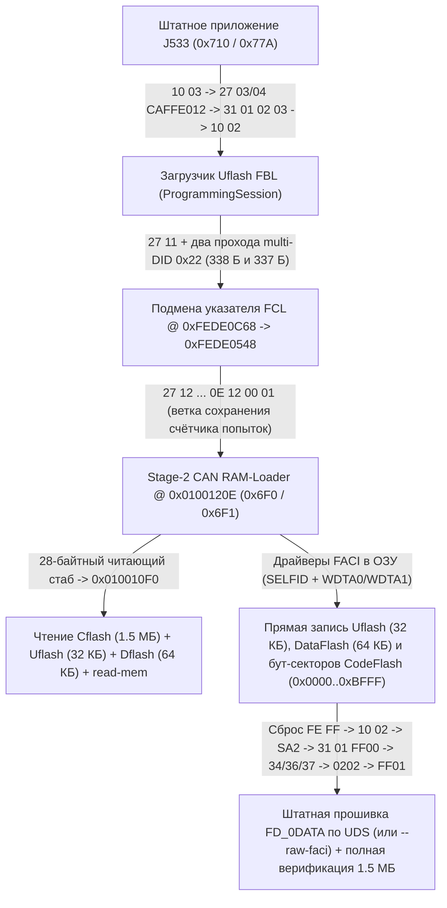

# Чтение и запись шлюза J533 по шине Diagnosis CAN (`500 кбит/с`)

[](can-read-write.en.md) • [К оглавлению `docs/`](README.md)

В этом документе без абстракций, с точными адресами ОЗУ/флеш-памяти, регистрами контроллера `FACI` и форматами кадров описано, как **ContiTool** полностью заменяет стендовый программатор по штатному 20-пиновому разъёму `T20` без вскрытия корпуса: вычитывает все области памяти (`Cflash`, `Uflash`, `Dflash` и произвольные диапазоны `read-mem`), разблокирует и прошивает загрузчик `Uflash` (`32 КБ`), дифференциально программирует `DataFlash` (`64 КБ`) и прошивает весь `CodeFlash` (`1.5 МБ`, включая бут-секторы `0x00000000..0x0000BFFF` и прикладную область `FD_0DATA`) на серийном закрытом шлюзе **Continental VAG MQB J533 (`3Q0 907 530 xx`, Renesas `RH850/F1L`)**.

---

## 1. Физический уровень и адресное пространство `RH850/F1L`

### Подключение на столе (`J533 T20`, `500 кбит/с`)

| Пин `T20` | Цепь | Назначение |
| :---: | :--- | :--- |
| **Pin 1** | `KL30 (+12V)` | Постоянное питание `+12 В` (`12.5–13.8 В`, не менее `1 А`) |
| **Pin 14** | `KL15 (+12V)` | Зажигание `+12 В` (на столе соединяется с `Pin 1`) |
| **Pin 11** | `KL31 (GND)` | Общий минус питания и линия `GND` CAN-адаптера |
| **Pin 19** | `Diag CAN-H` | Диагностическая шина `CAN High` (`500 кбит/с`) |
| **Pin 9** | `Diag CAN-L` | Диагностическая шина `CAN Low` (`500 кбит/с`) |

Между **`Pin 19`** и **`Pin 9`** обязателен согласующий резистор **`120 Ом`** (внутри самого шлюза `J533` терминатора на диагностической паре нет).

### Две пары идентификаторов на одной шине Diagnosis CAN

1. **Штатный `ISO 14229 UDS` поверх `ISO 15765-2 (ISO-TP)`**:
   - **`0x710`** (11-бит, запрос тестера → шлюз, паддинг одиночных кадров `0xAA`, последовательных `0x00`);
   - **`0x77A`** (11-бит, ответ шлюза → тестер).
2. **Заводской потоковый загрузчик Continental (`CAN RAM-Loader`)**:
   - **`0x6F0`** (11-бит, сырые 8-байтные кадры потока данных без заголовков `ISO-TP`);
   - **`0x6F1`** (11-бит, синхроответы, маяки и поток вычитываемых данных из памяти).

### Карта памяти микроконтроллера `R7F7010543AFP / R7F7010563AFP`

| Область | Диапазон адресов | Объём | Содержимое |
| :--- | :---: | :---: | :--- |
| **`Cflash` (Boot + OTP)** | `0x00000000 .. 0x0000BFFF` | `49 152` Б | Стартовый вектор, `Sector 5` (`OTP` по `0x0000A167`, модуль `FBL RSA-1024` по `0x0000A2F7`, скрипт `SA2` по `0x0000A377`, 128-бит `SELFID` кристалла по `0x0000AB00`) |
| **`Cflash` (Presence)** | `0x0000C000 .. 0x0000C1FF` | `512` Б | Сектор флага присутствия приложения (`0x90482442` LE по `0x0000C000`, `0xFFFFFFFF` по `0x0000C100`) |
| **`Cflash` (`FD_0DATA`)** | `0x0000C200 .. 0x0017FFFF` | `1 523 200` Б | Основное приложение шлюза (`App CRC-16/MODBUS` хранится по `0x0000C21C`, счётчик диапазонов `1` — по `0x0000C21E`, границы `[start, end]` — по `0x0000C220..0x0000C227`) |
| **`Uflash` (`Ext. User Area`)** | `0x01000000 .. 0x01007FFF` | `32 768` Б | Перепрошивочный бутлодер `FBL` + встроенный заводской `CAN RAM-Loader` (`Stage 1 @ 0x01000BCC`, `Stage 2 @ 0x0100120E`, проверка `RSA` @ `0x010033FC / +0x342A`) |
| **`Dflash` (`Data Flash`)** | `0xFF200000 .. 0xFF20FFFF` | `65 536` Б | Параметрия `ZDC` (`0x0000..0x303F`), 12 банков `CP` (`0xC000..0xCBFF`), мастер-ключ `GFA` (`0xDA00`), кэш `SWaP RSA` + `VCRN` (`0xDB00`), 15 слотов `FSC` (`0xDD00..0xE83F`) |
| **`Local RAM`** | `0xFEDE0000 .. 0xFEDFFFFF` | `131 072` Б | Рабочее ОЗУ `FBL` (`0xFEDE0000..`), буфер пакетов `RAM-Loader` (`0xFEDF8020..0xFEDFFEFF`) и ячейка режима сброса (`0xFEDFFFF0`) |

---

## 2. Общая схема работы конвейера CAN



На серийном блоке с завода закрыты три двери:
1. Внешний отладочный интерфейс микроконтроллера заблокирован битами `Security Lock`.
2. Штатная команда входа из приложения в `CAN RAM-Loader` (`0x07FC80FE`) заблокирована проверками `Feature 0x81` и одноразового байта `OTP [0x0000A167] != 0x00`.
3. Штатная перепрошивка через `Uflash` требует закрытый ключ `RSA-1024` концерна для прохождения `CheckMemory (31 01 02 02)`.

Чтобы работать с таким блоком без вскрытия, **ContiTool** переводит шлюз в штатную сессию программирования `10 02` и передаёт управление напрямую во **второй этап встроенного заводского `CAN RAM-Loader` (`0x0100120E`)**, который уже физически присутствует внутри каждого заводского `Uflash.bin`.

---

## 3. Вход в заводской `CAN RAM-Loader` (`0x0100120E`) на стоковом блоке

### Фаза 1 — Переход из приложения в бутлодер `Uflash`

Тестер открывает расширенную сессию приложения, разблокирует предпосылки программирования штатным статическим паролем второго уровня (`CA FF E0 12`), подтверждает готовность к перепрошивке и запрашивает `ProgrammingSession`:

```text
TX 0x710: 02 10 03 AA AA AA AA AA          -> RX 0x77A: 06 50 03 00 32 01 F4 AA
TX 0x710: 02 27 03 AA AA AA AA AA          -> RX 0x77A: 06 67 03 <S0 S1 S2 S3> AA
TX 0x710: 06 27 04 CA FF E0 12 AA          -> RX 0x77A: 02 67 04 AA AA AA AA AA
TX 0x710: 04 31 01 02 03 AA AA AA          -> RX 0x77A: 05 71 01 02 03 00 AA AA
TX 0x710: 02 10 02 AA AA AA AA AA          -> RX 0x77A: 03 7F 10 78 AA -> 06 50 02 00 19 01 F4 AA
```

При приёме `10 02` приложение записывает сигнатуру `0xA5430911` в сохраняемое слово ОЗУ `0xFEDFFFF0` и выполняет программный сброс в загрузчик `Uflash.bin` (`0x01000000`).

### Фаза 2 — Двухэтапная подготовка дескриптора `Renesas FCL` в ОЗУ

В ОЗУ работающего бутлодера `Uflash` ключевые структуры расположены в фиксированных адресах:

| Адрес в `Local RAM` | Назначение в `Uflash.bin` |
| :---: | :--- |
| `0xFEDE0052` | Однобайтовая ячейка в ОЗУ: `2E 04 10 <XX>` записывает туда байт `<XX>`, а `22 04 10` возвращает 3 байта `04 10 <XX>` |
| `0xFEDE0536` | Приёмный буфер многокадрового UDS-запроса (`ISO-TP RX`): смещение `+0x12` в запросе соответствует адресу **`0xFEDE0548`**, а смещение `+0x22` (или `+0x12` в коротком кадре) контролирует поля внутри `0xFEDE0548..0xFEDE055B` |
| `0xFEDE0B18` | Буфер формирования ответа `ReadDataByIdentifier (0x22)` проектной ёмкостью `330` байт |
| **`0xFEDE0C68`** | Активный указатель на структуру дескриптора драйвера флеш-памяти `Renesas FCL` (ровно **`+336` байт** от начала `0xFEDE0B18`! Исходное значение при старте: `0xFEDE0014` = `14 00 DE FE` LE) |

Обработчик `ReadDataByIdentifier (0x22)` (`0x01003DC2`) принимает до **19 идентификаторов `DID`** в одном запросе и последовательно дописывает их данные в `0xFEDE0B18` без проверки лимита в `330` байт. При этом неизвестные бутлодеру идентификаторы (`0x000E`, `0x1200`, `0x0100`) при сборке ответа молча пропускаются, но сами их байты остаются лежать в приёмном буфере запроса.

Чтобы перенаправить указатель `0xFEDE0C68` с `0xFEDE0014` на строго выровненный по 4 байта адрес **`0xFEDE0548`** внутри приёмного буфера, выполняются два точных прохода (предварительно запросом `27 11` автомат `SecurityAccess` переводится в состояние ожидания ключа):

1. **`27 11`** → бутлодер выдаёт `67 11 <Seed>` и взводит внутреннее состояние ожидания `27 12`.
2. **Проход 1 (`338` байт ответа — запись байта `0x05` в `0xFEDE0C69`)**:
   - `2E 04 10 05` сохраняет байт `0x05` в `0xFEDE0052`.
   - Отправляется запрос `0x22` из 19 DID:
     `6 × F17C` + `F1A2` + `F15B` + `[000E, 1200, 0100]` + `7 × F15B` + `0410`.
   - Суммарная длина ответа `62 ... 04 10 05` составляет ровно **`338` байт**: предпоследний байт `0x10` ложится по смещению `+336` (`0xFEDE0C68`), а последний байт `0x05` — по смещению `+337` (`0xFEDE0C69`), не затрагивая старшую половину `DE FE`. Указатель `0xFEDE0C68` превращается из `0xFEDE0014` в `0xFEDE0510` (`10 05 DE FE`).
3. **Проход 2 (`337` байт ответа — запись младшего байта `0x48` в `0xFEDE0C68`)**:
   - `2E 04 10 48` сохраняет байт `0x48` в `0xFEDE0052`.
   - Отправляется второй запрос `0x22` из 19 DID:
     `8 × F15B` + `[000E, 1200, 0100]` + `6 × F15B` + `F17C` + `0410`.
   - Суммарная длина ответа `62 ... 04 10 48` составляет ровно **`337` байт**: последний байт `0x48` переписывает только младший байт по смещению `+336` (`0xFEDE0C68`), а байт `0x05` в `0xFEDE0C69` остаётся от первого прохода.
   - В итоге по адресу `0xFEDE0C68` сформирован 4-байтно выровненный указатель **`0xFEDE0548`** (`48 05 DE FE`).

### Фаза 3 — Передача управления через ветку неверного ключа `27 12`

Сразу после этого тестер отправляет 22-байтный UDS-кадр:

```text
27 12 DE AD BE EF 00 00 00 00 00 00 00 00 00 00 00 00 0E 12 00 01
```

Что происходит внутри `Uflash` при приёме этого кадра:
1. Кадр помещается в приёмный буфер ISO-TP (`0xFEDE0536`), поэтому его последние 4 байта `0E 12 00 01` (число **`0x0100120E`** в Little-Endian) оказываются ровно по адресу `0xFEDE0558`, то есть по смещению **`+0x10`** относительно подменённого дескриптора `0xFEDE0548`.
2. Обработчик `SendKey` (`0x01002F92`) видит, что ключ `DE AD BE EF` не совпадает с расчётным, увеличивает счётчик ошибок в `0xFEDE0AEE` и вызывает штатную функцию сохранения счётчика в энергонезависимую память (`0x01001002` → обёртка `FCL` `0x01001AA8` → диспетчер `0x01004B66`).
3. Диспетчер `0x01004B66` читает базовый адрес дескриптора из `0xFEDE0C68` (`0xFEDE0548`), загружает из `*(uint32_t *)(0xFEDE0548 + 0x10)` адрес обработчика и совершает прямой переход на **`0x0100120E`** — точку входа второго этапа заводского **`CAN RAM-Loader`**!

Ни один бит флеш-памяти на этом этапе не изменяется, а проверка `OTP [0x0000A167]` и первый этап `Seed/Key` загрузчика остаются позади.

---

## 4. Потоковый протокол `0x6F0 / 0x6F1` и чтение всей памяти

Оказавшись по адресу `0x0100120E`, микроконтроллер работает в привилегированном режиме ядра (`Supervisor Mode`) и слушает сырые 8-байтные кадры на идентификаторе **`0x6F0`**.

### Структура пакета `build_loader_packet`

Перед отправкой каждого пакета выполняется рукопожатие синхронизации:
- Тестер отправляет в `0x6F0`: `84 00 00 00 00` (`DLC = 5`).
- Шлюз эхом отвечает в `0x6F1`: `84 00 00 00 00`.

Затем пакет длиной `size + 3` байт (где `size = max(0x120, align16(0x118 + len(payload)))`, аппаратный максимум загрузчика `0x0100120E` — **`0x7DB8` = `32 184` байта**, свыше которого возвращается ошибка `04`) нарезается подряд по 8 байт и передаётся в `0x6F0`:

| Смещение в пакете | Адрес в `Local RAM` | Содержимое |
| :---: | :---: | :--- |
| `0x000 .. 0x001` | Заголовок длины | `[size & 0xFF, 0x80 \| (size >> 8)]` (15-битная длина LE со взведённым старшим битом `0x8000`) |
| `0x002 .. 0x10F` | `0xFEDF8022 .. 0xFEDF812F` | Нулевое заполнение до базового указателя `r28` (`0xFEDF8130`) |
| **`0x110 .. 0x117`** | **`0xFEDF8130 .. 0xFEDF8137`** | Обязательный 8-байтный пароль Continental: **`DE 42 56 5E E5 65 24 ED`** |
| **`0x118 ..`** | **`0xFEDF8138 ..`** | Машинный код `RH850`, вызываемый загрузчиком инструкцией `jarl [r28 + 8], lp` (возврат в цикл загрузчика — инструкцией `7F 00` = `jmp [lp]`) |
| `size + 2` | Контрольный байт | Побайтовый `XOR` всех предыдущих байт пакета (`0 .. size + 1`) |

Для штатного выхода из `RAM-Loader` обратно в основное приложение шлюза по смещению `0x118` передаётся 2-байтная команда `FE FF`, выполняющая аппаратный сброс микроконтроллера.

После возврата **любого** RAM-апплета по `jmp [lp]` диспетчер `0x0100120E` (`0x01001410 -> 0x010011C2`) обязательно отправляет в `0x6F1` завершающий 2-байтный кадр статуса **`00 00`**. **ContiTool** явно вычитывает этот кадр `00 00` после каждого вызова (маяка, чтения блока памяти, `RSA`-пробы и `FACI`-записи), исключая рассинхронизацию при следующей посылке `84 00 00 00 00`.

### Маяк готовности, 28-байтный стаб `Cflash`/`Uflash` и 652-байтный `FACI Blank-Check` стаб `Dflash`

1. **Маяк готовности (`35` байт)**: сразу после входа в `0x6F0` утилита загружает короткий стаб, который вызывает внутреннюю процедуру CAN-передатчика бутлодера `0x010010F0` и отправляет в `0x6F1` ASCII-строку `J533-RCE-OK` (за которой следует финальный кадр `00 00`). Это гарантирует, что исполнение кода в ОЗУ активно и линия связи безошибочна.
2. **Прямое чтение `Cflash`, `Uflash` и `RAM` (`28` байт)**: для вычитывания `CodeFlash`, `Uflash` и `Local RAM` формируется 28-байтный машинный стаб `RH850`:
   ```text
   26 06 <addr_le32>        ; mov  imm32(address), r6
   27 06 <len_le32>         ; mov  imm32(length),  r7
   1F D8                    ; mov  lp, r27              (сохранение адреса возврата)
   21 06 F0 10 00 01        ; mov  0x010010F0, r1       (штатная функция отправки CAN в Uflash)
   E1 C7 60 F9              ; jarl [r1], lp             (стриминг r7 байт из [r6] в кадры 0x6F1)
   1B F8                    ; mov  r27, lp
   7F 00                    ; jmp  [lp]                 (возврат в 0x0100120E -> кадр 00 00)
   ```
3. **Детерминированное чтение `DataFlash` с аппаратным `FACI Blank Check` (`652` + `16` байт, `DFLASH_READER_STUB`)**:
   на технологии `Renesas RV40F` (`R7F7010543AFP`) физически стёртые 4-байтные слова `DataFlash` (`0xFF200000 .. 0xFF20FFFF`) не имеют валидного ECC-синдрома, поэтому прямое чтение шиной ЦП (`ld.w`) возвращает случайный аналоговый шум плавающих затворов (из-за чего два чтения подряд расходятся на тысячи байт и защёлкивают ошибки `DFERSTR`).
   Для стопроцентно воспроизводимого чтения `DataFlash` **ContiTool** использует двухпроходный стаб `DFLASH_READER_STUB` с буфером в `0xFEDFA000`:
   - **Проход 1 (`DataFlash P/E Mode`, `FENTRYR = 0xAA80`)**: загружает `SELFID` из `0x0000AB00` в `0xFFA08000..0xFFA0800C` (без обращения к `FPROTR = 0xFFA10088`, допустимому только для `CodeFlash`) и для каждого 4-байтного слова (`FSADDR = off`, `FEADDR = off + 3`) подаёт в `0xFFA20000` аппаратную команду **Blank Check (`0x71` → `0xD0`)**, считывая бит `BCSTAT` регистра `FBCSTAT` (`0xFFA100D4`).
   - **Проход 2 (`Read Mode`, `FENTRYR = 0xAA00`)**: для физически чистых слов (`BCSTAT == 0`) записывает в буфер `0xFEDFA000` детерминированное `FF FF FF FF` вообще без чтения `0xFF20xxxx` по шине ЦП; к физическому чтению `ld.w` с проверкой ECC обращается **только** для реально запрограммированных слов (`BCSTAT == 1`), после чего передаёт готовый блок через `0x010010F0`.
   - **Бюджет сторожевого таймера `273 мс` (`WDTA0/1` @ `240 кГц`)**: стаб вызывает штатную процедуру сброса `WDTA0/1` загрузчика **`0x01000EF0`** в начале блока, **каждые `256` байт (`64` слова ≈ `0,7 мс`)** внутри цикла `Blank Check`, при выходе из `P/E` и до/после стриминга `0x010010F0` (`4 КБ` ≈ `115 мс`), оставаясь кратно внутри окна `273 мс`.

   **ContiTool** опрашивает память блоками по **`4096` байт**:
   - `Cflash.bin`: `0x00000000 .. 0x0017FFFF` (`384` блока = `1 572 864` Б, `28`-байтный стаб);
   - `Uflash.bin`: `0x01000000 .. 0x01007FFF` (`8` блоков = `32 768` Б, `28`-байтный стаб);
   - `Dflash.bin`: `0xFF200000 .. 0xFF20FFFF` (`16` блоков = `65 536` Б, `DFLASH_READER_STUB` с `FACI Blank Check`, гарантирующий побайтовое совпадение повторных чтений и верификации после `can write-dflash`);
   - произвольный физический диапазон (`can read-mem --address <ADDR> --length <LEN>`): автоматически задействует `DFLASH_READER_STUB` для `0xFF200000..0xFF20FFFF` и 28-байтный стаб для остальных областей.

   Команда `FACI Blank Check (0x71)` является строго диагностической (не стирает и не изменяет ни одной ячейки), поэтому `can backup` остаётся на 100% неразрушающим.

---

## 5. Атомарная запись инженерного `Uflash` через контроллер `FACI` в ОЗУ

### В чём состоит патч `Engineering RSA-Free Uflash` (`+0x342A`)

Внутри `Uflash.bin` процедура проверки подписи `0x010033FC` в конце сравнения `RSA-1024 PKCS#1 v1.5` содержит по смещению **`+0x342A`** (`0x0100342A`) 4-байтную инструкцию условной пересылки кода ошибки:

- **Заводской сток (`rsa_status = 2` при несовпадении подписи):**
  `E2 57 14 EB` — `cmov ne, 2, r10, r29`
- **Инженерный `RSA-Free` загрузчик (`rsa_status = 0` всегда):**
  `00 EA 00 00` — `mov 0, r29; nop`

При этом все остальные проверки бутлодера — контроль границ секторов, последовательность блоков `TransferData` и обязательная проверка контрольной суммы приложения **`App CRC-16/MODBUS` @ `0x0000C21C`** в `CheckProgrammingDependencies (31 01 FF 01)` — сохраняются полностью штатными.

Перед записью **ContiTool** побайтово сравнивает подготовленный образ с физически вычитанным `Uflash_before.bin` и блокирует операцию, если отличается хотя бы один байт за пределами 4-байтного окна `+0x342A .. +0x342D`.

### Почему `Uflash` прошивается строго одним автономным пакетом

Вся область `Extended User Area` (`0x01000000 .. 0x01007FFF`, `32 КБ`) на кристалле `RH850/F1L` образует **единый стираемый блок флеш-памяти**, внутри которого находится и сам код `CAN RAM-Loader` (`0x0100120E`). Если стереть `Uflash` и попытаться вернуться в бутлодер за следующей порцией данных по CAN, возвращаться будет уже некуда.

Поэтому весь процесс стирания и программирования выполняется **за один вызов полностью из `Local RAM`** единым пакетом размером около `26 КБ`, содержащим:
- **`436` байт** автономного машинного драйвера `RH850 FACI` (`0xFEDF8138 .. 0xFEDF82EB`);
- **`N × 256` байт** всех непустых страниц `Uflash` подряд начиная с `0xFEDF82EC` (для типового загрузчика `99` страниц = `25 344` байта; хвостовые `0xFF` после стирания записывать не требуется).

### Последовательность работы 436-байтного драйвера `FACI` в ОЗУ

1. **Запрет прерываний (`di`)** — на всё время нахождения Code Flash в режиме `P/E` ядро не обращается ни к таблице векторов во флеш-памяти, ни к коду `Uflash`.
2. **Автоматическая подгрузка `SELFID` кристалла**: перед входом в режим `P/E` драйвер считывает 4 машинных слова (`128` бит) индивидуального заводского идентификатора чипа прямо из системной области `Cflash + 0xAB00` и записывает их в регистры аутентификации `FACI` (`0xFFA08000 .. 0xFFA0800C`). Благодаря этому внешний `IDCODE` программатора не нужен.
3. **Вход в режим программирования `Extended User Area`**:
   - `FENTRYR` (`0xFFA10084`) `= 0xAA01` — перевод Code Flash в режим `P/E`;
   - `FPROTR` (`0xFFA10088`) `= 0x5501` — отключение защиты от стирания/записи;
   - `FAREASELC` (`0xFFA10020`) `= 0x3B02` — выбор банка `Extended User Area` (`0x01000000`).
4. **Стирание блока `0x01000000 .. 0x01007FFF`**:
   - установка `FSADDR = 0x01000000` (`0xFFA10030`), `FEADDR = 0x01007FFF` (`0xFFA10034`);
   - подача команд `0x50` (`Clear Status`), `0x20` и `0xD0` (`Block Erase`) в командное окно `FACI` (`0xFFA20000`);
   - ожидание готовности `FSTATR.FRDY == 1` (`бит 15` по `0xFFA10080`) и проверка отсутствия битов ошибок `ILGLERR | ERSERR | PRGERR` (`маска 0x7000`).
5. **Постраничное программирование (`99 × 256` байт)**:
   - для каждой 256-байтной страницы задаются `FSADDR` / `FEADDR`, подаются команды `0x50`, `0xE8`, `0x80` (`128` 16-битных полуслов);
   - записываются все `128` полуслов из буфера ОЗУ `0xFEDF82EC+` с ожиданием `FSTATR.DBFULL == 0` (`бит 10`) после каждого полуслова;
   - подаётся завершающая команда `0xD0`, ожидается `FSTATR.FRDY == 1` и проверяется отсутствие ошибок `0x7000`.
6. **Возврат в режим чтения и отчёт**:
   - `FENTRYR = 0xAA00`, `FAREASELC = 0x3B00`;
   - сохранение маркера `1` и итогового регистра `FSTATR` в `0xFEDE9000..0xFEDE9007`;
   - разрешение прерываний (`ei`), отправка кадра успеха `00 00` в `0x6F1` и возврат `jmp [lp]` в уже обновлённый `Uflash`.

Сразу после этого **ContiTool** заново вычитывает все `32 768` байт `Uflash` по CAN, сверяет их побайтово с эталоном и запускает **92-байтный живой `RSA`-пробник** (вызывающий `0x010033FC` на тестовом буфере из 128 байт `0xFF` и проверяющий, что `rsa_status == 0`).

---

## 6. Штатная перепрошивка `CodeFlash` (`FD_0DATA`) по UDS

Когда в блоке активен инженерный `Uflash` (`rsa_status == 0`), запись основного приложения шлюза (`0x0000C200 .. 0x0017FFFF`, `1 523 200` байт) выполняется **на 100 % штатными сервисами `ISO 14229 UDS`** (`0x710` → `0x77A`), идентично дилерскому обновлению:

1. **Вход в `ProgrammingSession`**: `10 03` → `27 03 / 27 04 CA FF E0 12` → `31 01 02 03` → `10 02`.
2. **Разблокировка `FBL SecurityAccess` (`27 11` → `27 12`)**: бутлодер выдаёт 4-байтный `Seed`, а **ContiTool** вычисляет точный ключ по алгоритму байт-код-интерпретатора `VAG SA2` (`fbl_sa2`: 8 шагов сдвига с полиномом `0x1EDC6F41` + 11 вычитаний `0x80361423` с заёмом `0x04000200`).
3. **Запись паспорта программатора (`Fingerprint`)**: `2E F1 5A <YY MM DD в BCD + 6 байт серийного номера>` (`9` байт).
4. **Стирание прикладной области (`EraseMemory`)**: `31 01 FF 00 01 01` — штатная процедура бутлодера стирает сектора `0x0000C000 .. 0x0017FFFF` (сопровождая процесс ответами ожидания `7F 31 78` до финального `71 01 FF 00 00`).
5. **Запрос загрузки (`RequestDownload`)**:
   ```text
   34 00 44 00 00 C2 00 00 17 3E 00
   ```
   (`адрес = 0x0000C200`, `размер = 0x00173E00 = 1 523 200` байт).
6. **Передача данных (`TransferData 0x36`) блоками строго по `512` байт**:
   - Фактическая ёмкость приёмного буфера ISO-TP внутри `Uflash` ограничена `0x202 = 514` байтами (`2` байта заголовка `36 <seq>` + **`512` байт полезных данных**, кратных странице `FACI` в `256` байт).
   - Всего передаётся `2 975` блоков (`2975 × 512 = 1 523 200` Б) со счётчиком `seq = 0x01 .. 0xFF` по кругу, затем `RequestTransferExit` (`37` → `77`).
7. **Проверка памяти и запись флага присутствия**:
   - `CheckMemory`: `31 01 02 02 44 00 00 C2 00 00 17 3E 00 00 80 <128 байт подписи или 0x00>` → `71 01 02 02 00`.
   - `CheckProgrammingDependencies`: `31 01 FF 01` — бутлодер самостоятельно пересчитывает **`App CRC-16/MODBUS`** по всему диапазону `FD_0DATA`, сверяет его с полем `0x0000C21C` и только при полном совпадении записывает 4-байтный маркер валидного приложения **`0x90482442`** (`42 24 48 90` LE) по адресу `0x0000C000`.
8. **Сброс и сквозная верификация**: после `ECUReset (11 01)` **ContiTool** повторно входит в `RAM-Loader`, вычитывает все `1 572 864` байта `Cflash` обратно, убеждается в 100 % побайтовом совпадении, возвращает блок в рабочий режим и проверяет `10 03` / `3E 00` / регистр ошибок `19 02 FF`.

---

## 7. Нативная запись `DataFlash` (`64 КБ`, `0xFF200000..0xFF20FFFF`) по CAN (`DFLASH_FACI_STUB`)

На кристалле `R7F7010543AFP / R7F7010563AFP` внутренняя `Data Flash` объёмом `64 КБ` состоит из **`1024` стираемых блоков по `64` байта** и программируется единицами по **`4` байта** (два 16-битных полуслова с аппаратным пересчётом `ECC`). **ContiTool** прошивает `DataFlash.bin` напрямую по **Diagnosis CAN** (`can write-dflash` / кнопка **«Записать в блок»** в GUI / `can turnkey --set ...`), полностью заменяя стендовый программатор.

### Устройство 784-байтного драйвера `DFLASH_FACI_STUB` (`0xFEDF8138 .. 0xFEDF8447`)

1. **Полное сохранение контекста EABI и обслуживание `WDTA0 + WDTA1`**:
   - при входе стаб сохраняет на стеке (`sp = 0xFEDFFFE0`) регистры `r20..r29, ep, lp` (`48` байт), благодаря чему живые указатели цикла `0x0100120E` (`r28 = 0xFEDF8130`, `r29 = 0xFEDF8000`) остаются неизменными при любом числе последовательных пакетов;
   - перед началом работы, после каждого стираемого 64-байтного блока и после каждого записываемого 4-байтного слова вызывается встроенная 30-байтная подпрограмма сброса обоих аппаратных сторожевых таймеров (`WDTA0 @ 0xFFED0000` и `WDTA1 @ 0xFFED1000`: запись `0xAC` и `-0x54 - WDTAnREF`), исключающая ресет на больших объёмах записи.
2. **Подгрузка `SELFID` и вход в режим `Data Flash P/E`**:
   - считывание 128-битного `SELFID` из `0x0000AB00..0x0000AB0F` в регистры `FLID` (`0xFFA08000..0xFFA0800C`) с холостым чтением `0xFFA0800C` до входа в `P/E`;
   - запись **`FENTRYR` (`0xFFA10084`) `= 0xAA80`** с ожиданием подтверждения `(FENTRYR & 0x00FF) == 0x0080`. В отличие от `Code Flash`, регистр `FPROTR` для `Data Flash` на `RH850/F1L` не существует — запись в него при `FENTRYR = 0xAA80` намеренно не выполняется, чтобы не поднять `FSTATR.ILGLERR`.
3. **Нулевая адресация `FSADDR / FEADDR` и стирание блоков по `64` байта**:
   - для `Data Flash` контроллер `FACI` принимает в `FSADDR` (`0xFFA10030`) и `FEADDR` (`0xFFA10034`) **смещения от нуля (`0x00000000 .. 0x0000F7FF`)**, а не окна чтения CPU `0xFF200000+`;
   - для каждого изменённого блока `b` задаются `FSADDR = b * 64`, `FEADDR = b * 64 + 63`, подаются байтовые команды `0x50` (`Clear Status`), `0x20`, `0xD0` в окно `0xFFA20000`, ожидается `FSTATR.FRDY == 1` (`бит 15`) и проверяется отсутствие ошибок `(FSTATR & 0x7000) == 0`.
4. **Пословное программирование `4` байт с сохранением `ECC` и пустых хвостов (`R_FDL`)**:
   - в драйвере `Renesas FDL / EEL` стёртое слово `0xFFFFFFFF` отличается по физическому состоянию `ECC` от явно запрограммированного `0xFFFFFFFF` (`Blank Check`). Поэтому функция `dflash_active_word_count()` отсекает хвостовые стёртые слова `0xFFFFFFFF` внутри каждого 64-байтного блока и передаёт в стаб счётчик `words_to_write` (`0..16`);
   - если блок переводится в чистое стёртое состояние (`64 × 0xFF`), он только стирается (`words_to_write = 0`);
   - для каждого активного 4-байтного слова задаётся `FSADDR = word_offset`, в командное окно `0xFFA20000` записываются байт `0x50` и 16-битные полуслова `0x00E8`, `0x0002`, два полуслова данных (с ожиданием `FSTATR.DBFULL == 0` по биту 10) и `0x00D0`, затем проверяется `FRDY == 1` и `(FSTATR & 0x7000) == 0`.
5. **Защита аппаратного хвоста `ICUSB` (`0xF800 .. 0xFFFF`)**:
   - последние `2048` байт (`блоки 992..1023`, смещения `0xF800..0xFFFF`) зарезервированы под криптохранилище `ICUSB` (`OPBT8` + аппаратный `Flash Guard`), а все рабочие структуры шлюза (`ZDC`, 12 банков `CP`, `GFA`, `SWaP RSA`, `VCRN`, 15 слотов `FSC`) лежат в диапазоне `0x0000..0xF0BF`. Попытка изменить байты в `0xF800..0xFFFF` блокируется защитой `DFLASH_ICUS_RESERVED_OFFSET` (при необходимости обходится только явным флагом `--allow-icus-tail`).
6. **Дифференциальный режим и верификация**:
   - перед записью **ContiTool** всегда сохраняет полный `Dflash_before.bin` (`64 КБ`), вычисляет только реально изменившиеся 64-байтные блоки (до `360` блоков за один пакет `0x6F0`, при `--full-rewrite` — автоматическая разбивка на пакеты), прошивает их, заново вычитывает все `65 536` байт и побайтово сверяет весь дамп.

---

## 8. Прямая запись бут-секторов `CodeFlash` (`0x00000000..0x0000BFFF`) и режим `--raw-faci` (`CFLASH_FACI_STUB`)

Штатная процедура бутлодера `EraseMemory (31 01 FF 00)` обслуживает только область приложения `0x0000C000 .. 0x0017FFFF`, не затрагивая первые `48 КБ` (`блоки 0..5`: стартовый вектор и `Sector 5` `0x0000A000..0x0000BFFF`, где лежат байт `OTP @ 0x0000A167` и публичный модуль `FBL RSA-1024 @ 0x0000A2F7`). Чтобы записывать **любые** изменения `CodeFlash.bin` по CAN (включая замену ключа `FBL RSA` при `--target fbl` или автономную запись без UDS по флагу `--raw-faci`), в **ContiTool** встроен 696-байтный нативный драйвер **`CFLASH_FACI_STUB`**.

### Физическая разбивка `CodeFlash` (`54` стираемых блока = `1.5 МБ`)

- **Блоки `0 .. 7`** (`0x00000000 .. 0x0000FFFF`): **`8` блоков по `8 КБ`** (`32 × 256` Б страниц в блоке; `Блок 5` = `0x0000A000 .. 0x0000BFFF`, `Блок 6` = `0x0000C000 .. 0x0000DFFF` включает флаг присутствия `0xC000` и начало `FD_0DATA`).
- **Блоки `8 .. 53`** (`0x00010000 .. 0x0017FFFF`): **`46` блоков по `32 КБ`** (`128 × 256` Б страниц в блоке).

### Как работает `CFLASH_FACI_STUB` (`0xFEDF8138 .. 0xFEDF83EF`)

1. **Пакетная передача в пределах лимита `0x7DB8`**:
   - любой `8 КБ` блок (`до 32 страниц = 8192 Б`) укладывается в один пакет `0x6F0` (`erase_flag = 1`);
   - полный `32 КБ` блок (`128 страниц = 32 768 Б`) превышает лимит буфера `0x7DB8`, поэтому автоматически делится на два пакета: первый пакет (`erase_flag = 1`) стирает весь 32-килобайтный блок `[block_start .. block_end]` и записывает первую половину непустых 256-байтных страниц, а второй (`erase_flag = 0`) дописывает оставшиеся страницы без повторного стирания.
2. **Последовательность команд `FACI` (`Code Flash User Area`)**:
   - подгрузка `SELFID` из `0x0000AB00` → `FENTRYR = 0xAA01` → `FPROTR = 0x5501` → **`FAREASELC = 0x3B00`** (`User Area`, либо `0x3B02` при работе с полными `128` страницами `Extended User Area`);
   - при `erase_flag == 1`: `FSADDR = block_start`, `FEADDR = block_end`, команды `0x50`, `0x20`, `0xD0`;
   - для каждой непустой 256-байтной страницы: `FSADDR = page_addr`, `FEADDR = page_addr + 0xFF`, команды `0x50`, `0x00E8`, `0x0080`, `128` полуслов с контролем `DBFULL == 0` и `0x00D0`, с регулярным сбросом `WDTA0 + WDTA1`.
3. **Автоматическая защита индивидуального `SELFID` (`0x0000AB00 .. 0x0000AB0F`)**:
   - при записи чужого или донорского `CodeFlash.bin` в блок **ContiTool** автоматически подставляет в диапазон `0x0000AB00..0x0000AB0F` родной 128-битный `SELFID`, только что вычитанный из целевого микроконтроллера, чтобы блок гарантированно сохранил собственную аутентификацию `FACI` (отключается только явным флагом `--overwrite-selfid`).
   - если в `CodeFlash.bin` изменены только бут-секторы `0x00000000..0x0000BFFF` (например, установлен свой ключ `FBL RSA`), **ContiTool** прошивает только затронутый `8 КБ` блок через `CFLASH_FACI_STUB` и сразу выполняет сквозную верификацию без лишней перезаливки `1.5 МБ` `FD_0DATA`.
