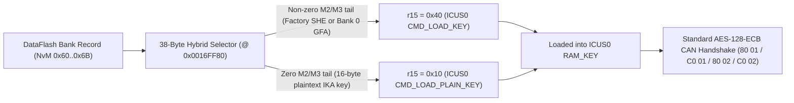

# Component Protection (`KSCHUTZ` / `#MoLaLi`), Hybrid Trampoline & CAN/UDS Protocols

[](component-protection.md) • [Back to `docs/` Index](README.md)

This document details the architecture of the **Component Protection** subsystem (internal Continental module **`KSCHUTZ` / `#MoLaLi`**) on **VAG MQB Gateway J533 (`19`, `3Q0 907 530 xx`)**, the structure of `DataFlash.bin` key banks, the 38-byte `RH850` hybrid trampoline in `CodeFlash.bin`, external `ST M95640` SPI EEPROM bitmask handling, and the runtime CAN/UDS protocols.

---

## 1. `KSCHUTZ` Architecture on `J533` & Where Slave `K3` (`IKA`) Comes From

On **VAG MQB** vehicles, Gateway `J533 (19)` acts as the Component Protection Master and stores keys in its internal `64 KB` `DataFlash` for **12 Slave ECUs** (`#1..#12`), alongside its own Application Master Key **`GFA` (Bank 0, `0xDA00`)**.

### Stock Key Storage (`ICUS0` / `SHE`)

On factory firmware, Slave ECU keys in `NvM 0x60..0x6B` (`0xC000..0xCBFF`) are stored **not as plaintext**, but as 64-byte **`SHE M1 || M2 || M3`** (`16 + 32 + 16` B) cryptographic containers wrapped under hardware key `KEY_2` inside the `RH850/F1L` **`ICUS0`** Secure Hardware Extension:
- Before starting a CAN handshake with a Slave ECU, firmware loads that bank's container into RAM and calls the `ICUS0` driver with command **`0x40` (`CMD_LOAD_KEY`)**.
- `ICUS0` unwraps `M1..M3` internally into its volatile `RAM_KEY` slot as the 16-byte working key **`K3` (`IKA` — Individual Key Application)** and computes the `AES-128-ECB` proof.

### Two Practical Rules for Module Adaptation

1. **Obtaining the target Slave ECU's 16-byte `K3` (`IKA`) key:**
   - Plaintext `K3` **never travels over UDS or CAN** during `ODIS` online sessions or normal driving (online containers are `SHE`-encrypted, and CAN handshakes exchange only random challenges and `AES-128` proofs).
   - To bind a used or retrofitted module (`5F` MIB2, `17` Cluster, `13` ACC Radar, `47` Sound Amplifier, `A5` Camera, etc.), its 16-byte `K3` (`IKA`) must be read from **that Slave ECU's own memory dump** (`EEPROM` / `DataFlash` / `SPI NOR` / `eMMC`), or an identical custom 16-byte key must be written into both the Slave ECU dump and the Gateway bank.
2. **Why `00..00` zeros fail & why `Bank 0` (`GFA` @ `0xDA00`) must stay untouched:**
   - Functional restrictions (audio mute in `5F`, radar lock in `13` ACC, etc.) are enforced **inside each Slave ECU**, which compares the Gateway's proof against its own stored `IKA`. Writing `00..00` only in the Gateway causes a mismatch (`7F 80 02 35`, DTC `U110100`).
   - Gateway `19`'s own Master Key **`GFA` (`NvM 0x7B @ 0xDA00 / 0xDA80`, Bank 0)** governs Master adaptation status (`0xFEDFC988` bit 0) and verifies `UDS 0x2E 02C5` containers. Erasing or corrupting `0xDA00` causes the gateway to substitute a temporary random dummy key (`key_type = 8`) across **all 12 slave banks**, dropping every module in the vehicle into `CP Active`. `Bank 0` is therefore always kept intact.

---

## 2. Inside the 38-Byte Hybrid `CodeFlash` Trampoline (`0x0016FF80`)

To keep every original factory module in the car running natively on `SHE M1..M3` (including `Bank 0 GFA`) while simultaneously allowing 16-byte plaintext `IKA` keys for retrofitted or replacement modules, **ContiTool** installs a **38-byte hybrid key-mode selector** in `CodeFlash.bin`:



### Hook Site & Buffer Discrimination

In the `KSCHUTZ` key-load callback, the 4-byte instruction `movea 0x40, r0, r15` (`20 7E 40 00`) selects the `ICUS0` command while `r1` points to the active bank buffer in RAM:
- For factory `SHE M1..M3` containers, the `M2` and `M3` words at `44[r1]`, `48[r1]`, `76[r1]`, and `80[r1]` hold high-entropy `AES-CBC`/`AES-CMAC` ciphertext and are non-zero.
- When **ContiTool** writes a 16-byte plaintext `IKA` key into a bank, the first 16 key bytes hold `IKA` and the remaining `48` bytes (`M2` and `M3`) are zero-filled (`0x00`).

### Byte-Level `RH850` Disassembly (`build_hybrid_cave`)

The stock `20 7E 40 00` instruction is replaced with an unconditional `jr disp22` jump to aligned free space at `0x0016FF80` (`38` bytes):

| Offset | Machine Bytes | `RH850` Instruction | Behavior |
| :---: | :--- | :--- | :--- |
| `+0x00` | `21 7F 2D 00` | `ld.w 44[r1], r15` | Load word from `M2` (`buf[19..22]`) |
| `+0x04` | `21 87 31 00` | `ld.w 48[r1], r16` | Load second word from `M2` (`buf[23..26]`) |
| `+0x08` | `10 79` | `or r16, r15` | Accumulate non-zero bits |
| `+0x0A` | `21 87 4D 00` | `ld.w 76[r1], r16` | Load word from `M3` (`buf[51..54]`) |
| `+0x0E` | `10 79` | `or r16, r15` | Accumulate non-zero bits |
| `+0x10` | `21 87 51 00` | `ld.w 80[r1], r16` | Load second word from `M3` (`buf[55..58]`) |
| `+0x14` | `10 79` | `or r16, r15` | If any bit is set → `Z = 0` |
| `+0x16` | `CA 05` | `bne +8` | Branch to `+0x1E` for factory `SHE` & `GFA` |
| `+0x18` | `20 7E 10 00` | `movea 0x10, r0, r15` | Plaintext `IKA`: select **`0x10` (`CMD_LOAD_PLAIN_KEY`)** |
| `+0x1C` | `B5 05` | `br +6` | Branch to return jump (`+0x22`) |
| `+0x1E` | `20 7E 40 00` | `movea 0x40, r0, r15` | Factory `SHE`: select **`0x40` (`CMD_LOAD_KEY`)** |
| `+0x22` | `8x 07 xx xx` | `jr return_vaddr` | Jump back immediately after the hook instruction |

`Application CRC-16/MODBUS` (`poly = 0xA001`) at `0x0000C21C` is recalculated automatically.

---

## 3. External `ST M95640` SPI EEPROM Learned-Bank Bitmask Bypass

In addition to `DataFlash` key records, the gateway stores `NvM 0x5E` inside its external `8 KB` **`ST M95640` (`SPI EEPROM`)** — a 16-bit bitmask of banks originally learned on that vehicle, authenticated by `ICUS0` `AES-CMAC` tags (`NvM 0x79 / 0x7A`).

When retrofitting a module into a previously empty (`FF..FF`) bank — such as `47` Sound (`0x0010`), `5F` Infotainment (`0x0040`), or `A5` Camera (`0x0400`) — stock firmware skips polling that bank if its `95640` bit is clear.

Enabling the `95640` bitmask bypass (enabled automatically in `bind-cp` and GUI bank binding for empty slots, or via `--bypass-eeprom-mask` in `patch-cflash`) replaces the 2-byte conditional branch `be +0x70` (`82 3D`) with `nop` (`00 00`), allowing the gateway to authenticate every bank with a valid `DataFlash.bin` key **without desoldering or modifying the external `95640` chip**.

---

## 4. Complete 12-Bank CP Reference & `DataFlash.bin` Layout

Each bank occupies **two mirrored copies** in `DataFlash.bin` (`off1` and `off1 + 0x80`):
- `+0x00 .. +0x03`: valid record header `55 55 55 55`;
- `+0x04 .. +0x45` (`rec_size = 0x42` for slave banks `#1..#12`): key-type header + 64-byte key payload (for plaintext `IKA`: 2 header bytes + `16`-byte `IKA` + `48` zero bytes);
- `+0x48 .. +0x4B` (`+0x44` for `GFA`): Little-Endian `IEEE 802.3 CRC-32` (`zlib.crc32`) over the payload bytes.

| Bank | VAG ECU | MQB Module Description | `DataFlash` (Pri / Mir) | `NvM ID` | `95640` Mask | UDS Req / Resp | CP CAN TX / RX |
| :---: | :---: | :--- | :---: | :---: | :---: | :---: | :---: |
| **`#1`** | **`17`** | Instrument Cluster / Immobilizer (`J285`, AID / Virtual Cockpit) | `0xC000` / `0xC080` | `0x60` | `0x0001` (bit 0) | `714 / 77E` | `17FC0114 / 17FE0114` |
| **`#2`** | **`09`** | Central Electrics `BCM` (`J519`) | `0xC100` / `0xC180` | `0x61` | `0x0002` (bit 1) | `70E / 778` | `17FC010E / 17FE010E` |
| **`#3`** | **`13`** | Adaptive Cruise Control / `ACC` Radar (`J428`) | `0xC200` / `0xC280` | `0x62` | `0x0004` (bit 2) | `757 / 7C1` | `17FC0157 / 17FE0157` |
| **`#4`** | **`15`** | Airbag Control Module (`J234`) | `0xC300` / `0xC380` | `0x63` | `0x0008` (bit 3) | `715 / 77F` | `17FC0115 / 17FE0115` |
| **`#5`** | **`47`** | Digital Sound System / Amplifier (`J525`, Canton / Dynaudio / Fender) | `0xC400` / `0xC480` | `0x64` | `0x0010` (bit 4) | `76F / 7D9` | `17FC016F / 17FE016F` |
| **`#6`** | **`57`** | TV Tuner (`R78`) | `0xC500` / `0xC580` | `0x65` | `0x0020` (bit 5) | `76D / 7D7` | `17FC016D / 17FE016D` |
| **`#7`** | **`5F`** | Infotainment Head Unit `MIB1 / MIB2 / MIB3` (`J794`) | `0xC600` / `0xC680` | `0x66` | `0x0040` (bit 6) | `773 / 7DD` | `17FC0173 / 17FE0173` |
| **`#8`** | **`3C`** | Lane Change Assist `Side Assist 1` Master (`J769` / `J1086`) | `0xC700` / `0xC780` | `0x67` | `0x0080` (bit 7) | `74E / 7B8` | `17FC014E / 17FE014E` |
| **`#9`** | **`CF`** | Lane Change Assist `Side Assist 2` Slave (`J770` / `J1087`) | `0xC800` / `0xC880` | `0x68` | `0x0100` (bit 8) | `78A / 7F4` | `17FC018A / 17FE018A` |
| **`#10`** | **`3D`** | Special Function / Special Purpose Vehicle (`J608`) | `0xC900` / `0xC980` | `0x69` | `0x0200` (bit 9) | `72C / 796` | `17FC012C / 17FE012C` |
| **`#11`** | **`A5`** | Front Driver Assistance Camera `MFK` (`R242`, `3Q0` / `2Q0`) | `0xCA00` / `0xCA80` | `0x6A` | `0x0400` (bit 10) | `74F / 7B9` | `17FC014F / 17FE014F` |
| **`#12`** | **`8C`** | Hybrid / EV High-Voltage Battery Manager (`J840`, GTE / e-Golf) | `0xCB00` / `0xCB80` | `0x6B` | `0x0800` (bit 11) | `77B / 7E5` | `17FC017B / 17FE017B` |
| **`Mst`** | **`19`** | Gateway Own Application Master Key `GFA` (`Master`, `key_type = 3`) | `0xDA00` / `0xDA80` | `0x7B` | — | `710 / 77A` | *Keep untouched!* |

### Complete `DataFlash.bin` (`64 KB` = `65,536` Bytes) Memory Map

> [!WARNING]
> **`64 KB` vs `32 KB` Rule (for third-party tools):** although `3Q0 907 530 xx` packages are marked `R7F7010343AFP`, the die inside is **`R7F7010543AFP / R7F7010563AFP`** with a full **`64 KB` DataFlash** (`fdlPoolSize = 0x0400 = 1024 × 64 B`). **ContiTool** reads and writes all `64 KB` over CAN automatically; if using third-party dump files, never select a `32 KB` `R7F7010343` profile — every `CP` bank and `SWaP` slot sits at `0xC000..0xF0BF`!

| Offset in `Dflash.bin` | `NvM ID` | Contents |
| :---: | :---: | :--- |
| `0x0000 .. 0x007F` | ZDC Header | Dataset identifier & version (`DID F1A0` / `F1A1`) |
| `0x0080 .. 0x303F` | 7 ZDC Blocks | Parameterization (`Base`, `MKE`, `FPA`, `Aux`, `Main GW`, `Cal`, `BEM`), verified by `IEEE CRC-32` |
| `0x3040 .. 0xBFFF` | FDL Pool | Unallocated `Data Flash` pool (`0xFF`) |
| `0xC000 .. 0xCBFF` | `0x60 .. 0x6B` | **12 Slave Component Protection (`CP`) Banks (`#1..#12`)**, `2 × 128` bytes each |
| `0xCC00 .. 0xD8FF` | `0x6C .. 0x78` | Reserved `NvM` slots |
| `0xD900 .. 0xD9FF` | `0x79 .. 0x7A` | Hardware `ICUS0` `AES-CMAC` authentication tags for `95640` block `0x5E` |
| `0xDA00 .. 0xDAFF` | `0x7B` | **Gateway `19` Own Application Master Key (`GFA`, Bank 0)** |
| `0xDB00 .. 0xDCFF` | `0x7C` | Cached **`SWaP RSA-1024`** public modulus (`0xDB04`) + 5-byte **`VCRN`** (`0xDC0C`) + `CRC-32` (`0xDCE4`) |
| `0xDD00 .. 0xE83F` | `0x7D .. 0x8B` | **15 `SWaP FSC` Activation Certificate Slots** (store `VIN` at `+0x10`) |
| `0xE840 .. 0xF0BF` | `0x8C .. 0x94` | `SWaP` counters & `NvM` layout version (`NvM 0x00..0x5F` reside in external `ST M95640`) |

---

## 5. Runtime CAN Handshake & Slave ECU UDS Key Adaptation

### 1. Four-Message Runtime CAN Handshake (`80 01` → `C0 01` → `80 02` → `C0 02`)

On internal vehicle CAN buses (`500 kbit/s`, `ISO-TP`, 29-bit Extended CAN IDs from the table above — e.g., `0x17FC0173` Gateway → `5F` and `0x17FE0173` `5F` → Gateway), mutual authentication runs at ignition-on and periodically using the shared 16-byte **`K3` (`IKA`)**:

1. **Gateway Challenge (`11`-byte `ISO-TP` on `0x17FC0173`):** `80 01 <8B GW_Challenge> <1B Seq>`
2. **Slave Challenge (`11`-byte `ISO-TP` on `0x17FE0173`):** `C0 01 <8B Slave_Challenge> <1B Seq>`
3. **`FIPS-197 AES-128-ECB` Proof (no IV, no byte reversal):**
   $$\text{AuthBlock}_{16\text{B}} = \text{AES-128-ECB\_Encrypt}_{K_3}\!\left(\text{GW\_Challenge}_{8\text{B}} \;\|\; \text{Slave\_Challenge}_{8\text{B}}\right)$$
   - `GW_Proof = AuthBlock[0..7]`;
   - `Slave_Proof = AuthBlock[8..15]`.
4. **Gateway Proof (`11` bytes on `0x17FC0173`):** `80 02 <8B GW_Proof> <1B Seq>`
5. **Slave Verdict (`0x17FE0173`):**
   - if `GW_Proof` matches, the Slave resets its CP fault counter to `0` (`KS_PASSIVE`), latches the vehicle `VIN` from `0x6B4`, and replies `C0 02 <8B Slave_Proof> <1B Seq>`;
   - otherwise it sets `KS_ACTIVE` (`>= 0x1F`, DTC `U110100`) and replies `7F 80 02 35 <Seq>` (`0x35 = invalidKey`).

**Worked Trace** (`K3 = 112233445566778899AABBCCDDEEFF00`, `Seq = 01`, `GW_Challenge = 0102030405060708`, `Slave_Challenge = 3E12A41605967F03` → `AuthBlock = 4A7FEC1BFF9B471F | 24E291A4AEECE2DC`):

```text
# 1) J533 -> 5F: 80 01 + GW_Challenge + Seq
TX 0x17FC0173: 10 0B 80 01 01 02 03 04   -> RX 0x17FE0173: 30 0F 05 AA AA AA AA AA
TX 0x17FC0173: 21 05 06 07 08 01 AA AA

# 2) 5F -> J533: C0 01 + Slave_Challenge + Seq
RX 0x17FE0173: 10 0B C0 01 3E 12 A4 16   -> TX 0x17FC0173: 30 00 00 AA AA AA AA AA
RX 0x17FE0173: 21 05 96 7F 03 01 AA AA

# 3) J533 -> 5F: 80 02 + GW_Proof + Seq
TX 0x17FC0173: 10 0B 80 02 4A 7F EC 1B   -> RX 0x17FE0173: 30 0F 05 AA AA AA AA AA
TX 0x17FC0173: 21 FF 9B 47 1F 01 AA AA

# 4) 5F -> J533: C0 02 + Slave_Proof + Seq (CP cleared!)
RX 0x17FE0173: 10 0B C0 02 24 E2 91 A4   -> TX 0x17FC0173: 30 00 00 AA AA AA AA AA
RX 0x17FE0173: 21 AE EC E2 DC 01 AA AA
```

### 2. Multiplexed Broadcast Frame `0x6B4` (`VIN_01`, 11-bit CAN, `DLC = 8`)

Alongside the handshake, `J533` broadcasts 3-part multiplexed frame **`0x6B4`**. Immediately after a valid `C0 02`, the Slave ECU stores `VehID` and the 17-character `VIN` in `EEPROM`:

| Multiplexer (`data[0] & 3`) | `0x6B4` Bytes | Example (`VIN = TMBJJ7NE0G0000480`, `VehID = 11 22 33 44`) |
| :---: | :--- | :--- |
| **`0` (`0x00`)** | `data[1..4]` = `4B VehID`, `data[5..7]` = `VIN[0..2]` | `00 11 22 33 44 54 4D 42` (`"TMB"`) |
| **`1` (`0x01`)** | `data[1..7]` = `VIN[3..9]` (7 ASCII chars) | `01 4A 4A 37 4E 45 30 47` (`"JJ7NE0G"`) |
| **`2` (`0x02`)** | `data[1..7]` = `VIN[10..16]` (7 ASCII chars) | `02 30 30 30 30 34 38 30` (`"0000480"`) |

### 3. Two-Step Slave ECU UDS Key Adaptation (`2E 00 BE` → `2E 00 BD`)

When the Slave ECU's **current** `K3_current` is known (donor key or factory Virgin key), its stored `K3` can be updated over Diagnostic CAN (e.g., `5F` on `0x773 / 0x7DD`) in session `10 03` with **no `SecurityAccess (0x27)`**:

- Exact 37-byte UDS request: `2E 00 <BE or BD> <Block1: 16B> <Block2: 16B> 00 00` (trailing `00 00` required).
- Block construction with `[15..0]` byte reversal and bitwise complement:
  $$\text{Block1} = \text{reverse}\!\left(\text{AES-128-ECB\_Encrypt}_{K_{3,\text{current}}}\!\left(K_{\text{new}}\right)\right)$$
  $$\text{Block2} = \text{reverse}\!\left(\text{AES-128-ECB\_Encrypt}_{K_{3,\text{current}}}\!\left(K_{\text{new}} \oplus \mathtt{FF}^{16}\right)\right)$$
- **Mandatory two-step order**:
  1. **`2E 00 BE`** (encrypted under **old** `K3_current`) — writes `K3_new` into Slot `/3` and clears the adaptation flag to `0`.
  2. **`2E 00 BD`** (encrypted under **new** `K3_new`!) — writes secondary 16-byte `K1_new` into Slot `/1` and sets the adaptation flag to `1` (clearing "Control module not adapted").

> [!NOTE]
> On `5F` MIB2, the 5-byte `VCRN` (`DID 0x3C05`) is derived from `(K3, K1)`. To keep `5F`'s existing `SWaP / FeC` licenses intact, leave `5F`'s internal keys unchanged and write its existing `K3` into Gateway Bank `#7` via **ContiTool**.

```python
import subprocess, struct

def aes128_ecb_encrypt(key16: bytes, plain16: bytes) -> bytes:
    return subprocess.run(
        ["openssl", "enc", "-aes-128-ecb", "-nopad", "-K", key16.hex()],
        input=plain16, capture_output=True, check=True,
    ).stdout

def build_cp_uds_write(did: int, k3_current: bytes, k_new: bytes) -> bytes:
    inv_new = bytes(b ^ 0xFF for b in k_new)
    block1 = aes128_ecb_encrypt(k3_current, k_new)[::-1]
    block2 = aes128_ecb_encrypt(k3_current, inv_new)[::-1]
    return struct.pack(">BH", 0x2E, did) + block1 + block2 + b"\x00\x00"
```
