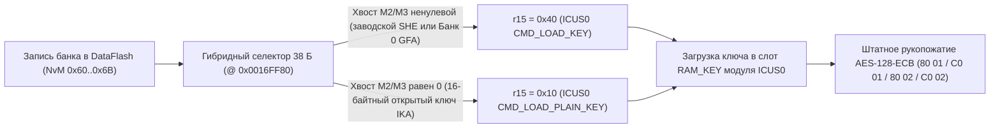

# Защита компонентов (`KSCHUTZ` / `#MoLaLi`), гибридный трамплин и протоколы CAN/UDS

[](component-protection.en.md) • [К оглавлению `docs/`](README.md)

В этом разделе подробно описана работа подсистемы защиты компонентов (**Component Protection**, внутреннее имя модуля Continental — **`KSCHUTZ` / `#MoLaLi`**) на межсетевом шлюзе **VAG MQB Gateway J533 (`19`, `3Q0 907 530 xx`)**, устройство записей в `DataFlash.bin`, машинный код 38-байтного гибридного трамплина в `CodeFlash.bin`, обход битовой маски внешней `95640 SPI EEPROM` и протоколы обмена ключами по шине CAN.

---

## 1. Архитектура `KSCHUTZ` на гейтвее `J533` и откуда берётся ключ `K3` (`IKA`)

В автомобилях платформы **VAG MQB** шлюз `J533 (19)` выступает мастером защиты компонентов и хранит в своей внутренней `DataFlash` (`64 КБ`) ключи для **12 ведомых ЭБУ** (`#1..#12`), а также собственный мастер-ключ **`GFA` (Банк 0, `0xDA00`)**.

### Штатная схема хранения ключей (`ICUS0` / `SHE`)

На заводском шлюзе ключи ведомых блоков хранятся в слотах `NvM 0x60..0x6B` (`0xC000..0xCBFF`) **не в открытом виде**, а в формате 64-байтных криптоконтейнеров **`SHE M1 || M2 || M3`** (`16 + 32 + 16` байт), зашифрованных на закрытом аппаратном ключе `KEY_2` криптографического сопроцессора **`ICUS0`** микроконтроллера `RH850/F1L`:
- При подготовке рукопожатия с очередным блоком прошивка загружает контейнер из `DataFlash` в буфер ОЗУ и вызывает аппаратный драйвер `ICUS0` с кодом команды **`0x40` (`CMD_LOAD_KEY`)**.
- Сопроцессор `ICUS0` внутри кристалла расшифровывает `M1..M3` и помещает полученный 16-байтный рабочий ключ **`K3` (`IKA` — Individual Key Application)** во внутренний слот `RAM_KEY`, после чего выполняет `AES-128-ECB`-рукопожатие по шине CAN.

### Два фундаментальных следствия для привязки Б/У и дооснащаемых блоков

1. **Где брать 16-байтный ключ `K3` (`IKA`) привязываемого ведомого блока:**
   - В диагностическом трафике `ODIS` и в рабочем обмене по CAN открытый ключ `K3` **никогда не передаётся** (сервер отдаёт зашифрованные контейнеры `SHE`, а в шине ходят только случайные вызовы и их `AES-128`-ответы).
   - Узнать рабочий 16-байтный `K3` (`IKA`) донорского блока (`5F` MIB2, `17` приборки, `13` радара ACC, `47` усилителя, `A5` камеры и т.д.) можно **только из дампа памяти самого ведомого блока** (`EEPROM` / `DataFlash` / `SPI NOR` / `eMMC`), либо записав одинаковый 16-байтный ключ сразу в обе стороны (в дамп ведомого блока и в соответствующий банк шлюза).
2. **Почему нельзя просто записать нули (`00..00`) в слот гейтвея и почему нельзя трогать `Банк 0` (`GFA` @ `0xDA00`):**
   - Решение о блокировке функций (отключение звука в `5F`, отключение радара `13` ACC и т.д.) принимает **сам ведомый ЭБУ**, сверяя ответ шлюза со своим собственным ключом `IKA`. Если в шлюзе лежат нули, а в ведомом блоке — его реальный `IKA`, рукопожатие завершится отказом `7F 80 02 35` и ошибкой `U110100`.
   - Прикладной мастер-ключ шлюза **`GFA` (`NvM 0x7B @ 0xDA00 / 0xDA80`, Банк 0)** отвечает за статус адаптации самого гейтвея `19` (`0xFEDFC988`, бит 0) и проверку онлайн-пакетов `UDS 0x2E 02C5`. Если стереть или подменить `0xDA00`, шлюз принудительно выставляет временный случайный ключ (`key_type = 8`) сразу для **всех 12 банков**, переводя все блоки автомобиля в `Component Protection Active`. Поэтому `Банк 0` всегда остаётся нетронутым!

---

## 2. Как устроен 38-байтный гибридный трамплин `CodeFlash` (`0x0016FF80`)

Чтобы одновременно сохранить работу всех родных заводских ЭБУ автомобиля (с их зашифрованными контейнерами `SHE M1..M3` и мастер-ключом `GFA`) и разрешить прямую запись открытых 16-байтных ключей `IKA` для дооснащаемых блоков, **ContiTool** устанавливает в `CodeFlash.bin` компактный **38-байтный гибридный селектор**:



### Точка перехвата и формат буфера

В коллбэке загрузки ключа `KSCHUTZ` находится 4-байтная инструкция `movea 0x40, r0, r15` (`20 7E 40 00`), задающая длину/режим команды для `ICUS0`, при этом регистр `r1` указывает на рабочую структуру банка в ОЗУ:
- при загрузке заводского контейнера `SHE M1..M3` байты `M2` и `M3` (смещения `44[r1]`, `48[r1]`, `76[r1]`, `80[r1]`) содержат плотный `AES-CBC`/`AES-CMAC` шифртекст и никогда не равны нулю одновременно;
- при записи открытого 16-байтного ключа `IKA` через **ContiTool** первые 16 байт полезного поля содержат сам ключ `IKA`, а остальные `48` байт (`M2` и `M3`) заполняются нулями `0x00`.

### Побайтовый дизассемблер трамплина (`build_hybrid_cave`)

На месте штатного `20 7E 40 00` записывается безусловный переход `jr disp22` в свободное выровненное окно `0x0016FF80` (`38` байт), а в самом окне размещается следующий код `RH850`:

| Смещение | Машинный код | Инструкция `RH850` | Назначение |
| :---: | :--- | :--- | :--- |
| `+0x00` | `21 7F 2D 00` | `ld.w 44[r1], r15` | Чтение слова из области `M2` (`buf[19..22]`) |
| `+0x04` | `21 87 31 00` | `ld.w 48[r1], r16` | Чтение второго слова из `M2` (`buf[23..26]`) |
| `+0x08` | `10 79` | `or r16, r15` | Побитовое объединение |
| `+0x0A` | `21 87 4D 00` | `ld.w 76[r1], r16` | Чтение слова из области `M3` (`buf[51..54]`) |
| `+0x0E` | `10 79` | `or r16, r15` | Побитовое объединение |
| `+0x10` | `21 87 51 00` | `ld.w 80[r1], r16` | Чтение второго слова из `M3` (`buf[55..58]`) |
| `+0x14` | `10 79` | `or r16, r15` | Если хотя бы один бит ненулевой → `Z = 0` |
| `+0x16` | `CA 05` | `bne +8` | Переход на `+0x1E` для заводских `SHE`-контейнеров и `GFA` |
| `+0x18` | `20 7E 10 00` | `movea 0x10, r0, r15` | Открытый ключ `IKA`: режим **`0x10` (`CMD_LOAD_PLAIN_KEY`)** |
| `+0x1C` | `B5 05` | `br +6` | Переход к возврату (`+0x22`) |
| `+0x1E` | `20 7E 40 00` | `movea 0x40, r0, r15` | Заводской `SHE`: штатный режим **`0x40` (`CMD_LOAD_KEY`)** |
| `+0x22` | `8x 07 xx xx` | `jr return_vaddr` | Возврат на инструкцию сразу за точкой перехвата |

После установки трамплина утилита автоматически пересчитывает `Application CRC-16/MODBUS` (`poly = 0xA001`) по адресу `0x0000C21C`.

---

## 3. Обход битовой маски обученных банков во внешней `ST M95640` SPI EEPROM

Помимо ключей во внутренней `DataFlash`, гейтвей хранит во внешней 8-килобайтной микросхеме **`ST M95640` (`SPI EEPROM`)** служебный блок `NvM 0x5E` — 16-битную битовую маску банков, которые когда-либо были обучены на этом автомобиле с завода, защищённую аппаратными тегами `AES-CMAC` (`NvM 0x79 / 0x7A`).

Если автомобиль дооснащается новым блоком в ранее пустой (`FF..FF`) банк — например, усилителем `47` (бит 4 = `0x0010`), мультимедиа `5F` (бит 6 = `0x0040`) или камерой `A5` (бит 10 = `0x0400`), — на стоковой прошивке проверка этой маски пропускает банк ещё до чтения `DataFlash`.

Опция обхода маски `95640` (автоматически включается в `bind-cp` и при выборе пустого банка в GUI, либо флагом `--bypass-eeprom-mask` в `patch-cflash`) заменяет 2-байтный условный переход `be +0x70` (`82 3D`) в проверке маски на `nop` (`00 00`). После этого гейтвей опрашивает все банки, в которых записан валидный ключ в `DataFlash.bin`, **без выпаивания и редактирования внешней `95640`**.

---

## 4. Справочник всех 12 банков CP и структура записи в `DataFlash.bin`

Каждый банк хранится в `DataFlash.bin` в **двух идентичных копиях** (основная по `off1` и резервная по `off1 + 0x80`):
- `+0x00 .. +0x03`: маркер валидной записи `55 55 55 55`;
- `+0x04 .. +0x45` (`rec_size = 0x42` для ведомых банков `#1..#12`): заголовок типа + 64-байтное поле ключа (при записи открытого `IKA`: 2 служебных байта + `16` байт `IKA` + `48` нулевых байт);
- `+0x48 .. +0x4B` (`+0x44` для `GFA`): контрольная сумма `IEEE 802.3 CRC-32` (`zlib.crc32`, Little-Endian) по предыдущим байтам полезной нагрузки.

| Банк | ЭБУ VAG | Назначение блока (MQB) | `DataFlash` (осн. / копия) | `NvM ID` | Маска `95640` | UDS Req / Resp | CP CAN TX / RX |
| :---: | :---: | :--- | :---: | :---: | :---: | :---: | :---: |
| **`#1`** | **`17`** | Приборная панель / Иммо (`J285`, AID / Virtual Cockpit) | `0xC000` / `0xC080` | `0x60` | `0x0001` (бит 0) | `714 / 77E` | `17FC0114 / 17FE0114` |
| **`#2`** | **`09`** | Блок бортовой сети `BCM` (`J519`) | `0xC100` / `0xC180` | `0x61` | `0x0002` (бит 1) | `70E / 778` | `17FC010E / 17FE010E` |
| **`#3`** | **`13`** | Адаптивный круиз-контроль / радар `ACC` (`J428`) | `0xC200` / `0xC280` | `0x62` | `0x0004` (бит 2) | `757 / 7C1` | `17FC0157 / 17FE0157` |
| **`#4`** | **`15`** | Подушки безопасности `Airbag` (`J234`) | `0xC300` / `0xC380` | `0x63` | `0x0008` (бит 3) | `715 / 77F` | `17FC0115 / 17FE0115` |
| **`#5`** | **`47`** | Акустическая система / усилитель (`J525`, Canton / Dynaudio / Fender) | `0xC400` / `0xC480` | `0x64` | `0x0010` (бит 4) | `76F / 7D9` | `17FC016F / 17FE016F` |
| **`#6`** | **`57`** | ТВ-тюнер (`R78`) | `0xC500` / `0xC580` | `0x65` | `0x0020` (бит 5) | `76D / 7D7` | `17FC016D / 17FE016D` |
| **`#7`** | **`5F`** | Мультимедиа / ГУ `MIB1 / MIB2 / MIB3` (`J794`) | `0xC600` / `0xC680` | `0x66` | `0x0040` (бит 6) | `773 / 7DD` | `17FC0173 / 17FE0173` |
| **`#8`** | **`3C`** | Ассистент смены полосы `Side Assist 1` Master (`J769` / `J1086`) | `0xC700` / `0xC780` | `0x67` | `0x0080` (бит 7) | `74E / 7B8` | `17FC014E / 17FE014E` |
| **`#9`** | **`CF`** | Ассистент смены полосы `Side Assist 2` Slave (`J770` / `J1087`) | `0xC800` / `0xC880` | `0x68` | `0x0100` (бит 8) | `78A / 7F4` | `17FC018A / 17FE018A` |
| **`#10`** | **`3D`** | Спецфункции / спецтранспорт (`J608`) | `0xC900` / `0xC980` | `0x69` | `0x0200` (бит 9) | `72C / 796` | `17FC012C / 17FE012C` |
| **`#11`** | **`A5`** | Передняя камера ассистентов `MFK` (`R242`, `3Q0` / `2Q0`) | `0xCA00` / `0xCA80` | `0x6A` | `0x0400` (бит 10) | `74F / 7B9` | `17FC014F / 17FE014F` |
| **`#12`** | **`8C`** | Управление ВВ-батареей гибрида / EV (`J840`, GTE / e-Golf) | `0xCB00` / `0xCB80` | `0x6B` | `0x0800` (бит 11) | `77B / 7E5` | `17FC017B / 17FE017B` |
| **`Mst`** | **`19`** | Собственный мастер-ключ шлюза `GFA` (`Master`, `key_type = 3`) | `0xDA00` / `0xDA80` | `0x7B` | — | `710 / 77A` | *Не изменять!* |

### Полная карта памяти `DataFlash.bin` (`64 КБ` = `65 536` байт)

> [!WARNING]
> **Правило `64 КБ` против `32 КБ` (для сторонних программаторов):** несмотря на лазерную гравировку `R7F7010343AFP` на корпусе чипа, физический кристалл внутри `3Q0 907 530 xx` относится к серии **`R7F7010543AFP / R7F7010563AFP`** с полными **`64 КБ` DataFlash** (`fdlPoolSize = 0x0400 = 1024 × 64 Б`). При чтении и записи по CAN через **ContiTool** все `64 КБ` обрабатываются автоматически; при работе со сторонними дампами никогда не выбирайте 32-килобайтный профиль `R7F7010343` — все ключи `CP` и `SWaP` находятся выше `0xC000`!

| Диапазон в `Dflash.bin` | `NvM ID` | Содержимое |
| :---: | :---: | :--- |
| `0x0000 .. 0x007F` | Паспорт ZDC | Идентификатор и версия параметрии (`DID F1A0` / `F1A1`) |
| `0x0080 .. 0x303F` | 7 блоков ZDC | Параметрия (`Base`, `MKE`, `FPA`, `Aux`, `Main GW`, `Cal`, `BEM`), проверка только `IEEE CRC-32` |
| `0x3040 .. 0xBFFF` | Пул FDL | Свободный резерв `Data Flash` (`0xFF`) |
| `0xC000 .. 0xCBFF` | `0x60 .. 0x6B` | **12 ведомых банков защиты компонентов `CP` (`#1..#12`)**, по `2 × 128` байт |
| `0xCC00 .. 0xD8FF` | `0x6C .. 0x78` | Резервные слоты `NvM` |
| `0xD900 .. 0xD9FF` | `0x79 .. 0x7A` | Аппаратные теги `AES-CMAC` `ICUS0` для списка `0x5E` в `95640` |
| `0xDA00 .. 0xDAFF` | `0x7B` | **Мастер-ключ самого шлюза `19` (`GFA`, Банк 0)** |
| `0xDB00 .. 0xDCFF` | `0x7C` | Кэш публичного модуля **`SWaP RSA-1024`** (`0xDB04`) + 5-байтовый **`VCRN`** (`0xDC0C`) + `CRC-32` (`0xDCE4`) |
| `0xDD00 .. 0xE83F` | `0x7D .. 0x8B` | **15 слотов сертификатов активации `SWaP FSC`** (содержат `VIN` по смещению `+0x10`) |
| `0xE840 .. 0xF0BF` | `0x8C .. 0x94` | Счётчики `SWaP` и версия разметки `NvM` (`NvM 0x00..0x5F` хранятся во внешней `ST M95640`) |

---

## 5. Рабочий протокол рукопожатия CP в шине CAN и адаптация ключей по UDS

### 1. Четырёхкадровое рабочее рукопожатие (`80 01` → `C0 01` → `80 02` → `C0 02`)

На внутренних шинах автомобиля (`500 кбит/с`, `ISO-TP`, 29-битные Extended CAN ID из таблицы выше — например, `0x17FC0173` от шлюза к `5F` и `0x17FE0173` от `5F` к шлюзу) при включении зажигания и периодически в движении выполняется взаимная проверка на общем 16-байтовом ключе **`K3` (`IKA`)**:

1. **Вызов от гейтвея (`11` байт `ISO-TP` в `0x17FC0173`):** `80 01 <8 байт GW_Challenge> <1 байт Seq>`
2. **Ответный вызов ведомого ЭБУ (`11` байт `ISO-TP` в `0x17FE0173`):** `C0 01 <8 байт Slave_Challenge> <1 байт Seq>`
3. **Расчёт `FIPS-197 AES-128-ECB` (без IV и без разворота байт):**
   $$\text{AuthBlock}_{16\text{B}} = \text{AES-128-ECB\_Encrypt}_{K_3}\!\left(\text{GW\_Challenge}_{8\text{B}} \;\|\; \text{Slave\_Challenge}_{8\text{B}}\right)$$
   - `GW_Proof = AuthBlock[0..7]` (первые 8 байт);
   - `Slave_Proof = AuthBlock[8..15]` (последние 8 байт).
4. **Доказательство гейтвея (`11` байт в `0x17FC0173`):** `80 02 <8 байт GW_Proof> <1 байт Seq>`
5. **Вердикт ведомого ЭБУ (`0x17FE0173`):**
   - при совпадении `GW_Proof` ведомый блок сбрасывает счётчик ошибок CP в `0` (`KS_PASSIVE`), разрешает сохранение текущего `VIN` из кадра `0x6B4` и отвечает `C0 02 <8 байт Slave_Proof> <1 байт Seq>`;
   - при несовпадении переводит счётчик за порог блокировки (`>= 0x1F` → `KS_ACTIVE`, `U110100`) и отвечает `7F 80 02 35 <Seq>` (`0x35 = invalidKey`).

**Проверенный численный пример** (`K3 = 112233445566778899AABBCCDDEEFF00`, `Seq = 01`, `GW_Challenge = 0102030405060708`, `Slave_Challenge = 3E12A41605967F03` → `AuthBlock = 4A7FEC1BFF9B471F | 24E291A4AEECE2DC`):

```text
# 1) J533 -> 5F: 80 01 + GW_Challenge + Seq
TX 0x17FC0173: 10 0B 80 01 01 02 03 04   -> RX 0x17FE0173: 30 0F 05 AA AA AA AA AA
TX 0x17FC0173: 21 05 06 07 08 01 AA AA

# 2) 5F -> J533: C0 01 + Slave_Challenge + Seq
RX 0x17FE0173: 10 0B C0 01 3E 12 A4 16   -> TX 0x17FC0173: 30 00 00 AA AA AA AA AA
RX 0x17FE0173: 21 05 96 7F 03 01 AA AA

# 3) J533 -> 5F: 80 02 + GW_Proof + Seq
TX 0x17FC0173: 10 0B 80 02 4A 7F EC 1B   -> RX 0x17FE0173: 30 0F 05 AA AA AA AA AA
TX 0x17FC0173: 21 FF 9B 47 1F 01 AA AA

# 4) 5F -> J533: C0 02 + Slave_Proof + Seq (защита снята!)
RX 0x17FE0173: 10 0B C0 02 24 E2 91 A4   -> TX 0x17FC0173: 30 00 00 AA AA AA AA AA
RX 0x17FE0173: 21 AE EC E2 DC 01 AA AA
```

### 2. Мультиплексированный кадр `0x6B4` (`VIN_01`, 11-бит CAN, `DLC = 8`)

Параллельно шлюз транслирует во внутренние шины 3-частный кадр **`0x6B4`**. Сразу после успешного `C0 02` ведомый блок сохраняет `VehID` и 17-символьный `VIN` к себе в `EEPROM` (тогда как смена ненулевого `VehID` в мультиплексоре `0` без подтверждённого рукопожатия сразу переводит ведомый блок в `CP Active`):

| Мультиплексор (`data[0] & 3`) | Поля кадра `0x6B4` | Пример (`VIN = TMBJJ7NE0G0000480`, `VehID = 11 22 33 44`) |
| :---: | :--- | :--- |
| **`0` (`0x00`)** | `data[1..4]` = `4B VehID`, `data[5..7]` = `VIN[0..2]` | `00 11 22 33 44 54 4D 42` (`"TMB"`) |
| **`1` (`0x01`)** | `data[1..7]` = `VIN[3..9]` (7 ASCII-символов) | `01 4A 4A 37 4E 45 30 47` (`"JJ7NE0G"`) |
| **`2` (`0x02`)** | `data[1..7]` = `VIN[10..16]` (7 ASCII-символов) | `02 30 30 30 30 34 38 30` (`"0000480"`) |

### 3. Двухшаговая запись ключей в ведомый ЭБУ по UDS (`2E 00 BE` → `2E 00 BD`)

Если известен текущий ключ ведомого блока **`K3_current`** (например, старый ключ донора или Virgin-ключ нового блока), сменить `K3` внутри самого ведомого ЭБУ (например, `5F` на `0x773 / 0x7DD`) можно штатной двухшаговой процедурой `WriteDataByIdentifier` в сессии `10 03` без `SecurityAccess (0x27)`:

- Формат 37-байтного пакета: `2E 00 <BE или BD> <Block1: 16 байт> <Block2: 16 байт> 00 00` (хвостовые `00 00` обязательны!).
- Расчёт блоков с разворотом байт `[15..0]` и побитовой инверсией второго блока:
  $$\text{Block1} = \text{reverse}\!\left(\text{AES-128-ECB\_Encrypt}_{K_{3,\text{current}}}\!\left(K_{\text{new}}\right)\right)$$
  $$\text{Block2} = \text{reverse}\!\left(\text{AES-128-ECB\_Encrypt}_{K_{3,\text{current}}}\!\left(K_{\text{new}} \oplus \mathtt{FF}^{16}\right)\right)$$
- **Строгий порядок двух шагов**:
  1. **`2E 00 BE`** (шифруется на **старом** `K3_current`) — записывает новый рабочий ключ `K3_new` в слот `/3` и сбрасывает флаг адаптации в `0`.
  2. **`2E 00 BD`** (шифруется **уже на новом** `K3_new`!) — записывает вторичный 16-байтный ключ `K1_new` в слот `/1` и выставляет флаг полной адаптации `1` (гасит ошибку «Блок не адаптирован»).

> [!NOTE]
> В мультимедиа `5F` MIB2 внутренний 5-байтовый `VCRN` (`DID 0x3C05`) зависит от пары `(K3, K1)`. Чтобы сохранить родные лицензии `SWaP / FeC` магнитолы нетронутыми, не меняйте ключ внутри `5F` по `00BE/00BD`, а просто запишите её существующий `K3` в банк `#7` гейтвея через **ContiTool**.

```python
import subprocess, struct

def aes128_ecb_encrypt(key16: bytes, plain16: bytes) -> bytes:
    return subprocess.run(
        ["openssl", "enc", "-aes-128-ecb", "-nopad", "-K", key16.hex()],
        input=plain16, capture_output=True, check=True,
    ).stdout

def build_cp_uds_write(did: int, k3_current: bytes, k_new: bytes) -> bytes:
    inv_new = bytes(b ^ 0xFF for b in k_new)
    block1 = aes128_ecb_encrypt(k3_current, k_new)[::-1]
    block2 = aes128_ecb_encrypt(k3_current, inv_new)[::-1]
    return struct.pack(">BH", 0x2E, did) + block1 + block2 + b"\x00\x00"
```
